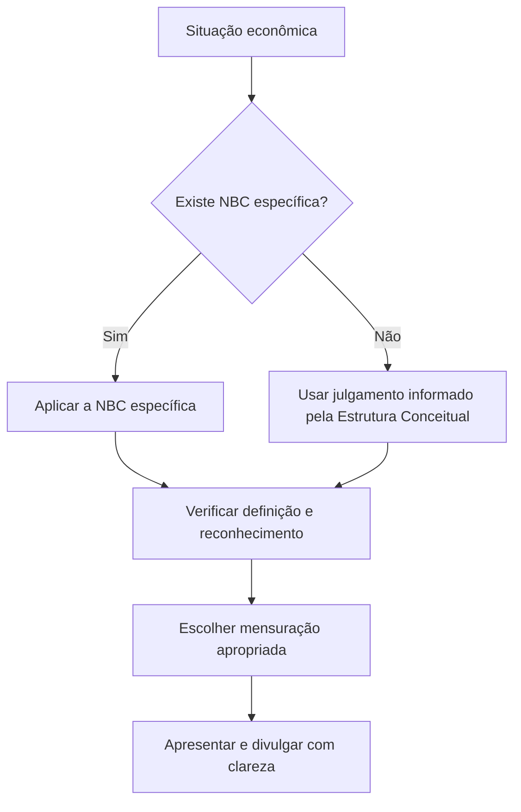
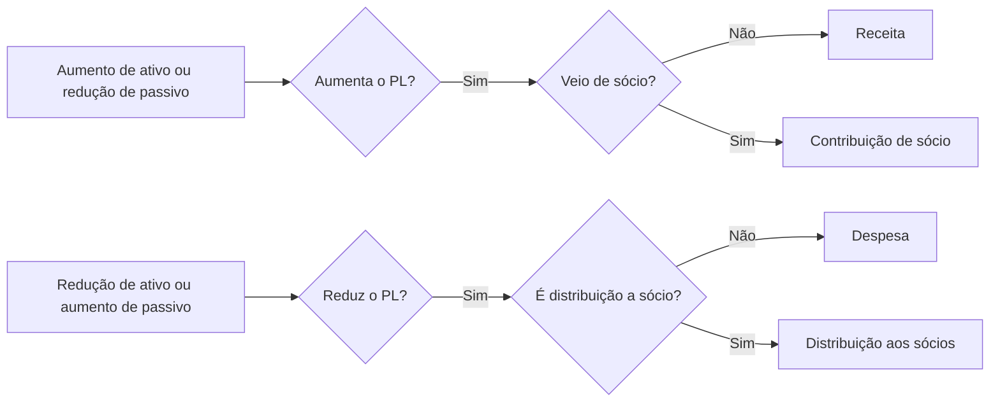
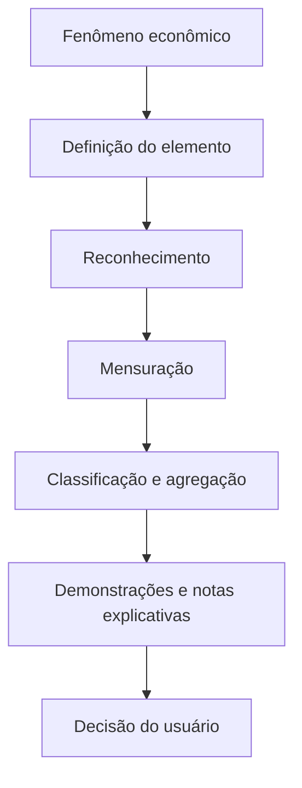

# Aula 1 — NBC TG Estrutura Conceitual: como a contabilidade define a realidade econômica

> [!abstract] Tese da aula
> A contabilidade não começa pelo lançamento. Ela começa por uma pergunta: **qual fenômeno econômico existe, quem controla o recurso ou está obrigado a transferi-lo, e qual representação fornece informação útil para decisão?**

> [!info] Nota de atualização normativa
> A página de Normas Completas do CFC consultada para esta aula lista a **NBC TG ESTRUTURA CONCEITUAL — Estrutura Conceitual para Relatório Financeiro**, publicada no DOU em 13/12/2019, correlacionada ao CPC 00 (R2) e ao Framework do IASB [1]. O CPC registra a aprovação do CPC 00 (R2) em 01/11/2019 e sua divulgação em 10/12/2019 [2]. Antes de cada semestre, o docente deve conferir a página vigente do CFC, pois revisões podem alterar normas brasileiras [3].

## 1. Posição da aula na disciplina

Esta é uma aula de fundação. O objetivo não é memorizar cinco definições, mas construir um método que o estudante possa reutilizar ao estudar estoques, arrendamentos, receita, instrumentos financeiros, provisões, ativo imobilizado e demonstrações contábeis.

A Estrutura Conceitual organiza o raciocínio em quatro movimentos:

1. identificar o fenômeno econômico;
2. verificar se ele atende à definição de um elemento das demonstrações;
3. avaliar reconhecimento e mensuração;
4. comunicar o fenômeno por apresentação e divulgação.

O lançamento contábil aparece depois. Ele registra uma conclusão; não substitui a análise.

## 2. Objetivos de aprendizagem

Ao final, o estudante deverá ser capaz de:

- explicar a finalidade do relatório financeiro de propósito geral e identificar seus principais usuários;
- distinguir a função da Estrutura Conceitual da função de uma NBC específica;
- aplicar as definições de recurso econômico, ativo, obrigação, passivo e patrimônio líquido;
- diferenciar receitas de contribuições de sócios e despesas de distribuições aos sócios;
- analisar reconhecimento sem transformar incerteza em uma regra automática de “não reconhecer”;
- comparar custo histórico, valor justo, valor em uso/valor de cumprimento e custo corrente;
- justificar uma decisão contábil com base em relevância, representação fidedigna, custo e características de melhoria;
- explicar por que uma informação pode ser reconhecida, apresentada separadamente ou apenas divulgada.

## 3. Preparação do professor

Antes da aula, leia a nota [[Normas Completas CFC/01 - Estrutura Conceitual/NBC TG ESTRUTURA CONCEITUAL - Resumo|Estrutura Conceitual — resumo]] e mantenha o PDF oficial aberto. A aula usa principalmente os capítulos e itens abaixo:

- finalidade e status: SP1.1–SP1.5;
- objetivo do relatório financeiro: 1.2–1.23;
- características qualitativas: 2.4–2.43;
- elementos: 4.3–4.72;
- reconhecimento e desreconhecimento: 5.1–5.33;
- mensuração: 6.1–6.95;
- apresentação e divulgação: 7.1–7.22;
- conceitos de capital e manutenção de capital: 8.1–8.10.

Sugestão didática: peça que os estudantes tragam uma notícia ou situação econômica de uma empresa. Ela será usada no final para testar se o grupo consegue passar da narrativa ao elemento contábil.

## 4. Abertura — o balanço não é a realidade inteira

Comece com a pergunta:

> Uma empresa paga R$ 120 mil para desenvolver uma plataforma digital. Há um ativo? Em que momento? O valor pago resolve a questão?

Não aceite imediatamente “débito no ativo” ou “despesa”. Primeiro pergunte:

- há um direito ou outro recurso econômico presente?
- a empresa controla o uso ou os benefícios?
- o recurso resulta de evento passado?
- a informação seria relevante e poderia ser fielmente representada?
- alguma NBC específica trata do caso?

A finalidade da provocação é mostrar que o mesmo desembolso pode ter tratamentos distintos conforme o fenômeno econômico, a norma específica e a qualidade da evidência. **Gastar dinheiro não prova que existe um ativo; não gastar dinheiro também não impede que exista um ativo.**

## 5. Parte I — para que serve o relatório financeiro?

O relatório financeiro de propósito geral fornece informações sobre recursos econômicos da entidade, reivindicações contra ela e alterações nesses itens. Essas informações ajudam investidores, credores por empréstimo e outros credores, existentes e potenciais, a decidir se compram, vendem ou mantêm instrumentos, concedem crédito ou avaliam a gestão [1][2].

A consequência pedagógica é importante: o relatório não foi desenhado para responder a toda pergunta de todos os usuários. Ele busca informar decisões econômicas por meio de representação estruturada da entidade.

### Pergunta socrática

> Um relatório pode ser tecnicamente correto e ainda ser pouco útil?

Sim. Uma informação pode ser correta, mas irrelevante, excessivamente agregada, intempestiva ou difícil de compreender. Por isso a análise não termina na existência do saldo.

### Atividade rápida — 8 minutos

Divida a turma em grupos e entregue três perguntas:

1. Quanto a entidade possui?
2. Quais obrigações podem consumir recursos?
3. A administração usou os recursos de forma eficiente?

Peça que os grupos relacionem cada pergunta a recursos econômicos, reivindicações, alterações e avaliação da gestão. Feche a atividade mostrando que lucro, caixa, patrimônio líquido e valor de mercado respondem a perguntas diferentes.

## 6. Parte II — a Estrutura Conceitual não substitui a NBC específica

A Estrutura Conceitual orienta a elaboração de normas, auxilia o preparador quando não há norma específica aplicável e ajuda os usuários a interpretar as normas e as demonstrações. Ela não cria, sozinha, obrigação de reconhecer, mensurar ou divulgar um item que uma norma específica trate de outra maneira.

Use a seguinte regra em sala:

> **Primeiro procure a NBC específica; depois use a Estrutura Conceitual para compreender, interpretar e preencher lacunas dentro dos limites permitidos.**

### Erro que a aula deve prevenir

A Estrutura Conceitual não autoriza o estudante a dizer: “como isso parece um ativo, vou reconhecer”. A definição é necessária, mas não é automaticamente suficiente. Relevância, representação fidedigna, custo e a norma específica também entram na decisão.

## 7. Parte III — as características qualitativas

As características fundamentais são **relevância** e **representação fidedigna**. Uma informação é relevante quando pode fazer diferença nas decisões, por seu valor preditivo, confirmatório ou ambos. Materialidade é uma dimensão específica da entidade: não existe um limite universal que sirva para todas as situações.

A representação fidedigna deve ser completa, neutra e livre de erros. Isso não significa que toda estimativa precise ser exata. Estimativas razoáveis fazem parte da contabilidade; o problema é apresentar uma estimativa sem explicar premissas relevantes ou com viés deliberado.

As características de melhoria são comparabilidade, capacidade de verificação, tempestividade e compreensibilidade. Elas aumentam a utilidade de uma informação que já precisa ser relevante e fielmente representada.

### Caso curto — duas informações

A Companhia Campinas divulga que possui “ativos diversos” de R$ 20 milhões. A informação é precisa, mas pode esconder naturezas e riscos diferentes. Outra versão separa caixa, estoques, ativos imobilizados, intangíveis e ativos financeiros, com políticas e incertezas relevantes.

Pergunte: qual versão é mais útil e por quê? O ponto não é que toda linha precise ser interminavelmente detalhada. O ponto é evitar tanto a agregação que esconde diferenças quanto o detalhamento que obscurece o conjunto.

## 8. Parte IV — elementos das demonstrações

### 8.1 Recurso econômico, ativo e controle

Um recurso econômico é um direito que tem potencial de produzir benefícios econômicos. O potencial não precisa ser certo nem provável em todos os cenários; basta que o direito possa produzir benefícios em pelo menos uma circunstância.

Ativo é o recurso econômico presente controlado pela entidade como resultado de eventos passados. Controle envolve capacidade presente de direcionar o uso do recurso e obter os benefícios, inclusive restringindo o acesso de terceiros quando essa capacidade existir.

**Propriedade legal e controle podem coincidir, mas não são sinônimos.** Essa distinção será retomada em arrendamentos, consignação, contratos de serviço, ativos digitais e instrumentos financeiros.

### 8.2 Obrigação, passivo e capacidade prática de evitar

Passivo é uma obrigação presente da entidade de transferir um recurso econômico como resultado de eventos passados. A obrigação precisa existir na data do relatório. Uma intenção futura, sem obrigação presente, não é automaticamente passivo.

A capacidade prática de evitar a transferência é central. Uma empresa pode ter poucas alternativas realistas, mesmo sem uma obrigação judicial formal. A análise depende do direito aplicável, contratos, práticas estabelecidas, declarações públicas e circunstâncias concretas. Em seguida, a NBC específica definirá o tratamento.

### 8.3 Patrimônio líquido

Patrimônio líquido é a participação residual nos ativos depois de deduzidos todos os passivos. Não é uma “dívida da empresa com os sócios” no mesmo sentido de um empréstimo, embora direitos específicos dos proprietários possam gerar obrigações em algumas estruturas.

A definição residual também explica por que patrimônio líquido não é sinônimo de valor de mercado, liquidez ou capacidade de pagar dividendos.

### 8.4 Receitas, despesas e transações com sócios

Receita é o aumento de ativo ou a redução de passivo que aumenta o patrimônio líquido, exceto os aumentos relacionados a contribuições dos detentores de direitos sobre o patrimônio.

Despesa é a redução de ativo ou o aumento de passivo que reduz o patrimônio líquido, exceto as reduções relacionadas a distribuições aos detentores de direitos sobre o patrimônio.

Use um quadro simples no quadro branco:

### Exemplo de classificação

- aporte de capital: aumenta ativo e patrimônio líquido, mas não é receita;
- dividendos pagos: reduzem ativo e patrimônio líquido, mas não são despesa;
- venda de mercadoria: aumenta ativo ou reduz passivo e aumenta patrimônio líquido, observada a norma de receita;
- consumo de estoque: reduz ativo e patrimônio líquido, observada a norma aplicável, e é despesa;
- empréstimo recebido: aumenta ativo e passivo, mas não aumenta patrimônio líquido e não é receita;
- pagamento do principal do empréstimo: reduz ativo e passivo, mas não é despesa.

## 9. Parte V — reconhecimento e desreconhecimento

Reconhecimento é a inclusão, no balanço patrimonial ou na demonstração do resultado, de item que atende à definição de elemento. A decisão exige avaliar se o reconhecimento produz informação relevante e fielmente representada e se o benefício justifica o custo.

Não transforme “incerteza” em um botão binário. A norma aceita estimativas razoáveis. O reconhecimento pode deixar de ser adequado quando a incerteza é tão extrema que nenhuma mensuração disponível produziria informação útil. Mesmo assim, apresentação separada ou divulgação podem continuar sendo necessárias.

Desreconhecimento ocorre quando o item deixa de atender à definição ou quando a entidade deixa de controlar o ativo ou deixa de ter a obrigação presente. A análise precisa evitar baixa artificial para melhorar indicadores.

### Exercício de análise — 15 minutos

Para cada situação, peça que o estudante identifique o elemento, o evento passado e a próxima pergunta normativa:

1. A empresa recebe um empréstimo bancário de R$ 500 mil.
2. A empresa recebe mercadorias em consignação, sem poder decidir livremente seu destino.
3. A empresa anuncia publicamente que pretende reformar sua sede no próximo ano.
4. A empresa vende um produto com garantia legal.
5. O sócio deposita R$ 100 mil em aumento de capital.

**Gabarito orientativo:**

1. ativo e passivo; o empréstimo não é receita;
2. investigar controle e a NBC específica aplicável à consignação;
3. intenção, por si só, não basta para reconhecer passivo;
4. analisar obrigação presente e tratamento específico de provisões/garantias;
5. ativo e patrimônio líquido; contribuição não é receita.

## 10. Parte VI — mensuração

Mensuração é atribuição de valor monetário a um elemento. A Estrutura apresenta bases com informações diferentes:

- **custo histórico:** parte do preço ou evento de origem e é atualizado por consumo, pagamentos, juros ou perda;
- **valor justo:** preço de saída em transação ordenada entre participantes do mercado na data de mensuração;
- **valor em uso ou valor de cumprimento:** valor presente de fluxos de caixa que o ativo gera ou que a entidade deverá transferir, com premissas da entidade;
- **custo corrente:** custo de adquirir ativo equivalente ou incorrer em passivo equivalente na data atual.

A pergunta didática não é “qual base é melhor em abstrato?”. É: **qual base produz informação relevante e fiel para o item, considerando suas características e o custo da informação?** Uma mesma entidade pode usar bases diferentes para itens diferentes.

### Demonstração no quadro

Use um ativo simples:

- custo de aquisição: R$ 100 mil;
- valor justo atual: R$ 140 mil;
- fluxos de caixa esperados, trazidos a valor presente: R$ 125 mil;
- custo corrente de reposição: R$ 115 mil.

Pergunte: os quatro valores são “o valor correto”? A resposta acadêmica é não existe valor correto sem esclarecer a base e a finalidade da mensuração. A norma específica e o objetivo da informação determinam a escolha.

## 11. Parte VII — apresentação, divulgação e capital

Comunicar bem envolve classificar, agregar, separar e explicar. Compensar ativo e passivo em um valor líquido pode retirar informação importante. Agregar demais esconde riscos; separar demais dificulta a visão do conjunto.

O conceito de capital também importa. No conceito financeiro, capital pode ser entendido como dinheiro ou poder de compra investido. No conceito físico, como capacidade produtiva. A forma de definir manutenção de capital afeta quando a entidade entende que preservou o capital e apurou lucro.

Feche a aula conectando isso às demonstrações:

## 12. Encerramento — uma frase para levar

> **Defina antes de lançar; teste antes de reconhecer; escolha a mensuração pela informação que ela produz; comunique sem esconder diferenças relevantes.**

Peça aos estudantes que voltem ao caso da plataforma digital da abertura e escrevam uma resposta curta, sem lançamento contábil, contendo: recurso ou obrigação identificada, controle/capacidade de evitar, evento passado, norma específica a consultar e informação que precisaria ser divulgada.

## 13. Avaliação formativa

### Questões para discussão

1. Por que um aporte de sócio não é receita?
2. Por que patrimônio líquido é residual, mas não deve ser tratado como uma dívida comum?
3. Um ativo precisa ter valor de mercado observável para existir?
4. Qual é a diferença entre valor justo e valor em uso?
5. Por que uma intenção futura não é necessariamente um passivo?
6. Quando uma estimativa pode ser aceitável mesmo sem certeza?
7. Como a materialidade depende da entidade e do contexto?
8. Por que uma NBC específica prevalece sobre a Estrutura Conceitual?

### Miniavaliação escrita — 20 minutos

A empresa Horizonte Campinas recebe R$ 300 mil de um banco, emite R$ 100 mil em ações para os sócios, vende produtos por R$ 80 mil à vista e reconhece uma obrigação estimada de R$ 12 mil relacionada à garantia de produtos vendidos. No mesmo período, paga R$ 20 mil de dividendos e consome R$ 45 mil do estoque vendido.

Solicite ao estudante:

- classificar cada evento como ativo, passivo, patrimônio líquido, receita, despesa, contribuição ou distribuição;
- explicar quais eventos alteram o patrimônio líquido;
- indicar qual item exige uma NBC específica antes da conclusão;
- apontar onde a estimativa e a incerteza aparecem;
- explicar por que o empréstimo não é receita e o dividendo não é despesa.

### Critérios de correção

- 30% identificação correta dos elementos;
- 25% distinção entre transações com sócios e resultado;
- 20% uso correto de controle, obrigação presente e evento passado;
- 15% reconhecimento da necessidade de consultar a norma específica;
- 10% clareza da justificativa e qualidade da comunicação.

## 14. Próxima aula

A sequência recomendada é **NBC TG 26 — Apresentação das Demonstrações Contábeis**, porque ela transforma os conceitos de classificação, agregação, compensação, desempenho e posição financeira em estrutura de apresentação. Depois, a turma pode avançar para NBC TG 47, NBC TG 01, NBC TG 16 e NBC TG 06, sempre retomando as definições da Estrutura Conceitual.

## Referências

[1]: https://cfc.org.br/tecnica/normas-brasileiras-de-contabilidade/normas-completas/ "CFC — Normas Completas"
[2]: https://www.cpc.org.br/CPC/Documentos-Emitidos/Pronunciamentos/Pronunciamento?Id=80 "CPC 00 (R2) — Estrutura Conceitual para Relatório Financeiro"
[3]: https://cfc.org.br/tecnica/normas-brasileiras-de-contabilidade/ "CFC — Normas Brasileiras de Contabilidade e Revisões NBC"

## Materiais do vault

- [[Normas Completas CFC/01 - Estrutura Conceitual/NBC TG ESTRUTURA CONCEITUAL - Resumo|Resumo técnico da NBC TG Estrutura Conceitual]]
- [[Normas Completas CFC/01 - Estrutura Conceitual/NBC TG ESTRUTURA CONCEITUAL.pdf|PDF oficial da NBC TG Estrutura Conceitual]]
- [[Normas Completas CFC/02 - NBC TG/NBC TG 26 (R5) - Resumo|Próxima aula sugerida: NBC TG 26]]
