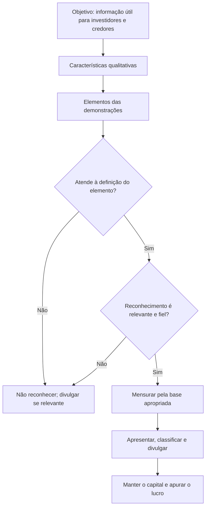

# 🏛️ NBC TG ESTRUTURA CONCEITUAL — Estrutura Conceitual para Relatório Financeiro

> [!abstract] Em 30 segundos
> A Estrutura Conceitual é o **conjunto de conceitos que sustenta todas as normas**. Ela define para que serve o relatório financeiro, quais características tornam a informação útil, o que é ativo, passivo, patrimônio líquido, receita e despesa, quando reconhecer e desreconhecer, como mensurar e como apresentar e divulgar. **Não é uma norma**: nenhum conceito aqui se sobrepõe ao texto de uma NBC ou IFRS específica (SP1.2).

## 🪪 Ficha rápida

| 🏷️ Item | Conteúdo |
| --- | --- |
| **Norma** | NBC TG ESTRUTURA CONCEITUAL |
| **Equivalente internacional** | CPC 00R2 · Conceptual Framework do IASB (março de 2018) |
| **Resolução** | DOU 13/12/2019 |
| **Aplica-se a** | Desenvolvimento das normas, escolha de políticas na ausência de norma específica e interpretação das demonstrações contábeis (SP1.1) |
| **Não se aplica a** | Substituir ou prevalecer sobre uma norma, interpretação ou comunicado técnico (SP1.2) |
| **Ideia central** | Informação **relevante** e **fielmente representada** sobre recursos econômicos, reivindicações e suas alterações |
| **Vigência** | Efeitos a partir de **1º/01/2020**; revoga a Estrutura de 2011 |
| **PDF oficial** | [[NBC TG ESTRUTURA CONCEITUAL.pdf]] |

## 🎯 Para que serve

A Estrutura tem três finalidades (SP1.1): **orientar o IASB/CFC** na elaboração das normas, **ajudar o preparador** a definir políticas quando não há norma aplicável ou quando há escolha de política, e **ajudar todos os interessados a entender e interpretar** as normas.

O ponto de partida é o objetivo do relatório financeiro: fornecer informações úteis a **investidores, credores por empréstimo e outros credores**, existentes e potenciais, para decidir sobre comprar, vender ou manter instrumentos, conceder crédito ou influenciar a administração (itens 1.2–1.4). Por isso o foco recai sobre recursos econômicos, reivindicações contra a entidade, alterações nesses itens e a eficiência da gestão.

> [!info] Conceito, não regra
> A Estrutura não cria obrigação de divulgação nem define prazo ou limite numérico. Ela explica **por que** uma norma exige o que exige. Em caso de conflito, prevalece a norma específica (SP1.2–SP1.3).

## 🧩 Conceitos-chave

| Elemento | Definição da Estrutura | Teste prático |
| --- | --- | --- |
| **Ativo** | Recurso econômico presente controlado pela entidade como resultado de eventos passados (4.3) | Existe **direito** com potencial de gerar benefícios e a entidade tem **controle**? |
| **Passivo** | Obrigação presente de transferir um recurso econômico como resultado de eventos passados (4.26) | Há obrigação que a entidade **não tem capacidade prática de evitar**? |
| **Patrimônio líquido** | Participação residual nos ativos após deduzir todos os passivos (4.63) | É o que sobra; não é passivo nem ativo |
| **Receita** | Aumento de ativo ou redução de passivo que aumenta o PL, exceto contribuições dos sócios (4.68) | O aumento veio de sócio? Então não é receita |
| **Despesa** | Redução de ativo ou aumento de passivo que reduz o PL, exceto distribuições aos sócios (4.69) | A saída foi distribuição de lucro? Então não é despesa |

**Recurso econômico** é um direito com potencial de produzir benefícios; não precisa ser provável, basta existir e poder gerar benefícios em pelo menos uma circunstância (4.14–4.15). **Controle** é a capacidade presente de direcionar o uso e obter os benefícios, incluindo impedir terceiros (4.20). Gastar não prova que há ativo, e não gastar não impede que haja ativo (4.18).

## 🗺️ Mapa da norma

## ✅ Características qualitativas

As **fundamentais** são relevância e representação fidedigna (2.5). A informação é **relevante** quando pode fazer diferença na decisão, com valor preditivo ou confirmatório (2.6–2.10); **materialidade** é a relevância específica da entidade, sem limite único (2.11). A **representação fidedigna** é completa, neutra e livre de erros (2.13); prudência apoia a neutralidade, mas não autoriza assimetria sistemática (2.16–2.17).

As **de melhoria** são comparabilidade, capacidade de verificação, tempestividade e compreensibilidade (2.23–2.38). A **restrição de custo** (2.39–2.43) exige que o benefício da informação justifique o custo de produzi-la e usá-la.

## ⚙️ Reconhecimento e desreconhecimento

- [ ] **1. Aplicar a definição** — só se reconhece o que atende à definição de ativo, passivo, PL, receita ou despesa (5.6).
- [ ] **2. Testar a relevância** — o reconhecimento gera informação útil? Incerteza de existência e baixa probabilidade não impedem automaticamente o reconhecimento (5.12–5.17).
- [ ] **3. Testar a fidelidade** — a mensuração representa o fenômeno? Incerteza extrema pode tornar o reconhecimento inadequado (5.18–5.23).
- [ ] **4. Considerar o custo** — o benefício esperado justifica o custo (5.8).
- [ ] **5. Reconhecer efeitos conjugados** — reconhecer receita normalmente vem com reconhecer ativo ou desreconhecer passivo (5.4).
- [ ] **6. Desreconhecer** quando se perde o controle do ativo ou deixa de existir a obrigação presente (5.26).

> [!warning] Incerteza não é sinônimo de não reconhecer
> Estimativas razoáveis fazem parte da contabilidade (2.19). O item 5.22 só afasta o reconhecimento em circunstâncias limitadas, quando **todas** as mensurações disponíveis são excessivamente incertas e nenhuma forneceria informação útil.

## 📐 Mensuração

| Base | O que representa | Observação prática |
| --- | --- | --- |
| **Custo histórico** | Preço da transação ou evento de origem, atualizado por consumo, pagamentos, perda e juros (6.4–6.9) | Não capta mudanças de valor, salvo redução ao valor recuperável ou passivo oneroso |
| **Valor justo** | Preço de saída entre participantes do mercado na data (6.12–6.16) | Perspectiva de mercado, não da entidade |
| **Valor em uso / de cumprimento** | Valor presente dos fluxos de caixa que o ativo gera ou o passivo exigirá (6.17–6.20) | Inclui premissas específicas da entidade |
| **Custo corrente** | Custo de adquirir ativo equivalente ou incorrer em passivo equivalente na data (6.21–6.22) | Reflete condições atuais de reposição |

A escolha da base considera relevância, representação fidedigna, características de melhoria e custo (6.43–6.86). Uma mesma entidade pode usar bases diferentes para ativos diferentes (6.2); a norma específica normalmente define a base.

## 📢 Apresentação e divulgação

Comunicar bem é tão importante quanto medir bem (7.1–7.3). **Classificar** significa agrupar itens com características compartilhadas e separar os diferentes (7.7). **Compensar** ativo com passivo em um único valor líquido geralmente não é adequado (7.10). **Agregar** demais esconde detalhes; agregar de menos obscurece o todo (7.20–7.22). A demonstração do resultado é a fonte principal do desempenho; excepcionalmente, normas podem exigir itens em outros resultados abrangentes (7.15–7.19).

## 💰 Capital e lucro

Sob o conceito **financeiro**, capital é o investimento em dinheiro ou poder de compra; sob o **físico**, é a capacidade produtiva (8.1–8.2). O lucro surge apenas quando o capital do fim do período supera o do início, excluindo contribuições e distribuições aos sócios (8.3–8.4). Reavaliações e reapresentações podem ir ao PL como **ajustes de manutenção de capital**, e não ao resultado (8.10).

> [!tip] Frase-âncora
> **Definiu, testou, mensurou, comunicou.** Primeiro a definição do elemento; depois relevância e fidelidade; em seguida a base de mensuração; por fim classificação, agregação e divulgação.

## ⚠️ Erros comuns

> [!danger] Evite
> - Tratar a Estrutura como norma e usá-la para contrariar uma NBC específica.
> - Exigir probabilidade alta para reconhecer ativo: o potencial de benefício já basta para a definição (4.14–4.15).
> - Confundir **controle** com propriedade legal; controle é capacidade presente de direcionar o uso (4.20).
> - Classificar contribuição de sócio como receita ou distribuição de lucro como despesa (4.70).
> - Usar valor justo e valor em uso como sinônimos: um é preço de mercado, o outro é fluxo de caixa da entidade.
> - Compensar ativos e passivos para “melhorar” o balanço (7.10).
> - Ignorar a restrição de custo e produzir divulgação extensa, porém pouco útil.

## 🔗 Conexões

| Norma | Por que se conecta |
| --- | --- |
| [[NBC TG 26 (R5) - Resumo\|NBC TG 26]] | Aplica os conceitos de apresentação, classificação e agregação |
| [[NBC TG 46 (R2) - Resumo\|NBC TG 46]] | Detalha a mensuração do valor justo |
| [[NBC TG 01 (R4) - Resumo\|NBC TG 01]] | Redução ao valor recuperável do custo histórico |
| [[NBC TG 47 - Resumo\|NBC TG 47]] | Reconhecimento de receita sob a definição de ativo e passivo |
| [[NBC TG 48 - Resumo\|NBC TG 48]] | Reconhecimento e desreconhecimento de instrumentos financeiros |
| [[NBC TG 25 (R2) - Resumo\|NBC TG 25]] | Provisões e contingências: obrigação presente e incerteza |
| [[NBC TG 15 (R4) - Resumo\|NBC TG 15]] | Aquisição e mensuração de ativos e passivos identificáveis |
| [[NBC TG 27 (R4) - Resumo\|NBC TG 27]] | Custo histórico, depreciação e reavaliação |
| [[NBC TG 04 (R4) - Resumo\|NBC TG 04]] | Definição e reconhecimento de ativo intangível |
| [[NBC TG 51 - Resumo\|NBC TG 51]] | Requisitos gerais de apresentação e divulgação |

## 📄 Fonte

- **PDF oficial:** [[NBC TG ESTRUTURA CONCEITUAL.pdf]]
- **Página do CFC:** [NBC TG ESTRUTURA CONCEITUAL](<https://www2.cfc.org.br/sisweb/sre/detalhes_sre.aspx?Codigo=2019/NBCTGEC&arquivo=NBCTGEC.doc>)
- **Itens-chave:** SP1.1–SP1.5 (finalidade); 1.2–1.23 (objetivo); 2.4–2.43 (características); 4.3–4.72 (elementos); 5.1–5.33 (reconhecimento); 6.1–6.95 (mensuração); 7.1–7.22 (apresentação); 8.1–8.10 (capital).
