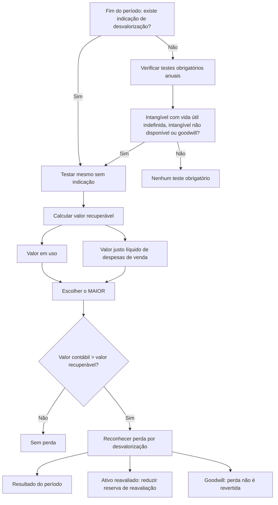
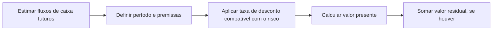

# 🧭 NBC TG 01 (R4) — Redução ao Valor Recuperável de Ativos

> [!abstract] Em 30 segundos
> Nenhum ativo pode ficar registrado por valor maior do que a entidade espera recuperar **pelo uso ou pela venda**. Se o **valor contábil** passar do **valor recuperável**, reconheça uma **perda por desvalorização**. O valor recuperável é o **maior** entre o valor justo líquido de despesas de venda e o valor em uso. Ágio (goodwill) e intangíveis com vida útil indefinida são testados **todo ano**, mesmo sem sinal de problema.

## 🪪 Ficha rápida

| 🏷️ Item                      | Conteúdo                                                                                                                                                                                                       |
| ----------------------------- | -------------------------------------------------------------------------------------------------------------------------------------------------------------------------------------------------------------- |
| **Norma**                     | NBC TG 01 (R4)                                                                                                                                                                                                 |
| **Equivalente internacional** | CPC 01R1 · IAS 36                                                                                                                                                                                              |
| **Resolução**                 | DOU 22/12/2017                                                                                                                                                                                                 |
| **Aplica-se a**               | Imobilizado, intangíveis, investimentos em controladas/coligadas/empreendimentos controlados em conjunto e demais ativos não tratados por norma específica                                                     |
| **Não se aplica a**           | Estoques, ativos de contrato, tributos diferidos, ativos de planos de benefícios, instrumentos financeiros, propriedade para investimento ao valor justo, ativo biológico ao valor justo e mantidos para venda |
| **Ideia central**             | Valor contábil **não pode** exceder o valor recuperável                                                                                                                                                        |
| **Teste obrigatório**         | Intangível com vida útil indefinida, intangível ainda não disponível para uso e goodwill: **no mínimo anual**                                                                                                  |
| **PDF oficial**               | [[NBC TG 01 (R4).pdf]]                                                                                                                                                                                         |
|                               |                                                                                                                                                                                                                |

## 🎯 Para que serve

Evitar que o balanço “infle” o valor dos ativos. A norma responde a três perguntas:

1. **Há sinal de que o ativo perdeu valor?**
2. **Quanto a entidade ainda consegue recuperar com esse ativo?**
3. **Se houver perda, quanto reconhecer, onde lançar e o que divulgar?**

## 🧩 Conceitos que sustentam a norma

| Conceito | Tradução prática |
| --- | --- |
| **Valor contábil** | Valor do ativo no balanço, já líquido de depreciação, amortização, exaustão e perdas anteriores |
| **Valor recuperável** | O **maior** entre o valor justo líquido de despesas de venda e o valor em uso |
| **Valor justo líquido de despesas de venda** | Preço de venda menos os custos incrementais de alienação |
| **Valor em uso** | Valor presente dos fluxos de caixa futuros esperados com o ativo |
| **Perda por desvalorização** | Valor contábil **menos** valor recuperável, quando o primeiro for maior |
| **Unidade geradora de caixa (UGC)** | Menor grupo de ativos que gera fluxos de caixa em grande parte independentes |
| **Ativo corporativo** | Ativo que ajuda várias UGCs, mas não gera fluxo próprio (ex.: sede, sistema central) |
| **Goodwill** | Ágio por expectativa de rentabilidade futura, reconhecido em combinação de negócios |

## 🗺️ Mapa da norma

## 🚦 Quando testar

| Situação | Teste é obrigatório? | Observação |
| --- | --- | --- |
| Ativo com sinal de desvalorização | ✅ Sim | Basta **um** indício para estimar o valor recuperável |
| Intangível com vida útil indefinida | ✅ Sim, no mínimo anual | Independentemente de indício |
| Intangível ainda não disponível para uso | ✅ Sim, no mínimo anual | Mesmo antes de começar a operar |
| Goodwill de combinação de negócios | ✅ Sim, no mínimo anual | Também quando há indicação de perda |
| Demais ativos sem qualquer indício | ❌ Não | A norma não exige estimativa formal |

**Indícios externos:** queda do valor de mercado, mudanças tecnológicas, econômicas ou legais adversas, aumento das taxas de juros, queda do valor de mercado do investimento.
**Indícios internos:** obsolescência, dano físico, reestruturação, descontinuação, desempenho pior que o esperado.

## 📐 Como calcular

> [!tip] Fórmula em duas linhas
> **Valor recuperável = MAIOR (valor justo líquido de despesas de venda; valor em uso)**
>
> **Perda = valor contábil − valor recuperável** → reconhecer **somente se o resultado for positivo**.

### Valor em uso — passo a passo

Premissas práticas:
- Fluxos de caixa **futuros** e **incrementais** decorrentes do ativo.
- Projeções com base em orçamento aprovado; depois, cenário estável.
- Taxa de desconto **antes dos impostos**, que reflita o risco específico do ativo.
- Não incluir fluxos de financiamento nem de tributos sobre o lucro.
- Não incluir melhorias futuras ainda não comprometidas.

## 🪜 Passo a passo

- [ ] **1. Identificar o ativo** e verificar se ele pertence a uma UGC.
- [ ] **2. Levantar indícios** externos e internos ao fim do período.
- [ ] **3. Verificar testes anuais obrigatórios** (goodwill e intangíveis citados).
- [ ] **4. Calcular o valor justo líquido de despesas de venda** (mercado, transação recente, avaliação).
- [ ] **5. Calcular o valor em uso** (fluxos, período, taxa, valor residual).
- [ ] **6. Comparar** valor contábil com o **maior** dos dois.
- [ ] **7. Reconhecer a perda** na DRE, salvo ativo reavaliado.
- [ ] **8. Revisar depreciação/amortização** com base no novo valor contábil.
- [ ] **9. Reavaliar tributos diferidos** conforme a NBC TG 32.
- [ ] **10. Divulgar** as informações exigidas.

## 🧮 Onde lançar a perda

| Tipo de ativo | Onde reconhecer |
| --- | --- |
| Ativo não reavaliado | **Resultado do período** |
| Ativo reavaliado | **Outros resultados abrangentes** (reserva de reavaliação), até o saldo da reavaliação; o excedente vai ao resultado |
| UGC | Alocar aos ativos da UGC, proporcionalmente ao valor contábil; **não reduzir** o goodwill abaixo de zero |
| Goodwill | Primeiro absorve a perda dentro da UGC |

## 🔄 Reversão: o que pode voltar?

| Situação | Pode reverter? | Limite |
| --- | --- | --- |
| Ativo individual (exceto goodwill) | ✅ Sim, se mudarem as estimativas | Não passar do valor contábil que existiria **sem** a perda anterior |
| UGC (exceto goodwill) | ✅ Sim | Alocação proporcional, respeitando o limite individual |
| **Goodwill** | ❌ **Nunca** | Perda por desvalorização do goodwill é definitiva |
| Passagem do tempo (unwinding) | ❌ Não | Aumento por mera fluência do desconto não justifica reversão |

> [!warning] Pegadinha clássica
> A reversão **não** é permitida só porque o valor recuperável subiu com a passagem do tempo. É preciso que tenha havido **mudança nas estimativas** usadas para mensurar o valor recuperável.

## 📢 O que divulgar

| Divulgação | Conteúdo |
| --- | --- |
| Por classe de ativos | Perdas e reversões reconhecidas no resultado e em outros resultados abrangentes |
| Por segmento | Perdas e reversões por segmento reportado |
| Para cada perda/reversão material | Eventos e circunstâncias, valor, natureza do ativo ou descrição da UGC |
| Valor recuperável | Se foi valor justo líquido de despesas de venda ou valor em uso |
| Valor justo | Nível da hierarquia (NBC TG 46) e técnicas de avaliação |
| Goodwill e intangíveis indefinidos | Premissas-chave, taxa de desconto, período de projeção e análise de sensibilidade |

## ⚠️ Erros comuns

> [!danger] Evite
> - Testar **só** quando “parece” que o ativo perdeu valor — goodwill e intangíveis indefinidos têm teste **anual obrigatório**.
> - Usar o **menor** entre valor justo e valor em uso (a regra é o **maior**).
> - Esquecer de revisar a **depreciação futura** após reconhecer a perda.
> - Reverter perda de **goodwill**.
> - Reconhecer reversão acima do valor que o ativo teria **sem** a perda anterior.
> - Ignorar **ativos corporativos** na formação da UGC.
> - Divulgar apenas o valor da perda, sem explicar **o evento** e as **premissas**.

## 🧠 Como memorizar

> **“Maior recupera, menor compara.”**
> O valor recuperável é o **maior** entre venda e uso; depois se compara com o valor contábil. Se o contábil for **maior**, há perda.

## 🔗 Conexões

| Norma | Por que se conecta |
| --- | --- |
| [[NBC TG 46 (R2) - Resumo\|NBC TG 46]] | Define como mensurar o valor justo |
| [[NBC TG 27 (R4) - Resumo\|NBC TG 27]] | Ativo imobilizado: reavaliação, depreciação e vida útil |
| [[NBC TG 04 (R4) - Resumo\|NBC TG 04]] | Ativo intangível: vida útil indefinida e goodwill gerado internamente |
| [[NBC TG 15 (R4) - Resumo\|NBC TG 15]] | Goodwill reconhecido em combinação de negócios |
| [[NBC TG 32 (R4) - Resumo\|NBC TG 32]] | Tributos diferidos após a perda |
| [[NBC TG 16 (R2) - Resumo\|NBC TG 16]] | Estoques ficam fora desta norma |
| [[NBC TG 28 (R4) - Resumo\|NBC TG 28]] | Propriedade para investimento ao valor justo fica fora |
| [[NBC TG 29 (R2) - Resumo\|NBC TG 29]] | Ativo biológico ao valor justo fica fora |
| [[NBC TG 31 (R4) - Resumo\|NBC TG 31]] | Mantidos para venda ficam fora |
| [[NBC TG 36 (R3) - Resumo\|NBC TG 36]] | Controladas e consolidação |
| [[NBC TG 18 (R4) - Resumo\|NBC TG 18]] | Coligadas e controladas em conjunto |
| [[NBC TG 19 (R2) - Resumo\|NBC TG 19]] | Negócios em conjunto |
| [[NBC TG 48 - Resumo\|NBC TG 48]] | Instrumentos financeiros ficam fora desta norma |

## 📄 Fonte

- **PDF oficial:** [[NBC TG 01 (R4).pdf]]
- **Página do CFC:** [NBC TG 01 (R4)](https://www2.cfc.org.br/sisweb/sre/detalhes_sre.aspx?Codigo=2017/NBCTG01(R4)&arquivo=NBCTG01(R4).doc)
- **Itens-chave:** 1–6 (objetivo, alcance e definições); 7–17 (indícios); 18–57 (mensuração); 58–64 (reconhecimento); 65–108 (UGC e goodwill); 109–125 (reversão); 126–136 (divulgação).
