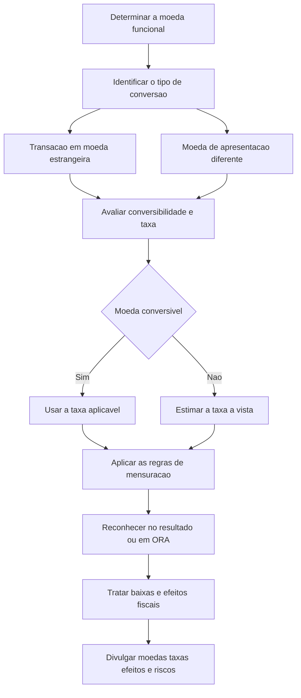

# NBC TG 02 (R3) — Efeitos das Mudanças nas Taxas de Câmbio e Conversão de Demonstrações Contábeis

## Resumo em 30 segundos

> [!abstract] A regra central
> Primeiro, determine a **moeda funcional** de cada entidade. Depois, converta as transações em moeda estrangeira para essa moeda. Se as demonstrações forem apresentadas em outra moeda, faça uma segunda conversão, com regras próprias.
>
> - **Reconhecimento inicial:** taxa à vista na data da transação.
> - **Fechamento na moeda funcional:** itens monetários pela taxa de fechamento; não monetários ao custo histórico pela taxa da transação; não monetários ao valor justo pela taxa da mensuração.
> - **Variações de itens monetários:** geralmente no resultado.
> - **Conversão para moeda de apresentação:** em economia não hiperinflacionária, ativos e passivos pela taxa de fechamento; receitas e despesas pelas taxas das transações; diferenças em outros resultados abrangentes.
> - **Moeda não conversível:** estimar a taxa à vista e divulgar restrições, efeitos, método e riscos.

> [!warning] O arquivo contém alterações posteriores à R3
> O PDF reúne redações anteriores e alteradas, incluindo a Revisão NBC 01 e a Revisão NBC 26. Este resumo privilegia as redações identificadas como alteradas ou incluídas. As regras de não conversibilidade não devem ser atribuídas ao ato de 2017: foram incluídas pela Revisão NBC 26. A data do DOU no título foi fornecida nos metadados da solicitação; sua ocorrência não está demonstrada no texto transcrito.

## Ficha rápida

| Campo | Informação |
|---|---|
| Norma | NBC TG 02 (R3) |
| Tema técnico | Efeitos das mudanças nas taxas de câmbio e conversão de demonstrações contábeis |
| Decisões principais | Moeda funcional, taxa aplicável e destino das diferenças cambiais |
| Abrangência | Transações, saldos, operações no exterior e moeda de apresentação |
| Ato identificado | NBC TG 02 (R3), de 24 de novembro de 2017 |
| Efeitos das alterações R3 | A partir de 1º de janeiro de 2018, conforme texto final do ato |
| Conteúdo adicional | Revisões posteriores, inclusive não conversibilidade e Apêndice A |

O ato reproduzido nas páginas 23–24 altera os itens 3, 4, 5, 27 e 52, substituindo referências anteriores sobre instrumentos financeiros pela **NBC TG 48**. Determina entrada em vigor na publicação e efeitos a partir de 1º de janeiro de 2018.

## Objetivo e alcance

A norma orienta como incorporar transações em moeda estrangeira e operações no exterior às demonstrações contábeis e como converter essas demonstrações para uma moeda de apresentação. As questões centrais são **qual taxa usar** e **onde reconhecer seus efeitos** — itens 1–2.

Aplica-se a:

- transações e saldos em moeda estrangeira, ressalvados os derivativos e saldos no alcance da NBC TG 48;
- conversão de resultados e posição financeira de operações no exterior incluídas por consolidação ou equivalência patrimonial;
- conversão das demonstrações para uma moeda de apresentação — item 3, redações alteradas.

**Limites importantes:**

- A contabilidade de hedge, inclusive de investimento líquido no exterior, segue a NBC TG 48.
- Derivativos fora do alcance da NBC TG 48 podem estar no alcance desta norma.
- A conversão de saldos de derivativos da moeda funcional para a moeda de apresentação segue esta norma.
- Fluxos de caixa em moeda estrangeira e conversão dos fluxos de entidades no exterior seguem a NBC TG 03 — itens 4–7.

## Conceitos-chave

### Moedas e taxas

| Conceito | Significado operacional |
|---|---|
| Moeda funcional | Moeda do ambiente econômico principal da entidade |
| Moeda estrangeira | Qualquer moeda diferente da funcional |
| Moeda de apresentação | Moeda utilizada para apresentar as demonstrações |
| Taxa à vista | Taxa normalmente utilizada para liquidação imediata |
| Taxa de fechamento | Taxa à vista ao término do período de reporte |
| Variação cambial | Diferença produzida pela conversão de unidades de moeda a taxas distintas |

A moeda funcional **não é uma escolha livre de apresentação**. A moeda de apresentação pode ser qualquer moeda, desde que a conversão cumpra os requisitos aplicáveis — itens 8, 13 e 38.

### Como determinar a moeda funcional

Priorize as moedas que mais influenciam:

1. preços de venda e forças competitivas e regulatórias que os determinam;
2. mão de obra, matéria-prima e demais custos de fornecimento.

Financiamento e acumulação dos recursos operacionais são evidências adicionais. Para operações no exterior, considere autonomia, participação das transações com a entidade que reporta, disponibilidade das remessas e capacidade de cumprir compromissos sem apoio financeiro — itens 9–11.

Quando os indicadores forem mistos, a administração deve exercer julgamento, **priorizando os fatores do item 9**. A moeda funcional somente muda se mudarem as transações, os eventos ou as condições subjacentes — itens 12–13.

### Itens monetários e não monetários

O critério é a existência de direito a receber ou obrigação de entregar **quantidade fixa ou determinável de moeda**, não apenas o nome da conta — item 16.

| Monetários | Não monetários |
|---|---|
| Caixa e recebíveis em moeda | Adiantamentos a fornecedores e prestadores |
| Provisões liquidadas em caixa | Estoques, imobilizado e intangíveis |
| Passivos de arrendamento | Ativos de direito de uso |
| Dividendos reconhecidos como passivos, pagos em caixa | Goodwill e provisões liquidadas com ativos não monetários |

### Investimento líquido em entidade no exterior

Um recebível ou passivo monetário pode integrar, em substância, o investimento líquido quando sua liquidação **não for provável nem estiver planejada para o futuro previsível**. A posição pode ser mantida por outra controlada do grupo.

Contas comerciais normais não se enquadram nessa definição — itens 15–15A.

## Diagrama de aplicação

**ORA** significa outros resultados abrangentes. O destino das diferenças depende do tipo de conversão e das exceções aplicáveis.

## Aplicação passo a passo — checklist

- [ ] **Definir a moeda funcional de cada entidade**, documentando indicadores primários e evidências adicionais.
- [ ] **Separar os processos:** conversão de transações para a moeda funcional e conversão das demonstrações para apresentação.
- [ ] **Verificar o alcance**, especialmente derivativos, hedge e demonstração dos fluxos de caixa.
- [ ] **Identificar a data de reconhecimento** de cada transação e a taxa correspondente.
- [ ] **Classificar os saldos** como monetários ou não monetários; nestes, identificar custo histórico ou valor justo.
- [ ] **Avaliar a conversibilidade** na data, direção e finalidade pertinentes.
- [ ] **Aplicar as taxas corretas** no reconhecimento, fechamento e apresentação.
- [ ] **Destinar as diferenças** ao resultado ou a ORA, conforme sua origem.
- [ ] **Revisar operações no exterior:** investimento líquido, saldos intragrupo, goodwill, ajustes de aquisição e datas de reporte.
- [ ] **Analisar baixas**, participação de não controladores e eventual reclassificação.
- [ ] **Tratar efeitos fiscais** pela NBC TG 32.
- [ ] **Preparar divulgações e conciliações**, incluindo estimativas por não conversibilidade.

> [!tip] Controle de fechamento
> Separe nos papéis de trabalho a diferença cambial de transações e saldos da diferença de conversão para apresentação. Essa separação facilita conferir taxas, classificação no resultado ou em ORA e conciliação do patrimônio líquido.

## Reconhecimento e mensuração

### 1. Reconhecimento inicial

Registre a transação em moeda funcional pela taxa à vista na data em que ela se qualifica para reconhecimento — itens 20–22.

**Valor em moeda funcional = valor em moeda estrangeira × taxa de conversão**

A fórmula pressupõe taxa expressa em unidades de moeda funcional por unidade de moeda estrangeira.

Taxas médias semanais ou mensais podem ser aproximações práticas. **Não são apropriadas quando houver flutuação significativa.**

### 2. Fechamento de transações na moeda funcional

| Natureza e base de mensuração | Taxa aplicável |
|---|---|
| Item monetário | Fechamento |
| Não monetário ao custo histórico | Data da transação |
| Não monetário ao valor justo | Data da mensuração do valor justo |

Essas regras são do item 23. A base de mensuração do ativo ou passivo continua sendo determinada pela norma pertinente — item 24.

Em estoques e testes de recuperabilidade, converta separadamente cada montante comparado com a taxa de sua data de determinação. Assim, pode existir perda na moeda funcional sem perda na moeda estrangeira, ou o contrário — item 25.

Se houver várias taxas, use aquela pela qual os fluxos representados pela transação ou saldo poderiam ser liquidados na data de mensuração — item 26, redação alterada.

### 3. Destino das variações cambiais

**Itens monetários:** diferenças de liquidação ou reconversão são reconhecidas no resultado do período em que surgem, ressalvada a exceção do investimento líquido. Se a liquidação ocorrer em período posterior, cada período reconhece a mudança cambial nele ocorrida — itens 28–29.

**Itens não monetários:** a parcela cambial acompanha o destino do ganho ou perda correspondente:

- ganho ou perda no resultado → componente cambial no resultado;
- ganho ou perda em ORA → componente cambial em ORA — itens 30–31.

**Itens monetários integrantes do investimento líquido:**

- nas demonstrações separadas da entidade que reporta ou individuais da entidade no exterior: resultado, conforme aplicável;
- nas demonstrações que incluem ambas, inclusive por equivalência patrimonial ou consolidação: inicialmente ORA, em conta específica do patrimônio líquido, com reclassificação na baixa conforme a norma — itens 32–33.

### 4. Conversão para a moeda de apresentação

Para moeda funcional de economia **não hiperinflacionária** — itens 39–41:

| Elemento | Tratamento |
|---|---|
| Ativos e passivos | Taxa de fechamento de cada balanço, inclusive comparativos |
| Receitas e despesas | Taxas das datas das transações, inclusive comparativos |
| Diferenças resultantes | ORA |

Uma média pode aproximar as taxas de receitas e despesas, mas não quando houver flutuação significativa. As diferenças acumuladas ficam em conta separada do patrimônio líquido; a parcela atribuível aos não controladores é alocada a eles.

> [!danger] Não confunda os dois fechamentos
> Converter um estoque ao custo histórico **para a moeda funcional** exige a taxa da transação. Converter esse estoque, já mensurado na moeda funcional, **para a moeda de apresentação** segue a taxa de fechamento do balanço, no procedimento do item 39.

### 5. Situações especiais

**Registros em moeda diferente da funcional:** reconverta todos os montantes segundo os itens 20–26, obtendo os valores que existiriam se o registro inicial tivesse sido feito na moeda funcional — item 34.

**Mudança da moeda funcional:** aplicação prospectiva; converta todos os itens pela taxa da data da alteração. Os valores dos não monetários tornam-se seus custos históricos. Diferenças acumuladas em ORA não são reclassificadas apenas por essa mudança — itens 35–37.

**Hiperinflação:** reelabore as demonstrações antes da conversão, conforme o tratamento indicado nos itens 14 e 43. Em regra, todos os montantes são convertidos pela taxa de fechamento do balanço mais recente. Na apresentação em moeda não hiperinflacionária, os comparativos permanecem como apresentados no ano anterior, sem ajustes posteriores de preços ou câmbio — item 42.

### 6. Particularidades das operações no exterior

- **Saldos intragrupo:** eliminar ativo e passivo correspondentes não elimina o efeito cambial. Ele permanece no resultado ou em ORA, se atender ao item 32 — item 45.
- **Datas de reporte:** normalmente devem coincidir. A redação alterada do item 46 admite diferença não superior a **dois meses**, com ajustes de transações, eventos e mudanças cambiais significativos. Ativos e passivos são convertidos pela taxa do encerramento da operação no exterior.
- **Goodwill e ajustes de valor justo da aquisição:** tratados como ativos e passivos da operação no exterior, expressos em sua moeda funcional e convertidos pela taxa de fechamento — item 47.

### 7. Baixa total ou parcial

| Evento | Diferenças cambiais acumuladas |
|---|---|
| Baixa da entidade no exterior | Reclassificação para resultado quando reconhecido o ganho ou perda da baixa |
| Baixa parcial de controlada sem perda de controle | Realocação proporcional aos não controladores |
| Outras baixas parciais | Reclassificação da parcela proporcional baixada |

A perda de controle de controlada é tratada como baixa, mesmo com participação retida. Também se aplica o tratamento de baixa à alienação parcial de coligada ou negócio em conjunto na situação descrita no item 48A(b), cuja participação retida é ativo financeiro.

Na baixa de controlada, a parcela acumulada atribuída aos não controladores é desreconhecida **sem passar pelo resultado**. Perdas próprias ou impairment não constituem baixa parcial e não provocam reclassificação — itens 48–49.

## Moeda não conversível: avaliação e estimativa

### Avaliação

Avalie a conversibilidade **na data de mensuração e para uma finalidade específica**. Considere capacidade de obtenção, e não intenção, incluindo obtenção indireta por outra moeda — itens 8A–8B e A2–A10.

Verifique:

- prazo compatível com atraso administrativo normal;
- mercados ou mecanismos que criem direitos e obrigações exequíveis;
- direção da conversão, pois a conversibilidade pode não ser recíproca;
- quantidade obtenível comparada à necessidade total.

Obter apenas quantia insignificante caracteriza não conversibilidade. O texto não fixa percentual.

A finalidade difere conforme o processo: liquidação de transações ou saldos individuais; realização de ativos ou passivos líquidos; ou realização do investimento líquido na operação no exterior — item A7.

### Estimativa

A taxa estimada deve refletir uma transação de câmbio regular, na data de mensuração, entre participantes do mercado sob as condições econômicas prevalecentes — item 19A.

Pode-se utilizar:

1. **Taxa observável sem ajuste**, inclusive de outra finalidade ou primeira taxa subsequente, se cumprir esse objetivo.
2. **Outra técnica de estimativa**, ajustando dados observáveis conforme necessário — itens A11–A17.

Avalie incentivos e penalidades, finalidade restrita, natureza e frequência de atualização da taxa. Para taxa subsequente, considere tempo decorrido e inflação.

> [!warning] A primeira taxa subsequente não é automática
> A antiga previsão do item 26 foi retirada na redação alterada. O Apêndice A admite essa taxa somente se ela cumprir o objetivo da estimativa.

## Divulgação

### Informações gerais — itens 51–57

Divulgue:

- variações cambiais no resultado, exceto as originadas de instrumentos financeiros ao valor justo por meio do resultado conforme a NBC TG 48;
- variações líquidas em ORA e conciliação do saldo acumulado inicial e final;
- moeda funcional e razão para usar moeda de apresentação diferente;
- mudança da moeda funcional e sua razão, inclusive de operação no exterior significativa.

Nos itens indicados pelo item 51, a moeda funcional de um grupo é a da controladora.

Demonstrações em outra moeda somente podem ser declaradas conformes às práticas contábeis adotadas no Brasil se atenderem a **todas as exigências aplicáveis**. Conversões que não as atendam devem ser identificadas como informações suplementares, divulgando moeda utilizada, moeda funcional e método.

### Não conversibilidade — itens 57A–57B e A18–A20

Divulgue moeda, restrições, transações e valores contábeis afetados; taxas utilizadas; técnica, dados e premissas qualitativos e quantitativos; riscos e ativos e passivos expostos.

Para operação no exterior afetada, acrescente nome, tipo e sede, informações financeiras resumidas e acordos que possam exigir apoio financeiro, inclusive circunstâncias de possível perda.

## Exceções e erros comuns

- **Escolher moeda funcional por conveniência:** contraria os indicadores econômicos.
- **Aplicar fechamento a todo não monetário:** confunde conversão para a moeda funcional com apresentação.
- **Usar média em câmbio volátil:** não representa adequadamente as taxas das transações.
- **Levar toda diferença ao resultado:** ignora ORA e investimento líquido.
- **Tratar empréstimo comercial como investimento líquido:** contas comerciais normais são excluídas.
- **Eliminar o efeito cambial intragrupo:** a eliminação dos saldos não elimina a exposição cambial.
- **Reclassificar ORA por impairment ou mudança da moeda funcional:** esses eventos, isoladamente, não autorizam a transferência.
- **Usar taxa oficial sem avaliar sua finalidade e adequação:** especialmente inadequado diante de restrições de conversibilidade.

## Aplicação inicial e disposições transitórias

O item 59 prevê aplicação prospectiva do tratamento do item 47 às aquisições posteriores ao início do período de adoção inicial, permitindo aplicação retrospectiva às anteriores. As demais alterações seguem a NBC TG 23 — item 60.

**Revisão NBC 26:** aprovada em 15 de agosto de 2024. O item 60L determina aplicação conforme aprovação dos reguladores e, para atendimento às normas internacionais, em períodos anuais iniciados em ou após **1º de janeiro de 2025**.

Não há reapresentação dos comparativos — item 60M:

- transações na moeda funcional: conversão dos monetários e não monetários ao valor justo afetados pela taxa estimada inicial; efeito em lucros acumulados iniciais;
- conversão para apresentação: conversão dos ativos e passivos afetados, e dos itens patrimoniais afetados se a moeda funcional for hiperinflacionária; efeito no componente acumulado de diferenças de conversão.

## Conexões explícitas com outras normas

| Norma | Relação no texto |
|---|---|
| NBC TG 48 | Instrumentos financeiros, derivativos e hedge |
| NBC TG 03 | Fluxos de caixa em moeda estrangeira |
| NBC TG 01 e NBC TG 16 | Recuperabilidade e comparação entre custo e valor líquido de realização |
| NBC TG 27 e NBC TG 46 | Imobilizado e valor justo |
| NBC TG 18, NBC TG 35 e NBC TG 36 | Equivalência patrimonial, demonstrações separadas e consolidação |
| NBC TG 26 | Reclassificação na baixa |
| NBC TG 32 | Efeitos fiscais |
| NBC TG 23 | Alterações decorrentes da aplicação |
| NBC TG 42 | Hiperinflação, citada no item A16 |

## Fonte

**Documento:** [[NBC TG 02 (R3).pdf]].

**Base exclusiva:** texto fornecido das páginas 1–24, com prioridade ao conteúdo técnico e às redações identificadas como alteradas ou incluídas.

- Texto técnico: páginas 1–17.
- Apêndice A sobre conversibilidade: páginas 18–22.
- Ato da NBC TG 02 (R3), de 24 de novembro de 2017: páginas 23–24.

As referências a itens e páginas correspondem ao texto fornecido; não pressupõem atualização externa nem aprovação específica de regulador.
