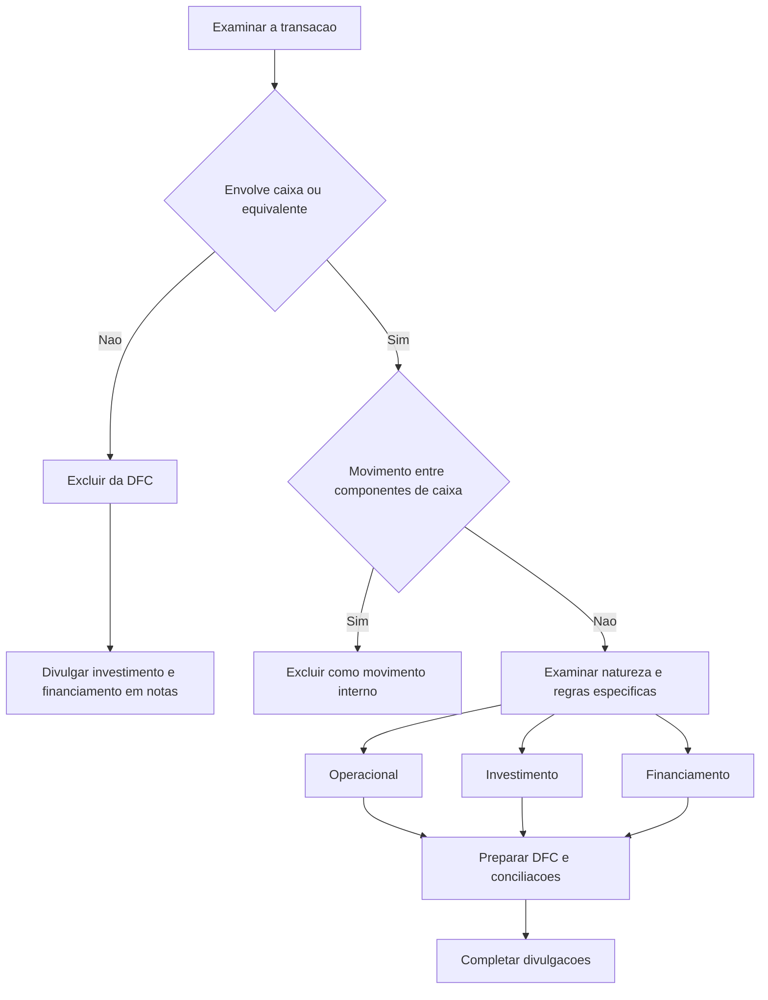

# NBC TG 03 (R3) — Demonstração dos Fluxos de Caixa

## Resumo em 30 segundos

> [!abstract] Essência da norma
> A demonstração dos fluxos de caixa — **DFC** — explica as alterações históricas de caixa e equivalentes de caixa, separando os fluxos em **atividades operacionais, de investimento e de financiamento**. Ela permite avaliar geração de caixa, liquidez, solvência e necessidades de recursos. As atividades operacionais podem ser apresentadas pelo método direto ou indireto; no método direto, a conciliação com o resultado é obrigatória. Transações de investimento e financiamento sem caixa ficam fora da DFC, mas devem ser divulgadas em notas.

**Para aplicar:** delimite caixa e equivalentes, identifique os movimentos efetivos, classifique cada fluxo, prepare a DFC, concilie os saldos e complete as divulgações.

> [!warning] Limitações editoriais do PDF
> O texto fornecido mistura redações anteriores, alterações e exclusões. Há inconsistências relevantes em juros e dividendos e no bloco de financiamento de fornecedores. Este resumo identifica essas limitações, sem reconstruir itens ausentes nem tratar exemplos históricos como regras superiores ao texto técnico.

## Ficha rápida

| Aspecto | Síntese |
|---|---|
| Norma | NBC TG 03 (R3) |
| Grupo | 02 - NBC TG |
| Demonstração | DFC, integrante das demonstrações contábeis de cada período |
| Alcance textual | Todas as entidades, inclusive instituições financeiras |
| Classificação | Operacional, investimento e financiamento |
| Métodos operacionais | Direto ou indireto, sem preferência no texto brasileiro |
| Base da informação | Entradas e saídas de caixa e equivalentes de caixa |
| Fonte principal | Texto técnico, páginas 2–14 |

### Alterações e aplicação temporal identificadas

- **Item 64, página 14:** as alterações da Revisão NBC 31 são aplicadas quando a entidade aplicar a **NBC TG 51**. O PDF não informa, nesse item, uma data autônoma para essa aplicação.
- **Item 65, página 14:** a alteração do item 37 pela Revisão NBC 33 aplica-se ao período anual de reporte iniciado em ou após **1º de janeiro de 2026**.
- O ato de alteração de 19 de agosto de 2016, reproduzido nas páginas 23–25, informa efeitos a partir de **1º de janeiro de 2017**.

Esses marcos não devem ser reunidos em uma única data de aplicação de todas as redações presentes no arquivo.

## Objetivo e alcance

A norma exige informações sobre mudanças históricas de caixa e equivalentes, permitindo avaliar:

- a capacidade de gerar recursos;
- as necessidades de utilização desses recursos;
- a época e o grau de certeza de sua geração;
- a liquidez, a solvência e a estrutura financeira;
- a relação entre lucratividade e geração efetiva de caixa.

A DFC deve ser elaborada conforme a norma e apresentada como parte integrante das demonstrações contábeis ao final de cada período. A exigência textual abrange todas as entidades, independentemente da natureza de suas atividades — **itens 1 e 3, página 2**.

A leitura conjunta com as demais demonstrações ajuda a avaliar mudanças nos ativos líquidos e melhora a comparabilidade, reduzindo efeitos de diferentes critérios contábeis sobre transações semelhantes — **itens 4–5**.

## Conceitos-chave

### Caixa e equivalentes de caixa

**Caixa** compreende numerário em espécie e depósitos bancários disponíveis.

**Equivalentes de caixa** são aplicações financeiras:

- de curto prazo;
- de alta liquidez;
- prontamente conversíveis em montante conhecido de caixa;
- sujeitas a risco insignificante de mudança de valor.

São mantidas para atender compromissos de curto prazo, **não para investimento ou outros propósitos** — **itens 6–7, página 3**.

O item 7 indica, como exemplo, vencimento de **três meses ou menos contado da aquisição**. Não basta verificar quanto falta para vencer na data do balanço.

Instrumentos patrimoniais normalmente não são equivalentes. A exceção é quando são substancialmente equivalentes de caixa, como ações preferenciais resgatáveis com prazo definido que satisfaça o conceito de curto prazo.

### Saldos bancários a descoberto

Empréstimos bancários são geralmente financiamento. Entretanto, descobertos liquidados em curto lapso temporal e integrantes da gestão de caixa podem compor caixa e equivalentes. A oscilação frequente entre saldo devedor e credor é característica desses arranjos — **item 8**.

### Movimentos internos

Transferências entre componentes de caixa e equivalentes **não são fluxos apresentados na DFC**. Incluem, por exemplo, a aplicação de excesso de caixa em investimento que efetivamente se qualifique como equivalente — **item 9**.

### As três atividades

| Atividade | Conteúdo central | Exemplos |
|---|---|---|
| Operacional | Principais atividades geradoras de receita e outras não classificadas nas demais categorias | Clientes, fornecedores e empregados |
| Investimento | Aquisição e venda de ativos de longo prazo e investimentos fora dos equivalentes | Imobilizado, intangíveis e empréstimos concedidos a terceiros |
| Financiamento | Mudanças no capital próprio e no capital de terceiros | Emissão de ações, captação e amortização de empréstimos |

A classificação deve refletir os negócios da entidade — **itens 10–17**. Uma transação pode conter parcelas de atividades diferentes; não se deve classificar um pagamento composto sem examinar seus componentes.

## Diagrama de decisão

## Aplicação passo a passo e checklist

### 1. Delimitar o perímetro de caixa

- [ ] Identificar numerário e depósitos disponíveis.
- [ ] Testar finalidade, liquidez, conversibilidade, risco e prazo das aplicações.
- [ ] Examinar descobertos bancários conforme o item 8.
- [ ] Documentar a política de composição de caixa e equivalentes.
- [ ] Separar saldos significativos indisponíveis para uso pelo grupo.

### 2. Identificar movimentos efetivos

- [ ] Levantar recebimentos e pagamentos do período.
- [ ] Excluir transferências internas entre caixa e equivalentes.
- [ ] Separar transações sem caixa.
- [ ] Não confundir receita, despesa ou variação patrimonial com fluxo financeiro.

### 3. Classificar os fluxos

- [ ] Considerar a natureza do negócio.
- [ ] Separar componentes de transações compostas.
- [ ] Aplicar regras específicas para tributos, câmbio, controle societário e proteção.
- [ ] Verificar se desembolsos classificados como investimento resultaram em ativo reconhecido.
- [ ] Para juros e dividendos, observar as limitações textuais descritas adiante.

### 4. Escolher o método operacional

- [ ] **Direto:** apresentar principais classes de recebimentos e pagamentos brutos.
- [ ] **Indireto:** ajustar o resultado pelas diferenças entre competência, classificação e caixa.
- [ ] No direto, fornecer a conciliação obrigatória do item 20A.

### 5. Preparar investimento e financiamento

- [ ] Apresentar separadamente as principais classes de recebimentos e pagamentos brutos.
- [ ] Usar base líquida somente nas hipóteses previstas.
- [ ] Tratar obtenção e perda de controle em linhas separadas.
- [ ] Excluir aquisições e financiamentos sem caixa, divulgando-os em notas.

### 6. Fechar e revisar

- [ ] Conciliar caixa inicial e final.
- [ ] Apresentar separadamente o efeito cambial sobre caixa e equivalentes.
- [ ] Conciliar os componentes da DFC com o balanço.
- [ ] Completar notas obrigatórias e avaliar divulgações encorajadas.
- [ ] Confirmar que não há divulgação de fluxo de caixa por ação.

> [!tip] Revisão prática
> Variações de contas do balanço podem incluir aquisições de negócios, câmbio e transações sem caixa. Antes de usá-las no método indireto, identifique esses componentes para não transformá-los indevidamente em fluxos operacionais.

## Reconhecimento e mensuração

### Natureza dos requisitos

A NBC TG 03 disciplina principalmente **identificação, classificação, apresentação e divulgação de fluxos**, e não o reconhecimento geral de ativos e passivos.

Um requisito específico é que somente desembolsos que resultem em **ativo reconhecido nas demonstrações contábeis** são passíveis de classificação como investimento — **item 16, página 5**.

### Atividades operacionais

Incluem recebimentos de vendas, serviços, royalties e comissões; pagamentos a fornecedores e empregados; e fluxos de contratos mantidos para negociação.

A compra e venda de títulos mantidos para negociação são operacionais. Adiantamentos e empréstimos feitos por instituições financeiras são comumente operacionais porque integram sua principal atividade geradora de receita — **itens 14–15**.

A venda de imobilizado é investimento, mesmo que gere ganho ou perda no resultado. Há tratamento específico para ativos adquiridos ou produzidos para aluguel e posteriormente vendidos, conforme a referência ao item 68A da NBC TG 27: aquisição ou produção, aluguéis e vendas subsequentes geram fluxos operacionais.

### Método direto

Apresenta recebimentos e pagamentos brutos por principais classes. As informações podem vir dos registros contábeis ou de ajustes em vendas, custos e outros itens do resultado, considerando:

- variações em estoques e contas operacionais a receber e a pagar;
- itens sem caixa;
- itens cujos fluxos pertencem a investimento ou financiamento.

**Referência:** itens 18–19, página 6.

### Método indireto

A redação alterada dos itens 18 e 20 direciona a apuração a partir do **lucro ou prejuízo operacional**, embora a transcrição conserve expressões de redações anteriores.

Os ajustes abrangem:

- variações de estoques e contas operacionais;
- depreciação, provisões, impostos diferidos e outros itens sem caixa;
- ganhos e perdas cambiais não realizados classificados na categoria operacional;
- equivalência patrimonial, quando aplicável;
- receitas e despesas operacionais cujos fluxos sejam investimento ou financiamento;
- fluxos operacionais cujas receitas ou despesas não estejam na categoria operacional do resultado.

O **item 20A, página 7**, exige conciliação mesmo no método direto, com os principais itens apresentados separadamente por categoria.

### Investimento e financiamento

Investimento inclui pagamentos e recebimentos relacionados a ativos de longo prazo, participações e instrumentos de outras entidades, além de empréstimos concedidos a terceiros, observadas as exceções.

Financiamento inclui emissão ou resgate de instrumentos patrimoniais, obtenção e amortização de dívida e pagamentos do arrendatário para redução do passivo de arrendamento.

Quando um contrato é contabilizado como proteção de posição identificável, seus fluxos seguem a classificação da posição protegida — **item 16**.

### Apresentação em base líquida

A regra para investimento e financiamento é a apresentação das principais classes **brutas** — **item 21**.

Os itens 22–24 permitem base líquida para:

- recebimentos e pagamentos em nome de clientes que reflitam mais as atividades deles;
- itens com giro rápido, montantes expressivos e vencimentos curtos;
- determinadas operações de instituições financeiras, como depósitos a prazo, operações interbancárias e empréstimos a clientes com suas amortizações.

A conveniência operacional, isoladamente, não constitui hipótese de compensação.

### Moeda estrangeira

Os fluxos são registrados na moeda funcional pela taxa da data de sua ocorrência. Os fluxos de controlada no exterior também são convertidos pelas taxas das respectivas datas — **itens 25–26**.

A NBC TG 02 permite aproximações, como média ponderada, mas não a taxa de encerramento para converter os fluxos de controlada no exterior — **item 27**.

Ganhos e perdas cambiais não realizados não são fluxos. O efeito cambial sobre caixa e equivalentes é apresentado separadamente para conciliar os saldos — **item 28**.

$$
\text{Caixa final}
=
\text{Caixa inicial}
+
\text{Fluxo operacional líquido}
+
\text{Fluxo de investimento líquido}
+
\text{Fluxo de financiamento líquido}
+
\text{Efeito cambial}
$$

### Juros, dividendos e juros sobre capital próprio

**Regras expressamente identificáveis:**

- Apresentar separadamente os fluxos recebidos e pagos e manter classificação consistente entre períodos — **item 31**.
- Divulgar o total dos juros pagos, inclusive os capitalizados — **item 32**.
- Classificar dividendos pagos como financiamento — **item 33A**.
- O trecho acrescentado ao item 34A determina, para entidades fora do grupo referido no item 34B, juros pagos como financiamento e juros e dividendos recebidos como investimento.

> [!danger] Não completar o item 34B
> O PDF remete ao item 34B, mas não apresenta seu texto. Além disso, o item 34A reúne uma orientação anterior e comandos posteriores. Não é possível identificar, exclusivamente por este arquivo, o grupo de entidades abrangido pelo item ausente nem fechar uma matriz completa de classificação, inclusive para juros sobre capital próprio.

Os itens 34C–34D relacionam a classificação à demonstração do resultado: quando cada espécie de receita ou despesa está em uma categoria, o respectivo fluxo segue a atividade associada; quando há mais de uma categoria, prevê-se escolha de política para classificar todos os fluxos da espécie em uma das atividades associadas. Ambos dependem do item 34B ausente.

### IR e CSLL

Devem ser divulgados separadamente e classificados como operacionais, salvo identificação específica com investimento ou financiamento — **itens 35–36**.

Identificar a despesa tributária não basta: deve ser praticável identificar o **fluxo de caixa** com a transação. Se os tributos forem alocados em mais de uma atividade, divulgar também o total pago.

### Participações e mudanças de controle

Pelos métodos de equivalência patrimonial ou custo, apresentam-se os fluxos entre investidora e investida, como dividendos e adiantamentos — **itens 37–38**.

Obtenção ou perda de controle:

- classificação como investimento;
- apresentação separada;
- valor líquido do caixa e equivalentes adquiridos ou alienados;
- proibição de compensar perda de controle com obtenção de controle.

Mudanças de participação sem perda de controle são financiamento, ressalvada a exceção textual para controlada detida por entidade de investimento e mensurada ao valor justo por meio do resultado — **itens 39–42B**.

## Divulgação

### Informações obrigatórias identificadas

| Informação | Referência |
|---|---|
| Conciliação do resultado com fluxo operacional no método direto | 20A |
| Juros, dividendos e juros sobre capital próprio, separadamente | 31–32 |
| IR e CSLL e total pago quando alocado em várias atividades | 35–36 |
| Informações agregadas sobre obtenção e perda de controle | 40 |
| Investimento e financiamento sem caixa | 43–44 |
| Componentes de caixa, política e conciliação com o balanço | 45–47 |
| Saldos significativos indisponíveis ao grupo, com comentário da administração | 48–49 |

Para obtenção e perda de controle, divulgar contraprestação total, parcela em caixa, caixa da entidade adquirida ou alienada e principais classes dos demais ativos e passivos. O item 40A dispensa as informações de 40(c)–40(d) para investimentos específicos de entidades de investimento.

### Informações encorajadas

Os itens 50–52 encorajam, acompanhadas de comentário da administração:

- linhas de crédito não utilizadas e restrições;
- fluxos de expansão separados dos necessários à manutenção;
- fluxos por segmento;
- totais separados de juros, dividendos e juros sobre capital próprio, pagos e recebidos, e de IR e CSLL pagos.

Essa categoria não elimina obrigações específicas estabelecidas em outros itens.

### Bloco inconsistente de financiamento

Os itens **44A–44E, página 12**, estão marcados como eliminados pela Revisão NBC 33. O sumário anuncia acordos de financiamento de fornecedores, mas o **44F, página 13**, repete conteúdo do bloco anterior e também está marcado como eliminado.

O item 60 e exemplos históricos permanecem no arquivo. Isso não basta para restabelecer os itens eliminados nem para inferir requisitos de acordos de fornecedores.

## Exceções e erros comuns

- **Confundir lucro com caixa:** competência e recebimentos ou pagamentos não coincidem necessariamente.
- **Classificar toda aplicação curta como equivalente:** verificar finalidade, conversibilidade e risco.
- **Contar o prazo somente desde o balanço:** o exemplo de três meses parte da aquisição.
- **Incluir aquisição por arrendamento como pagamento imediato:** a parcela sem caixa fica fora da DFC.
- **Compensar entradas e saídas indiscriminadamente:** observar as hipóteses de base líquida.
- **Usar taxa de fechamento para todos os fluxos externos:** respeitar os itens 25–27.
- **Omitir restrições de caixa:** divulgar saldos significativos indisponíveis ao grupo.
- **Usar exemplos antigos para resolver alterações:** os exemplos não integram a norma.
- **Divulgar fluxo de caixa por ação:** proibido pelo **item 52A, página 14**.

## Conexões com outras normas

- **NBC TG 51:** requisitos gerais de apresentação, ligação com categorias do resultado e aplicação das alterações da Revisão NBC 31 — itens 10, 34D e 64.
- **NBC TG 02:** câmbio e conversão dos fluxos — item 27.
- **NBC TG 20:** juros capitalizados incluídos no total pago — item 32.
- **NBC TG 27:** ativos mantidos para aluguel e posteriormente vendidos — item 14.
- **NBC TG 36:** entidades de investimento e alterações de participação sem perda de controle — itens 40A e 42A–42B.
- **NBC TG 23:** política de composição de caixa e efeitos de mudanças — itens 46–47; o item 46 conserva referências sobrepostas na transcrição.
- **NBC TG 22:** divulgação de fluxos por segmento — item 50(d).

## Fonte

**Arquivo:** [[NBC TG 03 (R3).pdf]]

Resumo elaborado exclusivamente com o texto fornecido:

- **Páginas 2–14:** texto técnico prioritário.
- **Páginas 15–22:** exemplos ilustrativos e nota explicativa, expressamente não integrantes da norma.
- **Páginas 23–25:** ato de alteração de 19 de agosto de 2016.

As inconsistências, duplicações e lacunas foram sinalizadas, sem complementação por fontes externas.
