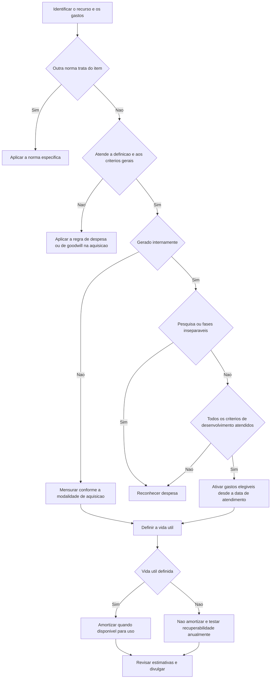

# NBC TG 04 (R4) — Ativo Intangível

## Resumo em 30 segundos

> [!abstract] Essência da norma
> Um recurso sem substância física não é automaticamente um ativo. Para reconhecer um **ativo intangível**, a entidade precisa demonstrar identificação, controle, benefícios econômicos futuros prováveis e mensuração confiável do custo. Na geração interna, **pesquisa é despesa**; desenvolvimento somente é ativado quando todos os critérios específicos forem demonstrados. Após o reconhecimento, ativos com vida útil definida são amortizados; os de vida útil indefinida não são amortizados, mas passam por teste anual de recuperabilidade e também quando houver indícios de perda.

**Decisões práticas fundamentais:**

- Separe aquisição externa, combinação de negócios e geração interna.
- Identifique a data em que os critérios de reconhecimento foram atendidos.
- Não reincorpore ao ativo gastos anteriormente reconhecidos como despesa.
- Inicie a amortização quando o ativo estiver disponível para uso.
- Justifique a vida útil e prepare a conciliação dos saldos por classe.

## Ficha rápida

| Aspecto | Síntese |
|---|---|
| Norma | NBC TG 04 (R4) — Ativo Intangível |
| Grupo | 02 - NBC TG |
| Finalidade | Reconhecimento, mensuração e divulgação de intangíveis |
| Mensuração inicial | Custo, observadas as regras da modalidade de aquisição |
| Mensuração posterior pelo custo | Custo menos amortização e perdas acumuladas |
| Vida útil definida | Amortização sistemática e avaliação de recuperabilidade |
| Vida útil indefinida | Sem amortização; teste anual e diante de indícios de perda |
| Complemento técnico | Interpretação sobre custos de sítio para internet |

> [!info] Leitura da consolidação
> O PDF apresenta redações anteriores e redações alteradas, além de itens eliminados. Este resumo utiliza as redações alteradas identificadas no texto técnico, sem tratar os trechos substituídos como regras simultâneas. O ato de alteração está reproduzido nas páginas 34–35; seus efeitos são indicados a partir de **1º de janeiro de 2018**, sem que isso represente a vigência inicial de toda a norma.

## Objetivo e alcance

A norma define o tratamento dos intangíveis não abrangidos especificamente por outra norma, estabelece critérios para reconhecimento e mensuração e exige divulgações específicas — **item 1**.

Antes de aplicá-la, verifique se existe tratamento específico. Entre as exclusões estão:

- intangíveis destinados à venda no curso ordinário dos negócios;
- ativos financeiros, fiscais diferidos e decorrentes de benefícios a empregados;
- arrendamentos de intangíveis contabilizados conforme a NBC TG 06;
- goodwill adquirido em combinação de negócios;
- ativos classificados como mantidos para venda;
- ativos decorrentes de contratos com clientes reconhecidos pela NBC TG 47;
- determinados ativos e gastos de exploração, avaliação, desenvolvimento e extração de recursos minerais e naturais não renováveis;
- custos e direitos contratuais de seguradoras especificados no alcance.

Há particularidades de divulgação para os intangíveis de seguradoras mencionados no **item 3(g)**. As exclusões setoriais não afastam a aplicação a outros intangíveis, como softwares utilizados por indústrias extrativas ou seguradoras — **itens 2–7**.

### Intangível ou imobilizado?

Avalie qual componente é mais significativo. Software indispensável ao funcionamento do equipamento, inclusive o sistema operacional de um computador, integra o imobilizado. Software não integrante do hardware é tratado como intangível — **item 4**.

Direitos de licenciamento sobre filmes, gravações, peças, manuscritos, patentes e direitos autorais estão no alcance desta norma — **item 6, redação alterada**.

## Conceitos-chave

| Conceito | Significado operacional |
|---|---|
| Ativo intangível | Ativo não monetário identificável sem substância física |
| Identificação | Separabilidade **ou** origem em direitos contratuais ou legais |
| Controle | Poder de obter benefícios e restringir o acesso de terceiros |
| Benefícios futuros | Receitas, redução de custos ou outros benefícios do uso |
| Pesquisa | Investigação original e planejada para obter conhecimento |
| Desenvolvimento | Aplicação de conhecimento em projeto antes do uso ou produção comercial |
| Vida útil | Período de utilização esperado ou unidades esperadas de produção |

**Identificável não significa necessariamente vendável isoladamente.** Direitos contratuais ou legais podem satisfazer a identificação mesmo sem transferência ou separação possível — **item 12**.

**Controle não exige sempre proteção legal**, embora sua ausência dificulte a comprovação. Treinamento e habilidades de empregados normalmente não proporcionam controle suficiente. Relacionamentos com clientes também não se qualificam apenas pela expectativa de fidelidade; operações envolvendo relações não contratuais podem fornecer evidências de controle e separabilidade — **itens 13–16**.

> [!warning] Valor empresarial não é custo de intangível
> Goodwill gerado internamente não é reconhecido. A diferença entre o valor justo da entidade e seu patrimônio líquido contábil não representa o custo dos intangíveis controlados — **itens 48–50**.

## Fluxo de decisão

O fluxo é uma orientação inicial: aquisições em combinação de negócios possuem regras próprias, e marcas e itens similares gerados internamente não podem ser ativados.

## Aplicação passo a passo e checklist

### 1. Delimitar o recurso

- [ ] Identificar o ativo, sua finalidade e a modalidade de obtenção.
- [ ] Confirmar o alcance e a distinção entre intangível e imobilizado.
- [ ] Documentar separabilidade ou direitos contratuais e legais.
- [ ] Demonstrar controle e benefícios econômicos futuros.

### 2. Validar o reconhecimento

- [ ] Avaliar benefícios futuros com premissas razoáveis e comprováveis.
- [ ] Dar maior peso às evidências externas disponíveis.
- [ ] Confirmar mensuração confiável do custo.
- [ ] Na geração interna, separar pesquisa e desenvolvimento.

### 3. Demonstrar todos os critérios do desenvolvimento

O **item 57** exige atendimento conjunto:

| Critério | O que demonstrar |
|---|---|
| Viabilidade técnica | Possibilidade de concluir o ativo para uso ou venda |
| Intenção | Decisão de concluir e usar ou vender |
| Capacidade | Condições de usar ou vender |
| Benefícios futuros | Mercado para o ativo ou seus produtos, ou utilidade interna |
| Recursos | Disponibilidade técnica, financeira e de outros recursos |
| Mensuração | Gastos atribuíveis mensurados com confiabilidade |

- [ ] Registrar a data de atendimento de todos os critérios.
- [ ] Segregar os gastos elegíveis incorridos a partir dessa data.
- [ ] Excluir despesas anteriores, treinamento, ineficiências e gastos não atribuíveis.

### 4. Preparar a contabilização posterior

- [ ] Registrar quando o ativo ficou disponível para uso.
- [ ] Definir vida útil, método de amortização e valor residual.
- [ ] Avaliar recuperabilidade conforme a NBC TG 01.
- [ ] Revisar estimativas e preparar divulgações por classe.

> [!tip] Evidência e rastreabilidade
> Planos de negócios, disponibilidade de financiamento e sistemas de custeio são exemplos de suporte mencionados nos **itens 61–62**. Vincule os gastos ao projeto e à data de atendimento dos critérios.

## Reconhecimento e mensuração

### Requisitos gerais

O reconhecimento depende da definição de intangível e de dois critérios: benefícios futuros prováveis em favor da entidade e custo mensurável com confiabilidade. A regra inicial é o custo — **itens 18–24**.

Gastos subsequentes raramente satisfazem os critérios. Gastos posteriores com marcas, títulos, logomarcas, listas de clientes e similares são reconhecidos no resultado, independentemente de origem externa ou interna — **item 20**.

### Aquisição separada

A condição de probabilidade é considerada atendida; normalmente o custo pode ser mensurado com confiabilidade — **itens 25–26**.

**Inclua no custo:**

- preço de compra, impostos de importação e tributos não recuperáveis, líquidos de descontos;
- gastos diretamente atribuíveis à preparação;
- pessoal diretamente envolvido, honorários e testes necessários.

**Não inclua:** propaganda, lançamento de produtos, treinamento, transferência de atividades, custos administrativos e indiretos, ociosidade e prejuízos operacionais iniciais — **itens 27–31**.

A capitalização cessa quando o ativo alcança as condições operacionais pretendidas. Pagamento além dos prazos normais de crédito exige custo equivalente ao preço à vista; a diferença é juros, salvo capitalização admitida pela NBC TG 20 — **item 32**.

### Combinação de negócios

O custo é o **valor justo na data de aquisição**. Para ativo identificável, os critérios de probabilidade e mensuração confiável são considerados atendidos — **item 33, redação alterada**.

Reconheça o intangível separadamente do goodwill, mesmo que a adquirida não o tivesse reconhecido. Isso pode incluir projeto de pesquisa e desenvolvimento em andamento — **item 34**.

Ativos separáveis apenas em conjunto com outro item são reconhecidos conjuntamente com esse item, mas separados do goodwill. Intangíveis complementares podem formar um único ativo se tiverem vidas úteis semelhantes — **itens 36–37**.

Nos projetos adquiridos, gastos posteriores de pesquisa são despesas; desenvolvimento somente aumenta o ativo quando satisfaz o item 57 — **itens 42–43**.

### Subvenção e permuta

| Modalidade | Tratamento inicial |
|---|---|
| Subvenção governamental | Valor justo do ativo e da subvenção, ou valor nominal do ativo mais gastos diretamente atribuíveis, conforme a opção descrita |
| Permuta | Valor justo, salvo ausência de natureza comercial ou impossibilidade de mensuração confiável dos valores justos |
| Permuta nas exceções | Valor contábil do ativo cedido |

Na permuta, a natureza comercial depende de alterações significativas nos fluxos de caixa ou no valor específico das atividades afetadas. Se ambos os valores justos forem confiáveis, use o do ativo cedido, salvo se o do recebido for mais evidente — **itens 44–47**.

### Geração interna: pesquisa versus desenvolvimento

Pesquisa é despesa quando incorrida. Se as fases não puderem ser diferenciadas, trate todo o projeto como pesquisa — **itens 53–56**.

Desenvolvimento é ativado apenas desde a data de atendimento dos critérios. O custo inclui materiais, serviços, pessoal, registro de direitos e amortização de patentes e licenças utilizados na geração. Exclui treinamento, ineficiências, perdas iniciais e gastos não diretamente atribuíveis — **itens 65–67**.

Marcas, títulos de publicações, listas de clientes e similares gerados internamente não são reconhecidos — **itens 63–64**.

**Exemplo do próprio PDF — página 14:**

- Em 20X5, gastos de **$ 1.000**: **$ 900** antes de atender aos critérios e **$ 100** depois.
- Reconhecimento: despesa de **$ 900** e ativo de **$ 100**.
- Em 20X6, gastos elegíveis de **$ 2.000** elevam o custo a **$ 2.100**.
- Valor recuperável de **$ 1.900** implica perda de **$ 200**.

> [!danger] Não recuperar despesas antigas
> O sucesso posterior do projeto não autoriza reintegrar ao custo gastos inicialmente reconhecidos como despesa — **item 71**.

### Despesas e antecipações

Gastos pré-operacionais, treinamento, publicidade e reorganização são despesas, observadas as ressalvas para custos de outros ativos. Produtos geram despesa quando existe direito de acesso; serviços, quando recebidos — **itens 68–69A**.

Pagamento antecipado pode permanecer como ativo até o acesso aos bens ou recebimento dos serviços. Isso não equivale ao reconhecimento de intangível — **item 70**.

### Mensuração posterior

Pelo método de custo — **item 74**:

$$
\text{Valor contábil}
=
\text{Custo}
-
\text{Amortização acumulada}
-
\text{Perdas acumuladas por desvalorização}
$$

> [!warning] Reavaliação não é opção irrestrita
> Os **itens 72 e 75** condicionam a reavaliação à permissão legal. A nota da página 16 informa que, na data de aprovação da norma, a reavaliação não era permitida pelas disposições legais ali citadas. Essa data não deve ser confundida com autorização atual.

No tratamento condicionado dos **itens 75–87**, a reavaliação exige mercado ativo, regularidade e aplicação por classe, ressalvados itens sem mercado ativo. Não cria ativos antes não reconhecidos. Aumentos vão, em regra, para outros resultados abrangentes; reduções, para o resultado, observadas reversões e o saldo da reserva. Transferências realizadas para lucros acumulados não transitam pelo resultado.

### Vida útil e amortização

Vida útil **indefinida** significa ausência de limite previsível para fluxos líquidos positivos, não duração infinita. Considere uso, obsolescência, concorrência, manutenção, dependência de outros ativos e limites legais — **itens 88–93**.

Direitos contratuais limitam a vida útil, que pode ser menor. Renovações exigem evidências e ausência de custo significativo. Direitos readquiridos em combinação de negócios usam somente o prazo contratual remanescente — **itens 94–96**.

Para vida útil definida:

- amortize desde a disponibilidade para uso;
- reflita o padrão de consumo; use o linear se ele não puder ser determinado confiavelmente;
- reconheça a amortização no resultado, salvo inclusão permitida ou exigida no custo de outro ativo;
- presuma valor residual zero, salvo compromisso de compra ou mercado ativo nas condições exigidas;
- revise vida útil, método e residual pelo menos ao final de cada exercício.

A amortização não para pela simples interrupção do uso — **itens 97–104 e 117**.

Métodos baseados em receita são presumidos inadequados. A presunção admite superação nas circunstâncias limitadas do **item 98A**, incluindo alta correlação demonstrada ou direito expresso por limite de receita conforme o **item 98C**.

### Recuperabilidade e baixa

Ativos de vida indefinida não são amortizados e são testados anualmente e diante de indícios de perda. A vida útil é revisada periodicamente; mudança para definida é mudança de estimativa e indicador para teste de recuperabilidade — **itens 107–111**.

Baixe o ativo na alienação ou quando não forem esperados benefícios do uso ou da alienação. Ganho ou perda corresponde à diferença entre valor líquido de alienação e valor contábil, reconhecida no resultado; ganhos não são receitas de venda — **itens 112–113**.

A data da alienação e a contrapartida seguem os requisitos da NBC TG 47 indicados nos **itens 114 e 116, redações R4**. Parcela substituída deve ser baixada quando a substituição for ativada — **item 115**.

## Aplicação específica: sítio para internet

A interpretação anexa aplica os critérios de geração interna ao website próprio — **itens 7–10, páginas 30–31**.

| Gasto ou fase | Tratamento |
|---|---|
| Planejamento | Despesa, como pesquisa |
| Aplicações, infraestrutura e desenho gráfico | Ativação somente com critérios atendidos e atribuição direta |
| Conteúdo não promocional | Pode integrar o custo nas condições exigidas |
| Conteúdo publicitário | Despesa |
| Funcionamento e manutenção | Despesa, salvo atendimento aos critérios de reconhecimento |
| Hardware | NBC TG 27 |
| Hospedagem por fornecedor | Despesa quando o serviço é recebido |

Website exclusiva ou basicamente promocional não satisfaz a demonstração de benefícios exigida pela interpretação: seus gastos de desenvolvimento são despesas. Capacidade de gerar receitas, como serviço de encomendas, pode apoiar a demonstração de benefícios, mas não dispensa os demais critérios.

A melhor estimativa de vida útil de um website deve ser curta. A interpretação exclui desenvolvimento para venda a outra entidade e intangíveis contabilizados conforme a NBC TG 06 — **itens 5–6, redações alteradas**.

## Divulgação

Por classe, distinguindo geração interna de outras origens, divulgue — **item 118**:

- vida útil definida ou indefinida, prazos ou taxas e métodos;
- valor bruto, amortização e perdas acumuladas no início e no fim;
- rubrica do resultado que contém a amortização;
- conciliação com adições por origem, baixas, classificação para venda, reavaliações, perdas, reversões, amortização, variações cambiais e outras alterações.

Complete com informações sobre — **itens 120–127**:

- perdas e mudanças relevantes de estimativas;
- valor e justificativa de vida indefinida;
- intangíveis individuais relevantes e amortização remanescente;
- subvenções inicialmente mensuradas ao valor justo;
- titularidade restrita, garantias e compromissos de aquisição;
- reavaliações, quando aplicáveis;
- total de pesquisa e desenvolvimento reconhecido como despesa.

Descrição de ativos totalmente amortizados ainda em uso e de intangíveis significativos não reconhecidos é **recomendável, não obrigatória** — **item 128**.

## Exceções e erros comuns

| Erro | Correção |
|---|---|
| Ativar tudo que produz benefício futuro | Exigir definição e critérios de reconhecimento |
| Confundir desenvolvimento com ativação automática | Demonstrar todos os critérios do item 57 |
| Ativar marca criada internamente | Aplicar a vedação dos itens 63–64 |
| Esperar a primeira receita para amortizar | Iniciar na disponibilidade para uso |
| Suspender amortização por ociosidade | Observar o item 117 |
| Tratar vida indefinida como ausência de revisão | Revisar a vida e testar recuperabilidade |
| Capitalizar todo website comercial | Separar promoção, desenvolvimento elegível e serviços |
| Aplicar redações eliminadas | Usar as alterações identificadas na consolidação |

## Conexões explícitas com outras normas

- **NBC TG 01:** recuperabilidade, perdas, reversões e unidades geradoras de caixa.
- **NBC TG 15:** combinação de negócios e separação do goodwill.
- **NBC TG 16 e NBC TG 27:** estoques, componentes físicos e amortização no custo de outros ativos.
- **NBC TG 20:** juros elegíveis à capitalização.
- **NBC TG 23:** mudanças de estimativas e divulgações.
- **NBC TG 07 e NBC TG 46:** subvenções e mensuração do valor justo.
- **NBC TG 06 e NBC TG 47:** delimitação do alcance e aspectos da alienação.

## Disposições transitórias e fonte

Os **itens 130–131** preveem aplicação prospectiva para os demais intangíveis e preservação dos valores contábeis anteriores nas condições descritas, com reavaliação das vidas úteis. Permutas anteriormente mensuradas pelo valor contábil não são reapresentadas ao valor justo da aquisição.

**Fonte exclusiva:** [[NBC TG 04 (R4).pdf]], texto fornecido, páginas 1–35.

- Texto técnico: páginas 2–25.
- Exemplo de custo gerado internamente: página 14.
- Exemplos de vida útil: páginas 26–28, identificados como não integrantes da norma.
- Interpretação sobre websites: páginas 28–31; apêndice ilustrativo nas páginas 31–33.
- Ato de alteração da R4: páginas 34–35.

Não foram utilizados requisitos externos ao PDF nem uma data de publicação não informada no texto.
