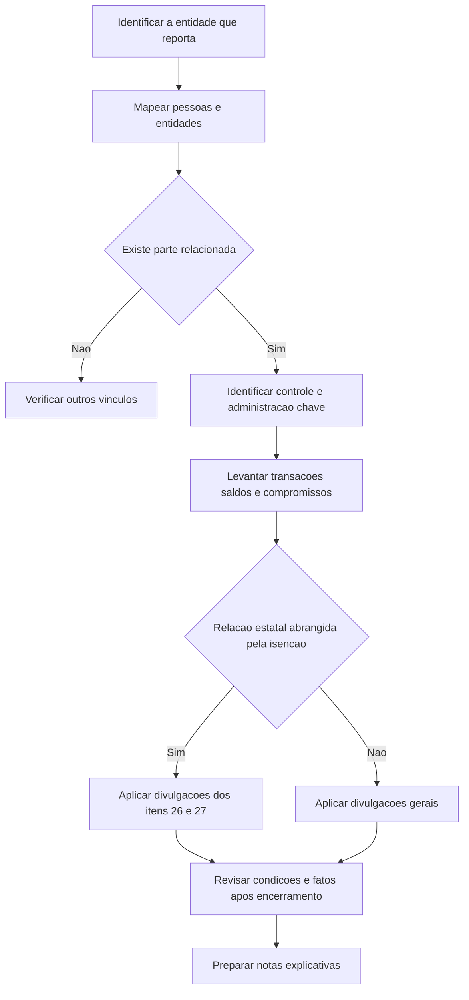

# NBC TG 05 (R3) — Divulgação sobre Partes Relacionadas

## Resumo em 30 segundos

> [!abstract] Essência da norma
> A NBC TG 05 exige informações que permitam compreender como **relacionamentos, transações, saldos e compromissos com partes relacionadas** podem afetar as demonstrações contábeis. O relacionamento pode produzir efeitos mesmo sem transações. A análise considera a **essência econômica**, e não apenas a forma jurídica.

Na prática, a entidade deve:

- Identificar pessoas e entidades relacionadas, inclusive familiares próximos e fornecedores de serviços de pessoal-chave da administração.
- Divulgar os vínculos entre controladora e controladas, mesmo sem transações.
- Informar a remuneração do pessoal-chave da administração por categoria.
- Divulgar transações, saldos, compromissos, condições, garantias e informações sobre créditos de liquidação duvidosa.
- Separar as informações por categoria de parte relacionada.
- Divulgar transações atípicas ocorridas após o encerramento do exercício ou período.
- Utilizar a isenção para determinadas relações com o Estado somente dentro de seus limites, mantendo as divulgações exigidas em substituição.

**Base:** itens 1, 7, 9–10 e 13–27, páginas 1–9.

## Ficha rápida

| Aspecto | Síntese |
|---|---|
| Finalidade | Evidenciar possíveis efeitos das partes relacionadas nas demonstrações contábeis |
| Aplicação | Demonstrações individuais, separadas e consolidadas, conforme o alcance |
| Conteúdo central | Relacionamentos, transações, saldos e compromissos |
| Critério de identificação | Essência do relacionamento |
| Particularidade da R3 | Serviços de pessoal-chave fornecidos por entidade administradora |
| Natureza dos requisitos | Principalmente divulgação, não um modelo próprio de mensuração |

> [!info] Leitura do documento
> O PDF apresenta algumas redações anteriores seguidas das versões alteradas. Este resumo utiliza as redações alteradas incorporadas ao texto técnico. Os exemplos ilustrativos e a nota explicativa acompanham a norma, mas **não são parte integrante dela**.

O ato de alteração da R3, datado de **21 de novembro de 2014**, informa entrada em vigor na data de publicação e aplicação aos exercícios iniciados a partir de **1º de janeiro de 2015**. Essa informação refere-se às alterações da R3; não representa uma verificação externa da situação atual da norma. **Fonte:** página 17.

## Objetivo e alcance

### Objetivo

As demonstrações contábeis devem chamar a atenção dos usuários para a possibilidade de o balanço patrimonial e a demonstração do resultado serem afetados pela existência de partes relacionadas e pelas operações e posições mantidas com elas. **Item 1, página 1.**

A divulgação ajuda a avaliar operações, riscos e oportunidades. Uma relação pode alterar preços, condições comerciais ou decisões de negócio. Também pode influenciar a atuação da entidade sem que exista transferência direta entre as partes. **Itens 5–8, página 2.**

### Alcance

A norma orienta:

1. A identificação de relacionamentos e transações.
2. A identificação de saldos existentes, incluindo compromissos.
3. A determinação das circunstâncias em que a divulgação é exigida.
4. A definição das informações a divulgar.

Aplica-se às demonstrações consolidadas e separadas de controladora ou investidores com controle conjunto ou influência significativa, conforme as NBC TG 35 e 36, e também às demonstrações individuais. **Itens 2–3, páginas 1–2.**

As transações e os saldos com outras entidades do grupo devem ser divulgados nas demonstrações da entidade. Na consolidação, os saldos e as transações intercompanhias são eliminados, **exceto aqueles entre entidade de investimento e suas controladas mensuradas ao valor justo por meio do resultado**. **Item 4, redação alterada, página 2.**

## Conceitos-chave

### Pessoas relacionadas

Uma pessoa, ou um membro próximo de sua família, está relacionada com a entidade que reporta quando essa pessoa:

- Tem controle ou controle conjunto sobre a entidade.
- Exerce influência significativa sobre ela.
- Integra o pessoal-chave da administração da entidade ou de sua controladora.

**Item 9(a), página 3.**

**Familiares próximos** são aqueles dos quais se pode esperar influência sobre a pessoa, ou influência dessa pessoa sobre eles, nos negócios com a entidade. Incluem filhos, cônjuge ou companheiro, filhos do cônjuge ou companheiro e dependentes da pessoa ou de seu cônjuge ou companheiro. A definição não se limita a um exame formal de parentesco. **Item 9, páginas 3–4.**

### Entidades relacionadas

O item 9(b), página 3, contempla os seguintes vínculos:

| Vínculo | Situação abrangida |
|---|---|
| Mesmo grupo econômico | Controladora, controladas e entidades sob controle comum |
| Coligada ou joint venture | Relação com outra entidade ou com membro do grupo da outra entidade |
| Terceira entidade comum | Duas joint ventures da mesma entidade, ou uma joint venture e uma coligada dela |
| Benefícios pós-emprego | Plano nas condições descritas no item 9(b)(v) |
| Controle por pessoa relacionada | Entidade controlada ou controlada em conjunto por pessoa identificada no item 9(a) |
| Influência ou administração | Pessoa com controle ou controle conjunto da entidade que reporta influencia significativamente ou integra a administração-chave da outra entidade ou de sua controladora |
| Serviços de administração-chave | Entidade, ou membro de seu grupo, fornece esses serviços à entidade que reporta ou à sua controladora |

Na hipótese de plano de benefício pós-emprego, a definição abrange o plano cujos beneficiários são empregados das duas entidades. Se a entidade que reporta for o próprio plano, os empregados que contribuem com ele também são partes relacionadas.

Uma **coligada inclui suas controladas**, assim como uma **joint venture inclui suas controladas**. Isso amplia a análise para além da investida diretamente identificada. **Item 12, página 5.**

### Outros conceitos essenciais

- **Transação com parte relacionada:** transferência de recursos, serviços ou obrigações, com ou sem cobrança de preço.
- **Pessoal-chave da administração:** pessoas com autoridade e responsabilidade pelo planejamento, direção e controle das atividades, direta ou indiretamente, incluindo administradores executivos ou não.
- **Remuneração:** benefícios a empregados e administradores, inclusive pagamentos baseados em ações.
- **Estado:** governo em sentido amplo, incluindo agências e organizações similares nos níveis indicados pela norma.
- **Entidade relacionada com o Estado:** entidade controlada, controlada em conjunto ou significativamente influenciada pelo Estado.

**Item 9, páginas 3–4.**

> [!tip] Regra de análise
> Avalie quem efetivamente controla, influencia ou administra. O item 10 exige atenção à essência do relacionamento, não apenas ao contrato ou à estrutura jurídica.

## Fluxo de aplicação

A isenção estatal é limitada às exigências do item 18 para as relações abrangidas pelo item 25. O fluxo não significa dispensa dos demais requisitos aplicáveis.

## Aplicação passo a passo — checklist

O roteiro abaixo organiza os requisitos para uso no fechamento contábil; não cria obrigações adicionais de documentação.

### 1. Definir o perímetro

- [ ] Identificar se as demonstrações são individuais, separadas ou consolidadas.
- [ ] Mapear controladora direta, controladora final e estrutura do grupo.
- [ ] Verificar as eliminações intercompanhias e a exceção para entidade de investimento.

### 2. Identificar as partes

- [ ] Avaliar controle, controle conjunto e influência significativa.
- [ ] Identificar pessoal-chave da entidade e da controladora.
- [ ] Examinar familiares próximos e entidades vinculadas às pessoas relacionadas.
- [ ] Identificar planos de benefícios pós-emprego.
- [ ] Verificar fornecedores de serviços de pessoal-chave e os grupos a que pertencem.
- [ ] Confrontar cada vínculo com as exclusões do item 11.

### 3. Levantar operações e posições

- [ ] Reunir transações dos períodos cobertos pelas demonstrações.
- [ ] Identificar saldos, compromissos e contratos a executar.
- [ ] Incluir transferências gratuitas, garantias e liquidações em nome de outra parte.
- [ ] Reunir prazos, condições, garantias e forma de liquidação.
- [ ] Identificar provisões e despesas relativas a créditos incobráveis ou duvidosos.
- [ ] Examinar transações atípicas após o encerramento.

### 4. Preparar a divulgação

- [ ] Separar as informações pelas categorias do item 19.
- [ ] Divulgar a remuneração do pessoal-chave no total e por categoria.
- [ ] Informar valores incorridos com entidade administradora separada.
- [ ] Se aplicável, avaliar a isenção estatal e preparar as informações substitutivas.
- [ ] Agregar apenas itens similares cuja separação não seja necessária à compreensão.
- [ ] Sustentar qualquer declaração de equivalência com condições de partes independentes.

**Base:** itens 4, 9–13 e 17–27.

## Reconhecimento e mensuração

### O que a norma estabelece

A NBC TG 05 é uma norma de **divulgação**. Ela não apresenta critérios gerais próprios para reconhecer ativos, passivos, receitas ou despesas, nem uma fórmula para mensurar transações entre partes relacionadas.

Isso não reduz seu alcance a valores já reconhecidos: a definição de transação independe de preço, e a divulgação inclui compromissos e contratos a executar, reconhecidos ou não. **Itens 9, 18 e 21(i).**

| Situação | Consequência para a divulgação |
|---|---|
| Serviço sem cobrança | Pode constituir transação com parte relacionada |
| Compromisso ainda não executado | Deve integrar a análise das informações exigidas |
| Crédito de liquidação duvidosa | Divulgar a provisão relacionada aos saldos |
| Dívida incobrável ou duvidosa | Divulgar a despesa reconhecida no período |

A referência à mensuração de controladas de entidade de investimento ao valor justo por meio do resultado aparece como condição da exceção à eliminação na consolidação. Não constitui um modelo geral de mensuração criado por esta norma. **Item 4.**

> [!warning] Preço não define o relacionamento
> Uma operação gratuita pode exigir divulgação. Por outro lado, a existência de parte relacionada não comprova, por si só, que os termos sejam diferentes dos praticados com partes independentes.

## Divulgação

### 1. Relacionamentos de controle

Os vínculos entre controladora e controladas devem ser divulgados **mesmo sem transações**. Informar:

- Nome da controladora direta.
- Nome da controladora final, se diferente.
- Quando nenhuma dessas disponibilizar demonstrações consolidadas ao público, nome da controladora do nível seguinte que as produza.

A controladora do nível seguinte é a primeira acima da controladora direta imediata que produz demonstrações consolidadas disponíveis ao público. **Itens 13–16, páginas 5–6.**

### 2. Remuneração do pessoal-chave

Divulgar o total e cada categoria:

| Categoria | Conteúdo exemplificativo |
|---|---|
| Curto prazo | Salários, contribuições, bônus e benefícios não monetários |
| Pós-emprego | Aposentadoria, pensões e assistência pós-emprego |
| Outros benefícios de longo prazo | Benefícios por tempo de serviço e remunerações diferidas |
| Rescisão | Benefícios de rescisão do contrato de trabalho |
| Baseada em ações | Remuneração dessa natureza |

**Itens 9 e 17, páginas 4 e 6.**

Se os serviços forem obtidos de entidade administradora, não é obrigatório aplicar o item 17 à remuneração que **essa administradora** paga ou deve aos próprios empregados ou diretores. Entretanto, devem ser divulgados os **valores incorridos pela entidade que reporta** pelos serviços fornecidos pela administradora separada. **Itens 17A e 18A, página 6.**

### 3. Transações, saldos e compromissos

Quando houver transações nos períodos cobertos, divulgar a natureza do relacionamento e informações suficientes para compreender seu possível efeito. O mínimo compreende:

- Montante das transações.
- Montante dos saldos existentes, incluindo compromissos.
- Prazos e condições, garantias e natureza da contrapartida na liquidação.
- Detalhes das garantias dadas ou recebidas.
- Provisão para créditos de liquidação duvidosa relacionada aos saldos.
- Despesa do período com dívidas incobráveis ou de liquidação duvidosa.

Essas informações são adicionais à divulgação da remuneração. **Item 18, página 6.**

A separação deve observar: **controladora; entidades com controle conjunto ou influência significativa sobre a entidade; controladas; coligadas; joint ventures em que a entidade seja investidor conjunto; pessoal-chave da entidade ou da controladora; outras partes relacionadas**. **Item 19, página 7.**

### 4. Operações a considerar

O item 21 inclui compras e vendas de bens e ativos, serviços, arrendamentos, pesquisa e desenvolvimento, licenças, empréstimos, contribuições de capital, garantias, avais, fianças, compromissos e liquidação de passivos em nome de outra parte.

Também é transação com parte relacionada a participação de controladora ou controlada em plano de benefícios definidos que compartilha riscos entre entidades do grupo. **Item 22, página 7.**

O exemplo ilustrativo EI27 acrescenta situações como uso de estrutura ou pessoal, comodatos, direitos e opções, benefícios para empregados de partes relacionadas e limitações mercadológicas ou tecnológicas. **Página 14; exemplo não integrante da norma.**

### 5. Condições e agregação

Para quaisquer transações entre partes relacionadas, divulgar as condições em que ocorreram. Também divulgar transações **atípicas após o encerramento** do exercício ou período. **Item 22A, página 8.**

A afirmação de que os termos equivalem aos de partes independentes somente pode ser feita quando efetivamente comprovada. Itens similares podem ser agregados, salvo quando a apresentação separada for necessária à compreensão. **Itens 23–24, página 8.**

## Entidades relacionadas com o Estado

A isenção do item 25 alcança as exigências do item 18 relativas a transações, saldos e compromissos com:

1. Ente estatal que controle, controle em conjunto ou influencie significativamente a entidade.
2. Outra entidade relacionada pelo fato de esse mesmo ente estatal exercer uma dessas formas de relação sobre ambas.

Ao utilizar a isenção, divulgar:

- Nome do ente estatal e natureza do vínculo.
- Natureza e montante de cada transação individualmente significativa.
- Indicação qualitativa e quantitativa da extensão das demais transações que sejam significativas em conjunto.

**Itens 25–26, página 8.**

O nível de detalhe depende de julgamento. Considerar proximidade do relacionamento, magnitude, condições fora de mercado, operações fora da rotina, divulgação a reguladores, reporte à administração sênior e aprovação dos acionistas. **Item 27, páginas 8–9.**

> [!danger] Isenção parcial, não silêncio
> A isenção não elimina a informação sobre operações significativas. No exemplo EI2, ela alcança as relações estatais indicadas, mas não as transações com a pessoa X. **Página 10.**

## Exceções e erros comuns

| Erro | Correção |
|---|---|
| Considerar administrador comum suficiente | Isoladamente, não torna duas entidades relacionadas |
| Tratar dois participantes da mesma joint venture como relacionados | O compartilhamento, por si só, não basta |
| Confundir dependência econômica com relacionamento | Grande volume com cliente ou fornecedor não basta |
| Omitir operações gratuitas | A definição independe de cobrança |
| Omitir controle por ausência de transações | O relacionamento entre controladora e controladas deve ser divulgado |
| Declarar condições de mercado sem suporte | A equivalência precisa ser efetivamente comprovada |
| Omitir custos de administradora externa | O item 18A exige divulgar os valores incorridos |

Financiadores, sindicatos, prestadores de serviços públicos e departamentos ou agências estatais sem controle, controle conjunto ou influência significativa também não são relacionados **simplesmente por seus negócios normais** com a entidade. Essas exclusões não afastam outros vínculos que atendam à definição. **Item 11, página 5.**

Os exemplos esclarecem ainda que duas coligadas não são relacionadas entre si apenas por terem o mesmo investidor, e que a influência significativa de uma mesma pessoa sobre duas entidades, sem os demais vínculos indicados, não as torna relacionadas. **EI7 e EI19, páginas 11 e 13.**

## Conexões explícitas com outras normas

| Norma | Relação indicada no PDF |
|---|---|
| NBC TG 36, 19 e 18 | Definições de controle, entidade de investimento, controle conjunto e influência significativa |
| NBC TG 35 e 36 | Demonstrações separadas e consolidadas no alcance |
| NBC TG 35 e 45 | Exigências às quais a divulgação de vínculos de controle é adicional |
| NBC TG 33 e 10 | Benefícios e remuneração baseada em ações |
| NBC TG 26 | Ampliação da classificação de valores a pagar e receber por categorias |
| NBC TG 25 | Definição de contratos a executar |
| NBC TG 07 | Divulgações de assistência governamental nos exemplos estatais, quando aplicáveis |

**Referências:** itens 3, 9, 15, 20–22 e exemplos da página 10.

## Fonte

- **Documento:** [[NBC TG 05 (R3).pdf]].
- **Texto técnico:** itens 1–27, páginas 1–9.
- **Exemplos ilustrativos:** EI1–EI27, páginas 9–14; não integrantes da norma.
- **Nota explicativa:** NE1–NE5, página 14; não integrante da norma.
- **Atos de alteração reproduzidos:** R1, páginas 15–16; R3, página 17; R2, página 18.

A nota explicativa identifica o **item 22A como exigência adicional brasileira** e o EI27 como exemplo adicional não existente na versão do IASB. Este resumo foi elaborado exclusivamente com base no texto fornecido, sem atualização normativa externa.
