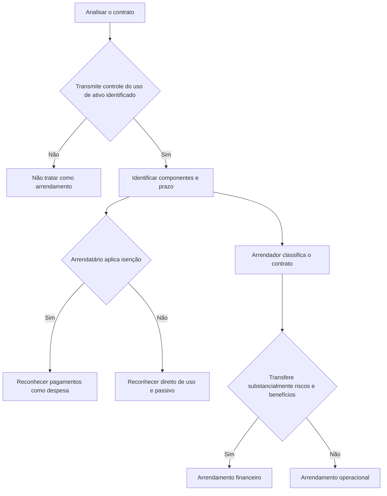

# NBC TG 06 (R3) — Arrendamentos

> [!abstract] Resumo em 30 segundos
> A NBC TG 06 estabelece como identificar, reconhecer, mensurar, apresentar e divulgar arrendamentos. Para o **arrendatário**, a regra geral é reconhecer, na data de início, um **ativo de direito de uso** e um **passivo de arrendamento**. Há expedientes opcionais para arrendamentos de curto prazo e de ativos subjacentes de baixo valor. Para o **arrendador**, cada contrato é classificado como financeiro ou operacional, conforme a transferência substancial dos riscos e benefícios da propriedade.

## Ficha rápida

| Campo | Síntese |
|---|---|
| Norma | NBC TG 06 (R3) — Arrendamentos |
| Finalidade | Fornecer informação relevante que represente fielmente os efeitos dos arrendamentos sobre posição financeira, desempenho e fluxos de caixa |
| Aplicação | Arrendatários e arrendadores, ressalvadas as exclusões expressas |
| Regra central para o arrendatário | Reconhecer ativo de direito de uso e passivo de arrendamento |
| Vigência indicada no texto | A vigência é definida pelos órgãos reguladores que aprovarem a norma. Para pleno atendimento às normas internacionais, o texto prevê aplicação a períodos anuais iniciados em ou após 1º de janeiro de 2019 (C1). |

## Objetivo e alcance

A norma aplica-se, em geral, a arrendamentos, inclusive a ativos de direito de uso em subarrendamento. Estão fora de seu alcance:

- arrendamentos para explorar ou usar minerais, petróleo, gás natural e recursos não renováveis similares;
- ativos biológicos no alcance da NBC TG 29, mantidos pelo arrendatário;
- acordos de concessão de serviço no alcance da ITG 01;
- licenças de propriedade intelectual concedidas pelo arrendador no alcance da NBC TG 47; e
- direitos do arrendatário previstos em determinados contratos de licenciamento no alcance da NBC TG 04, como os relativos a filmes, gravações, manuscritos, patentes e direitos autorais.

O arrendatário pode, mas não é obrigado a, aplicar a norma a arrendamentos de ativos intangíveis que não estejam na exclusão acima (itens 3–4; p. 2).

A entidade deve considerar os termos e condições do contrato e os fatos e circunstâncias relevantes. Deve aplicar a norma consistentemente a contratos com características e circunstâncias similares (item 2; p. 2).

## Conceitos-chave

- **Arrendamento:** contrato que transmite o direito de controlar o uso de um ativo identificado por um período, em troca de contraprestação. O período pode ser definido pela quantidade de uso do ativo (itens 9–10; p. 3).
- **Controle do uso:** a avaliação deve determinar se o contrato transmite ao cliente o direito de controlar o uso do ativo identificado. A norma traz orientação específica nos itens B9 a B31.
- **Componente de arrendamento:** deve ser contabilizado separadamente de componentes que não sejam de arrendamento, salvo aplicação do expediente prático permitido ao arrendatário (itens 12–16; p. 4).
- **Prazo do arrendamento:** prazo não cancelável, acrescido dos períodos de prorrogação quando for razoavelmente certo que o arrendatário exercerá a opção e dos períodos de rescisão quando for razoavelmente certo que não a exercerá (itens 18–21; pp. 4–5).
- **Ativo de direito de uso e passivo de arrendamento:** reconhecidos pelo arrendatário na data de início, salvo quando aplicável uma isenção de reconhecimento (item 22; p. 5).

## Diagrama de decisão

## Aplicação passo a passo e checklist

1. **Avalie o contrato na celebração.** Determine se ele é ou contém arrendamento. Reavalie essa conclusão somente se os termos e condições forem alterados (itens 9 e 11; p. 3).
2. **Identifique componentes.** Separe componentes de arrendamento e de não arrendamento. O arrendatário pode eleger, por classe de ativo subjacente, o expediente prático de contabilizar juntos os componentes associados; essa escolha não se aplica a derivativos embutidos que atendam aos critérios indicados na NBC TG 48 (itens 12–16; p. 4).
3. **Determine o prazo.** Considere opções de prorrogação e rescisão com base nos incentivos econômicos e nos fatos e circunstâncias relevantes. Reavalie a conclusão quando ocorrer evento ou mudança significativa dentro do controle do arrendatário que afete a avaliação (itens 18–21; pp. 4–5).
4. **Verifique as isenções do arrendatário.** Pode-se optar por não aplicar os requisitos de reconhecimento e mensuração a arrendamentos de curto prazo e a arrendamentos cujo ativo subjacente seja de baixo valor. A escolha para curto prazo é por classe de ativo; para baixo valor, pode ser feita contrato a contrato (itens 5–8; p. 3).
5. **Mensure o reconhecimento inicial.** Na data de início, reconheça o ativo de direito de uso e o passivo, se não aplicada uma isenção (itens 22–28; pp. 5–6).
6. **Acompanhe a mensuração subsequente.** Deprecie o ativo, reconheça juros no passivo e registre pagamentos. Avalie remensurações por mudanças no prazo, em opções, em garantias de valor residual, em índices ou taxas e por modificações contratuais (itens 29–46; pp. 7–10).
7. **Apresente e divulgue.** Verifique separação ou identificação em notas das rubricas de direito de uso e passivos, classificação dos fluxos de caixa e informações quantitativas e qualitativas exigidas (itens 47–60; pp. 10–13).

> [!tip] Expedientes opcionais não são isenções gerais
> A norma permite opções específicas para curto prazo, baixo valor e separação de componentes. Documente a política escolhida e aplique-a conforme a base definida para cada expediente.

## Reconhecimento e mensuração

### Arrendatário

**Mensuração inicial do ativo de direito de uso:** custo composto pelo valor inicial do passivo, pagamentos feitos até a data de início menos incentivos recebidos, custos diretos iniciais e, quando aplicável, estimativa dos custos de desmontagem, remoção ou restauração. Os custos relacionados à produção de estoques seguem a NBC TG 16; as obrigações são reconhecidas e mensuradas conforme a NBC TG 25 (itens 23–25; pp. 5–6).

**Mensuração inicial do passivo:** valor presente dos pagamentos ainda não efetuados na data de início. Use a taxa de juros implícita no arrendamento, se puder ser determinada imediatamente; caso contrário, use a taxa incremental sobre empréstimo do arrendatário (item 26; p. 6).

Em geral, entram no passivo pagamentos fixos, pagamentos variáveis vinculados a índice ou taxa, valores esperados devidos por garantias de valor residual, preço de exercício de opção de compra quando seu exercício for razoavelmente certo e multas de rescisão quando o prazo refletir o exercício dessa opção (itens 27–28; p. 6).

**Mensuração subsequente:**

- O modelo de custo é a regra geral: custo menos depreciação acumulada e perdas por redução ao valor recuperável, ajustado por remensurações especificadas do passivo.
- A depreciação segue a NBC TG 27. Se houver transferência de propriedade ou exercício razoavelmente certo da opção de compra, deprecia-se até o fim da vida útil do ativo subjacente; caso contrário, até o que ocorrer primeiro entre o fim da vida útil do ativo de direito de uso e o fim do prazo do arrendamento.
- A redução ao valor recuperável segue a NBC TG 01.
- O passivo aumenta pelos juros, diminui pelos pagamentos e é remensurado nas circunstâncias previstas pela norma. Juros e pagamentos variáveis não incluídos no passivo são reconhecidos no resultado, salvo quando outra norma exigir que os custos componham outro ativo (itens 29–43; pp. 7–9).
- A modificação pode ser arrendamento separado se ampliar o alcance com direito a outro ativo subjacente e a contraprestação aumentar em valor compatível com o preço individual ajustado. Caso contrário, aplicam-se os procedimentos de remensuração e ajuste do ativo previstos nos itens 45–46 (pp. 9–10).

### Arrendador

Classifique cada arrendamento como financeiro se transferir substancialmente os riscos e benefícios inerentes à propriedade do ativo subjacente; caso contrário, classifique-o como operacional. A classificação considera a essência da transação. A norma lista situações e indicadores, mas ressalva que eles nem sempre são conclusivos (itens 61–66; pp. 13–14).

- **Financeiro:** reconheça, na data de início, um recebível pelo valor equivalente ao investimento líquido no arrendamento. Reconheça receita financeira ao longo do prazo com padrão que reflita taxa de retorno periódica constante (itens 67–77; pp. 15–16).
- **Operacional:** mantenha o ativo subjacente no balanço e reconheça os recebimentos como receita pelo método linear ou por outra base sistemática que melhor represente a diminuição do benefício do uso. Reconheça como despesa os custos incorridos para gerar a receita (itens 81–88; pp. 17–18).

## Apresentação

Para o arrendatário, ativos de direito de uso e passivos de arrendamento devem ser apresentados separadamente ou identificados nas notas quanto às rubricas em que estão incluídos. Ativos que atendam à definição de propriedade para investimento são apresentados como tal. Na demonstração do resultado, juros do passivo são separados da depreciação do ativo de direito de uso. Nos fluxos de caixa, principal é atividade de financiamento; juros seguem os requisitos da NBC TG 03; pagamentos de curto prazo, baixo valor e variáveis não incluídos no passivo são atividades operacionais (itens 47–50; pp. 10–11).

Para o arrendador, ativos subjacentes sujeitos a arrendamentos operacionais são apresentados conforme sua natureza (item 88; p. 18).

## Divulgação

O arrendatário divulga, em nota única ou seção própria, informações para permitir que usuários avaliem os efeitos dos arrendamentos. Entre os valores do período estão depreciação por classe de ativo, juros, despesas de curto prazo e baixo valor, pagamentos variáveis fora do passivo, receita de subarrendamento, saídas totais de caixa, adições a ativos de direito de uso, ganhos ou perdas em venda e retroarrendamento e valores contábeis finais por classe (itens 51–54; pp. 11–12). Também divulga análise de vencimento dos passivos separadamente de outros passivos financeiros e informações adicionais relevantes sobre opções, garantias de valor residual, restrições, fluxos futuros e transações de venda e retroarrendamento (itens 58–59; pp. 12–13).

O arrendador divulga valores relativos a arrendamentos financeiros e operacionais, além de informações sobre a natureza das atividades e a gestão de riscos associados aos direitos sobre ativos subjacentes. Para arrendamentos financeiros, divulga análise de vencimento e conciliação dos recebimentos não descontados com o investimento líquido; para operacionais, divulga recebimentos futuros não descontados (itens 89–97; pp. 18–19).

## Exceções e erros comuns

> [!warning] Atenção ao escopo
> Não conclua que todo contrato denominado “aluguel” é arrendamento. A definição depende do direito de controlar o uso de ativo identificado, e a análise é feita com base nos termos e circunstâncias relevantes.

- Confundir a isenção opcional com dispensa de contabilização: quando escolhida, a norma exige reconhecer os pagamentos como despesa linearmente ou por outra base sistemática que represente melhor o padrão do benefício (item 6; p. 3).
- Aplicar ao curto prazo uma escolha contrato a contrato: a escolha é por classe de ativo; para baixo valor, pode ser individual (item 8; p. 3).
- Incluir no passivo todos os pagamentos variáveis: a regra inicial inclui os vinculados a índice ou taxa; outros pagamentos variáveis não incluídos são reconhecidos no resultado quando ocorre o evento ou condição que os gera (itens 27–28 e 38; pp. 6–8).
- Tratar automaticamente como venda uma transferência seguida de retroarrendamento. É necessário avaliar os requisitos de venda da NBC TG 47. Se não for venda, vendedor-arrendatário mantém o ativo e reconhece passivo financeiro; comprador-arrendador não reconhece o ativo transferido e reconhece ativo financeiro (itens 98–103; pp. 19–20).
- Ignorar a redação sobre o expediente Covid-19: o PDF reproduz a condição original até 30 de junho de 2021 e a alteração da Revisão NBC 10, que estende a condição aos pagamentos devidos até 30 de junho de 2022. A opção depende também das demais condições do item 46B; não deve ser tratada como dispensa geral de avaliar modificações (itens 46A–46B; pp. 10–11).

## Conexões explícitas com outras normas

A NBC TG 06 remete, conforme a situação, à NBC TG 47 para alocação de contraprestação e avaliação de venda; à NBC TG 27 para depreciação e divulgações de imobilizado; à NBC TG 01 para redução ao valor recuperável; à NBC TG 03 para juros pagos nos fluxos de caixa; à NBC TG 25 para obrigações de restauração; à NBC TG 28 para propriedades para investimento; e à NBC TG 40 para análise de vencimento de passivos financeiros. As referências decorrem dos próprios requisitos da norma.

## Fonte

**PDF fornecido:** *NBC TG 06 (R3).pdf*. Síntese baseada no texto técnico da NBC TG 06 (R3) apresentado no documento. As páginas indicadas correspondem à paginação impressa no texto fornecido.
