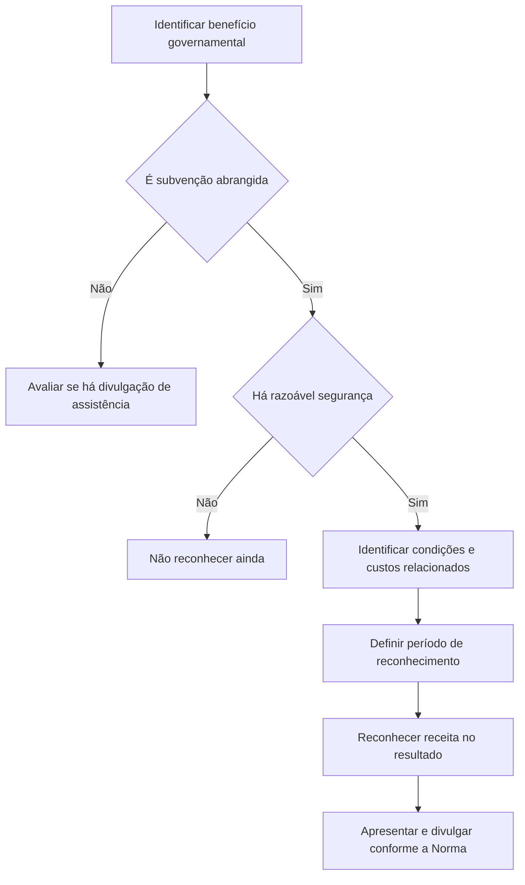

# NBC TG 07 (R2) — Subvenção e Assistência Governamentais

> [!abstract] Resumo em 30 segundos
> A NBC TG 07 disciplina o reconhecimento, a mensuração, a apresentação e a divulgação de subvenções governamentais e a divulgação de outras formas de assistência governamental. A subvenção só é reconhecida quando há razoável segurança de que a entidade cumprirá as condições e receberá o benefício. Em regra, é reconhecida como receita de forma sistemática, nos períodos em que são reconhecidos os custos que pretende compensar — não diretamente no patrimônio líquido.

## Ficha rápida

| Campo | Síntese |
|---|---|
| Norma | NBC TG 07 (R2) — Subvenção e Assistência Governamentais |
| Tema central | Contabilização de subvenções e divulgação de assistência governamental |
| Aplicação | Entidades que recebam subvenções ou se beneficiem de assistência governamental abrangida pela Norma |
| Princípio de reconhecimento | Razoável segurança quanto ao cumprimento das condições e ao recebimento |
| Apresentação | Receita no resultado; subvenções relacionadas a ativos também podem aparecer como receita diferida no passivo ou deduzir o ativo |
| Alteração identificável como R2 | Revisão do item 10A sobre empréstimos governamentais com juros abaixo do mercado |
| Vigência informada na resolução | A alteração R2 produz efeitos a partir de 1º de janeiro de 2018 |

> [!info] Sobre a identificação R2
> O texto técnico contém a regra atualizada do item 10A, que remete à NBC TG 48 para o empréstimo. A resolução de 2017 identifica essa alteração e informa sua data de efeitos. Esta nota prioriza o conteúdo técnico consolidado da Norma.

## Objetivo e alcance

A Norma estabelece como contabilizar e divulgar subvenções governamentais e como divulgar outras formas de assistência governamental (item 1). O objetivo prático é permitir que as demonstrações mostrem a natureza do benefício recebido, o período em que ele foi apropriado e as condições ainda associadas.

A Norma não trata:

- de questões de contabilização em demonstrações expressas em moeda de poder aquisitivo constante;
- de benefícios tributários que não tenham característica de subvenção, como depreciação acelerada ou redução de alíquota;
- da participação do governo no capital da entidade;
- de subvenções tratadas pela NBC TG 29 — Ativo Biológico e Produto Agrícola (item 2).

## Conceitos-chave

| Termo | Como entender |
|---|---|
| Assistência governamental | Ação governamental que fornece benefício econômico específico a uma entidade ou grupo que satisfaça critérios. Benefícios indiretos decorrentes de condições comerciais gerais não entram nessa definição. |
| Subvenção governamental | Assistência, geralmente pecuniária, concedida em troca do cumprimento passado ou futuro de condições relacionadas às atividades operacionais. |
| Subvenção relacionada a ativos | Subvenção cuja condição principal é adquirir, construir ou obter ativos de longo prazo. |
| Subvenção relacionada a resultado | Subvenção que não se enquadra como relacionada a ativos. |
| Empréstimo subsidiado | Empréstimo em que há renúncia total ou parcial ao principal ou aos juros, ou condições de custo abaixo das praticadas no mercado, sujeito a condições. |
| Valor justo | Preço que seria recebido pela venda de um ativo ou pago pela transferência de um passivo em transação não forçada entre participantes do mercado na data de mensuração. |

A contabilização deve refletir a essência econômica da assistência, independentemente de sua forma jurídica ou de como é recebida (itens 4 e 9). A simples entrada de recursos, por si só, não prova que as condições foram ou serão cumpridas (item 8).

## Aplicação passo a passo

### Checklist de trabalho

1. **Identifique a natureza do benefício.** Verifique se há transferência ou benefício econômico específico do governo e se a operação é distinguível de uma transação comercial normal.
2. **Leia todas as condições.** Separe requisitos já cumpridos, obrigações futuras e fatores externos que ainda precisem ocorrer.
3. **Avalie o reconhecimento.** Confirme que existe razoável segurança tanto do cumprimento das condições quanto do recebimento (itens 7–8).
4. **Determine o padrão de apropriação.** Relacione a subvenção às despesas ou aos custos que pretende compensar; identifique se há mais de uma condição e se partes do benefício exigem bases distintas.
5. **Classifique a subvenção.** Determine se é relacionada a ativo ou a resultado e escolha a apresentação prevista para a categoria.
6. **Registre e divulgue.** Aplique a política de apresentação de forma consistente com a natureza do benefício e divulgue condições e contingências relevantes.
7. **Reavalie se houver devolução ou mudança nas condições.** Se a subvenção precisar ser reembolsada, aplique o tratamento do item 32 e avalie eventual perda do ativo conforme o item 33.

## Reconhecimento e mensuração

### Regra geral e apropriação da receita

A subvenção é reconhecida como receita ao longo do período e confrontada, em base sistemática, com as despesas que pretende compensar, desde que atendidas as condições da Norma (item 12). O recebimento não determina automaticamente o período de reconhecimento.

- **Ativo depreciável:** aproprie a receita ao longo da vida útil do bem, na mesma proporção da depreciação (item 17).
- **Ativo não depreciável com obrigações:** reconheça a receita conforme forem apropriadas as despesas necessárias ao cumprimento das obrigações (item 18).
- **Pacote com várias condições:** identifique quais condições geram custos e em quais períodos eles ocorrem; pode ser necessário alocar partes da subvenção por critérios diferentes (item 19).
- **Compensação de gasto ou perda já incorridos, ou suporte sem despesa futura relacionada:** reconheça como receita no período em que se tornar recebível (itens 20–22).

A receita de subvenção não deve ser creditada diretamente no patrimônio líquido. Se houver exigência de que o valor não seja distribuído aos sócios ou acionistas, depois de transitar pelo resultado pode ser destinado a reserva própria, como reserva de incentivos fiscais, a partir de lucros ou prejuízos acumulados (itens 15A–15B).

### Empréstimo governamental abaixo do mercado

O empréstimo é reconhecido e mensurado conforme a NBC TG 48. O benefício econômico correspondente à taxa de juros abaixo da praticada no mercado é a diferença entre o valor contábil inicial do empréstimo, apurado segundo essa norma, e o montante recebido. Esse benefício é tratado como subvenção. Ao identificar os custos que ele pretende compensar, a entidade considera as condições e obrigações que foram ou devem ser atendidas (item 10A).

Para subsídio em empréstimo, a Norma também exige segurança de que a entidade cumprirá os compromissos assumidos. Quando o cumprimento depende de fatores externos — por exemplo, volume de vendas ou nível de emprego —, o reconhecimento deve aguardar o cumprimento do compromisso (item 10).

### Ativo não monetário e casos tributários previstos

- **Ativo não monetário recebido:** reconheça o ativo e a subvenção pelo valor justo. Use o valor nominal somente se não for possível verificar o valor justo (item 23).
- **Aplicação de parcela do imposto de renda em fundo regional:** a destinação é tratada como subvenção; atendidas as condições, o registro é pelo valor justo no momento do fato gerador, identificado no texto como o pagamento da parcela do imposto. A mensuração considera a melhor estimativa e pode haver deságio frente ao valor nominal (itens 38A–38C).
- **Redução ou isenção de imposto de renda em área incentivada:** o texto determina registrar o imposto total no resultado como se devido fosse, em contrapartida à receita de subvenção equivalente, demonstrados um deduzido do outro (itens 38D–38E).

### Devolução da subvenção

O reembolso é tratado como revisão de estimativa contábil. Primeiro, reduz eventual crédito diferido não amortizado relacionado à subvenção; o excedente, ou o reembolso sem crédito diferido, é reconhecido imediatamente como despesa. Para subvenção ligada a ativo, ajusta-se o valor escriturado do ativo ou reduz-se a receita diferida. A depreciação adicional que teria sido reconhecida sem a subvenção é reconhecida imediatamente como despesa (item 32). A devolução pode ainda indicar perda de valor do ativo, a avaliar segundo a NBC TG 01 (item 33).

## Apresentação

### No balanço patrimonial

Para subvenção relacionada a ativo, a entidade pode apresentá-la:

1. como receita diferida no passivo, reconhecida em resultado de forma sistemática durante a vida útil do ativo; ou
2. deduzida do valor contábil do ativo, reconhecendo a subvenção em resultado durante a vida do ativo depreciável, por meio de crédito à despesa de depreciação.

Os dois métodos são descritos nos itens 24–27. Movimentos relevantes de compra de ativos e recebimento da subvenção relacionada podem ser divulgados separadamente na demonstração dos fluxos de caixa, para evidenciar o investimento bruto, independentemente da apresentação escolhida no balanço (item 28).

### Na demonstração do resultado

A subvenção relacionada a resultado pode ser apresentada como crédito, separadamente, ou como dedução da despesa relacionada. Em ambos os casos, o registro deve ocorrer no grupo de contas compatível com sua natureza. A escolha da forma de apresentação não elimina a necessidade de divulgar o efeito da subvenção quando a receita ou despesa relacionada for apresentada separadamente (itens 29–31).

## Divulgação

A entidade deve divulgar (item 39):

- a política contábil aplicada às subvenções e os métodos de apresentação adotados;
- a natureza e a extensão das subvenções e assistências reconhecidas, além de indicar outras formas de assistência de que tenha se beneficiado diretamente;
- as condições que devem ser satisfeitas regularmente e outras contingências ligadas à assistência reconhecida.

Quando o benefício puder ser material, a divulgação de sua natureza, extensão e duração pode ser necessária para evitar que as demonstrações sejam enganosas (item 36). Para subvenções de suporte financeiro imediato ou destinadas a perdas de períodos anteriores, o texto também requer divulgação adequada dos efeitos (itens 21–22).

## Exceções e erros comuns

> [!warning] Pontos de atenção
> - **Reconhecer no recebimento sem avaliar condições:** o recebimento não é prova conclusiva de cumprimento.
> - **Creditar diretamente no patrimônio líquido:** a subvenção deve transitar pelo resultado; eventual reserva própria ocorre depois do reconhecimento no resultado, quando aplicável.
> - **Reconhecer tudo no resultado de uma vez:** isso só é admitido quando não houver base para alocar a subvenção aos períodos beneficiados, ou nos casos de suporte imediato descritos pela Norma.
> - **Confundir assistência com subvenção:** assistência sem valor razoavelmente atribuível, ou indistinguível de operações comerciais normais, não é tratada como subvenção; pode, conforme sua materialidade, exigir divulgação.
> - **Omitir benefícios não monetários ou tributários:** a forma do benefício não afasta a análise de reconhecimento e divulgação prevista na Norma.

A assistência técnica ou comercial gratuita e a concessão de garantias são exemplos de benefícios cujo valor pode não ser razoavelmente atribuível. Infraestruturas disponíveis de forma contínua e indeterminada para benefício de toda a comunidade local são excluídas da assistência abrangida nos termos descritos pela Norma (itens 34–38).

## Conexões com outras normas

- **NBC TG 48 — Instrumentos Financeiros:** mensuração do empréstimo governamental com taxa abaixo do mercado (item 10A).
- **NBC TG 25 — Provisões, Passivos Contingentes e Ativos Contingentes:** tratamento de contingências relacionadas depois do reconhecimento da subvenção (item 11).
- **NBC TG 23 — Políticas Contábeis, Mudança de Estimativa e Retificação de Erro:** devolução da subvenção tratada como revisão de estimativa contábil (item 32).
- **NBC TG 01 — Redução ao Valor Recuperável de Ativos:** avaliação de perda de valor do ativo quando a devolução da subvenção relacionada ao ativo assim exigir (item 33).

## Fonte

**NBC TG 07 (R2) — Subvenção e Assistência Governamentais**, PDF fornecido. Síntese baseada no texto técnico da Norma; referências a itens e páginas foram incluídas apenas onde identificáveis no documento. A informação de efeitos a partir de 1º de janeiro de 2018 consta da resolução de alteração reproduzida no PDF.
