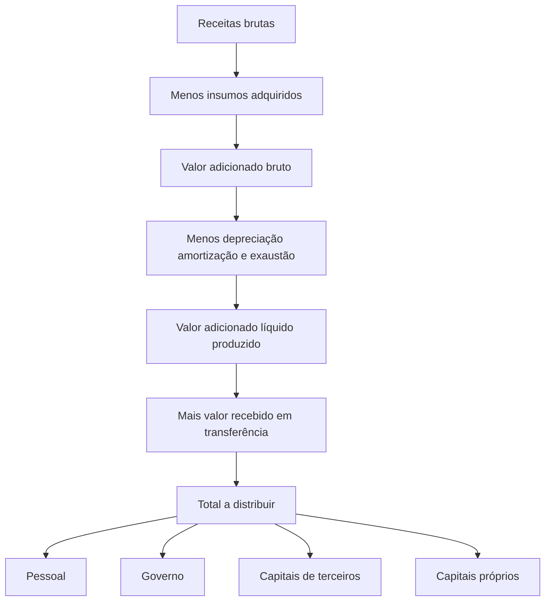

# NBC TG 09 (R1) — Demonstração do Valor Adicionado (DVA)

> [!abstract] Resumo em 30 segundos
> A DVA evidencia a riqueza criada pela entidade no período e como ela foi distribuída entre pessoal, governo, financiadores externos e proprietários. Em geral, sua elaboração parte da Demonstração do Resultado do Período, mas exige reclassificações e critérios próprios — em especial para apresentar receitas e insumos brutos dos tributos incidentes. A distribuição total deve ser igual ao valor adicionado total a distribuir.

## Ficha rápida

| Campo | Síntese |
|---|---|
| Norma | NBC TG 09 (R1) — Demonstração do Valor Adicionado |
| Ato identificável no PDF | Norma aprovada pelo CFC em 7 de dezembro de 2023 |
| Aplicação indicada no texto | Exercícios sociais iniciados em ou após 1º de janeiro de 2024 |
| Apresentação | Parte integrante das demonstrações contábeis divulgadas ao fim de cada exercício social |
| Modelos | Geral; instituições financeiras bancárias; seguradoras e resseguradoras |
| Base principal | Demonstração do Resultado do Período, com ajustes e classificações próprios da DVA |

> [!info] Disposição transitória
> O item 34 informa que a norma entra em vigor em 1º de março de 2024 e se aplica aos exercícios sociais iniciados em ou após 1º de janeiro de 2024. Também permite adoção antecipada para entidades com contratos no escopo da NBC TG 50. O mesmo item identifica a revogação das Resoluções CFC nº 1.138/2008 e nº 1.162/2009.

## Objetivo e alcance

A norma estabelece critérios para elaborar e apresentar a DVA, que evidencia a riqueza criada pela entidade e sua distribuição durante determinado período. A demonstração fornece informações econômicas e pode contribuir para a comunicação de aspectos ambientais, sociais e de governança (ASG) (itens 1–2).

A entidade deve apresentar a DVA como parte integrante de suas demonstrações contábeis ao final de cada exercício social. A DVA consolidada é elaborada com base nas demonstrações consolidadas e evidencia a participação dos sócios não controladores conforme o modelo (itens 3–4).

As entidades mercantis e prestadoras de serviços utilizam o Modelo I. Instituições financeiras bancárias utilizam o Modelo II; seguradoras e resseguradoras, o Modelo III. Os modelos são indicativos: a norma admite detalhamento adicional para ampliar a transparência.

A DVA tem base contábil e segue, portanto, o regime de competência e os padrões usados na produção dos dados contábeis. Não deve ser interpretada como cálculo idêntico ao PIB: os critérios econômicos e contábeis podem produzir valores diferentes em um mesmo período.

## Conceitos-chave

| Conceito | Significado prático |
|---|---|
| Valor adicionado | Riqueza criada, em geral medida pela diferença entre vendas e insumos adquiridos de terceiros, acrescida do valor recebido em transferência. |
| Insumos adquiridos de terceiros | Aquisições de matérias-primas, mercadorias, materiais, energia e serviços que se tornaram despesas no período. Itens ainda mantidos em estoque não integram a formação da riqueza do período. |
| Valor adicionado recebido em transferência | Riqueza criada por terceiros e transferida à entidade, como receitas financeiras, equivalência patrimonial, dividendos e aluguéis. Deve ser destacada para evitar dupla contagem em agregações. |
| Outras receitas | Incluem, entre outros, resultados na alienação de ativos não circulantes e ajustes de mensuração de ativos não monetários. Podem apresentar sinal negativo. |
| Distribuição da riqueza | Destinação do valor adicionado a pessoal, governo, financiadores externos e proprietários. |

A DVA apresenta dois blocos: formação da riqueza e distribuição. Para o modelo geral, a estrutura pode ser resumida assim:

```text
Receitas menos insumos
          ↓
Valor adicionado bruto
          ↓
Menos depreciação, amortização e exaustão
          ↓
Valor adicionado líquido produzido
          ↓
Mais valor recebido em transferência
          ↓
Valor adicionado total a distribuir
          ↓
Pessoal, governo, terceiros e proprietários
```



> [!warning] Conferência essencial
> O total distribuído deve ser exatamente igual ao valor adicionado total a distribuir. Essa igualdade é indicada nos modelos anexos e decorre da consistência entre a formação e a destinação da riqueza.

## Aplicação passo a passo — checklist

- [ ] **Identifique o modelo aplicável:** geral, bancário ou de seguros e resseguros.
- [ ] **Parta dos dados contábeis do período**, principalmente da Demonstração do Resultado do Período.
- [ ] **Reúna as receitas de formação da riqueza** e apresente-as pelo valor bruto, incluindo os tributos incidentes quando aplicável.
- [ ] **Apure os insumos efetivamente transformados em despesas no período.** Não inclua itens que ainda permaneçam em estoque.
- [ ] **Reclassifique as despesas por natureza:** pessoal próprio não é insumo adquirido de terceiros; depreciação, amortização e exaustão aparecem em linha própria.
- [ ] **Inclua o valor adicionado recebido em transferência** nas linhas correspondentes, mantendo-o separado da riqueza produzida pela própria entidade.
- [ ] **Distribua o total** entre pessoal, impostos, taxas e contribuições, capitais de terceiros e capitais próprios.
- [ ] **Confira a igualdade dos totais** entre valor adicionado a distribuir e valor distribuído.
- [ ] **Na consolidação, evidencie a participação dos não controladores** conforme o modelo.
- [ ] **Apresente comparativos ajustados**, quando houver ajustes de exercícios anteriores, conforme o tratamento descrito pela norma.

## Reconhecimento e mensuração

### Formação da riqueza — modelo geral

O grupo de receitas inclui a receita de contrato com cliente, outras receitas, receitas relativas à construção de ativos próprios e perdas estimadas com créditos de liquidação duvidosa — reversão ou constituição. As receitas devem incluir os tributos incidentes quando aplicável, ainda que esses tributos apareçam de forma diferente na Demonstração do Resultado do Período.

Os insumos adquiridos de terceiros incluem custos de produtos, mercadorias e serviços vendidos, materiais, energia e serviços de terceiros. Devem incorporar os tributos incluídos nas compras — recuperáveis ou não —, procedimento diferente do adotado na Demonstração do Resultado do Período. Valores de insumos que ainda estejam em estoque não compõem a riqueza do período.

A estrutura de cálculo do modelo geral é:

- **Valor adicionado bruto** = receitas − insumos adquiridos de terceiros.
- **Valor adicionado líquido produzido** = valor adicionado bruto − depreciação, amortização e exaustão.
- **Valor adicionado total a distribuir** = valor adicionado líquido produzido + valor adicionado recebido em transferência.

As perdas e recuperações de valores ativos reconhecidas no resultado são apresentadas entre os insumos adquiridos de terceiros. Se o valor líquido do período for positivo, deve ser somado. O resultado de equivalência patrimonial também pode ser negativo e, nessa hipótese, reduz o valor adicionado recebido em transferência. Ajustes positivos ou negativos de mensuração de ativos não monetários são incluídos em outras receitas; a norma admite que essa linha tenha sinal negativo.

### Distribuição da riqueza

A distribuição mínima detalha:

- **Pessoal:** remuneração direta, benefícios e FGTS.
- **Impostos, taxas e contribuições:** segregados entre federais, estaduais e municipais. Para tributos compensáveis, consideram-se os valores devidos ou recolhidos, observada a diferença entre tributos incidentes sobre receitas e sobre insumos.
- **Remuneração de capitais de terceiros:** juros, aluguéis e outras remunerações, como royalties e franquias.
- **Remuneração de capitais próprios:** JCP, dividendos e lucros retidos ou prejuízos do exercício.

O total destinado aos capitais próprios deve corresponder ao resultado líquido do exercício reportado na Demonstração do Resultado do Período. Dividendos e JCP devem ser atribuídos ao resultado do próprio período: distribuições com base em lucros de exercícios anteriores não são incluídas novamente, pois esses lucros já foram tratados como retidos no período em que foram gerados. Prejuízo do exercício é apresentado com sinal negativo.

### Situações específicas

- **Ativos construídos para uso próprio:** durante a construção, o valor contábil integral é tratado como receita relativa à construção de ativos próprios. Os custos são alocados segundo sua natureza; mão de obra própria é distribuição da riqueza criada. Na entrada em operação, a depreciação recebe tratamento igual ao de outros ativos.
- **Juros capitalizados:** na construção de ativo para uso próprio, são refletidos na DVA quando capitalizados. Em estoques de longa maturação, são apresentados como remuneração de capitais de terceiros quando os estoques forem baixados.
- **Ajustes de exercícios anteriores:** a DVA comparativa deve ser adaptada para o período mais antigo apresentado e para os demais comparativos, como se a nova prática sempre tivesse sido aplicada ou o erro corrigido.
- **Substituição tributária:** na modalidade progressiva, o imposto antecipado é incluído no faturamento bruto e depois deduzido para chegar à receita bruta. Na regressiva, o tratamento depende do direito a crédito: quando houver, o tributo é tratado como imposto a recuperar; quando não houver, como custo dos estoques.

### Modelos específicos

Na atividade bancária, as despesas de intermediação financeira integram a formação da riqueza, e não sua distribuição. O valor adicionado bruto resulta das receitas, incluindo as de intermediação, menos as despesas de intermediação financeira e os insumos adquiridos de terceiros.

Em seguros e resseguros, sinistros retidos e despesas com benefícios e resgates são deduzidos das receitas. O modelo inclui rubricas próprias para operações de seguros e resseguros emitidos e para resultados com operações de resseguros mantidos.

## Divulgação

A DVA deve acompanhar as demonstrações contábeis divulgadas ao fim de cada exercício social. A demonstração consolidada deve evidenciar a participação dos sócios não controladores. Os modelos apresentam colunas para o período atual e o comparativo, e permitem maior detalhamento quando isso favorecer a transparência.

A análise da DVA pode mostrar como a riqueza se distribui entre empregados, governo, credores e proprietários, e como essa distribuição evolui ao longo do tempo. O texto também relaciona a demonstração à geração de informações ASG e de sustentabilidade, sem substituir outras informações dessa natureza.

## Exceções e erros comuns

> [!danger] Evite estes erros
> - Usar diretamente o CMV, CPV ou CSP da demonstração do resultado sem separar as naturezas que pertencem a outros grupos da DVA.
> - Apresentar receitas ou insumos líquidos dos tributos incidentes, contrariando a apresentação bruta prevista para a DVA.
> - Incluir no período aquisições que ainda permanecem em estoque.
> - Classificar juros e aluguéis indistintamente: a norma diferencia a apresentação conforme os critérios de reconhecimento de arrendamentos.
> - Somar dividendos de lucros anteriores como se fossem distribuição da riqueza do período.
> - Desconsiderar valores negativos em outras receitas, equivalência patrimonial ou prejuízos quando o tratamento da norma requer sua apresentação com sinal negativo.
> - Deixar de conferir a igualdade entre o valor adicionado total a distribuir e o total distribuído.

## Conexões com outras normas

- **NBC TG Estrutura Conceitual para Relatório Financeiro:** a elaboração da DVA deve levá-la em conta (item 2).
- **NBC TG 01 — Redução ao Valor Recuperável de Ativos:** indicada no tratamento de perdas e recuperações de valores ativos.
- **NBC TG 06:** citada na classificação de aluguéis e nos critérios de reconhecimento de arrendamentos.
- **NBC TG 50 — Contratos de Seguro:** mencionada na permissão de adoção antecipada e no modelo adaptado para seguradoras e resseguradoras.

## Fonte

**NBC TG 09 (R1) — Demonstração do Valor Adicionado**, conforme o texto do PDF fornecido. Referências aos itens e páginas seguem a numeração e a paginação nele apresentadas: objetivo e alcance (itens 1–8, pp. 1–2); definições e formação/distribuição da riqueza (itens 9–15, pp. 2–5); casos especiais (itens 16–27, pp. 6–8); modelos específicos (itens 28–33, pp. 8–12); disposições transitórias (item 34, p. 12); modelos (pp. 13–17); e documento explicativo sobre origem, conceitos, modelos e utilidade da DVA (pp. 18–28).
