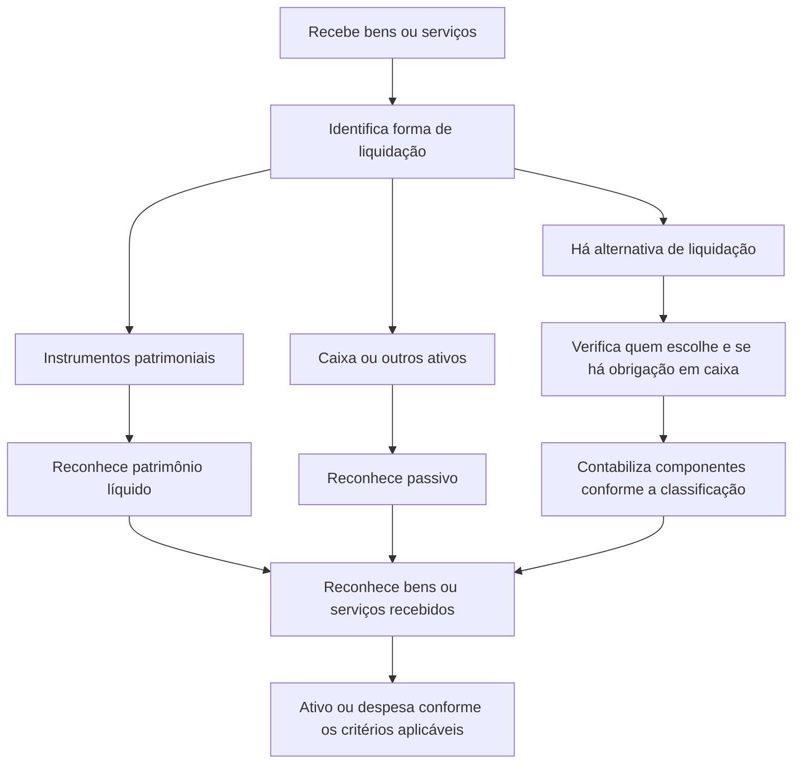

# NBC TG 10 (R3) — Pagamento Baseado em Ações

> [!abstract] Resumo em 30 segundos
> A NBC TG 10 determina como reconhecer e mensurar bens ou serviços recebidos em troca de pagamentos baseados em ações. A classificação da liquidação define a contrapartida: **patrimônio líquido** quando liquidada com instrumentos patrimoniais; **passivo**, remensurado periodicamente, quando liquidada em caixa ou outros ativos. O reconhecimento acompanha o recebimento dos bens ou serviços — e, para serviços sujeitos a período de aquisição de direito, ocorre ao longo desse período.

## Ficha rápida

| Aspecto | Síntese |
|---|---|
| Tema | Contabilização de transações com pagamento baseado em ações |
| Aplicação | Entidades que recebem ou adquirem bens ou serviços nesses acordos, observadas as exclusões |
| Efeito contábil | Reconhecimento de ativo ou despesa e, conforme a classificação, de patrimônio líquido ou passivo |
| Principal decisão | Identificar quem escolhe a forma de liquidação e se a entidade assume obrigação de pagar em caixa |
| Base de mensuração | Em geral, valor justo dos bens ou serviços recebidos ou dos instrumentos patrimoniais outorgados; em acordos liquidados em caixa, valor justo do passivo |
| Identificação da versão | A resolução identificada como NBC TG 10 (R3), de 24 de novembro de 2017, informa efeitos a partir de 1º de janeiro de 2018 para as alterações nela descritas |

## Objetivo e alcance

A norma estabelece procedimentos para reconhecer e divulgar transações com pagamento baseado em ações, de modo que seus efeitos sejam refletidos no resultado e no balanço patrimonial. Abrange transações:

- liquidadas pela entrega de instrumentos patrimoniais;
- liquidadas em caixa ou outros ativos; e
- em que a entidade ou a contraparte pode escolher a forma de liquidação.

A norma também pode se aplicar quando não há bens ou serviços especificamente identificáveis, mas outras circunstâncias indicam que foram ou serão recebidos. Em transações entre entidades do mesmo grupo, o item 3A direciona a aplicação à entidade que recebe os bens ou serviços ou à que tem a obrigação de liquidar, ressalvada a hipótese de a transação ter claramente outro propósito.

**Fora do alcance ou situações a distinguir:**

- direitos recebidos por alguém na condição de detentor de uma classe de instrumentos patrimoniais não são, por si só, transações com pagamento baseado em ações;
- determinadas aquisições de bens em combinações de negócios, reorganizações sob controle comum e contribuições de negócios para empreendimento controlado em conjunto são tratadas fora desta norma, conforme o item 5; instrumentos concedidos a empregados da adquirida em troca de serviços pós-combinação podem permanecer no alcance;
- o item 6 exclui transações abrangidas pelos contratos especificados na NBC TG 39 e na NBC TG 48.

> [!warning] Valor justo
> A norma informa que usa “valor justo” de modo diferente em alguns aspectos da definição da NBC TG 46. Para suas transações, a mensuração deve seguir a NBC TG 10, não ser substituída automaticamente pela NBC TG 46 (item 6A).

## Conceitos-chave

- **Instrumento patrimonial:** instrumento entregue como forma de liquidação do acordo.
- **Transação liquidada em caixa:** a entidade assume passivo, mensurado pelo valor justo e remensurado até a liquidação.
- **Período de aquisição de direito:** intervalo de serviço ou de atendimento de condições necessário para que a contraparte adquira o direito aos instrumentos ou pagamentos.
- **Condição de mercado:** condição ligada, por exemplo, ao preço ou valor de mercado dos instrumentos patrimoniais. Para instrumentos patrimoniais, é considerada na estimativa do valor justo.
- **Condição de aquisição que não seja de mercado:** em geral, afeta a quantidade de instrumentos ou prêmios estimada para reconhecimento, e não o valor justo unitário na data de mensuração.
- **Valor intrínseco:** base alternativa permitida apenas nos casos raros em que não seja possível estimar confiavelmente o valor justo dos instrumentos patrimoniais outorgados (item 24).

## Diagrama de decisão

## Aplicação passo a passo — checklist

1. **Identifique o acordo e a contraparte.** Determine quais bens ou serviços foram ou serão recebidos e se há indícios de itens não identificáveis.
2. **Confirme o alcance.** Avalie as exclusões para combinações de negócios, direitos recebidos na condição de acionista e contratos abrangidos pelas normas de instrumentos financeiros.
3. **Determine a forma de liquidação.** Verifique se haverá entrega de instrumentos patrimoniais, pagamento em caixa ou uma alternativa entre ambos. Se houver escolha, identifique quem a detém e se a entidade tem obrigação presente de pagar em caixa.
4. **Defina a base de mensuração.** Para instrumentos patrimoniais, use o valor justo dos bens ou serviços recebidos quando mensurável com confiabilidade; nos casos descritos pela norma, use o valor justo dos instrumentos outorgados. Para liquidação em caixa, mensure o passivo pelo valor justo.
5. **Identifique as condições.** Separe condições de mercado das demais condições de aquisição e avalie como cada uma afeta a mensuração e a quantidade de instrumentos ou prêmios reconhecida.
6. **Determine o período de reconhecimento.** Reconheça serviços à medida que forem prestados. Se o direito for imediato e não houver evidência em contrário, reconheça os serviços na data da outorga.
7. **Registre a contrapartida adequada.** Reconheça aumento do patrimônio líquido ou passivo, conforme a classificação. Avalie se os bens ou serviços atendem aos critérios para reconhecimento como ativo; caso contrário, reconheça despesa.
8. **Reavalie estimativas e passivos.** Revise a quantidade esperada de instrumentos ou prêmios quando aplicável. Remensure passivos liquidados em caixa ao fim de cada período de reporte e na liquidação.
9. **Avalie alterações, cancelamentos e divulgações.** Aplique os requisitos específicos para modificações e considere informações adicionais necessárias para explicar os efeitos da transação.

## Reconhecimento e mensuração

### Regra geral

A entidade reconhece os bens quando os obtém e os serviços à medida que os recebe. A contrapartida é:

- **patrimônio líquido**, para transação liquidada em instrumentos patrimoniais;
- **passivo**, para transação liquidada em caixa ou outros ativos.

Se os bens ou serviços não se qualificarem como ativos, são reconhecidos como despesa. Produtos consumidos ao longo do tempo, ou estoques vendidos posteriormente, geram despesa quando consumidos ou vendidos, salvo quando não puderem ser reconhecidos como ativo.

### Liquidação em instrumentos patrimoniais

A mensuração é direta pelo valor justo dos bens ou serviços quando esse valor puder ser estimado com confiabilidade. Para empregados e prestadores de serviços similares, a norma prevê mensuração indireta pelo valor justo dos instrumentos outorgados, normalmente na data da outorga. Para outras contrapartes, presume-se que o valor justo dos bens ou serviços possa ser mensurado confiavelmente; a presunção pode ser refutada em casos raros.

Quando os serviços dependem de período de aquisição de direito, reconheça-os ao longo do período, com base na melhor estimativa da quantidade de instrumentos que se espera adquirir. Revise a estimativa conforme novas informações e, na data de aquisição, ajuste-a à quantidade efetivamente adquirida.

Para condições de aquisição que **não sejam de mercado**, ajuste a quantidade de instrumentos considerada. Se o direito não for adquirido por descumprimento dessas condições, em geral nenhum valor é reconhecido cumulativamente pelos bens ou serviços relacionados. Já condições de mercado são consideradas na mensuração do valor justo; o reconhecimento dos serviços pode prosseguir se as demais condições de aquisição forem satisfeitas.

Depois da aquisição de direito, a entidade não reverte o valor reconhecido apenas porque os instrumentos expiram ou não são exercidos. Modificações que aumentem o valor justo ou beneficiem a contraparte têm tratamento próprio. Cancelamento ou liquidação durante o período de aquisição pode acelerar o reconhecimento dos serviços remanescentes, conforme as condições da norma.

### Liquidação em caixa e situações especiais

O passivo é mensurado inicialmente e, até ser liquidado, pelo valor justo. A remensuração ocorre ao término de cada período de reporte e na liquidação; as variações vão para o resultado. Para condições que não sejam de mercado, ajusta-se a quantidade de prêmios considerada, enquanto condições de mercado e condições de não aquisição indicadas no item 33C são consideradas no valor justo.

Se os termos permitirem escolha entre caixa e instrumentos patrimoniais, a contabilização depende de quem pode escolher e da existência de obrigação da entidade em caixa. Quando a contraparte escolhe, a norma trata o acordo como instrumento financeiro composto, com componente de dívida e, se aplicável, componente patrimonial; os bens ou serviços são reconhecidos separadamente por componente.

A norma também prevê tratamento específico para retenção de instrumentos patrimoniais destinada ao recolhimento de tributos do empregado. A classificação integral como liquidada em ações depende dos requisitos dos itens 33E a 33H; retenções em excesso da obrigação tributária não recebem automaticamente esse tratamento.

## Divulgação

A norma exige divulgação das informações pertinentes às transações com pagamento baseado em ações. O item 52 determina que sejam fornecidas informações adicionais quando as exigências de divulgação não forem suficientes para atender aos princípios mencionados nos itens 44, 46 e 50. O exemplo do item 52 trata da estimativa do valor a transferir à autoridade fiscal quando necessário para informar usuários sobre efeitos futuros nos fluxos de caixa.

**Limite deste resumo:** o texto disponibilizado não reproduz integralmente os itens 44 a 51; por isso, não é possível apresentar aqui um checklist completo das divulgações específicas sem extrapolar a fonte.

## Exceções e erros comuns

> [!danger] Evite estes tratamentos
> - Classificar toda transação baseada em ações como patrimônio líquido: acordos liquidados em caixa geram passivo.
> - Levar condições de aquisição que não sejam de mercado ao valor justo unitário dos instrumentos patrimoniais, em vez de ajustar a quantidade considerada.
> - Deixar de remensurar passivos de acordos liquidados em caixa.
> - Reverter, após a aquisição de direito, valores reconhecidos por serviços apenas porque a opção expirou ou não foi exercida.
> - Aplicar automaticamente a definição de valor justo da NBC TG 46 à mensuração regida pela NBC TG 10.

> [!tip] Controle prático
> Mantenha documentação do acordo, da forma de liquidação, das condições, do período de serviço, das estimativas de aquisição de direito, dos cálculos de valor justo e das revisões feitas em cada período de reporte.

## Conexões com outras normas

- **NBC TG 15 — Combinação de Negócios:** ajuda a distinguir instrumentos emitidos para obter controle daqueles concedidos em troca de serviços pós-combinação; a NBC TG 10 alcança, entre outros casos, instrumentos concedidos a empregados da adquirida em troca de continuidade dos serviços.
- **NBC TG 19 — Negócios em Conjunto:** citada no tratamento de contribuições de negócios para empreendimento controlado em conjunto, excluídas do alcance da NBC TG 10 nas circunstâncias descritas no item 5.
- **NBC TG 39 e NBC TG 48:** o item 6 exclui determinadas transações com bens ou serviços realizadas por força de contratos dentro do alcance dessas normas.
- **NBC TG 46 — Mensuração do Valor Justo:** a própria NBC TG 10 esclarece que sua aplicação do termo valor justo difere em alguns aspectos.

## Fonte

**NBC TG 10 (R3) — Pagamento Baseado em Ações**, conforme o texto fornecido do PDF *NBC TG 10 (R3).pdf*. Referências a itens foram incluídas quando confirmáveis no material disponibilizado.
