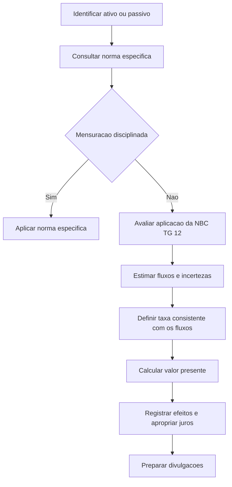

# NBC TG 12 (R1) — Ajuste a Valor Presente

> [!abstract] Resumo em 30 segundos
> A NBC TG 12 (R1) orienta a mensuração de ativos e passivos a valor presente. O ajuste deve refletir os fluxos de caixa estimados, o valor do dinheiro no tempo e os riscos pertinentes, com premissas neutras e consistentes. A norma trata de mensuração, não decide quando reconhecer um item: regras específicas prevalecem quando disciplinam a mensuração. Para aplicar o ajuste, considere também a relevância do efeito, a materialidade em operações de curto prazo e a qualidade das estimativas.

## Ficha rápida

| Campo | Informação |
|---|---|
| Norma | NBC TG 12 (R1) — Ajuste a Valor Presente |
| Aprovação indicada no texto | 20 de setembro de 2023 |
| Grupo | 02 - NBC TG |
| Tema central | Mensuração de ativos e passivos a valor presente |
| Vigência indicada no texto | 1º de novembro de 2023 |
| Documento-base | NBC TG 12 (R1).pdf |

## Objetivo e alcance

A norma busca esclarecer requisitos para apurar o ajuste a valor presente de elementos do ativo e do passivo nas demonstrações contábeis. Entre as questões que aborda estão os fluxos de caixa aplicáveis, a taxa de desconto, o tratamento de riscos e incertezas, a apropriação dos juros e os efeitos fiscais (item 1).

Seu foco é **mensurar**, isto é, determinar “por quanto registrar”. O reconhecimento — a decisão de “quando registrar” — não é disciplinado por esta norma (itens 5–6). Assim, a NBC TG 12 não substitui os critérios de reconhecimento previstos em outras normas.

Quando uma norma específica estabelecer como calcular o ajuste ou quais fluxos de caixa usar para determinado ativo ou passivo, seus requisitos prevalecem. A NBC TG 12 é aplicada nos aspectos não especificamente disciplinados por outra norma (item 4). Ela também pode ser considerada na mensuração subsequente, respeitados os requisitos específicos aplicáveis (item 6).

O ajuste a valor presente **não equivale necessariamente ao valor justo**. Se a mensuração for realizada como valor justo, aplica-se integralmente a NBC TG 46; nos demais casos, observam-se as normas específicas pertinentes e, quando aplicável, a NBC TG 12 (item 7).

## Conceitos-chave

- **Valor presente:** mensuração que considera fluxos de caixa futuros e o valor do dinheiro no tempo.
- **Incerteza e risco:** a estimativa pode exigir considerar variações possíveis no valor e no momento dos fluxos de caixa, além do prêmio necessário para suportar a incerteza (itens 9 e 17).
- **Taxa livre de risco:** representa o valor do dinheiro no tempo, considerando prazo compatível com os fluxos e ausência de incerteza de época ou risco de inadimplência para o titular (item 9).
- **Taxa de desconto e fluxos:** devem incorporar premissas consistentes. Um risco já refletido nos fluxos esperados não deve ser contado novamente na taxa (item 19).
- **Neutralidade e prudência:** julgamentos sob incerteza devem evitar viés e apoiar uma representação fidedigna (itens 2–3 e 20).
- **Reversão do desconto:** os juros são alocados ao resultado ao longo do período pertinente pelo método de juros efetivos, conforme disciplinado pela NBC TG 48 (item 13).

> [!warning] Valor presente não é sinônimo de valor justo
> O uso de uma técnica de valor presente, por si só, não transforma a mensuração em valor justo. Identifique primeiro o objetivo e a base de mensuração exigidos para o item.

## Diagrama de aplicação

## Aplicação passo a passo / checklist

1. **Identifique o item e a transação.** Determine se há ativo, passivo, receita, despesa ou outra mutação patrimonial relacionada a recebimento ou pagamento em data diferente do reconhecimento. Considere também mudanças periódicas de valor e fluxos de caixa estimados associados ao item (item 8).
2. **Verifique as normas específicas.** Confirme se outra norma define os fluxos, a técnica ou o tratamento da mensuração. Aplique esses requisitos antes de recorrer às diretrizes gerais da NBC TG 12.
3. **Avalie relevância e prazo.** Elementos de longo prazo devem ser ajustados; elementos de curto prazo devem ser ajustados quando o efeito for relevante (item 26). Julgue a relevância considerando os efeitos sobre ativo, passivo, patrimônio líquido e resultado (item 22).
4. **Estime os fluxos de caixa.** Considere a natureza contratual ou não contratual dos fluxos, seus montantes, datas e possíveis variações. Quando pertinente, avalie cenários e probabilidades (itens 9 e 18).
5. **Defina a técnica e a taxa.** Escolha uma abordagem coerente com os fluxos disponíveis e com a incerteza. Evite omitir ou contar duas vezes os riscos; não introduza prêmios arbitrários (itens 18–20).
6. **Calcule e registre o ajuste.** Use base exponencial *pro rata die*, desde a origem de cada transação, apropriando os efeitos nas contas relacionadas (item 27).
7. **Aloque os juros e classifique os efeitos.** Aplique o método de juros efetivos para apropriar os juros ao longo do período. Avalie a classificação da reversão conforme a norma específica aplicável e a natureza da atividade (itens 13 e 28).
8. **Avalie tributos e divulgações.** Use taxa antes dos impostos e trate diferenças temporárias conforme as regras de tributos diferidos. Documente premissas e prepare as informações explicativas requeridas (itens 34–37).

## Reconhecimento e mensuração

A NBC TG 12 fornece diretrizes para mensuração; não estabelece, isoladamente, o reconhecimento dos ativos e passivos. A aplicação pode ocorrer no reconhecimento inicial ou em nova mensuração, conforme as normas específicas que regem o item e a transação (itens 5–7).

Em termos gerais, a mensuração considera:

\[
\text{Valor presente} = \text{fluxos de caixa futuros trazidos a valor presente}
\]

A norma não prescreve uma única técnica para todas as situações. Pode-se ajustar a taxa de desconto e utilizar fluxos contratuais, prometidos ou mais prováveis; ou partir de fluxos esperados, ponderados pelas probabilidades dos resultados possíveis (item 18). A taxa precisa ser compatível com o risco já refletido nos fluxos.

| Situação | Tratamento indicado no texto |
|---|---|
| Longo prazo ou curto prazo com efeito relevante | Ajustar a valor presente usando taxas que reflitam o valor do dinheiro no tempo e os riscos específicos (item 26). |
| Ativo ou passivo monetário com juros implícitos ou explícitos | Mensurar a valor presente no reconhecimento inicial, conforme as normas específicas aplicáveis (item 10). |
| Aquisição com financiamento embutido | Excluir o componente de financiamento do custo do bem e reconhecer a despesa de juros ao longo do prazo (item 15). |
| Venda a prazo com financiamento significativo | Observar os requisitos da NBC TG 47 para separar o preço à vista do componente financeiro e reconhecer juros pela passagem do prazo (item 14). |
| Passivo não contratual | Descontar os fluxos; a taxa deve considerar o risco de crédito da entidade (itens 30–33). |

Quando o ajuste altera a mensuração de um ativo não monetário, o custo pode ser ajustado em contrapartida, ou o efeito pode afetar receita, despesa ou outra conta, conforme a situação (item 10). Depois de ajustado, o item não monetário não recebe novos ajustes referentes aos juros embutidos (item 10).

As reversões do ajuste em ativos e passivos monetários qualificáveis são, em regra, receitas ou despesas financeiras. Podem ser operacionais quando uma norma específica determinar essa classificação ou quando a entidade fundamentar que a transação integra suas atividades operacionais, conforme o exemplo de financiamento das vendas a prazo (item 28).

### Tributos e empréstimos subsidiados

A taxa de desconto deve ser **antes dos impostos**, não líquida dos efeitos fiscais. Diferenças temporárias entre bases contábil e fiscal seguem as regras de reconhecimento e mensuração de ativos e passivos fiscais diferidos. Ativos e passivos fiscais diferidos não são ajustados a valor presente (itens 11 e 34–35).

O texto prevê tratamento excepcional para empréstimos e financiamentos subsidiados de longo prazo enquanto não houver mercado competitivo efetivo de crédito de longo prazo no Brasil: não se aplica taxa diferente daquela a que esses empréstimos já estão sujeitos. A exceção não abrange operações com características de subvenção ou assistência governamental tratadas pela NBC TG 07 (item 12).

## Divulgação

As notas explicativas devem permitir que os usuários entendam as mensurações realizadas. O rol do item 37 é mínimo e não exaustivo. Inclua, quando pertinente:

- descrição do item e da natureza dos fluxos, contratuais ou não;
- premissas, taxas de juros e decomposição dos prêmios e fatores de risco;
- montantes ou séries estimadas de fluxos, horizonte temporal e probabilidades associadas;
- modelos de risco utilizados e informações que alimentaram esses modelos;
- método de alocação dos descontos e tratamento de mudanças nas premissas;
- finalidade da mensuração — reconhecimento inicial ou nova mensuração — e motivação da administração;
- outras informações relevantes.

Quando incertezas significativas exigirem julgamento e estimativas, a extensão das divulgações deve considerar a relevância dos possíveis efeitos nos montantes reconhecidos (item 20).

## Exceções e erros comuns

> [!danger] Evite estes tratamentos
> - Descontar ativos ou passivos fiscais diferidos: o texto exclui expressamente essa aplicação.
> - Usar taxa líquida de impostos: a taxa deve ser antes dos impostos.
> - Aplicar a mesma taxa a fluxos que já incorporam o risco: isso pode contar o risco duas vezes.
> - Acrescentar prêmios de risco arbitrários: a norma os considera inadmissíveis por introduzirem viés.
> - Tratar todo ativo não monetário como sujeito ao ajuste: a norma cita adiantamentos em dinheiro por bens ou serviços como exemplo de item que, pela sua natureza, não está sujeito ao ajuste.
> - Confundir ajuste a valor presente com valor justo: a NBC TG 46 aplica-se quando a mensuração de valor presente é usada como metodologia de valor justo.
> - Ignorar obrigações não formalizadas: passivos não contratuais também podem exigir desconto, com estimativas e julgamento apropriados.
> - Aplicar automaticamente o ajuste a qualquer valor de curto prazo: avalie se o efeito é relevante.

## Conexões com outras normas

A relação abaixo é a indicada expressamente no texto:

| Norma | Conexão mencionada |
|---|---|
| NBC TG 46 | Mensuração do valor justo; deve ser aplicada integralmente quando o valor presente for técnica para mensurar valor justo. |
| NBC TG 48 | Método de juros efetivos e exemplos de mensuração subsequente de passivos financeiros. |
| NBC TG 06 | Exemplo de passivos de arrendamento na mensuração subsequente. |
| NBC TG 47 | Componente de financiamento significativo em contratos com clientes e decomposição do valor da operação. |
| NBC TG 32 | Tratamento de tributos sobre o lucro e vedação ao ajuste a valor presente de ativos e passivos fiscais diferidos. |
| NBC TG 25 | Exemplo de passivos não contratuais, como obrigações não formalizadas. |
| NBC TG 07 | Subvenção e assistência governamentais; operações com essas características não integram a exceção dos financiamentos subsidiados descrita no item 12. |
| NBC TG 26 | Divulgação de incertezas e estimativas relevantes. |

> [!info] Vigência conforme o PDF
> O texto da norma informa entrada em vigor em **1º de novembro de 2023** e revogação, nessa mesma data, da Resolução CFC nº 1.151/09. A resolução é mencionada aqui apenas conforme identificada no próprio documento.

## Fonte

- **PDF fornecido:** `NBC TG 12 (R1).pdf`
- **Referência:** NBC TG 12 (R1) — Ajuste a Valor Presente, aprovada em 20 de setembro de 2023.
