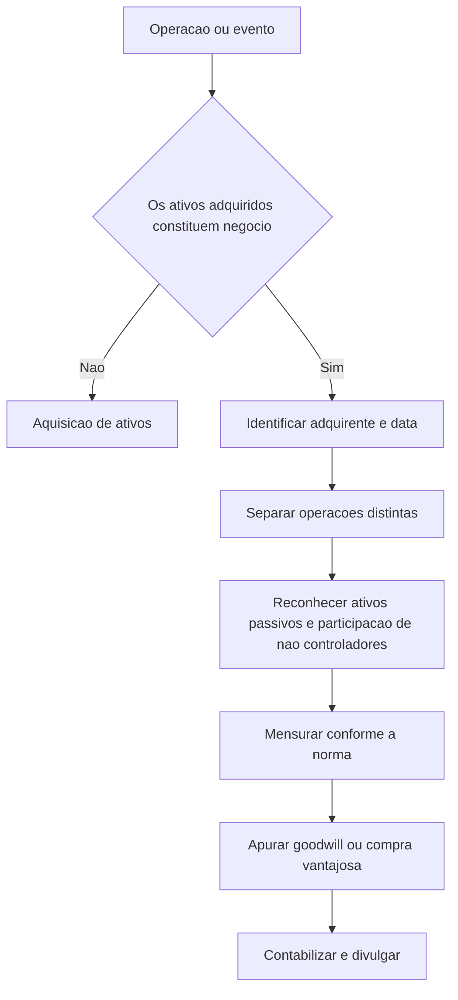

# NBC TG 15 (R4) — Combinação de Negócios

> [!abstract] Resumo em 30 segundos
> A NBC TG 15 disciplina a contabilização de combinações de negócios pelo **método de aquisição**. O adquirente identifica quem obteve o controle e a data em que isso ocorreu; reconhece e mensura, em regra a valor justo nessa data, os ativos identificáveis adquiridos e os passivos assumidos; e apura o goodwill ou, após revisão, o ganho por compra vantajosa. A norma também orienta o tratamento de situações específicas e as divulgações necessárias para que os usuários avaliem a natureza e os efeitos financeiros da combinação.

## Ficha rápida

| Campo | Síntese |
|---|---|
| Norma | NBC TG 15 (R4) — Combinação de Negócios |
| Tema central | Reconhecimento, mensuração e divulgação de combinações de negócios |
| Método exigido | Método de aquisição |
| Data de referência | Data em que o adquirente obtém o controle |
| Mensuração geral | Valores justos na data da aquisição, ressalvadas exceções previstas na norma |

> [!info] Identificação da versão
> O PDF identifica a NBC TG 15 (R4) como alteração da NBC TG 15 (R3). A resolução reproduzida ao final informa que as alterações entram em vigor na data de publicação e produzem efeitos a partir de 1º de janeiro de 2018. Essa informação se refere às alterações descritas no próprio documento; não é uma afirmação sobre vigência atual.

## Objetivo e alcance

A norma busca aprimorar a relevância, a confiabilidade e a comparabilidade das informações sobre combinações de negócios e seus efeitos. Para isso, estabelece princípios para o adquirente:

- reconhecer e mensurar os ativos identificáveis adquiridos, os passivos assumidos e as participações de não controladores;
- reconhecer e mensurar o goodwill ou o ganho decorrente de compra vantajosa; e
- divulgar informações que permitam avaliar a natureza e os efeitos financeiros da combinação. (item 1; p. 2)

Aplica-se a operações ou eventos que atendam à definição de combinação de negócios. Não se aplica, entre outros casos, à aquisição de ativos — ou grupo de ativos — que não constitua um negócio, nem a combinações de entidades ou negócios sob controle comum. Na aquisição de ativos que não constituem negócio, o custo é alocado aos ativos identificáveis e passivos com base em seus respectivos valores justos na data da compra; essa operação não gera goodwill. (itens 2 e 3; pp. 2–3)

Também há exclusões específicas no texto para formação de negócios em conjunto e para determinada aquisição de investimento por entidade de investimento. A identificação de um negócio deve ser feita conforme as orientações da própria norma. (itens 2A e 3; pp. 2–3)

## Conceitos-chave

- **Adquirente:** entidade que obtém o controle da adquirida. As orientações da NBC TG 36 são usadas para identificá-la; se não forem conclusivas, consideram-se os fatores indicados na norma. (itens 6 e 7; p. 3)
- **Data de aquisição:** data em que o adquirente obtém o controle. Pode ser anterior ou posterior à data de fechamento; a conclusão deve considerar os fatos e as circunstâncias pertinentes. (itens 8 e 9; pp. 3–4)
- **Ativos e passivos identificáveis:** itens reconhecidos separadamente do goodwill, se atenderem aos critérios aplicáveis e fizerem parte da troca para obtenção do controle. Podem incluir intangíveis, como marcas, patentes e relacionamentos com clientes, ainda que não estivessem reconhecidos pela adquirida. (itens 10–13; pp. 4–5)
- **Participação de não controladores:** participação na adquirida que não pertence ao adquirente. Para certos instrumentos patrimoniais que conferem participação proporcional nos ativos líquidos em caso de liquidação, a norma permite mensuração pelo valor justo ou pela participação proporcional nos valores reconhecidos dos ativos líquidos identificáveis. Os demais componentes são mensurados ao valor justo, salvo exigência diferente de outra norma. (item 19; p. 6)
- **Goodwill:** excesso da soma da contraprestação transferida, da participação de não controladores e, se aplicável, do valor justo da participação anterior do adquirente sobre o valor líquido dos ativos identificáveis adquiridos e passivos assumidos. (item 32; p. 9)
- **Compra vantajosa:** situação em que o valor líquido dos ativos identificáveis adquiridos e passivos assumidos excede a soma dos componentes considerados no cálculo do goodwill. O ganho só é reconhecido após revisão da identificação e mensuração dos itens. (itens 34–36; pp. 9–10)

## Método de aquisição: aplicação passo a passo

1. **Confirme se a operação é uma combinação de negócios.** Determine se os ativos adquiridos e passivos assumidos constituem um negócio; caso contrário, trate como aquisição de ativos. (item 3; p. 3)
2. **Identifique o adquirente.** Determine qual entidade obteve o controle, utilizando as orientações da NBC TG 36 e, quando necessário, os fatores previstos na NBC TG 15. (itens 6 e 7; p. 3)
3. **Determine a data de aquisição.** Identifique quando o controle foi efetivamente obtido, considerando contratos e demais circunstâncias, e não apenas a data formal de fechamento. (itens 8 e 9; pp. 3–4)
4. **Separe a combinação de operações distintas.** Avalie se pagamentos, acordos ou relações preexistentes são parte da obtenção do controle ou operações separadas. Contabilize estas últimas conforme sua natureza e as normas pertinentes. (itens 12 e 51–52; pp. 4 e 14)
5. **Reconheça os ativos, passivos e participações de não controladores elegíveis.** Avalie as condições de reconhecimento na data de aquisição e identifique os itens separadamente do goodwill. (itens 10–14; pp. 4–5)
6. **Classifique ou designe os itens para aplicação subsequente de outras normas.** Considere os termos contratuais, condições econômicas e demais circunstâncias existentes na data de aquisição, respeitando as exceções previstas. (itens 15–17; pp. 5–6)
7. **Mensure os itens e a contraprestação.** Aplique a regra geral de valor justo na data de aquisição e as exceções específicas da norma. (itens 18–31 e 37–40; pp. 6–11)
8. **Calcule o goodwill ou avalie eventual compra vantajosa.** Antes de reconhecer ganho por compra vantajosa, revise ativos, passivos, participação de não controladores, participação anterior e contraprestação. (itens 32–36; pp. 9–10)
9. **Conclua a contabilização inicial e divulgue as informações requeridas.** Se faltarem informações ao fim do período de reporte, avalie valores provisórios e o período de mensuração. (itens 45–50; pp. 13–14)

## Reconhecimento e mensuração

### Regra geral

A partir da data de aquisição, o adquirente reconhece separadamente do goodwill os ativos identificáveis adquiridos, os passivos assumidos e as participações de não controladores. Os ativos e passivos devem atender às definições aplicáveis na data de aquisição e integrar a operação de troca para obtenção do controle. Custos futuros que o adquirente apenas espera incorrer — como encerramento de atividade ou realocação de empregados — não são passivos da adquirida na data de aquisição e não devem ser reconhecidos como parte da combinação. (itens 10–12; pp. 4–5)

Como regra geral, ativos identificáveis e passivos assumidos são mensurados pelos respectivos valores justos na data de aquisição. As exceções de reconhecimento e mensuração são limitadas e devem ser aplicadas aos itens especificamente tratados pela norma. (itens 18–21; p. 6)

### Fórmula do goodwill

**Goodwill = (contraprestação transferida + participação de não controladores + valor justo da participação anterior, se aplicável) − valor líquido dos ativos identificáveis adquiridos e passivos assumidos**

A fórmula considera os valores determinados de acordo com a norma. Em combinações realizadas em estágios, inclui-se o valor justo, na data de aquisição, da participação que o adquirente já detinha. Se o resultado indicar compra vantajosa, faça a revisão exigida antes de reconhecer o ganho no resultado. (itens 32–36; pp. 9–10)

### Contraprestação e situações específicas

A contraprestação transferida é mensurada pelo valor justo na data de aquisição e pode incluir caixa, outros ativos, passivos incorridos junto aos antigos proprietários, instrumentos patrimoniais e contraprestação contingente. Ativos ou passivos transferidos com valor contábil diferente do valor justo são, em regra, remensurados, com reconhecimento do ganho ou perda correspondente. Há tratamento distinto quando permanecem sob controle do adquirente após a combinação. (itens 37–39; pp. 10–11)

A norma também contempla combinações realizadas em estágios, combinações sem transferência de contraprestação, passivos contingentes, tributos sobre o lucro, benefícios a empregados, ativos de indenização, arrendamentos em que a adquirida é arrendatária, direitos readquiridos, pagamentos baseados em ações e ativos mantidos para venda. Para cada caso, consulte o tratamento específico do item aplicável; não se deve presumir que a regra geral de valor justo prevalece sem exceções. (itens 22–31 e 41–44; pp. 6–13)

Em combinação realizada em estágios, a participação anterior é remensurada a valor justo na data de aquisição. O ganho ou perda resultante é reconhecido no resultado ou em outros resultados abrangentes, conforme apropriado, e valores previamente reconhecidos em outros resultados abrangentes são tratados como seriam na alienação da participação. (itens 41 e 42; pp. 11–12)

## Período de mensuração

Se a contabilização inicial estiver incompleta ao fim do período de reporte, o adquirente apresenta valores provisórios. Durante o período de mensuração, novas informações sobre fatos e circunstâncias existentes na data de aquisição podem levar a ajustes retrospectivos ou ao reconhecimento de ativos e passivos adicionais. O período termina quando as informações buscadas forem obtidas ou não puderem ser obtidas; não pode exceder um ano da data de aquisição. Após seu encerramento, os registros são revistos somente para correção de erros, conforme a NBC TG 23. (itens 45–50; pp. 13–14)

## Divulgação

A norma inclui requisitos de divulgação para que os usuários avaliem a natureza e os efeitos financeiros da combinação. O exemplo ilustrativo do PDF demonstra informações sobre a contraprestação, ativos adquiridos e passivos assumidos, participação de não controladores, goodwill, custos de aquisição, valores provisórios e efeitos no resultado. Também ilustra a divulgação de premissas e estimativas relacionadas a mensurações relevantes. O exemplo é ilustrativo, não uma lista completa dos requisitos aplicáveis a qualquer operação. (itens 59–63; exemplo C72; pp. 60–62)

## Exceções e erros comuns

> [!warning] Pontos de atenção
> - **Não confunda aquisição de ativos com combinação de negócios:** se não houver um negócio, não se reconhece goodwill. (itens 2 e 3; pp. 2–3)
> - **Não use automaticamente a data de fechamento:** a data de aquisição é quando o controle é obtido. (itens 8 e 9; pp. 3–4)
> - **Não reconheça custos futuros esperados como passivo da adquirida:** é necessário que exista obrigação na data de aquisição. (item 11; p. 4)
> - **Não inclua automaticamente todos os pagamentos no método de aquisição:** operações separadas, como certas liquidações de relações preexistentes ou pagamentos por serviços futuros, devem ser avaliadas à parte. (itens 51 e 52; p. 14)
> - **Não reconheça compra vantajosa sem revisão:** reavalie a identificação dos itens e os procedimentos de mensuração antes de reconhecer o ganho. (item 36; p. 10)
> - **Não trate todos os itens pela regra geral:** passivos contingentes, tributos, benefícios a empregados e outras situações têm disposições específicas. (itens 21–31; pp. 6–9)
> - **Não confunda informação nova com evento posterior:** ajuste de período de mensuração depende de informação sobre fatos e circunstâncias existentes na data de aquisição. (itens 45–50; pp. 13–14)

## Conexões com outras normas

A relação com outras normas é expressa no texto, entre outras, para: NBC TG 36 na identificação do adquirente; NBC TG 25 no tratamento de passivos contingentes; NBC TG 32 para tributos sobre o lucro; NBC TG 33 para benefícios a empregados; NBC TG 06 para arrendamentos; NBC TG 10 para pagamentos baseados em ações; NBC TG 31 para ativos mantidos para venda; e NBC TG 23 para correção de erros após o período de mensuração. A NBC TG 48 é citada em regras de classificação de instrumentos financeiros e nos custos de emissão de instrumentos. (pp. 3, 6–9, 14 e 16)

## Fonte

PDF **NBC TG 15 (R4).pdf**, texto técnico da NBC TG 15 — Combinação de Negócios, com referências a itens e páginas conforme identificáveis no documento fornecido. A resolução de alteração aparece no final do PDF, nas páginas 63–64.
