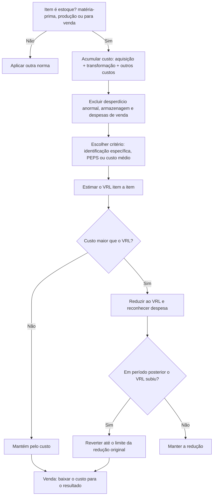

# NBC TG 16 (R2) — Estoques

> [!abstract] Em 30 segundos
> Estoque é ativo **mantido para venda**, **em produção** ou **na forma de materiais/suprimentos** a consumir. Mensura-se pelo **menor valor entre o custo e o valor realizável líquido** (VRL). O custo captura tudo o que foi gasto para colocar o item **no local e na condição atuais** — e nada além disso. Se o preço esperado de venda cair abaixo do custo, reconhece-se a redução (**write down**) no resultado; se as condições melhorarem, a perda pode ser **revertida até o limite original**.

## 🪪 Ficha rápida

| 🏷️ Item | Conteúdo |
| --- | --- |
| **Norma** | NBC TG 16 (R2) |
| **Equivalente internacional** | CPC 16R1 · IAS 2 |
| **Resolução** | DOU 22/12/2017 |
| **Aplica-se a** | Mercadorias, matérias-primas, produtos em elaboração, acabados, materiais de consumo e estoques de prestadores de serviços |
| **Não se aplica a** | Instrumentos financeiros (NBC TG 48/39); ativos biológicos e produto agrícola antes da colheita (NBC TG 29); contratos de construção (item eliminado na R2) |
| **Excluídos só da mensuração** | Produtores agrícolas, florestais e minerais que usam práticas setoriais de VRL; *broker-traders* de commodities ao valor justo menos custos de venda (itens 3–5) |
| **Ideia central** | Custo × VRL — **o menor** |
| **PDF oficial** | [[NBC TG 16 (R2).pdf]] |

## 🎯 Para que serve

A questão central é **quanto do gasto fica no ativo** até a receita ser reconhecida (item 1). A norma define o que entra no custo, fixa os critérios de valoração aceitos, obriga a comparar custo com o que a entidade espera realizar na venda, e diz quando o estoque vira despesa e o que divulgar.

## 🧩 Conceitos-chave

| Conceito | Tradução prática |
| --- | --- |
| **Estoques** | Ativos mantidos para venda no curso normal, em produção para venda, ou materiais/suprimentos a consumir ou transformar (item 6) |
| **Valor realizável líquido (VRL)** | Preço de venda estimado **menos** custos de conclusão **menos** gastos para vender (item 6) |
| **Valor justo** | Preço de saída entre participantes do mercado, no mercado principal ou mais vantajoso (item 6, alterado pela R1) |
| **Custo de aquisição** | Preço de compra + tributos **não recuperáveis** + frete + seguro + manuseio − descontos (item 11) |
| **Custo de transformação** | Mão de obra direta + custos indiretos fixos e variáveis alocados (itens 12–14) |
| **Capacidade normal** | Produção média esperada em circunstâncias normais; base para ratear o custo fixo (item 13) |

> [!info] VRL ≠ valor justo
> O **VRL** é específico da entidade (o que **ela** espera realizar). O **valor justo** é de mercado (item 7). Os números podem divergir — e é o VRL que manda nesta norma.

## 🗺️ Mapa da norma

## 📌 Quando se aplica

| Situação | Aplica? | O que fazer |
| --- | --- | --- |
| Varejista com mercadorias para revenda | ✅ | Custo de aquisição × VRL |
| Indústria com produto em elaboração | ✅ | Ratear custo fixo pela **capacidade normal** (item 13) |
| Prestador de serviços com trabalhos em andamento | ✅ | Custo do serviço, **sem margem de lucro**; cada serviço é um item separado (itens 19 e 29) |
| Produto agrícola **após** a colheita | ✅ | Custo inicial = valor justo menos gastos de venda na colheita (item 20) |
| Ativo biológico **antes** da colheita | ❌ | NBC TG 29 |
| *Broker-trader* de commodities ao valor justo menos custos de venda | ⚠️ parcial | Excluído apenas da **mensuração** (item 3(b)) |

## ⚙️ Como funciona na prática

- [ ] **1. Classificar** o item e sua categoria (mercadoria, matéria-prima, elaboração, acabado, serviço).
- [ ] **2. Somar custos de aquisição** — preço, tributos não recuperáveis, frete, seguro, manuseio — líquidos de descontos (item 11).
- [ ] **3. Somar custos de transformação** — ratear o fixo pela **capacidade normal**; ociosidade vai direto para despesa (item 13).
- [ ] **4. Avaliar "outros custos"** — só entram se colocam o estoque no local e na condição atuais (item 15).
- [ ] **5. Verificar encargos financeiros** — juros só entram se a NBC TG 20 permitir (item 17); compra a prazo com financiamento embutido gera despesa de juros (item 18).
- [ ] **6. Escolher o critério** — identificação específica para itens não intercambiáveis (itens 23–24); PEPS ou custo médio ponderado para os demais, consistente por natureza e uso (itens 25–27).
- [ ] **7. Estimar o VRL** com as evidências mais confiáveis, inclusive eventos após o fechamento que confirmem condições existentes (item 30).
- [ ] **8. Comparar item a item**, reconhecer a redução, baixar o custo na venda e reavaliar o VRL a cada período (itens 29, 33 e 34).

## 📐 Reconhecimento e mensuração

> [!tip] Fórmula
> **Estoque = MIN (custo; VRL)**
> **VRL = preço de venda estimado − custos de conclusão − gastos de venda**
> **Perda = custo − VRL** (só se positivo)

| Método | Quando usar | Observação |
| --- | --- | --- |
| Identificação específica | Itens não intercambiáveis e bens/serviços segregados para projeto | Item 23 |
| PEPS | Estoques geralmente intercambiáveis | O que fica é o mais recente (item 27) |
| Custo médio ponderado | Estoques geralmente intercambiáveis | Média periódica ou por lote recebido (item 27) |
| Custo-padrão / varejo | Conveniência, se aproximar do custo | Revisão regular (itens 21–22) |
| **UEPS (LIFO)** | ❌ | **Não permitido** |

**Não entram no custo (item 16):** desperdício anormal; armazenagem (salvo se necessária entre fases produtivas); despesas administrativas que não aproximam o estoque do local/condição; despesas de comercialização, venda e entrega.

> [!example] Exemplo rápido
> 100 unidades a R$ 50 (R$ 5.000) + frete R$ 200 + tributo não recuperável R$ 300 → custo unitário R$ 55. Se o preço de venda esperado é R$ 60 e os gastos para vender, R$ 8, o VRL é R$ 52 → reduzir a R$ 52 e lançar R$ 300 de despesa. Se no ano seguinte o VRL voltar a R$ 58, reverte-se R$ 6 por unidade, **nunca acima de R$ 55**.

## 🔄 Reversão e situações especiais

| Situação | Tratamento | Base |
| --- | --- | --- |
| VRL subiu por mudança nas circunstâncias econômicas | Reverter a redução, **limitada à perda original** | Item 33 |
| VRL subiu só com o passar do tempo | ❌ Não reverter | Item 33 |
| Matéria-prima cujo produto final venderá pelo custo ou acima | Não reduzir abaixo do custo | Item 32 |
| Matéria-prima cujo produto final venderá abaixo do custo | Reduzir ao VRL; custo de reposição pode ser a melhor medida | Item 32 |
| Contrato firme de venda maior que o estoque, com prejuízo | Tratar como **provisão** pela NBC TG 25 | Item 31 |

## 📢 O que divulgar (item 36)

| Divulgação | Conteúdo |
| --- | --- |
| Políticas contábeis | Formas e critérios de valoração adotados |
| Valor escriturado | Total dos estoques e valores em outras contas apropriadas |
| Estoques ao valor justo menos custos de venda | Valor correspondente |
| Custo reconhecido como despesa | CMV/CPV/CSP do período |
| Reduções e reversões ao VRL | Valores no resultado e as circunstâncias da reversão |
| Garantias | Montante de estoques dados em penhor |

A norma recomenda ainda abrir por classificação (mercadorias, materiais, elaboração, acabados) — item 37.

## ⚠️ Erros comuns

> [!danger] Evite
> - Usar **UEPS**: não é método aceito pela NBC TG 16.
> - Ratear custo fixo pela produção **real** em período de ociosidade — infla o custo unitário. O correto é **capacidade normal** (item 13).
> - Jogar frete, seguro e tributos não recuperáveis direto em despesa.
> - Incluir despesas administrativas, de venda ou armazenagem genérica no custo (item 16).
> - Comparar o **estoque total** com o VRL em vez de testar **item a item** (item 29).
> - Reverter perda acima do custo original ou por simples passagem do tempo.

## 🧠 Como memorizar

> **"O menor dos dois, item por item."**
> Custo × VRL — o que for menor fica no balanço. O custo só cresce até o item estar **pronto e no lugar**; depois disso, é despesa.

## 🔗 Conexões

| Norma | Por que se conecta |
| --- | --- |
| [[NBC TG 29 (R2) - Resumo|NBC TG 29]] | Produto agrícola na colheita define o custo inicial (item 20) |
| [[NBC TG 20 (R2) - Resumo|NBC TG 20]] | Define quando juros entram no custo (item 17) |
| [[NBC TG 47 - Resumo|NBC TG 47]] | Custos de contrato que não geram estoque (item 8) |
| [[NBC TG 25 (R2) - Resumo|NBC TG 25]] | Contratos firmes onerosos viram provisão (item 31) |
| [[NBC TG 01 (R4) - Resumo|NBC TG 01]] | Estoques estão fora do teste de recuperabilidade — o VRL faz esse papel |
| [[NBC TG 12 (R1) - Resumo|NBC TG 12]] | Ajuste a valor presente em compras a prazo (item 18) |
| [[NBC TG 27 (R4) - Resumo|NBC TG 27]] | Estoque transferido para imobilizado de construção própria (item 35) |

## 📄 Fonte

- **PDF oficial:** [[NBC TG 16 (R2).pdf]]
- **Página do CFC:** [NBC TG 16 (R2)](<https://www2.cfc.org.br/sisweb/sre/detalhes_sre.aspx?Codigo=2017/NBCTG16(R2)&arquivo=NBCTG16(R2).doc>)
- **Itens-chave:** 1 (objetivo); 2–5 (alcance); 6–8 (definições); 9–27 (custo e critérios); 28–33 (VRL e reversão); 34–35 (despesa); 36–39 (divulgação).
