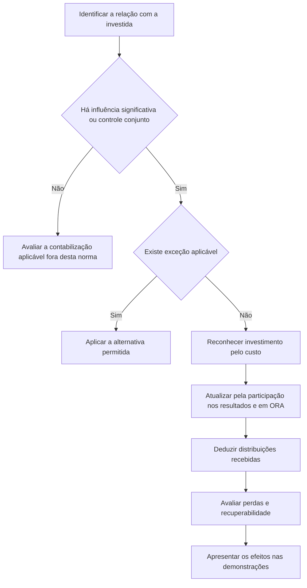

# NBC TG 18 (R4) — Investimento em Coligada e em Empreendimento Controlado em Conjunto

> [!abstract] Resumo em 30 segundos
> A NBC TG 18 trata da contabilização de investimentos em coligadas e empreendimentos controlados em conjunto. Como regra, aplica-se o método da equivalência patrimonial: o investimento começa pelo custo e depois é ajustado pela participação do investidor nos resultados e em outros resultados abrangentes da investida. Distribuições recebidas reduzem o saldo do investimento. A norma também orienta como avaliar influência significativa, tratar perdas, mudanças na participação e situações em que o método pode não ser aplicado.

## Ficha rápida

| Campo | Síntese |
|---|---|
| Norma | NBC TG 18 (R4) |
| Tema | Investimentos em coligadas e empreendimentos controlados em conjunto |
| Base internacional indicada no PDF | IAS 28 |
| Aplicação central | Método da equivalência patrimonial |
| Vigência informada no PDF | 1º de janeiro de 2025 |
| Investidores abrangidos | Entidades com controle conjunto ou influência significativa sobre uma investida |

> [!info] Identificação do texto
> O PDF identifica a aprovação da NBC TG 18 (R4) em 7 de dezembro de 2023 e informa vigência a partir de 1º de janeiro de 2025. A nota mantém o título solicitado, mas não presume que a data indicada nele seja a data de aprovação ou vigência do texto fornecido.

## Objetivo e alcance

A norma estabelece como contabilizar investimentos em coligadas e define requisitos para aplicar o método da equivalência patrimonial a investimentos em coligadas e empreendimentos controlados em conjunto (item 1).

Aplica-se a entidades que tenham controle conjunto de uma investida ou influência significativa sobre ela (item 2). O método da equivalência patrimonial é a regra, ressalvadas as exceções previstas na própria norma.

Para demonstrações individuais, o PDF determina que investimentos em controladas sejam avaliados pelo método da equivalência patrimonial, conforme exigido legalmente, e remete à ITG 09 e à NBC TG 35, quando aplicáveis (item 2A). Para demonstrações separadas, o tratamento de investimentos em coligadas e empreendimentos controlados em conjunto segue a NBC TG 35 (item 44).

## Conceitos-chave

- **Coligada:** entidade sobre a qual o investidor tem influência significativa.
- **Influência significativa:** poder de participar das decisões sobre políticas financeiras e operacionais, sem controlar individualmente ou em conjunto essas políticas.
- **Controle conjunto:** compartilhamento contratual do controle; existe somente quando decisões sobre atividades relevantes exigem consentimento unânime das partes que compartilham o controle.
- **Empreendimento controlado em conjunto:** negócio conjunto no qual as partes com controle conjunto têm direitos sobre os ativos líquidos do acordo.
- **Método da equivalência patrimonial:** método em que o investimento é inicialmente reconhecido pelo custo e ajustado pela participação do investidor nas alterações posteriores à aquisição dos ativos líquidos da investida. A participação nos lucros ou prejuízos afeta o resultado do investidor; a participação em outros resultados abrangentes afeta os outros resultados abrangentes do investidor (item 3).

### Como avaliar a influência significativa

A posse direta ou indireta de **20% ou mais** do poder de voto cria presunção de influência significativa, salvo demonstração clara em contrário. Abaixo de 20%, presume-se ausência de influência significativa, salvo demonstração clara de que ela existe. A participação majoritária de outro investidor não impede, por si só, a influência significativa (item 5).

Indícios possíveis incluem representação no conselho ou diretoria, participação na elaboração de políticas, operações materiais, intercâmbio de administradores e fornecimento de informação técnica essencial (item 6). A análise também considera potenciais direitos de voto prontamente exercíveis ou conversíveis e os fatos e circunstâncias relevantes, mas não a intenção da administração nem sua capacidade financeira de exercer ou converter esses direitos (itens 7 e 8).

## Diagrama do processo

## Aplicação passo a passo — checklist

1. **Identifique a relação:** determine se há influência significativa ou controle conjunto. Considere direitos de voto, acordos e evidências práticas da participação nas decisões.
2. **Avalie as exceções:** verifique se a entidade pode deixar de aplicar o método ou escolher mensuração ao valor justo por meio do resultado nas situações previstas nos itens 17 a 19.
3. **Defina a data de início:** aplique a equivalência patrimonial a partir da data em que o investimento se torna uma coligada ou empreendimento controlado em conjunto (item 32).
4. **Estabeleça a base de aquisição:** reconheça o investimento inicialmente pelo custo e analise as diferenças entre o custo e a participação nos valores justos líquidos dos ativos e passivos identificáveis.
5. **Obtenha informações comparáveis:** use demonstrações da investida na mesma data, se possível; trate diferenças de datas e práticas contábeis conforme a norma.
6. **Atualize o saldo:** reconheça a participação nos lucros ou prejuízos, nos outros resultados abrangentes e nas distribuições recebidas.
7. **Examine transações entre as partes:** verifique se há lucros não realizados ou perdas que devam ser reconhecidos integralmente ou na proporção aplicável.
8. **Avalie perdas adicionais e recuperabilidade:** aplique os limites de reconhecimento de prejuízos e avalie evidências de redução ao valor recuperável.
9. **Reavalie a relação e a classificação:** mudanças no poder de participação, na natureza do investimento ou na intenção de venda podem alterar o tratamento.

## Reconhecimento e mensuração

### Evolução do investimento

Em termos operacionais, a movimentação básica pode ser resumida assim:

**Saldo do investimento = custo inicial + participação nos resultados + participação em ORA − distribuições recebidas ± outros ajustes aplicáveis**

A participação nos lucros ou prejuízos da investida é reconhecida no resultado do investidor. A parcela de alterações em outros resultados abrangentes da investida é reconhecida nos outros resultados abrangentes do investidor; distribuições recebidas reduzem o valor contábil do investimento (itens 10 e 11).

O goodwill relacionado à coligada ou ao empreendimento controlado em conjunto integra o valor contábil do investimento e não é amortizado. Se a participação do investidor no valor justo líquido dos ativos e passivos identificáveis superar o custo, o excedente é incluído como receita na determinação da participação do investidor nos resultados da investida no período da aquisição. Após a aquisição, podem ser necessários ajustes, por exemplo, para refletir depreciação baseada nos valores justos da data de aquisição (item 32).

### Demonstrações e ajustes

Use as demonstrações mais recentes da investida. Se as datas de encerramento forem diferentes, a defasagem máxima é de três meses; ajustes pertinentes devem refletir eventos significativos ocorridos no intervalo, e a diferença de datas deve ser consistente entre períodos (itens 33 e 34). As práticas contábeis devem ser uniformes para transações de mesma natureza em circunstâncias semelhantes, com os ajustes requeridos para alinhar as práticas da investida às do investidor, ressalvada a alternativa prevista no item 36A (itens 35 e 36).

A participação de um grupo econômico corresponde à soma das participações da controladora e de suas outras controladas. Ao aplicar o método, consideram-se os resultados, outros resultados abrangentes e ativos líquidos da investida após os ajustes necessários (item 27).

### Transações e perdas

Em transações ascendentes e descendentes envolvendo ativos que **não constituam um negócio**, o resultado do investidor é reconhecido somente na extensão da participação de outros investidores independentes do grupo econômico; elimina-se a participação do investidor no resultado da investida decorrente dessas transações (item 28). Há tratamento específico para perdas que indiquem redução no valor realizável líquido ou perda por redução ao valor recuperável dos ativos (item 29). Em operação descendente com ativos que constituam um negócio, o ganho ou a perda é reconhecido integralmente pelo investidor (item 31A).

Quando os prejuízos alcançam ou excedem o saldo da participação, suspenda o reconhecimento de perdas adicionais, considerando também participações de longo prazo que, em essência, façam parte do investimento líquido. Depois de reduzir essa participação a zero, reconheça passivo por perdas adicionais apenas até o limite de obrigações legais ou construtivas, ou de pagamentos feitos em nome da investida. O reconhecimento de lucros posteriores só recomeça depois de compensadas as perdas não reconhecidas (itens 38 e 39).

### Redução ao valor recuperável

Após aplicar o método e reconhecer prejuízos, procure evidência objetiva de que o investimento líquido não é recuperável. A norma cita, entre outros indícios, dificuldade financeira significativa, inadimplência, concessão motivada por dificuldades da investida, probabilidade de falência ou reorganização financeira e desaparecimento de mercado ativo por dificuldades financeiras (itens 40 e 41A).

A redução de classificação de crédito ou a queda no valor justo, isoladamente, não prova perda; pode ser evidência quando considerada com outras informações. Perdas esperadas de eventos futuros não são reconhecidas (item 41B). Havendo indício de perda, testa-se o investimento total como um único ativo, incluindo o goodwill, conforme a NBC TG 01. O goodwill não é testado separadamente nem recebe alocação específica da perda (item 42). O valor recuperável é determinado para cada investimento, salvo a condição descrita no item 43.

## Divulgação e apresentação

O texto fornecido não apresenta uma seção autônoma com requisitos detalhados de divulgação. Para aplicação prática, observe os efeitos de apresentação expressamente indicados: participação nos resultados no resultado do investidor; participação em outros resultados abrangentes nos outros resultados abrangentes; e distribuições como redução do investimento (item 10). Salvo classificação como mantido para venda, o investimento é classificado como ativo não circulante (item 15).

Ao descontinuar o método, certos valores anteriormente reconhecidos em outros resultados abrangentes podem exigir reclassificação para o resultado, na mesma base que seria aplicável se a investida tivesse se desfeito dos ativos ou passivos relacionados (itens 22 e 23). A norma remete a apresentação em demonstrações separadas à NBC TG 35 (item 44).

## Exceções e erros comuns

> [!warning] Exceções à equivalência patrimonial
> - **Dispensa em situações específicas:** a entidade pode não aplicar o método nas condições do item 17, incluindo a exceção relacionada à NBC TG 36 ou o atendimento conjunto dos requisitos ali descritos.
> - **Organizações de capital de risco e entidades similares:** para certos investimentos, a entidade pode escolher valor justo por meio do resultado, conforme a NBC TG 48. A escolha é feita separadamente para cada investida no reconhecimento inicial (item 18).
> - **Participação indireta por meio dessas entidades:** a opção pode se limitar à parcela detida indiretamente; para a parcela restante, aplica-se a equivalência patrimonial (item 19).
> - **Mantido para venda:** aplica-se a NBC TG 31 à parcela que atende aos critérios; eventual parcela retida continua no método até a baixa efetiva, conforme as condições do item 20. Se deixar de atender aos critérios, a equivalência patrimonial volta a ser aplicada retrospectivamente desde a classificação como mantido para venda (item 21).

**Erros a evitar:**

- Tratar dividendos recebidos como substitutos da participação nos lucros: a norma ressalta que distribuições podem não representar adequadamente o desempenho da investida (item 11).
- Usar potenciais direitos de voto para alterar automaticamente a participação na equivalência patrimonial: em regra, a participação considera a participação societária existente, com a exceção de acesso atual aos retornos descrita nos itens 12 e 13.
- Reconhecer perdas futuras esperadas sem evidência objetiva de evento de perda (item 41A).
- Reconhecer prejuízos indefinidamente sem considerar o limite da participação e as obrigações legais ou construtivas (itens 38 e 39).
- Tratar a perda de influência significativa como dependente de mudança percentual acionária: ela pode ocorrer sem mudança na participação (item 9).
- Remensurar a participação retida quando coligada e empreendimento controlado em conjunto se alternam: a norma determina continuidade do método sem remensuração (item 24).

## Conexões com outras normas

As relações a seguir são explicitamente mencionadas no texto:

- **NBC TG 35:** demonstrações separadas e tratamento nelas dos investimentos (itens 2A e 44).
- **NBC TG 36:** consolidação, exceções e aspectos de transações entre entidades (itens 17, 26, 28 e 31B).
- **NBC TG 48:** instrumentos financeiros e alternativas de mensuração ao valor justo por meio do resultado (itens 14, 14A, 18 a 20 e 22).
- **NBC TG 31:** classificação como mantido para venda (itens 15, 20 e 21).
- **NBC TG 01:** teste e reversão de perdas por redução ao valor recuperável do investimento (item 42).
- **NBC TG 23:** aplicação retrospectiva de alterações em situações transitórias (item 45G).

## Fonte

NBC TG 18 (R4) — *Investimento em Coligada e em Empreendimento Controlado em Conjunto*, PDF fornecido. Texto técnico consultado nas páginas 1–14; vigência informada no item 47: 1º de janeiro de 2025.
