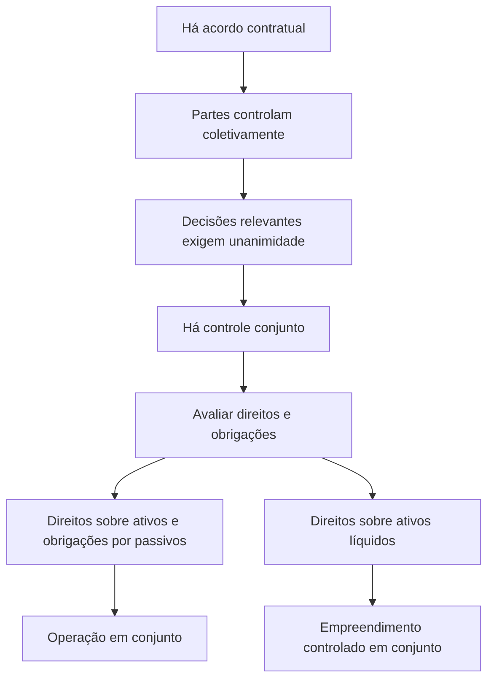

# NBC TG 19 (R2) — Negócios em Conjunto

> [!abstract] Resumo em 30 segundos
> A NBC TG 19 estabelece como reportar interesses em negócios controlados em conjunto. Primeiro, confirme se há acordo contratual e controle conjunto — decisões sobre atividades relevantes exigem consentimento unânime das partes que compartilham o controle. Depois, classifique o negócio pelos direitos e obrigações da entidade: direitos sobre ativos e obrigações por passivos indicam **operação em conjunto**; direitos sobre ativos líquidos indicam **empreendimento controlado em conjunto**. Essa classificação determina a contabilização.

## Ficha rápida

| Campo | Síntese |
|---|---|
| Norma | NBC TG 19 (R2) — Negócios em Conjunto |
| Grupo | 02 - NBC TG |
| Tema central | Identificar controle conjunto, classificar o negócio e contabilizar os direitos e obrigações correspondentes |
| Aplicação | Entidades que sejam partes integrantes de negócio em conjunto |
| Data indicada no texto da resolução | Alterações em vigor na publicação, aplicáveis a exercícios iniciados a partir de 1º de janeiro de 2016 |

> [!info] Como usar este resumo
> A norma exige julgamento baseado nos fatos e circunstâncias. Não classifique um negócio apenas pela percentagem de participação, pelo nome dado ao acordo ou pela existência de um veículo separado.

## Objetivo e alcance

A norma estabelece princípios para o reporte financeiro de entidades com interesses em negócios controlados em conjunto. A entidade que seja parte de um negócio em conjunto deve determinar o tipo de negócio em que está envolvida, avaliando seus direitos e obrigações, e contabilizá-los de acordo com essa classificação. Aplica-se a todas as entidades que sejam partes integrantes de negócio em conjunto (itens 1–3, p. 1).

Um negócio em conjunto é um negócio sujeito ao controle conjunto de duas ou mais partes. Para existir, deve haver acordo contratual que vincule as partes e que conceda controle conjunto a duas ou mais delas (itens 4–6, pp. 1–2).

## Conceitos-chave

| Conceito | Significado prático |
|---|---|
| **Controle conjunto** | Compartilhamento contratualmente convencionado do controle. Existe somente quando as decisões sobre atividades relevantes exigem consentimento unânime das partes que compartilham o controle. |
| **Parte integrante** | Entidade que participa do negócio, tenha ou não controle conjunto. |
| **Operação em conjunto** | As partes com controle conjunto têm direitos sobre ativos e obrigações por passivos relacionados ao negócio. |
| **Operador em conjunto** | Parte integrante que detém controle conjunto de uma operação em conjunto. |
| **Empreendimento controlado em conjunto — joint venture** | As partes com controle conjunto têm direitos sobre os ativos líquidos do negócio. |
| **Empreendedor em conjunto — joint venturer** | Parte integrante que detém controle conjunto de uma joint venture. |
| **Veículo separado** | Estrutura financeira separadamente identificável, incluindo pessoas jurídicas separadas ou entidades reconhecidas por estatuto, mesmo sem personalidade jurídica. |

### Avaliação do controle conjunto

A análise tem duas etapas:

1. Verifique se todas as partes, ou um grupo de partes, controlam coletivamente o negócio, dirigindo as atividades que afetam significativamente seus retornos.
2. Verifique se as decisões sobre essas atividades relevantes exigem o consentimento unânime das partes que controlam coletivamente o negócio.

Uma parte pode ter capacidade de bloquear decisões sem controlar o negócio individualmente. A unanimidade relevante é a que se aplica às atividades relevantes — não basta que se aplique a decisões que concedam apenas direitos de proteção. Acordos de arbitragem ou outros mecanismos de solução de litígios não impedem, por si só, a existência de controle conjunto (itens 7–13 e B5–B10, pp. 2 e 6–7).

## Diagrama de classificação

## Aplicação passo a passo — checklist

1. **Identifique o acordo contratual.** Verifique contratos, discussões documentadas e mecanismos legais ou estatutários que vinculem as partes. O acordo costuma tratar de propósito, atividades, duração, governança, votação, aportes e compartilhamento de ativos, passivos, receitas e despesas (B2–B4, pp. 6).
2. **Determine quem controla coletivamente o negócio.** Avalie quem pode dirigir as atividades relevantes e afetar os retornos.
3. **Teste a unanimidade.** Confirme se as decisões relevantes precisam do consentimento unânime do conjunto de partes que controla o negócio. Se diferentes combinações de partes puderem atingir o quórum, o acordo deve especificar qual combinação precisa concordar para que haja controle conjunto (B7–B9, pp. 6–7).
4. **Classifique pelos direitos e obrigações.** Não presuma que o negócio é uma joint venture só porque opera por meio de pessoa jurídica ou outro veículo separado.
5. **Se houver veículo separado, examine conjuntamente** sua forma legal, os termos contratuais e, quando relevante, outros fatos e circunstâncias (B15, p. 8).
6. **Defina a contabilização** conforme a classificação e o tipo de demonstração contábil.
7. **Reavalie** o controle conjunto ou a classificação se fatos e circunstâncias se modificarem (itens 13 e 19, p. 2).

> [!tip] Pista para negócios estruturados em veículo separado
> Se a atividade se destina basicamente a fornecer produção às partes, e o negócio depende delas para gerar os fluxos de caixa necessários à liquidação dos passivos, esses fatos podem indicar direitos sobre os benefícios econômicos dos ativos e obrigações pelos passivos. Avalie as circunstâncias concretas; esses indícios não substituem a análise do acordo (B29–B32, pp. 13–14).

## Reconhecimento e mensuração

### Operação em conjunto

O operador em conjunto reconhece, em relação ao seu interesse:

- seus ativos, incluindo sua parcela dos ativos detidos em conjunto;
- seus passivos, incluindo sua parcela dos passivos assumidos em conjunto;
- a receita da venda de sua parcela da produção;
- sua parcela da receita de venda da produção da operação; e
- suas despesas, incluindo sua parcela das despesas incorridas em conjunto.

Os itens relacionados devem ser contabilizados conforme as normas, interpretações e comunicados do CFC aplicáveis a cada ativo, passivo, receita ou despesa (itens 20–21, pp. 3).

Uma parte que participe de uma operação em conjunto sem ter controle conjunto também aplica os itens 20–22 se tiver direitos sobre os ativos e obrigações pelos passivos. Se não tiver esses direitos e obrigações, contabiliza seu interesse de acordo com as normas aplicáveis a esse interesse (item 23, p. 4).

**Aquisição de participação quando a atividade da operação é um negócio:** aplicam-se, na extensão da participação adquirida, os princípios de contabilização de combinação de negócios da NBC TG 15 e de outras normas, desde que não conflitem com a NBC TG 19. Entre os princípios indicados estão a mensuração de ativos e passivos identificáveis, o reconhecimento de custos de aquisição como despesa e, quando cabível, o reconhecimento de ágio por expectativa de rentabilidade futura. As participações anteriores não são remensuradas em situações especificadas para aumento de participação com manutenção do controle conjunto. Há também disposições específicas para formação da operação e para operações sob controle comum (item 21A e B33A–B33D, pp. 3 e 15–16).

### Empreendimento controlado em conjunto

O empreendedor em conjunto reconhece seu interesse como investimento e usa o método da equivalência patrimonial, conforme a NBC TG 18, salvo se estiver isento de aplicá-lo segundo a norma e se isso for legalmente permitido (item 24, p. 4).

Quem participa de uma joint venture sem controle conjunto contabiliza seu interesse segundo a NBC TG 38, salvo se tiver influência significativa; nesse caso, aplica a NBC TG 18 (item 25, p. 4).

### Transações entre operador e operação em conjunto

- **Venda ou aporte de ativos:** o operador reconhece o resultado somente na extensão das participações das demais partes. Se a transação indicar redução no valor realizável líquido ou perda por redução ao valor recuperável dos ativos vendidos ou aportados, a perda é reconhecida integralmente pelo operador.
- **Compra de ativos:** o operador não reconhece sua parcela do resultado até revender os ativos a terceiro independente. Se houver evidência de redução no valor realizável líquido ou perda por redução ao valor recuperável, reconhece sua parcela da perda (B34–B37, p. 16).

## Demonstrações separadas e individuais

Nas **demonstrações separadas**, operador ou empreendedor contabiliza seus interesses em operação em conjunto conforme os itens 20–22 e em joint venture conforme o item 10 da NBC TG 35. Para uma parte sem controle conjunto, aplicam-se o item 23 para operação em conjunto e, para joint venture, a NBC TG 38 ou, se houver influência significativa, o item 10 da NBC TG 35 (itens 26–27, p. 4).

Nas **demonstrações contábeis individuais**, a aplicação dos itens 20–22 ou 23 desta norma é prevista somente para entidades com interesses em operações em conjunto organizadas sem personalidade jurídica própria (item 27A, p. 4).

## Divulgação

A NBC TG 19 determina expressamente que, ao adquirir participação em operação em conjunto cuja atividade constitua um negócio, a entidade divulgue as informações exigidas pelas normas aplicáveis à combinação de negócios (item 21A, p. 3; B33A, pp. 15–16). Para os demais aspectos de divulgação, consulte as normas específicas aplicáveis aos ativos, passivos, receitas, despesas ou interesses contabilizados; o texto apresentado não estabelece aqui um quadro geral adicional de divulgações.

## Exceções e erros comuns

> [!warning] Erros a evitar
> - Tratar qualquer negócio com duas ou mais partes como negócio em conjunto: é necessário acordo contratual e controle conjunto.
> - Confundir poder de veto com controle conjunto sem verificar se a unanimidade se refere às atividades relevantes.
> - Classificar pela forma jurídica isoladamente: contrato e, quando relevante, outros fatos e circunstâncias também podem influenciar os direitos e obrigações.
> - Considerar uma garantia prestada pelas partes como prova suficiente de que elas têm obrigações pelos passivos do negócio. A garantia, sozinha, não determina a classificação (B27, pp. 11–13).
> - Aplicar equivalência patrimonial a uma operação em conjunto como se fosse uma joint venture: na operação em conjunto, reconhecem-se os direitos e obrigações pertinentes.
> - Ignorar mudanças posteriores: alterações nos fatos e circunstâncias podem exigir reavaliação do controle conjunto e do tipo de negócio.

> [!danger] Atenção a diferenças contratuais
> Participações nos ativos e passivos podem ser diferentes entre si e também da participação geral no negócio. Na aquisição de participação em operação em conjunto que seja um negócio, reconheça a parcela dos ativos e passivos conforme o acordo contratual, sem incluir as parcelas pertencentes às outras partes (exemplo ilustrativo IE53–IE62, pp. 30–32).

## Conexões com outras normas

- **NBC TG 36 — Demonstrações Consolidadas:** utilizada na avaliação de controle e na análise de exposição a retornos variáveis e capacidade de afetá-los (B5, p. 6).
- **NBC TG 15 — Combinação de Negócios:** seus princípios se aplicam, sem conflito com a NBC TG 19, à aquisição de participação em operação em conjunto cuja atividade constitua um negócio (item 21A e B33A, pp. 3 e 15–16).
- **NBC TG 18 — Investimento em Coligada, em Controlada e em Empreendimento Controlado em Conjunto:** base para o método da equivalência patrimonial em joint ventures e para situações de influência significativa descritas na norma (itens 24–25, p. 4).
- **NBC TG 35 — Demonstrações Separadas** e **NBC TG 38 — Instrumentos Financeiros: Reconhecimento e Mensuração:** referenciadas para a contabilização nas situações de demonstrações separadas descritas nos itens 26–27 (p. 4).

## Fonte

PDF fornecido: **NBC TG 19 (R2).pdf**. Síntese baseada no texto técnico da norma e nos trechos identificáveis da resolução de alteração. O texto da resolução informa que as alterações entram em vigor na publicação e se aplicam aos exercícios iniciados a partir de 1º de janeiro de 2016.
