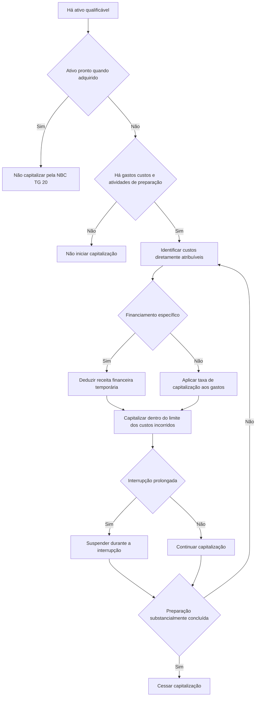

# NBC TG 20 (R2) — Custos de Empréstimos

> [!abstract] Resumo em 30 segundos
> Custos de empréstimos diretamente atribuíveis à aquisição, construção ou produção de um **ativo qualificável** integram o custo desse ativo, desde que atendidos os critérios de reconhecimento. Os demais custos de empréstimos são despesa do período. A capitalização começa quando coexistem gastos com o ativo, custos de empréstimos e atividades de preparação; é suspensa em interrupções prolongadas e cessa quando substancialmente pronto para uso ou venda. A entidade divulga o total capitalizado e a taxa de capitalização utilizada.

## Ficha rápida

| Campo | Síntese |
|---|---|
| Norma | NBC TG 20 (R2) — Custos de Empréstimos |
| Tema central | Capitalização ou reconhecimento como despesa dos custos de empréstimos |
| Unidade de análise | Custos atribuíveis a um ativo qualificável e período de preparação |
| Divulgação expressamente exigida | Total capitalizado no período e taxa de capitalização utilizada |
| Alteração identificada no texto da resolução | Redação do item 6(a), incluindo referência à NBC TG 48 |
| Efeito informado na resolução | A alteração entra em vigor na publicação e produz efeitos a partir de 1º de janeiro de 2018 |

## Objetivo e alcance

A norma estabelece como contabilizar os custos de empréstimos. A regra principal é capitalizar os custos diretamente atribuíveis à aquisição, construção ou produção de ativo qualificável, como parte do custo do ativo. Custos que não atendam a essa condição são reconhecidos como despesa quando incorridos.

O alcance abrange os custos de empréstimos da entidade. A norma **não trata do custo do capital próprio**, inclusive do custo de instrumentos patrimoniais classificados no patrimônio líquido.

A entidade não é obrigada a aplicar a norma aos custos diretamente atribuíveis a:

- ativo qualificável mensurado pelo valor justo, como ativos biológicos dentro do alcance da NBC TG 29;
- estoques produzidos ou manufaturados em larga escala e em bases repetitivas.

Essa dispensa é descrita como não obrigatoriedade de aplicação; não deve ser confundida com uma regra que imponha tratamento contábil específico para essas situações.

## Conceitos-chave

**Custos de empréstimos** são juros e outros custos incorridos pela entidade em conexão com o empréstimo de recursos. Podem incluir encargos financeiros calculados pelo método da taxa efetiva de juros, juros sobre passivos de arrendamento reconhecidos conforme a NBC TG 06 e variações cambiais de empréstimos em moeda estrangeira, na medida em que sejam tratadas como ajuste dos custos de juros.

**Ativo qualificável** é aquele que necessariamente demanda período substancial para ficar pronto para o uso ou a venda pretendida. Dependendo das circunstâncias, podem se qualificar estoques, plantas de manufatura, usinas de geração de energia, ativos intangíveis, propriedades para investimento e plantas portadoras.

Em geral, não são ativos qualificáveis os ativos financeiros, estoques produzidos em curto período e ativos que já estejam prontos para o uso ou a venda pretendida quando adquiridos.

**Atribuição direta**: são diretamente atribuíveis os custos de empréstimos que poderiam ter sido evitados se os gastos com o ativo qualificável não tivessem sido feitos. Quando há financiamento específico para determinado ativo, a identificação tende a ser mais direta. Em estruturas centralizadas de financiamento, com vários instrumentos ou operações entre entidades do mesmo grupo, pode ser necessário julgamento para determinar o montante atribuível.

> [!info] O teste não é apenas a existência de empréstimo
> A capitalização depende da relação entre o custo de empréstimo e a preparação de um ativo qualificável. Empréstimos sem destinação específica também podem gerar valores capitalizáveis, mas exigem aplicação da taxa de capitalização aos gastos com o ativo.

## Reconhecimento e mensuração

### Empréstimo específico

Quando os recursos são tomados especificamente para obter um ativo qualificável, o montante capitalizável corresponde aos custos efetivamente incorridos sobre esses empréstimos durante o período, **deduzida qualquer receita financeira** obtida com o investimento temporário dos recursos antes de sua aplicação no ativo.

**Cálculo conceitual:**

`Custos capitalizáveis = custos do empréstimo específico incorridos − receita financeira do investimento temporário`

### Empréstimos sem destinação específica

Quando a entidade usa empréstimos gerais para obter um ativo qualificável, aplica aos gastos com o ativo uma taxa de capitalização. Essa taxa é a média ponderada dos custos dos empréstimos aplicáveis que estiveram vigentes durante o período. O cálculo exclui os empréstimos feitos especificamente para obter ativo qualificável, conforme a condição descrita no texto: até que estejam completas as atividades necessárias para preparar esse ativo para o uso ou a venda pretendida.

O montante capitalizado não pode exceder o total dos custos de empréstimos incorridos no período. Conforme as circunstâncias, o cálculo pode considerar os empréstimos da controladora e das subsidiárias ou os empréstimos próprios de cada subsidiária.

### Condições para iniciar

A capitalização começa na primeira data em que as três condições a seguir são atendidas simultaneamente:

1. a entidade incorre em gastos com o ativo;
2. a entidade incorre em custos de empréstimos; e
3. a entidade inicia atividades necessárias para preparar o ativo para seu uso ou venda pretendida.

Os gastos considerados incluem desembolsos em dinheiro, transferências de outros ativos ou assunção de passivos onerosos. Devem ser reduzidos por recebimentos intermediários e subvenções relacionadas ao ativo.

As atividades de preparação podem incluir trabalho técnico e administrativo anterior à construção física, como a obtenção de permissões. Por outro lado, manter um ativo sem produção ou desenvolvimento que altere suas condições não basta para caracterizar atividade de preparação. Assim, empréstimos incorridos enquanto um terreno é preparado podem ser elegíveis; mantê-lo sem atividades de preparação não gera, por si só, custos capitalizáveis.

### Fluxo de decisão

## Aplicação passo a passo / checklist

- [ ] **Identifique o ativo:** ele demanda necessariamente período substancial para ficar pronto?
- [ ] **Verifique o alcance:** trata-se de ativo mensurado a valor justo ou de estoque produzido em larga escala e repetidamente, situações para as quais a aplicação não é requerida?
- [ ] **Determine o início:** já há gastos com o ativo, custos de empréstimos e atividades de preparação?
- [ ] **Mapeie os custos:** avalie quais custos seriam evitados se os gastos com o ativo não tivessem ocorrido.
- [ ] **Classifique o financiamento:** específico para o ativo ou proveniente de empréstimos sem destinação específica?
- [ ] **Calcule o valor:** no empréstimo específico, deduza receitas financeiras temporárias; nos empréstimos gerais, aplique a taxa de capitalização pertinente aos gastos.
- [ ] **Controle o limite:** não capitalize mais do que os custos de empréstimos incorridos no período.
- [ ] **Avalie interrupções:** suspenda a capitalização em períodos extensos de interrupção das atividades de desenvolvimento, observando as situações em que o trabalho técnico ou administrativo continua ou o atraso é parte necessária do processo.
- [ ] **Determine a conclusão:** cesse quando substancialmente todas as atividades necessárias estiverem concluídas.
- [ ] **Registre a divulgação:** total capitalizado e taxa de capitalização utilizada.

## Suspensão e cessação

A capitalização deve ser suspensa durante períodos extensos nos quais as atividades de desenvolvimento do ativo sejam interrompidas. Os custos incorridos nesse intervalo podem corresponder à manutenção do ativo parcialmente concluído e não se qualificam para capitalização.

Não se suspende a capitalização apenas porque há trabalho técnico ou administrativo substancial em andamento. Tampouco se suspende quando o atraso temporário é parte necessária do processo de conclusão — por exemplo, uma condição sazonal que atrase a construção e seja comum na região durante o período da obra.

A capitalização cessa quando estiverem substancialmente concluídas as atividades necessárias à preparação. A conclusão física costuma ser um indicador, mesmo que ainda reste trabalho administrativo rotineiro. Modificações menores pendentes também podem indicar que a preparação está substancialmente concluída.

Se partes de um ativo puderem ser usadas individualmente enquanto outras continuam em construção, a capitalização cessa para cada parte quando ela estiver substancialmente pronta. Se nenhuma parte puder ser usada antes da conclusão do conjunto, a cessação ocorre quando o conjunto atingir essa condição.

## Divulgação

A entidade deve divulgar:

1. o total de custos de empréstimos capitalizados durante o período; e
2. a taxa de capitalização utilizada para determinar o montante elegível.

## Exceções e erros comuns

> [!warning] Não capitalize automaticamente todos os juros
> A regra alcança apenas custos diretamente atribuíveis a ativo qualificável, sujeitos às condições e aos limites da norma. Os demais custos são despesa no período em que incorridos.

- **Confundir ativo em andamento com ativo qualificável:** estar em construção, por si só, não substitui o requisito de período substancial de preparação.
- **Começar antes de atender às três condições:** gastos, custos de empréstimos e atividades de preparação precisam coexistir para caracterizar a data de início.
- **Capitalizar custos durante mera manutenção:** manter o ativo sem desenvolvimento não é atividade suficiente para sustentar a capitalização.
- **Ignorar receitas financeiras temporárias:** no financiamento específico, elas reduzem os custos elegíveis.
- **Aplicar a taxa de capitalização sem limite:** o valor capitalizado não pode exceder os custos incorridos no período.
- **Suspender por qualquer atraso:** atrasos necessários ao processo e períodos de trabalho técnico ou administrativo substancial não exigem suspensão conforme os exemplos e critérios apresentados.
- **Manter a capitalização até o encerramento administrativo:** a conclusão substancial da preparação, e não necessariamente o fim de toda tarefa de rotina, determina a cessação.
- **Tratar partes utilizáveis como um único bloco:** quando cada parte puder ser usada individualmente, avalie a cessação separadamente para cada uma.

> [!tip] Verificação de recuperabilidade
> Se o valor contábil ou o custo final esperado do ativo qualificável exceder o montante recuperável ou o valor líquido de realização, a norma determina que o valor contábil seja reduzido conforme os requisitos de outras normas. Uma eventual reversão também depende dessas outras normas.

## Conexões com outras normas

- **NBC TG 08 e NBC TG 48:** citadas no item 6 para encargos financeiros calculados pelo método da taxa efetiva de juros.
- **NBC TG 06:** relacionada aos juros sobre passivos de arrendamento considerados entre os possíveis custos de empréstimos.
- **NBC TG 07:** referenciada no tratamento de subvenções relacionadas ao ativo, que reduzem os gastos considerados.
- **NBC TG 29:** aparece como exemplo de ativos biológicos mensurados a valor justo para os quais a aplicação da NBC TG 20 não é requerida.
- **Normas sobre redução ao montante recuperável ou valor líquido de realização:** aplicáveis à baixa do valor contábil quando os limites mencionados forem excedidos; a NBC TG 20 não detalha esses procedimentos.

## Fonte

PDF **NBC TG 20 (R2).pdf**, texto técnico da norma e texto da alteração da NBC TG 20 (R1) para NBC TG 20 (R2). A resolução identifica a alteração do item 6(a) e informa que seus efeitos se produzem a partir de 1º de janeiro de 2018.
