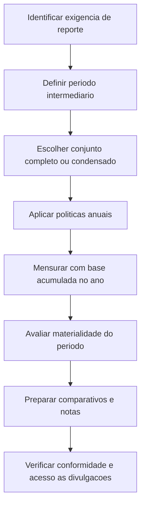

# NBC TG 21 (R4) — Demonstração Intermediária

> [!abstract] Resumo em 30 segundos
> A NBC TG 21 define o conteúdo mínimo e os princípios de reconhecimento e mensuração das demonstrações contábeis intermediárias. A entidade deve aplicar as mesmas políticas contábeis usadas nas demonstrações anuais, mensurar os períodos intermediários com base acumulada no ano até a data e divulgar informações relevantes sobre mudanças ocorridas desde o último encerramento anual. Demonstrações condensadas são permitidas, mas precisam conter os componentes mínimos, comparativos e notas explicativas selecionadas exigidos pela Norma.

## Ficha rápida

| Campo | Síntese |
|---|---|
| Norma | NBC TG 21 (R4) — Demonstração Intermediária |
| Tema | Conteúdo, reconhecimento, mensuração e divulgação em períodos intermediários |
| Período intermediário | Período inferior ao exercício social completo |
| Formato | Conjunto completo ou conjunto condensado de demonstrações contábeis |
| Objetivo prático | Atualizar usuários sobre a posição financeira, o desempenho e as mudanças relevantes desde o último exercício anual |
| Alteração identificada | A resolução da NBC TG 21 (R4), de 24 de novembro de 2017, informa efeitos a partir de 1º de janeiro de 2018 |

## Objetivo e alcance

A Norma estabelece o conteúdo mínimo das demonstrações intermediárias e princípios para reconhecer e mensurar elementos nelas apresentados. Relatórios intermediários tempestivos e confiáveis ajudam investidores, credores e outros usuários a avaliar a capacidade da entidade de gerar lucros e fluxos de caixa, além de sua condição financeira e liquidez.

A NBC TG 21 **não determina quais entidades devem divulgar demonstrações intermediárias, nem a frequência ou o prazo dessa divulgação**. Esses requisitos podem decorrer de governos, reguladores, bolsas de valores ou órgãos contábeis. Quando a entidade for requerida a divulgar ou publicar demonstrações intermediárias de acordo com as normas do CFC, aplica-se a NBC TG 21. Companhias abertas são incentivadas a seguir seus princípios; o texto encoraja a divulgação pelo menos semestral e em até 60 dias após o fim do período intermediário, ressalvada exigência legal diferente (item 1).

Cada demonstração — anual ou intermediária — é avaliada individualmente quanto à conformidade. Deixar de apresentar uma demonstração intermediária, ou apresentar uma que não esteja de acordo com esta Norma, **não implica, por si só**, que as demonstrações anuais estejam em desacordo (item 2).

## Conceitos-chave

- **Período intermediário:** período inferior ao exercício social completo.
- **Demonstração contábil intermediária:** conjunto completo de demonstrações, nos termos da NBC TG 26, ou conjunto condensado conforme a NBC TG 21.
- **Conjunto condensado:** forma intermediária que reduz repetição de informações já disponíveis nas demonstrações anuais, sem deixar de atualizar o usuário sobre fatos e mudanças relevantes.
- **Materialidade:** avaliada em relação às informações do próprio período intermediário. A avaliação considera que as mensurações intermediárias podem depender mais de estimativas do que as anuais (itens 23–25).
- **Base acumulada no ano até a data:** mensuração que considera o período desde o início do exercício até a data intermediária, em vez de tratar cada trimestre ou semestre como exercício autônomo (itens 28–29).

## Componentes e períodos apresentados

O conjunto intermediário condensado deve conter, pelo menos (item 8):

1. balanço patrimonial condensado;
2. demonstração condensada do resultado;
3. demonstração condensada do resultado abrangente;
4. demonstração condensada das mutações do patrimônio líquido;
5. demonstração condensada dos fluxos de caixa; e
6. notas explicativas selecionadas.

A demonstração do resultado abrangente pode ser apresentada junto à demonstração das mutações do patrimônio líquido (item 8A). A entidade pode apresentar o conjunto completo previsto na NBC TG 26; nesse caso, aplicam-se os requisitos daquela Norma para a forma e o conteúdo do conjunto completo (item 9).

As demonstrações intermediárias devem incluir os seguintes períodos comparativos (item 20):

| Demonstração | Período corrente | Comparativo |
|---|---|---|
| Balanço patrimonial | Fim do período intermediário | Fim do exercício social imediatamente anterior |
| Resultado e resultado abrangente | Período intermediário corrente e acumulado no exercício | Períodos intermediários correspondentes do exercício anterior |
| Mutações do patrimônio líquido | Acumulado no exercício | Acumulado no exercício anterior |
| Fluxos de caixa | Acumulado no exercício | Acumulado no exercício anterior |

Entidades com negócios altamente sazonais são encorajadas a considerar, além dos períodos requeridos, informações dos últimos 12 meses terminados na data intermediária e dos 12 meses comparáveis anteriores (item 21).

## Diagrama — preparação do relatório intermediário

## Aplicação passo a passo — checklist

- [ ] **Confirme se a entidade está requerida a divulgar** demonstrações intermediárias de acordo com as normas do CFC. A NBC TG 21 não cria, por si só, essa obrigação.
- [ ] **Determine o período intermediário** e se serão apresentados dados condensados ou o conjunto completo.
- [ ] **Prepare todos os componentes mínimos** se optar por demonstrações condensadas.
- [ ] **Inclua os comparativos apropriados** para cada demonstração; não use um único padrão comparativo para todos os componentes.
- [ ] **Mantenha os cabeçalhos, grupos ou subgrupos de contas e totais** apresentados nas demonstrações anuais mais recentes. Acrescente linhas se a omissão puder tornar a informação enganosa (item 10).
- [ ] **Avalie materialidade para o período intermediário**, inclusive para reconhecimento, mensuração, classificação e divulgação.
- [ ] **Atualize as notas anuais com eventos e transações significativos** ocorridos desde o encerramento do último exercício.
- [ ] **Revise estimativas anteriores** usando as informações disponíveis na data intermediária; divulgue alterações materiais quando exigido.
- [ ] **Verifique se declarações de conformidade são justificadas**: só descreva as demonstrações como conformes às normas do CFC se todos os requisitos aplicáveis forem atendidos (item 19).
- [ ] **Garanta acesso simultâneo e nas mesmas condições** a informações divulgadas por referência cruzada, quando usadas para cumprir divulgações exigidas (item 16A).

## Reconhecimento e mensuração

### Políticas contábeis e base de mensuração

A entidade deve aplicar nas demonstrações intermediárias as mesmas políticas contábeis aplicadas nas demonstrações anuais, exceto por alterações de políticas feitas depois da data das demonstrações anuais mais recentes, que serão refletidas nas próximas demonstrações anuais (item 28).

A frequência de reporte — anual, semestral ou trimestral — não deve alterar a mensuração do resultado anual. Por isso, as mensurações intermediárias são feitas com base acumulada no ano até a data. Uma estimativa revisada em período posterior do mesmo exercício pode afetar o valor acumulado reportado então, mas os valores divulgados em períodos intermediários anteriores **não são ajustados retrospectivamente**; a natureza e o montante das mudanças significativas de estimativa devem ser evidenciados (itens 35–36).

### Ativos, passivos, receitas e despesas

Os critérios de reconhecimento são os mesmos nos períodos anuais e intermediários. Um ativo precisa atender aos critérios aplicáveis nas datas intermediárias; custos que não se qualificam como ativos ao fim do período não devem ser diferidos para aguardar informações futuras ou nivelar resultados. Um passivo deve representar uma obrigação existente na data de reporte. Receitas e despesas são reconhecidas quando ocorreram as entradas ou saídas correspondentes de ativos ou passivos (itens 30–33).

Outras orientações expressamente presentes no trecho fornecido incluem:

- **Estimativas e perdas:** perdas de estoques, reestruturações e perdas por redução ao valor recuperável seguem os mesmos princípios que seriam aplicados nas demonstrações anuais. Mudanças posteriores na estimativa podem gerar reconhecimento adicional ou reversão, conforme aplicável (item 30).
- **Tributos sobre o lucro:** a despesa de cada período intermediário baseia-se na melhor estimativa da alíquota média efetiva ponderada anual esperada; a estimativa pode ser ajustada em períodos subsequentes do mesmo exercício (item 30).
- **Estimativas práticas:** os apêndices citam exemplos em que estimativas intermediárias podem ser utilizadas, como estoques, provisões, benefícios de pensão, contingências e avaliações a valor justo. A utilização de estimativas não elimina a necessidade de mensuração confiável e divulgação de mudanças relevantes.

> [!warning] Limite do texto fornecido
> A transcrição disponibilizada omite conteúdo intermediário após o item 36. Assim, não é possível resumir com segurança os requisitos detalhados dos itens 37 a 42, inclusive os tópicos indicados no sumário sobre receitas sazonais ou cíclicas, custos incorridos de forma não homogênea e uso de estimativas. Não complete esses requisitos por suposição.

## Divulgação

As notas explicativas intermediárias devem priorizar informações novas ou atualizadas, e não repetir informações já disponíveis nas demonstrações anuais. A entidade deve explicar eventos e transações significativos para compreender as mudanças patrimoniais, econômicas e financeiras e o desempenho desde o último exercício social (itens 15–15C).

A lista de eventos potencialmente significativos não é exaustiva. Entre os exemplos do item 15B estão: perdas ou reversões de perdas por redução ao valor recuperável; aquisições e baixas de imobilizado; compromissos de aquisição de imobilizado; liquidações de processos; correções de erros anteriores; inadimplência ou quebra de contrato de empréstimo não solucionada; transações com partes relacionadas; mudanças em contingências; alterações relevantes na mensuração ou classificação de instrumentos financeiros.

Além disso, quando materiais e não evidenciadas em outro lugar, devem ser incluídas informações como (item 16A):

- confirmação de continuidade das políticas e métodos de cálculo, ou descrição da natureza e dos efeitos de mudanças;
- efeitos de sazonalidade ou ciclicidade e itens não usuais;
- alterações de estimativas;
- emissões, recompras ou resgates de títulos e dividendos pagos;
- informações por segmento, quando requeridas pela NBC TG 22 para as demonstrações anuais;
- eventos subsequentes não refletidos no período intermediário;
- mudanças na composição da entidade, incluindo combinações de negócios, reestruturações e operações descontinuadas;
- divulgações de valor justo de instrumentos financeiros previstas nas normas citadas; e
- desagregação da receita de contratos com clientes requerida pela NBC TG 47.

As divulgações do item 16A são normalmente feitas com base no acumulado do ano até a data. Podem aparecer nas demonstrações intermediárias ou em outro documento acessível aos usuários nas mesmas condições e ao mesmo tempo, com referência cruzada. Se o acesso não for equivalente, o relatório intermediário é considerado incompleto.

## Exceções e erros comuns

> [!danger] Perda por redução ao valor recuperável do ágio
> O Apêndice D, na redação da NBC TG 21 (R4), conclui que a perda por impairment do goodwill reconhecida em período intermediário **não deve ser revertida** em período posterior. O consenso descrito nessa redação trata do goodwill; não deve ser estendido por analogia a outras áreas.

- **Tratar cada trimestre como período independente:** contraria a base acumulada no ano e pode distorcer o resultado anual.
- **Diferir custos sem definição de ativo:** não se deve manter no balanço um custo apenas para suavizar resultados ou aguardar informação futura.
- **Omitir uma linha por considerá-la pequena sem avaliar o efeito informativo:** linhas adicionais são necessárias quando a omissão puder tornar a demonstração enganosa.
- **Usar uma conclusão de conformidade sem cumprir todos os requisitos:** a declaração de conformidade não é uma afirmação genérica.
- **Repetir notas anuais sem atualizar fatos relevantes:** o foco intermediário é explicar mudanças significativas desde o último encerramento anual.
- **Presumir obrigação ou frequência de divulgação a partir da NBC TG 21:** a Norma não define quais entidades devem reportar nem a frequência geral.

## Conexões com outras normas

As relações abaixo são expressamente citadas no texto da NBC TG 21:

- **NBC TG 26:** apresentação do conjunto completo de demonstrações contábeis e referências sobre estrutura e comparativos.
- **NBC TG 23:** mudanças de políticas contábeis, estimativas e retificação de erros.
- **NBC TG 22:** divulgação de informações por segmento quando aplicável.
- **NBC TG 47:** desagregação da receita de contratos com clientes.
- **NBC TG 01:** redução ao valor recuperável de ativos, inclusive o tratamento específico do goodwill no Apêndice D.
- **NBC TG 46 e NBC TG 40:** divulgações relacionadas ao valor justo de instrumentos financeiros, conforme indicado no item 16A.

## Fonte

PDF fornecido: **NBC TG 21 (R4).pdf**. O documento identifica a alteração como Norma Brasileira de Contabilidade NBC TG 21 (R4), de 24 de novembro de 2017, e informa que suas alterações produzem efeitos a partir de 1º de janeiro de 2018. Os itens citados nesta nota são os identificáveis no texto fornecido.
