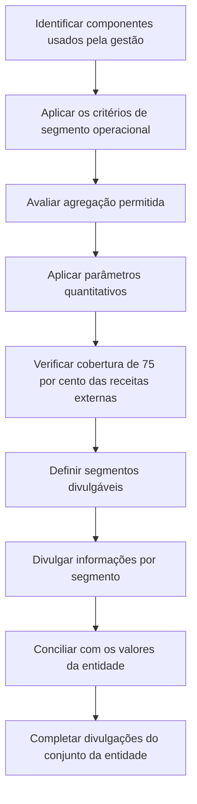

# NBC TG 22 (R2) — Informações por Segmento

> [!abstract] Resumo em 30 segundos
> A NBC TG 22 exige que determinadas entidades divulguem informações sobre seus segmentos operacionais para que os usuários avaliem a natureza e os efeitos financeiros dos negócios e dos ambientes econômicos em que atuam. A segmentação parte das informações regularmente examinadas pelo principal gestor das operações. Depois, a entidade identifica quais segmentos devem ser divulgados separadamente, aplica os parâmetros quantitativos, apresenta as informações exigidas e concilia os valores dos segmentos com os da entidade.

## Ficha rápida

| Campo | Síntese |
|---|---|
| Norma | NBC TG 22 (R2) — Informações por Segmento |
| Tema | Identificação, mensuração e divulgação de informações por segmento |
| Foco prático | Refletir a visão utilizada pela administração para alocar recursos e avaliar desempenho |
| Base para identificar segmentos | Componentes e informações examinados pelo principal gestor das operações |
| Aplicação | Demonstrações separadas ou individuais e demonstrações consolidadas, nas situações indicadas no alcance |
| Nota sobre a resolução | O texto da resolução da R2 informa aplicação aos exercícios iniciados a partir de 1º de janeiro de 2016. |

## Objetivo e alcance

O princípio básico é divulgar informações que permitam aos usuários avaliar a natureza e os efeitos financeiros das atividades de negócio da entidade e os ambientes econômicos em que ela opera (item 1).

A Norma aplica-se às demonstrações contábeis separadas ou individuais de entidades cujos instrumentos de dívida ou patrimoniais sejam negociados em mercado de capitais, ou que tenham depositado — ou estejam em vias de depositar — demonstrações perante a CVM ou outro regulador para emitir instrumentos nesse mercado. Aplica-se também às demonstrações consolidadas de controladoras que atendam a essas condições (item 2).

Se um relatório contiver demonstrações consolidadas e individuais de uma controladora dentro do alcance, a informação por segmento é exigida somente para as demonstrações consolidadas (item 4). Uma entidade que não esteja obrigada a aplicar a Norma pode divulgar informações sobre segmentos, mas não deve classificá-las como informações por segmento se elas não estiverem de acordo com a NBC TG 22 (item 3).

## Conceitos-chave

### Segmento operacional

É um componente da entidade que reúne estas três características (item 5):

1. desenvolve atividades de negócio que podem gerar receitas e despesas, inclusive em transações com outros componentes;
2. tem resultados operacionais regularmente revisados pelo principal gestor das operações para decisões de alocação de recursos e avaliação de desempenho; e
3. possui informação financeira individualizada disponível.

O componente pode ser segmento operacional antes de começar a gerar receitas, como pode ocorrer em operações em início de atividade. Em contrapartida, a sede corporativa ou departamentos funcionais podem não ser segmentos operacionais. Planos de benefícios pós-emprego não constituem segmentos operacionais para fins da Norma (item 6).

“Principal gestor das operações” é uma função, não necessariamente um cargo específico. O responsável pode ser um executivo, um grupo de diretores ou outra estrutura que exerça as funções de alocar recursos e avaliar o desempenho dos segmentos (item 7).

### Segmento divulgável

É o segmento operacional — ou o segmento formado por agregação permitida — para o qual a entidade deve apresentar informações separadamente. Em regra, deve superar pelo menos um parâmetro quantitativo. Há também exigências de divulgação para atingir a cobertura mínima de receitas externas, além da possibilidade de manter separado um segmento que continue significativo para a administração (itens 11 e 13 a 17).

### Agregação

Dois ou mais segmentos operacionais podem ser agregados se a agregação for compatível com o princípio básico, se tiverem características econômicas semelhantes e se forem semelhantes quanto a todos os aspectos listados no item 12:

- natureza dos produtos ou serviços;
- natureza dos processos de produção;
- tipo ou categoria de clientes;
- métodos de distribuição ou prestação dos serviços; e
- quando aplicável, natureza do ambiente regulatório.

A entidade também deve divulgar os julgamentos da administração sobre a agregação, com uma breve descrição dos segmentos agregados e dos indicadores econômicos considerados (item 22, alínea aa).

## Identificação dos segmentos: fluxo decisório

## Aplicação passo a passo e checklist

1. **Mapeie a estrutura gerencial.** Identifique os componentes cujos resultados são regularmente revisados pelo principal gestor das operações e verifique se há informação financeira individualizada.
2. **Defina o conjunto de segmentos operacionais.** Se houver mais de uma forma de organizar as informações, considere a natureza das atividades, a existência de gestores responsáveis e as informações apresentadas ao conselho. Em estruturas matriciais, determine qual conjunto de componentes melhor atende ao princípio básico (itens 8 a 10).
3. **Avalie a agregação.** Documente as características econômicas e a semelhança quanto aos critérios do item 12. Registre os julgamentos e indicadores econômicos utilizados.
4. **Teste cada segmento contra os parâmetros de 10%.** Um segmento atende ao teste se superar pelo menos um dos critérios quantitativos descritos abaixo.
5. **Verifique a cobertura de receitas externas.** Se os segmentos divulgáveis somarem menos de 75% das receitas externas da entidade, identifique segmentos adicionais até alcançar pelo menos 75%.
6. **Decida o tratamento dos demais segmentos.** Segmente a categoria “outros segmentos” e descreva as fontes de receita incluídas. Considere também se um segmento abaixo dos parâmetros continua significativo.
7. **Prepare as informações por período.** Apresente as informações gerais, os dados de resultado e ativos e, quando exigido, passivos e demais itens. Concilie os totais com os valores da entidade.
8. **Revise comparativos e divulgações complementares.** Avalie reapresentações por mudança na composição dos segmentos e prepare as informações sobre produtos e serviços, áreas geográficas e principais clientes.

## Reconhecimento e mensuração

A NBC TG 22 trata da divulgação por segmento. Para fins dessa divulgação, os montantes devem refletir os valores reportados ao principal gestor das operações para decisões de alocação de recursos e avaliação de desempenho (item 25). Isso significa que a informação por segmento acompanha a visão gerencial definida pela Norma; não se deve presumir que cada valor segmentado corresponda, sem ajustes, ao valor apresentado nas demonstrações da entidade.

| Informação | Exigência principal |
|---|---|
| Lucro ou prejuízo | Divulgar para cada segmento divulgável |
| Ativos e passivos | Divulgar se os respectivos valores forem apresentados regularmente ao principal gestor das operações |
| Receitas, despesas e demais itens especificados | Divulgar quando estiverem incluídos no resultado revisado pelo gestor ou forem apresentados regularmente a ele, conforme os itens 23 e 24 |
| Ajustes e eliminações | Incluir na mensuração segmentada somente na medida em que estejam incluídos nos valores usados pelo principal gestor |
| Valores alocados | Fazer a alocação em base razoável |

Entre os dados a divulgar por segmento, quando atendidas as condições do item 23, estão receitas de clientes externos e intersegmentos, receitas e despesas financeiras, depreciação e amortização, itens materiais de receita e despesa, equivalência patrimonial, imposto de renda e contribuição social e itens materiais não caixa, exceto depreciação e amortização.

As receitas financeiras devem ser apresentadas separadamente das despesas financeiras. A exceção permite apresentar o valor líquido quando a maioria das receitas do segmento vier de juros e a avaliação e alocação de recursos pelo principal gestor se basearem principalmente na receita financeira líquida. Nesse caso, a entidade deve informar que adotou essa forma de apresentação (item 23).

Se a administração usar mais de uma medida para avaliar resultado, ativos ou passivos, deve divulgar a medida que considere mais consistente com os princípios usados na mensuração dos valores correspondentes nas demonstrações da entidade. Também deve explicar as bases de mensuração e diferenças relevantes, inclusive as relativas a políticas contábeis, alocação de custos ou ativos comuns, alterações de métodos e alocações assimétricas (itens 26 e 27).

## Divulgação

### Informações gerais

Para cada segmento divulgável, a entidade deve explicar:

- os fatores usados para identificar os segmentos e a base de organização;
- se houve agregação e os julgamentos correspondentes; e
- os tipos de produtos e serviços dos quais cada segmento obtém receitas (item 22).

### Conciliações

A entidade deve conciliar os totais dos segmentos divulgáveis com os valores correspondentes da entidade, incluindo receitas, lucro ou prejuízo, ativos e passivos quando divulgados, além de outros itens materiais. Os itens materiais de conciliação devem ser identificados e descritos separadamente (item 28).

### Informação relativa ao conjunto da entidade

As divulgações dos itens 32 a 34 aplicam-se também a entidades com um único segmento divulgável. Elas são necessárias quando as informações não estiverem já integradas às informações por segmento:

- **Produtos e serviços:** receitas de clientes externos por produto ou serviço, ou por grupos semelhantes.
- **Áreas geográficas:** receitas externas atribuídas ao país-sede e aos países estrangeiros de origem; ativos não circulantes localizados no país-sede e nos países estrangeiros em que a entidade mantém ativos. Países estrangeiros materiais devem ser apresentados separadamente, e a base de atribuição das receitas deve ser informada.
- **Principais clientes:** quando um único cliente externo representar 10% ou mais das receitas totais, informar o fato, a receita total proveniente de cada cliente nessa condição e o segmento ou segmentos em que a receita é divulgada. A identidade do cliente não é exigida.

As divulgações geográficas e de produtos e serviços têm dispensa quando as informações necessárias não estiverem disponíveis e o custo de sua elaboração for excessivo; a situação deve ser informada. O texto também prevê que, se informações por região geográfica dentro do Brasil forem relevantes e usadas gerencialmente, sejam observadas as mesmas regras de evidenciação (itens 32 e 33).

## Exceções e erros comuns

> [!warning] Testes quantitativos
> Os parâmetros de 10% são alternativos: basta atender a um deles. Não confunda a receita usada no teste quantitativo — que inclui receitas internas e externas — com o teste de cobertura de 75%, baseado nas receitas externas.

- **Receita:** receita reconhecida do segmento, incluindo vendas externas e vendas ou transferências entre segmentos, igual ou superior a 10% da receita combinada interna e externa de todos os segmentos operacionais.
- **Resultado:** valor absoluto do lucro ou prejuízo do segmento igual ou superior a 10% do maior, em valor absoluto, entre o lucro combinado dos segmentos lucrativos e o prejuízo combinado dos segmentos deficitários.
- **Ativos:** ativos do segmento iguais ou superiores a 10% dos ativos combinados de todos os segmentos operacionais (item 13).

Segmentos que não atinjam os parâmetros podem ser divulgados separadamente se a administração considerar a informação útil. A agregação de segmentos abaixo dos parâmetros tem condições próprias; não basta que cada um seja pequeno. Se as receitas externas dos segmentos divulgáveis forem inferiores a 75% das receitas da entidade, devem ser incluídos segmentos adicionais, mesmo que não atendam aos parâmetros quantitativos (itens 13 a 15).

Outros pontos a observar:

- Se um segmento divulgado no período anterior continuar significativo, mantenha a divulgação separada mesmo que deixe de atender ao critério quantitativo (item 17).
- Ao tornar um segmento divulgável no período corrente, reapresente os comparativos, salvo indisponibilidade das informações e custo excessivo de preparação (item 18).
- Se a estrutura interna mudar e os comparativos não forem reapresentados, divulgue, no ano da mudança, os dados correntes tanto na base antiga quanto na nova, sujeito à mesma ressalva de disponibilidade e custo (itens 29 e 30).
- Mais de dez segmentos divulgáveis é um sinal para avaliar se a informação ficou excessivamente detalhada; o texto não estabelece um limite preciso (item 19).
- Não omita a categoria “outros segmentos” nem a descrição das fontes de suas receitas quando aplicável (item 16).
- Não confunda divulgação por segmento com reconhecimento de itens contábeis: os valores segmentados seguem a informação usada pela gestão, e as diferenças para os valores da entidade devem ser explicadas e conciliadas.

## Conexões com outras normas

O texto menciona a NBC TG 26 para itens materiais de receita e despesa e a NBC TG 33 para determinados ativos de benefícios pós-emprego excluídos da informação de ativos não circulantes geográficos (itens 23 e 33). Não são desenvolvidas, neste resumo, relações além das expressamente citadas na NBC TG 22.

## Fonte

**NBC TG 22 (R2) — Informações por Segmento**, PDF fornecido. Conteúdo técnico resumido a partir dos itens 1 a 34 e do Apêndice A. O PDF também inclui a resolução de alteração da R2, que informa aplicação aos exercícios iniciados a partir de 1º de janeiro de 2016.
