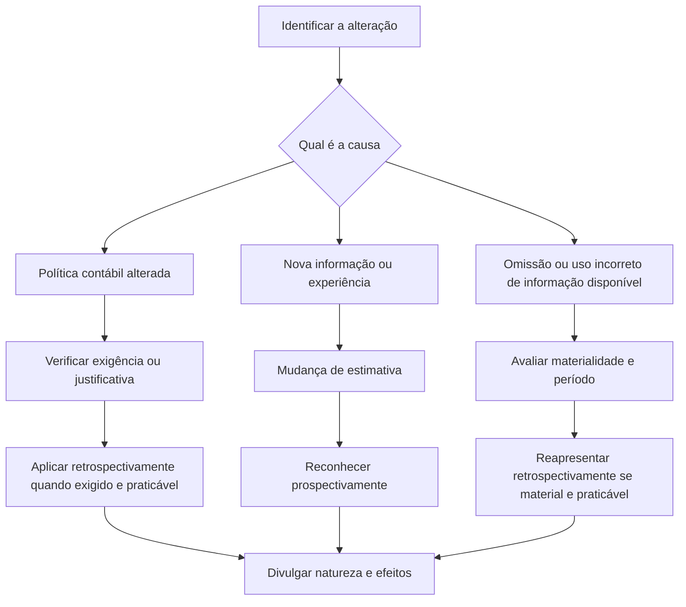

# NBC TG 23 (R2) — Políticas Contábeis, Mudança de Estimativa e Retificação de Erro

## Resumo em 30 segundos

A NBC TG 23 orienta como selecionar e aplicar políticas contábeis e como tratar mudanças de política, revisões de estimativas e erros de períodos anteriores. A regra central é distinguir a causa da alteração: **nova informação ou experiência** normalmente indica mudança de estimativa, reconhecida prospectivamente; **uso incorreto ou omissão de informação confiável disponível** pode caracterizar erro, corrigido retrospectivamente quando material e praticável. Mudanças de política também são, em regra, retrospectivas, respeitadas as disposições transitórias e os limites de praticabilidade. A norma exige divulgações que expliquem a natureza e os efeitos dessas alterações.

## Ficha rápida

| Campo | Síntese |
|---|---|
| Norma | NBC TG 23 (R2) |
| Tema | Políticas contábeis, mudanças de estimativa e retificação de erro |
| Aplicação | Seleção e aplicação de políticas; mudanças de políticas e estimativas; erros de períodos anteriores |
| Objetivo | Relevância, confiabilidade e comparabilidade das demonstrações contábeis |
| Referências expressas no texto | NBC TG 26, NBC TG 32, NBC TG 41, NBC TG 27, NBC TG 04, NBC TG 33 e NBC TG Estrutura Conceitual |

> [!info] Identificação da alteração
> O PDF identifica a NBC TG 23 (R2) como alteração do item 53 da versão anterior. A resolução reproduzida no documento informa que a alteração produz efeitos a partir de 1º de janeiro de 2018. Essa informação se refere à alteração identificada no texto da resolução.

## Objetivo e alcance

A norma define critérios para selecionar e mudar políticas contábeis e estabelece o tratamento contábil e as divulgações relativas a:

- mudanças nas políticas contábeis;
- mudanças nas estimativas contábeis; e
- retificação de erros de períodos anteriores.

Aplica-se à seleção e à aplicação de políticas e à contabilização desses três tipos de ocorrência. Os efeitos tributários de erros de períodos anteriores e de ajustes retrospectivos decorrentes de mudanças de política são tratados e divulgados conforme a **NBC TG 32 – Tributos sobre o Lucro**. Os requisitos gerais de divulgação de políticas contábeis, exceto os relativos a mudanças, são indicados como assunto da **NBC TG 26 – Apresentação das Demonstrações Contábeis**.

## Conceitos-chave

| Conceito | Como entender |
|---|---|
| Política contábil | Princípios, bases, convenções, regras e práticas específicas usados na elaboração e apresentação das demonstrações contábeis. |
| Mudança de estimativa | Ajuste decorrente de nova informação, inovação ou reavaliação da situação atual e das obrigações ou benefícios futuros esperados. Não é, por si só, correção de erro. |
| Erro de período anterior | Omissão ou incorreção decorrente de falta de uso, ou uso incorreto, de informação confiável que estava disponível e podia razoavelmente ter sido obtida e considerada quando as demonstrações anteriores foram elaboradas. |
| Aplicação retrospectiva | Aplicar a nova política como se ela sempre tivesse sido usada. |
| Reapresentação retrospectiva | Corrigir reconhecimento, mensuração e divulgação como se o erro anterior nunca tivesse ocorrido. |
| Aplicação prospectiva | Aplicar a mudança a transações e condições posteriores à mudança; no caso de estimativa, reconhecer seus efeitos nos períodos corrente e futuro afetados. |
| Impraticabilidade | Situação em que a entidade não consegue aplicar o requisito depois de todos os esforços razoáveis. Inclui casos em que não se determinam os efeitos ou em que seriam necessárias premissas sobre intenções passadas ou estimativas sem informação histórica objetivamente identificável. |

A avaliação da materialidade considera se a omissão ou incorreção pode influenciar decisões econômicas dos usuários. A materialidade depende da dimensão, da natureza ou da combinação de ambas, conforme as circunstâncias.

## Diagrama de decisão

## Aplicação passo a passo — checklist

1. **Identifique o fato contábil.** Determine se a questão é seleção de política, mudança de política, revisão de estimativa ou erro anterior.
2. **Procure norma específica.** Se uma norma, interpretação ou comunicado técnico tratar da transação ou condição, aplique seus requisitos e considere os guias de implementação relevantes.
3. **Se não houver orientação específica, fundamente o julgamento.** Desenvolva política que produza informação relevante e confiável. Consulte, em ordem, requisitos e orientações para assuntos semelhantes e os conceitos da Estrutura Conceitual. Outras posições técnicas e literatura podem ser consideradas se não conflitarem com essas fontes.
4. **Mantenha uniformidade.** Aplique políticas uniformemente a transações semelhantes, salvo se houver exigência ou permissão para classificar itens em categorias distintas; nesse caso, aplique uma política consistente a cada categoria.
5. **Se for mudança de política, teste a justificativa.** A mudança deve ser exigida por norma, interpretação ou comunicado técnico, ou resultar em informação confiável e mais relevante.
6. **Determine o método de aplicação.** Verifique disposições transitórias. Sem disposição específica aplicável, a mudança exigida na adoção inicial e a mudança voluntária são tratadas retrospectivamente, ressalvadas as limitações de praticabilidade.
7. **Se for estimativa, identifique os períodos afetados.** Reconheça o efeito no resultado do período corrente ou no período corrente e nos futuros afetados. Se atingir ativo, passivo ou componente do patrimônio líquido, ajuste o item correspondente.
8. **Se for erro, avalie materialidade e praticabilidade.** Erros materiais de períodos anteriores são corrigidos retrospectivamente: reapresente comparativos ou, se o erro for anterior ao período mais antigo apresentado, ajuste os saldos de abertura desse período.
9. **Documente limitações.** Se a aplicação ou reapresentação retrospectiva for impraticável, identifique o período mais antigo praticável e explique a situação; não use percepção posterior para reconstruir intenções ou valores passados.
10. **Prepare as divulgações aplicáveis.** Informe natureza, razões quando cabível, valores por período e itens afetados, limitações e efeitos futuros conhecidos ou estimáveis.

> [!tip] Materialidade não autoriza distorção intencional
> A norma diz que políticas previstas em normas podem não ser aplicadas quando seu efeito for imaterial. Isso não torna apropriado produzir ou deixar de corrigir incorreções imateriais intencionalmente para alcançar determinada apresentação.

## Reconhecimento e mensuração

### Políticas contábeis

A entidade só deve mudar uma política contábil quando a mudança for exigida ou produzir informação confiável e mais relevante. A adoção de política para transações que diferem em essência das anteriores, ou que não ocorriam antes ou eram imateriais, não constitui mudança de política.

Quando a aplicação retrospectiva for exigida, ajuste o saldo de abertura de cada componente do patrimônio líquido afetado no período anterior mais antigo apresentado e os demais valores comparativos, como se a política sempre tivesse sido aplicada. O ajuste de períodos anteriores pode ser registrado em lucros ou prejuízos acumulados ou, quando exigido, em outro componente do patrimônio líquido.

Se a retrospectiva for impraticável, aplique a política desde o período mais antigo para o qual seja praticável. Se não for possível determinar o efeito cumulativo no início do período corrente, aplique prospectivamente desde o período mais antigo praticável e ignore a parcela anterior que não puder ser determinada.

### Estimativas contábeis

Estimativas razoáveis são parte essencial da elaboração das demonstrações e não reduzem sua confiabilidade. Podem exigir revisão por mudanças nas circunstâncias, novas informações ou maior experiência. Exemplos do texto incluem créditos de liquidação duvidosa, obsolescência de estoques, valor justo, vida útil e obrigações de garantia.

O efeito é reconhecido prospectivamente: no resultado corrente se afetar apenas esse período; ou no resultado corrente e nos futuros afetados. Se a mudança afetar ativos, passivos ou patrimônio líquido, ajuste o item correspondente no período da mudança.

> [!warning] Base de avaliação
> Mudança na base de avaliação é mudança de política contábil, não mudança de estimativa. Se for difícil distinguir as duas, a norma determina tratar a mudança como estimativa.

### Erros de períodos anteriores

Corrija retrospectivamente erros materiais no primeiro conjunto de demonstrações autorizado após sua descoberta. Reapresente os comparativos do período em que o erro ocorreu ou, se anterior ao período mais antigo apresentado, os saldos de abertura de ativos, passivos e patrimônio líquido desse período. A correção não deve integrar o resultado do período em que o erro foi descoberto.

Se for impraticável determinar os efeitos por período ou o efeito cumulativo, corrija a partir da data mais antiga praticável, ajustando os saldos de abertura ou os comparativos conforme aplicável. Não confunda erro com revisão de estimativa motivada por informação adicional.

## Divulgação

| Situação | Divulgações principais |
|---|---|
| Adoção inicial de norma, interpretação ou comunicado | Título, natureza da mudança, disposições transitórias aplicáveis, ajustes do período corrente e dos comparativos por item afetado, ajuste relativo a períodos anteriores apresentados e, quando aplicável, efeitos futuros. Se a retrospectiva for impraticável, explicar as circunstâncias e como e desde quando a política foi aplicada. |
| Mudança voluntária de política | Natureza da mudança; por que a nova política fornece informação confiável e mais relevante; ajustes do período corrente e dos comparativos por item; ajuste de períodos anteriores apresentados; e explicação da impraticabilidade, quando houver. |
| Nova norma emitida, ainda não adotada | Informar que não foi adotada antecipadamente e divulgar informação disponível ou razoavelmente estimável sobre o possível impacto. A norma enumera título, natureza da mudança, data exigida, data planejada para adoção inicial e avaliação do impacto ou explicação de por que não pode ser estimado. |
| Mudança de estimativa | Natureza e montante do efeito no período corrente e, se esperado, em períodos subsequentes. Se o efeito futuro for impraticável de divulgar, informar esse fato. |
| Erro de período anterior | Natureza do erro; montante da retificação por período e item afetado; ajuste no início do período mais antigo apresentado; e, se aplicável, circunstâncias da impraticabilidade e como e desde quando o erro foi corrigido. |

Quando aplicável à entidade, as divulgações de ajustes incluem os efeitos sobre resultados por ação básicos e diluídos, conforme indicado no texto. As divulgações sobre mudanças e erros não precisam ser repetidas nas demonstrações de períodos subsequentes.

## Exceções e erros comuns

- **Tratar toda revisão como erro:** nova informação ou experiência normalmente leva a mudança de estimativa; erro decorre de informação confiável disponível que não foi usada ou foi usada incorretamente.
- **Alterar política sem justificativa:** mudança voluntária só é admitida se resultar em informação confiável e mais relevante.
- **Aplicar política de forma inconsistente:** uniformidade é a regra para transações semelhantes, ressalvadas classificações permitidas ou exigidas.
- **Confundir retrospectiva com prospectiva:** políticas e erros materiais seguem, em regra, tratamento retrospectivo; estimativas são reconhecidas prospectivamente.
- **Invocar impraticabilidade sem análise:** a entidade deve ter feito esforços razoáveis. Dificuldade, por si só, não substitui a avaliação dos critérios da norma.
- **Usar conhecimento posterior:** não use informações surgidas depois para presumir intenções da administração ou estimar valores de períodos anteriores. A estimativa retrospectiva deve refletir as circunstâncias existentes na época e as informações então disponíveis.
- **Presumir que estimativas significativas impedem correção:** a necessidade de estimativas relevantes não impede, por si só, ajuste ou correção confiável.

## Conexões com outras normas

- **NBC TG 26:** requisitos gerais de divulgação de políticas contábeis, exceto mudanças de política.
- **NBC TG 32:** efeitos tributários de erros anteriores e de ajustes retrospectivos de políticas.
- **NBC TG 41:** resultados por ação básicos e diluídos nas divulgações de ajustes, quando aplicável.
- **NBC TG 27 e NBC TG 04:** tratamento próprio da aplicação inicial da política de reavaliação, quando permitida pela legislação e regulação mencionadas no texto.
- **NBC TG Estrutura Conceitual:** definições, critérios de reconhecimento e conceitos de mensuração usados como fonte de julgamento na ausência de norma específica.

## Fonte

**NBC TG 23 (R2) – Políticas Contábeis, Mudança de Estimativa e Retificação de Erro**, PDF fornecido, páginas 1–12. O corpo técnico está reproduzido principalmente nas páginas 1–10; as páginas 11–12 contêm o texto das alterações anteriores e da alteração identificada como R2.
