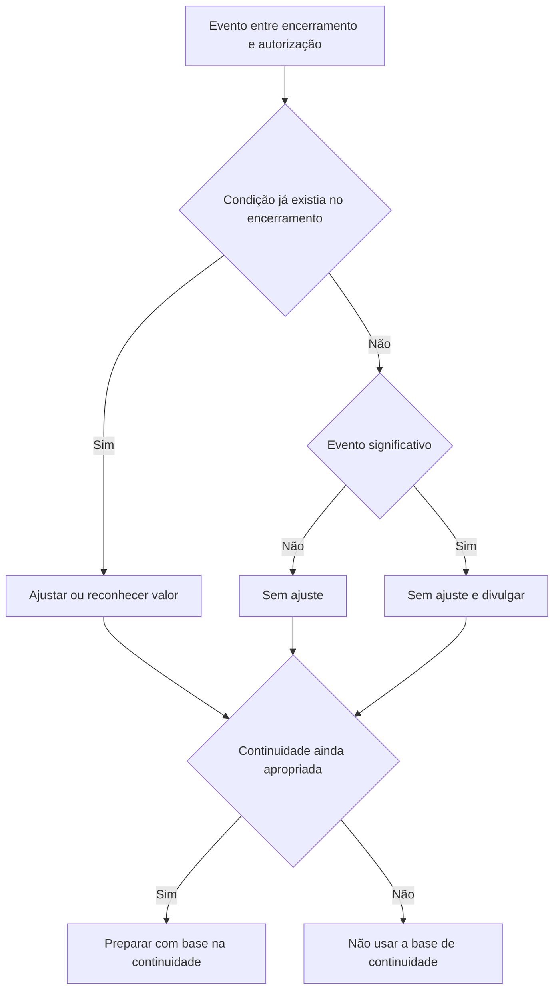

# NBC TG 24 (R2) — Evento Subsequente

## Resumo em 30 segundos

A NBC TG 24 trata dos eventos ocorridos entre o encerramento do período contábil e a data em que as demonstrações contábeis são autorizadas para emissão. A decisão central é verificar se o evento confirma uma condição que já existia no encerramento ou se decorre de uma condição surgida depois:

- **Condição já existente no encerramento:** ajustar os valores reconhecidos — ou reconhecer um item que ainda não estava registrado.
- **Condição surgida depois do encerramento:** não ajustar os valores do período; se o evento for significativo, divulgar sua natureza e estimar o efeito financeiro, ou informar que não é possível estimá-lo.
- **Continuidade:** se, após o encerramento, a administração concluir que pretende liquidar a entidade, deixar de operar ou não tem alternativa realista a isso, as demonstrações não devem ser elaboradas com base na continuidade.

> [!abstract] Regra prática
> A data de autorização para emissão delimita o período de análise. A classificação depende da condição subjacente, não apenas de quando a informação ou o evento se tornou conhecido.

## Ficha rápida

| Campo | Síntese |
|---|---|
| Norma | NBC TG 24 (R2) — Evento Subsequente |
| Grupo | 02 - NBC TG |
| Tema central | Contabilização e divulgação de eventos subsequentes |
| Período considerado | Do encerramento do período contábil até a autorização para emissão |
| Decisão principal | Ajustar, não ajustar com divulgação quando significativa, ou rever a base de continuidade |
| Fonte utilizada | PDF “NBC TG 24 (R2).pdf” |

## Objetivo e alcance

A norma determina quando a entidade deve ajustar suas demonstrações contábeis por causa de eventos subsequentes e quais informações deve divulgar sobre:

1. a data em que as demonstrações foram autorizadas para emissão e quem concedeu a autorização; e
2. os eventos subsequentes ao período a que as demonstrações se referem.

Também determina que a entidade não use a premissa de continuidade quando eventos posteriores indicarem que essa base deixou de ser apropriada. Aplica-se à contabilização e à divulgação de eventos subsequentes (itens 1–2, p. 1).

## Conceitos-chave

**Evento subsequente** é um evento favorável ou desfavorável ocorrido entre o encerramento do período contábil e a data de autorização para emissão das demonstrações (item 3, p. 2).

| Categoria | O que indica | Tratamento principal |
|---|---|---|
| Evento que origina ajuste | Evidência de condição existente na data de encerramento | Ajustar valores reconhecidos ou reconhecer item aplicável |
| Evento que não origina ajuste | Condição surgida depois da data de encerramento | Não ajustar os valores do período; divulgar se significativo |

**Data de autorização para emissão** é a data em que a emissão é autorizada segundo o processo aplicável à entidade. Esse processo pode variar conforme sua estrutura administrativa, exigências legais e estatutárias e procedimentos de preparação e finalização (itens 4–7, pp. 2–3).

A aprovação posterior dos acionistas não altera necessariamente essa data: nos exemplos da norma, a autorização ocorre quando a administração autoriza a emissão ou a apresentação ao conselho competente. Os eventos ocorridos após anúncio público de lucros, mas até a autorização, continuam dentro do período considerado pela norma (itens 5–7, pp. 2–3).

## Diagrama de decisão

## Aplicação passo a passo — checklist

1. **Identifique a data de encerramento** do período a que as demonstrações se referem.
2. **Determine a data de autorização para emissão** e quem concede a autorização conforme o processo aplicável.
3. **Levante os eventos ocorridos entre essas datas**, inclusive os identificados depois de eventual anúncio público de lucros.
4. **Avalie a condição que o evento evidencia:** ela já existia no encerramento ou surgiu posteriormente?
5. **Se já existia, avalie o ajuste** dos valores reconhecidos ou o reconhecimento de item ainda não registrado.
6. **Se surgiu depois, não ajuste os valores do período.** Avalie se o evento é significativo e exige divulgação.
7. **Atualize divulgações** sobre condições existentes no encerramento quando forem recebidas novas informações, mesmo que os valores reconhecidos não mudem.
8. **Reavalie a continuidade**, especialmente diante de deterioração dos resultados ou da situação financeira após o encerramento.
9. **Inclua as divulgações exigidas:** data e responsável pela autorização; eventual poder de terceiros para alterar as demonstrações após a emissão; e informações sobre eventos significativos sem ajuste.

## Reconhecimento e mensuração

### Eventos que originam ajustes

A entidade ajusta os valores reconhecidos para refletir eventos que evidenciem condições existentes na data de encerramento (item 8, p. 3). A norma também inclui o reconhecimento de itens que não haviam sido registrados.

Exemplos apresentados pela norma (item 9, pp. 3–4):

- **Decisão ou pagamento em processo judicial** após o encerramento que confirme uma obrigação presente já existente: ajustar a provisão ou reconhecer nova provisão, conforme aplicável.
- **Falência de cliente após o encerramento** que confirme perda por redução ao valor recuperável do crédito existente no fim do período: ajustar o valor contábil correspondente.
- **Venda posterior de estoques** que forneça evidência sobre o valor realizável líquido desses estoques no encerramento.
- **Informação posterior sobre custo de ativo adquirido** ou sobre valor de ativo recebido em troca de ativo vendido antes do encerramento.
- **Determinação posterior de participação nos lucros ou gratificações**, se havia obrigação presente legal ou construtiva no encerramento em decorrência de eventos anteriores.
- **Descoberta de fraude ou erro** que demonstre que as demonstrações estavam incorretas.

> [!tip] Pergunta de controle
> A informação posterior confirma uma situação que já existia no encerramento? Se sim, avalie o ajuste. O fato de a evidência surgir depois, por si só, não transforma o evento em não ajustável.

### Eventos que não originam ajustes

A entidade não ajusta os valores reconhecidos por eventos que indiquem condições surgidas após o período contábil (item 10, p. 4). Um exemplo é a queda do valor justo de investimentos ocorrida depois do encerramento: em regra, ela reflete circunstâncias do período seguinte, não a condição do investimento no encerramento (item 11, p. 4).

Se o evento for significativo, a entidade divulga sua natureza e uma estimativa do efeito financeiro — ou declara que essa estimativa não pode ser feita (item 21, p. 6). Portanto, **não ajustar não significa necessariamente não divulgar**.

### Dividendos

Dividendos declarados após o período contábil não são reconhecidos como passivo no encerramento, inclusive quando declarados antes da autorização para emissão. A norma justifica que, nessa data, não há obrigação presente que atenda aos critérios mencionados no texto. Os dividendos devem ser divulgados nas notas explicativas conforme a NBC TG 26 (itens 12–13, pp. 4–5).

### Continuidade

A entidade não deve elaborar as demonstrações com base na continuidade se a administração determinar, após o encerramento, que pretende liquidar a entidade, cessar as operações ou que não tem alternativa realista a isso (item 14, p. 5).

A deterioração posterior dos resultados ou da situação financeira pode exigir que a administração reavalie essa premissa. Se a continuidade não for apropriada, a consequência é uma mudança fundamental nos critérios contábeis adotados, e não apenas um ajuste de valores calculados sob a base original (item 15, p. 5).

## Divulgação

A entidade deve divulgar:

- **Data de autorização para emissão e quem a concedeu.**
- **Se sócios ou outros têm poder para alterar as demonstrações após sua emissão.** A norma destaca a relevância de informar a data porque as demonstrações não refletem eventos posteriores a ela (itens 17–18, p. 5).
- **Informações atualizadas sobre condições existentes no encerramento**, quando novas evidências forem recebidas após essa data. Isso pode ser necessário mesmo quando tais informações não alteram valores reconhecidos, como no caso de evidência posterior relativa a contingência passiva (itens 19–20, pp. 5–6).
- **Para cada categoria significativa de eventos sem ajuste:** a natureza do evento e a estimativa de seu efeito financeiro, ou a declaração de que não é possível estimá-lo (item 21, p. 6).

Entre os exemplos de eventos sem ajuste que normalmente podem exigir divulgação estão combinação de negócios importante, plano de descontinuação de operação, aquisição ou alienação relevante de ativos, incêndio em instalação importante, reestruturação significativa, grandes mudanças em preços ou taxas de câmbio, alterações tributárias com efeito significativo, garantias relevantes e litígio importante originado exclusivamente após o encerramento (item 22, p. 6).

## Exceções e erros comuns

> [!warning] Não classifique só pela data em que a informação chegou
> Uma informação recebida após o encerramento pode confirmar condição já existente e, portanto, levar a ajuste. O critério é a condição evidenciada.

> [!warning] Evento sem ajuste ainda pode exigir divulgação
> Se for significativo, divulgue sua natureza e o efeito financeiro estimado, ou informe que não foi possível estimá-lo.

> [!danger] Não mantenha a base de continuidade se ela deixou de ser apropriada
> A conclusão de que a entidade será liquidada, deixará de operar ou não tem alternativa realista exige abandonar essa base; não se trata apenas de recalcular valores segundo os critérios anteriores.

Outros erros a evitar:

- Considerar a aprovação posterior dos acionistas como a data de autorização em todos os casos.
- Encerrar a análise na data de anúncio público de lucros, embora o período de análise possa seguir até a autorização para emissão.
- Reconhecer dividendos declarados depois do encerramento como passivo daquele período.
- Deixar de atualizar uma divulgação sobre condição existente apenas porque os valores reconhecidos não foram alterados.

## Conexões com outras normas

As relações abaixo são expressamente citadas no texto da NBC TG 24:

| Norma citada | Relação indicada |
|---|---|
| NBC TG 25 — Provisões, Passivos Contingentes e Ativos Contingentes | Provisões e divulgação de contingências, inclusive diante de evidência posterior |
| NBC TG 33 — Benefícios a Empregados | Participação nos lucros e gratificações |
| NBC TG 39 — Instrumentos Financeiros: Apresentação | Instrumentos de patrimônio relacionados aos dividendos |
| NBC TG 26 — Apresentação das Demonstrações Contábeis | Divulgação de dividendos e divulgações relacionadas à continuidade |
| NBC TG 15 — Combinação de Negócios | Divulgação específica em combinações de negócios posteriores |
| NBC TG 31 — Ativo Não Circulante Mantido para Venda e Operação Descontinuada | Classificação de ativos mantidos para venda |
| NBC TG 32 — Tributos sobre o Lucro | Alterações tributárias com efeito sobre ativos e passivos fiscais |

## Fonte

PDF fornecido: **NBC TG 24 (R2).pdf**, texto técnico da NBC TG 24 (R2), pp. 1–6. A alteração identificada como R2 informa efeitos a partir de 1º de janeiro de 2018 (p. 7).
