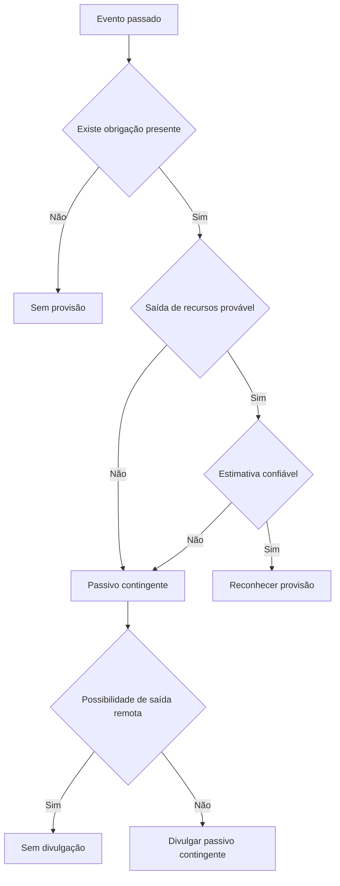

# NBC TG 25 (R2) — Provisões, Passivos Contingentes e Ativos Contingentes

> [!abstract] Resumo em 30 segundos
> Reconheça uma **provisão** quando houver obrigação presente decorrente de evento passado, for provável a saída de recursos e o valor puder ser estimado com confiabilidade. Mensure-a pela melhor estimativa na data do balanço, considerando riscos e, quando material, o valor do dinheiro no tempo. **Passivos contingentes não são reconhecidos**; em geral, são divulgados, salvo quando remota a possibilidade de saída. **Ativos contingentes não são reconhecidos**; divulgam-se quando a entrada de benefícios econômicos for provável, e reconhecem-se quando a realização se tornar praticamente certa.

## Ficha rápida

| Campo | Síntese |
|---|---|
| Norma | NBC TG 25 (R2) |
| Tema | Provisões, passivos contingentes e ativos contingentes |
| Foco prático | Distinguir obrigação presente de expectativa de gasto futuro; decidir entre reconhecer, divulgar ou não fazer nada |
| Data indicada no PDF | Alterações com efeitos a partir de 1º de janeiro de 2018 |
| Fonte | PDF da NBC TG 25 (R2), conforme identificado ao final |

O PDF informa que a R2 alterou o alcance relativo a instrumentos financeiros e às normas específicas aplicáveis a provisões e contratos onerosos. A resolução de alteração está reproduzida ao final do documento; este resumo prioriza os requisitos técnicos apresentados na norma.

## Objetivo e alcance

A norma estabelece critérios de reconhecimento e bases de mensuração para provisões, passivos contingentes e ativos contingentes. Exige informação em notas explicativas suficiente para que os usuários compreendam sua natureza, oportunidade e valor.

Aplica-se à contabilização desses elementos, exceto quando:

- resultarem de contratos a executar, salvo se forem onerosos; ou
- estiverem cobertos por outra norma.

A norma não se aplica a instrumentos financeiros dentro do alcance da NBC TG 48. Quando outra norma tratar especificamente do assunto, ela prevalece. O texto também prevê aplicação da NBC TG 25 a contratos com clientes que sejam ou se tornem onerosos, pois a NBC TG 47 não contém requisito específico para esses casos. Contratos de execução que não sejam onerosos ficam fora do alcance.

“Provisão” significa um passivo de prazo ou valor incertos. O termo não abrange ajustes de valores contábeis de ativos, como depreciação, redução ao valor recuperável e créditos de liquidação duvidosa.

## Conceitos-chave

| Conceito | Como aplicar |
|---|---|
| **Provisão** | Passivo de prazo ou valor incertos, reconhecido se os critérios da norma forem atendidos. |
| **Obrigação presente** | Obrigação legal ou não formalizada originada por evento passado. |
| **Obrigação não formalizada** | Surge de práticas, políticas ou declarações específicas que criam expectativa válida em terceiros de que a entidade assumirá determinada responsabilidade. |
| **Passivo contingente** | Obrigação possível; ou obrigação presente não reconhecida por falta de probabilidade de saída ou de estimativa confiável. |
| **Ativo contingente** | Ativo possível cuja existência depende de evento futuro incerto fora do controle total da entidade. |
| **Contrato oneroso** | Contrato em que os custos inevitáveis de cumprir as obrigações excedem os benefícios econômicos esperados. |
| **Reestruturação** | Programa planejado e controlado pela administração que altera materialmente o alcance do negócio ou a forma de conduzi-lo. |

A incerteza quanto ao prazo ou ao valor não torna, por si só, uma provisão um passivo contingente. A diferença essencial é se a obrigação satisfaz os critérios de reconhecimento.

## Árvore de decisão

Em casos raros de dúvida sobre a existência de obrigação presente, considere toda a evidência disponível. Presume-se que ela existe quando for mais provável que sim do que não que a obrigação esteja presente na data do balanço.

## Aplicação passo a passo — checklist

1. **Identifique o evento passado.** Pergunte se ele já criou uma obrigação que existe independentemente das ações futuras da entidade.
2. **Verifique se há obrigação presente.** Pode ser legal ou não formalizada. Uma decisão interna, sem comunicação ou implementação que crie expectativa válida, não basta por si só.
3. **Avalie a probabilidade de saída.** “Provável” significa mais provável que sim do que não. Para obrigações semelhantes, avalie o conjunto, não apenas cada ocorrência isolada.
4. **Teste a possibilidade de estimar o valor.** Estimativas são normalmente apropriadas; somente em casos extremamente raros não haverá estimativa confiável.
5. **Decida o tratamento.** Reconheça a provisão se os três critérios forem atendidos. Se não houver reconhecimento, avalie se cabe divulgar passivo contingente.
6. **Mensure e reavalie.** Use a melhor estimativa na data do balanço e atualize-a em cada encerramento.
7. **Prepare a divulgação.** Apresente as informações exigidas para provisões, passivos contingentes e ativos contingentes, conforme o caso.

## Reconhecimento e mensuração

### Provisões

Uma provisão é reconhecida somente se, cumulativamente:

- existir obrigação presente, legal ou não formalizada, decorrente de evento passado;
- for provável uma saída de recursos com benefícios econômicos para liquidar a obrigação; e
- houver estimativa confiável do valor.

Gastos futuros para operar, treinar equipes, fazer manutenção ou adaptar instalações não geram provisão apenas porque são esperados ou exigidos para o futuro. A entidade precisa ter uma obrigação presente na data do balanço, que não possa evitar por suas próprias ações futuras.

### Melhor estimativa

A provisão corresponde à melhor estimativa do desembolso necessário para liquidar ou transferir a obrigação na data do balanço. A estimativa considera o julgamento da administração, a experiência em situações semelhantes, relatórios de especialistas quando pertinentes e evidências de eventos posteriores à data do balanço.

- Para uma população grande de itens, use o valor esperado: desfechos ponderados pelas probabilidades associadas.
- Para uma obrigação individual, o desfecho mais provável pode ser a melhor estimativa, mas considere também outros resultados possíveis.
- Se os desfechos possíveis formarem uma faixa contínua em que cada valor seja igualmente provável, use o ponto médio.

Considere riscos e incertezas sem criar provisões excessivas nem contar o mesmo risco mais de uma vez. A provisão é mensurada antes dos impostos; os efeitos fiscais são tratados pela NBC TG 32.

Quando o efeito do valor do dinheiro no tempo for material, desconte os desembolsos esperados. A taxa deve ser antes dos impostos e refletir as avaliações atuais de mercado sobre o valor do dinheiro no tempo e os riscos específicos do passivo. Não inclua na taxa riscos já incorporados nos fluxos de caixa estimados. O aumento da provisão descontada pela passagem do tempo é despesa financeira.

Eventos futuros entram na mensuração quando houver evidência objetiva suficiente de que ocorrerão. Ganhos esperados com a alienação de ativos não reduzem a provisão; esses ganhos são reconhecidos conforme a norma aplicável ao ativo.

### Passivos e ativos contingentes

**Passivo contingente:** não reconhecer. Divulgar, a menos que a possibilidade de saída de recursos seja remota. Reavaliar periodicamente: se a saída se tornar provável, reconhecer provisão no período da mudança, desde que seja possível estimar o valor com confiabilidade.

**Ativo contingente:** não reconhecer enquanto a entrada de benefícios não for praticamente certa. Divulgar quando a entrada for provável. Se a entrada se tornar praticamente certa, o ativo e o ganho correspondente deixam de ser contingentes e são reconhecidos no período da mudança.

### Reembolsos, revisão e uso

Reconheça um reembolso esperado como **ativo separado** somente quando for praticamente certo que será recebido se a entidade liquidar a obrigação. O ativo de reembolso não pode exceder o valor da provisão. A despesa relacionada pode ser apresentada líquida do reembolso. Se a entidade não for responsável pela parcela que a terceira parte deixaria de pagar, essa parcela não integra sua provisão.

Reavalie provisões em cada data de balanço e ajuste-as à melhor estimativa corrente. Reverta a provisão quando deixar de ser provável a saída de recursos. Use-a exclusivamente para os desembolsos para os quais foi originalmente reconhecida.

## Casos específicos

- **Perdas operacionais futuras:** não constituem provisão. A expectativa pode indicar que ativos estão sujeitos a perda por não recuperabilidade; avalie-os conforme a NBC TG 01.
- **Contratos onerosos:** reconheça a obrigação presente como provisão. Os custos inevitáveis correspondem ao menor custo líquido de sair do contrato: custo de cumprimento ou compensações e penalidades por não cumprimento. Antes da provisão, reconheça eventual perda por desvalorização dos ativos relacionados.
- **Reestruturações:** reconheça provisão apenas se os critérios gerais forem cumpridos. A obrigação não formalizada requer plano formal detalhado e criação de expectativa válida nos afetados, por início da implementação ou anúncio suficientemente específico. Uma decisão interna isolada não basta.
- **Venda de unidade operacional:** a entidade não está comprometida até existir contrato firme de venda. Uma decisão anunciada, por si só, não cria a obrigação de vender.
- **Custos de reestruturação:** inclua apenas desembolsos diretos necessariamente ocasionados pela reestruturação e não associados às atividades em andamento. Exclua, por exemplo, treinamento ou remanejamento de pessoal permanente, marketing e investimentos em novos sistemas ou redes de distribuição. Não inclua perdas operacionais futuras, salvo as relativas a contrato oneroso.

## Divulgação

| Elemento | Informação requerida |
|---|---|
| Cada classe de provisão | Saldo inicial e final; adições; valores utilizados; reversões; efeito da passagem do tempo e de mudanças na taxa de desconto |
| Cada classe de provisão | Natureza da obrigação, cronograma esperado de saídas, incertezas relevantes e reembolsos esperados, incluindo o ativo reconhecido |
| Cada classe de passivo contingente | Natureza e, quando praticável, efeito financeiro estimado, incertezas e possibilidade de reembolso |
| Ativo contingente | Quando a entrada for provável: natureza e, quando praticável, estimativa dos efeitos financeiros |

Não é exigida informação comparativa para a movimentação de provisões. Agrupe itens apenas quando sua natureza for suficientemente similar para que a divulgação conjunta continue adequada. Quando provisão e passivo contingente decorrerem das mesmas circunstâncias, evidencie a ligação entre eles. Evite divulgar ativos contingentes de modo que sugira indevidamente a probabilidade de ganhos.

Se informações requeridas não forem praticáveis de divulgar, informe esse fato. Em casos extremamente raros, se a divulgação puder prejudicar seriamente a posição da entidade em uma disputa, a norma permite omitir as informações afetadas, mas exige descrição geral da disputa e justificativa para a omissão.

## Exceções e erros comuns

> [!warning] Pontos de atenção
> - Não constituir provisão para gastos que dependam de ações futuras da entidade.
> - Não tratar automaticamente toda incerteza como passivo contingente: provisões também têm incerteza de prazo ou valor.
> - Não reconhecer passivo contingente nem ativo contingente enquanto permanecer contingente.
> - Não compensar provisão com reembolso que não seja praticamente certo.
> - Não incluir ganhos de alienação esperados na mensuração.
> - Não usar uma provisão para desembolsos diferentes daqueles que motivaram seu reconhecimento.
> - Não reconhecer provisão de reestruturação com base apenas em decisão administrativa ainda não comunicada ou implementada de modo a criar expectativa válida.

## Conexões explícitas com outras normas

- **NBC TG 01:** recuperabilidade de ativos associada a perdas operacionais futuras, contratos onerosos e certos casos de venda de unidade operacional.
- **NBC TG 12:** referência expressa ao ajuste a valor presente na mensuração descontada.
- **NBC TG 32:** consequências fiscais das provisões e de suas alterações.
- **NBC TG 24:** divulgação de reestruturação material ocorrida após a data do balanço, nas condições descritas no texto.
- **NBC TG 06, NBC TG 47 e NBC TG 48:** normas citadas para arrendamentos, contratos com clientes onerosos e instrumentos financeiros, respectivamente.

## Fonte

PDF **NBC TG 25 (R2).pdf**, texto técnico “Provisões, Passivos Contingentes e Ativos Contingentes” e apêndices ilustrativos. Os requisitos resumidos encontram-se nas páginas 2–16; exemplos de aplicação e divulgação, nas páginas 17–24; texto da resolução de alteração, na página 25. O PDF informa que as alterações entram em vigor na data da publicação e produzem efeitos a partir de 1º de janeiro de 2018.
