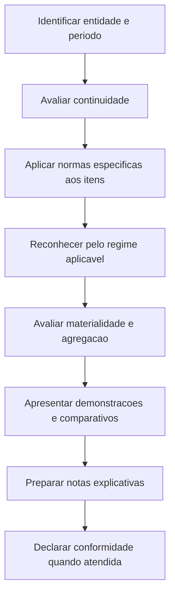

# NBC TG 26 (R5) — Apresentação das Demonstrações Contábeis

> [!abstract] Resumo em 30 segundos
> A NBC TG 26 estabelece a base para apresentar demonstrações contábeis de propósito geral de modo apropriado e comparável. Define o conjunto completo de demonstrações, orienta a apresentação, a agregação, a comparabilidade, a continuidade e o regime de competência. As normas específicas tratam do reconhecimento e da mensuração de transações; a NBC TG 26 organiza como as informações resultantes devem ser apresentadas e divulgadas.

## Ficha rápida

| Campo | Síntese |
|---|---|
| Norma | NBC TG 26 (R5) |
| Tema | Apresentação das demonstrações contábeis |
| Objetivo central | Favorecer a comparabilidade entre períodos da mesma entidade e entre entidades |
| Aplicação | Demonstrações elaboradas e apresentadas segundo normas, interpretações e comunicados técnicos do CFC |
| Referência do arquivo | *NBC TG 26 (R5).pdf* |

## Objetivo e alcance

A norma define requisitos gerais de apresentação, diretrizes para a estrutura das demonstrações e requisitos mínimos de conteúdo. Busca que as informações sobre posição patrimonial e financeira, desempenho e fluxos de caixa sejam úteis às avaliações e decisões econômicas dos usuários. Também considera a prestação de contas da administração pelos recursos que lhe foram confiados (itens 1 e 9; páginas 2 e 6).

Aplica-se às demonstrações contábeis elaboradas de acordo com as normas, interpretações e comunicados técnicos do CFC. O reconhecimento, a mensuração e a divulgação de transações específicas são tratados por outras normas (itens 2 e 3; página 2). A NBC TG 26 também alcança entidades que apresentam demonstrações consolidadas ou separadas.

**Limites e adaptações expressamente indicados no texto:**

- A estrutura e o conteúdo de demonstrações intermediárias condensadas seguem a NBC TG 21; ainda assim, os itens 13 a 35 da NBC TG 26 aplicam-se a essas demonstrações (item 4; página 2).
- Entidades sem fins lucrativos podem precisar adaptar descrições de rubricas e demonstrações.
- Entidades sem capital próprio ou cujo capital não seja apresentado como patrimônio líquido podem precisar adaptar a apresentação aos interesses e participações de seus membros ou proprietários (itens 5 e 6; páginas 2–3).
- Relatórios apresentados fora das demonstrações contábeis, como relatórios ambientais e sociais, não estão no âmbito das normas do CFC, conforme o texto fornecido (item 14; página 8).

## Conceitos-chave

| Conceito | Aplicação prática |
|---|---|
| Demonstrações de propósito geral | Atendem usuários externos que não podem solicitar relatórios feitos sob medida para suas necessidades específicas. |
| Materialidade | Considera se omissão, distorção ou obscuridade pode influenciar decisões dos usuários; depende da natureza, da magnitude ou de ambas. |
| Notas explicativas | Complementam as demonstrações com explicações narrativas, detalhamentos e informações sobre itens que não atendem aos critérios de reconhecimento. |
| Resultado do período | Receitas menos despesas, exceto itens reconhecidos como outros resultados abrangentes. |
| Outros resultados abrangentes | Itens de receita e despesa reconhecidos fora do resultado quando assim requerido ou permitido pelas normas aplicáveis. |
| Resultado abrangente | Mutação do patrimônio líquido decorrente de eventos que não sejam transações com proprietários nessa condição. |

A entidade pode usar outros termos para os totais — por exemplo, “lucro líquido” para “resultado” — desde que o sentido permaneça claro (itens 7 e 8; páginas 3–6).

## Conjunto completo e arquitetura da apresentação

O conjunto completo inclui:

- balanço patrimonial ao final do período;
- demonstração do resultado do período;
- demonstração do resultado abrangente;
- demonstração das mutações do patrimônio líquido;
- demonstração dos fluxos de caixa;
- demonstração do valor adicionado, quando exigida legalmente ou por regulador, ou se apresentada voluntariamente;
- notas explicativas;
- informações comparativas do período anterior; e
- balanço patrimonial no início do período mais antigo comparativo em determinadas aplicações retrospectivas, reapresentações ou reclassificações previstas no texto.

As demonstrações que compõem o conjunto devem receber igual importância. O resultado abrangente pode ser apresentado em demonstração própria ou, conforme indicado pela norma, em apresentação conjunta ou nas mutações do patrimônio líquido, observadas as condições descritas no texto e a legislação societária brasileira (itens 10, 10A e 11; páginas 7–8).

## Diagrama do processo

## Aplicação passo a passo — checklist

- [ ] **Definir a base de preparação:** identificar as normas, interpretações e comunicados aplicáveis às demonstrações.
- [ ] **Avaliar a continuidade:** considerar a capacidade de a entidade continuar em operação e as informações disponíveis sobre o futuro.
- [ ] **Usar o regime de competência:** aplicá-lo às demonstrações, exceto à demonstração dos fluxos de caixa.
- [ ] **Montar o conjunto completo:** incluir as demonstrações, notas e informações comparativas requeridas.
- [ ] **Organizar as rubricas:** separar classes materiais semelhantes e itens de natureza ou função distinta, salvo se imateriais.
- [ ] **Evitar compensações indevidas:** apresentar separadamente ativos, passivos, receitas e despesas, exceto quando exigido ou permitido ou quando a apresentação refletir a essência da transação.
- [ ] **Revisar a inteligibilidade:** não ocultar informação material em linguagem vaga, dispersa ou agregada inadequadamente.
- [ ] **Preparar as notas:** complementar os valores apresentados com informações elucidativas necessárias à compreensão.
- [ ] **Verificar a declaração de conformidade:** afirmá-la de forma explícita e sem reservas somente se todos os requisitos aplicáveis forem cumpridos.

## Reconhecimento e mensuração

A NBC TG 26 é principalmente uma norma de apresentação. Ela não substitui as regras específicas de reconhecimento e mensuração: essas regras são objeto de outras normas, interpretações e comunicados (item 3; página 2).

Para as demonstrações, a entidade utiliza o regime de competência, exceto para a demonstração dos fluxos de caixa. Sob esse regime, os itens são reconhecidos quando satisfazem as definições e os critérios de reconhecimento dos elementos contábeis previstos na Estrutura Conceitual (itens 27 e 28; páginas 13–14).

A apresentação apropriada pressupõe representação fidedigna dos efeitos das transações, eventos e condições. A aplicação das normas pertinentes, acompanhada de divulgações adicionais quando necessárias, é a base indicada para alcançar esse objetivo (itens 15 e 17; páginas 8–9).

O texto também esclarece que mensurar ativos líquidos de provisões relacionadas — como provisão para obsolescência de estoques ou para créditos de liquidação duvidosa — não constitui, por si só, compensação (item 33; página 14).

## Divulgação

As notas explicativas integram o conjunto completo. Além de apresentarem políticas contábeis materiais e outras informações elucidativas, podem fornecer descrições narrativas, aberturas de valores e informações sobre itens que não foram reconhecidos nas demonstrações (itens 7 e 10; páginas 4 e 7).

A entidade deve declarar nas notas, de forma explícita e sem reservas, que suas demonstrações estão em conformidade com as normas, interpretações e comunicados técnicos do CFC **somente se cumprir todos os requisitos aplicáveis** (item 16; páginas 8–9).

O texto também prevê divulgação específica para situações excepcionais em que a administração conclua que cumprir determinado requisito produziria apresentação enganosa e conflitante com o objetivo das demonstrações. Se a entidade deixar de aplicar o requisito, deve informar, entre outros aspectos, qual requisito não aplicou, por que o tratamento seria inadequado, qual tratamento adotou e os impactos financeiros por período e item. Se a estrutura regulatória proibir a não aplicação, deve divulgar a natureza do requisito, as razões da conclusão e os ajustes considerados necessários para reduzir os aspectos inadequados (itens 19 a 24; páginas 9–12).

## Exceções e erros comuns

> [!warning] Situação excepcional não é opção de política contábil
> A não aplicação de requisito é prevista para circunstâncias extremamente raras e sujeita às condições e divulgações descritas nos itens 19 a 24. A entidade não deve usar esse tratamento como alternativa ordinária de apresentação.

- **Confundir apresentação com mensuração:** a NBC TG 26 estabelece a estrutura de apresentação; normas específicas tratam das transações.
- **Compensar saldos sem base:** compensação não é a regra. Só cabe quando exigida ou permitida por norma ou quando refletir a essência da transação, conforme o texto.
- **Agregar itens materiais de natureza diferente:** a agregação não deve ocultar informação relevante nem reduzir a compreensibilidade.
- **Tratar materialidade como um limite apenas quantitativo:** natureza e magnitude, isoladas ou combinadas, podem ser determinantes.
- **Afirmar conformidade parcial:** não se pode declarar conformidade com as normas do CFC se algum requisito aplicável não tiver sido cumprido.
- **Omitir incertezas de continuidade:** incertezas relevantes que possam lançar dúvidas significativas sobre a continuidade devem ser divulgadas. Se a base de continuidade não for usada, devem ser divulgados esse fato, as bases adotadas e a razão.

A avaliação de continuidade considera informações disponíveis sobre o futuro por, no mínimo, doze meses a partir da data do balanço; a análise depende dos fatos e circunstâncias da entidade (itens 25 e 26; páginas 12–13).

## Conexões com outras normas

| Norma citada no texto | Relação indicada |
|---|---|
| NBC TG 21 | Demonstrações intermediárias condensadas; os itens 13 a 35 da NBC TG 26 também se aplicam a elas. |
| NBC TG 35 e NBC TG 36 | Referências para demonstrações separadas e consolidadas. |
| NBC TG 23 | Seleção e aplicação de políticas contábeis. |
| NBC TG 09 | Demonstração do valor adicionado. |
| NBC TG 47 | Mensuração de receita de contrato com cliente, citada no contexto de apresentação de receitas e compensações. |
| NBC TG 25 | Provisões e possibilidade de apresentar despesas relacionadas com reembolso contratual de forma compensada, nos termos do exemplo da norma. |
| NBC TG 48 | Itens financeiros relacionados a resultado, outros resultados abrangentes e instrumentos de hedge. |

## Fonte

Conselho Federal de Contabilidade. **NBC TG 26 (R5) — Apresentação das Demonstrações Contábeis**. Arquivo fornecido: *NBC TG 26 (R5).pdf*. Referências de páginas e itens foram incluídas apenas quando identificáveis no texto disponibilizado.
