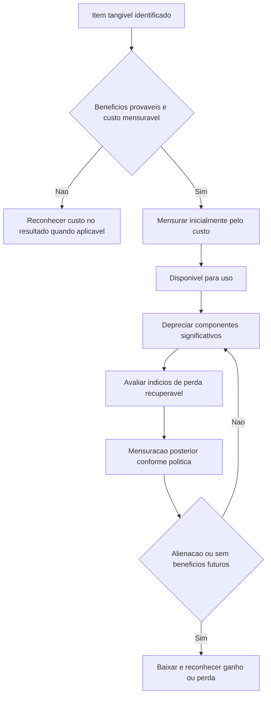

# NBC TG 27 (R4) — Ativo Imobilizado

> [!abstract] Resumo em 30 segundos
> A NBC TG 27 disciplina o reconhecimento, a mensuração, a depreciação, a redução ao valor recuperável, a baixa e a divulgação de ativos imobilizados. Reconheça um item quando for provável que gere benefícios econômicos futuros e seu custo puder ser mensurado confiavelmente. Inicialmente, mensure pelo custo; depois, aplique o modelo de custo ou, se permitido por lei, o modelo de reavaliação. Deprecie sistematicamente os componentes significativos ao longo da vida útil e reconheça manutenção periódica no resultado.

## Ficha rápida

| Campo | Síntese |
|---|---|
| Norma | NBC TG 27 (R4) — Ativo Imobilizado |
| Objetivo | Informar sobre o investimento em imobilizado e suas mutações, incluindo valores contábeis, depreciação e perdas por desvalorização. |
| Aplicação | Contabilização de ativos imobilizados, salvo quando outra norma exigir ou permitir tratamento diferente. |
| Mensuração inicial | Custo. |
| Mensuração posterior | Custo menos depreciação e perdas acumuladas; ou reavaliação, quando permitida por lei. |
| Referência no PDF | Texto técnico: páginas 1–17. Alteração identificada como NBC TG 27 (R4): páginas 17–19. |

> [!info] O que identifica a R4
> O texto da resolução identifica alterações nos itens 68A, 69 e 72, relacionadas à transferência para estoques de ativos antes alugados e mantidos para venda, à data da alienação e à mensuração da contrapartida. O texto técnico consolidado também apresenta as disposições gerais da norma.

## Objetivo e alcance

A norma busca permitir que os usuários das demonstrações contábeis compreendam o investimento da entidade em ativos imobilizados e as mudanças nesse investimento. Para isso, trata principalmente do reconhecimento dos ativos, da determinação do valor contábil, da depreciação e das perdas por redução ao valor recuperável.

Aplica-se à contabilização de ativos imobilizados, exceto quando outra norma exigir ou permitir tratamento diferente. Não se aplica, entre outros casos, a ativos imobilizados classificados como mantidos para venda; a ativos biológicos ligados à atividade agrícola que não sejam plantas portadoras; à exploração e avaliação de recursos minerais; nem a direitos sobre jazidas e reservas minerais. A norma aplica-se, contudo, ao imobilizado usado para desenvolver ou manter determinados ativos excluídos do seu alcance. Plantas portadoras são abrangidas, mas os produtos dessas plantas não.

A NBC TG 27 não define uma unidade de medida obrigatória para cada item. A entidade exerce julgamento para determinar se deve reconhecer itens separadamente ou agregar itens individualmente insignificantes, como ferramentas e moldes.

## Conceitos-chave

| Termo | Significado prático |
|---|---|
| Ativo imobilizado | Item tangível mantido para produção ou fornecimento, aluguel a terceiros ou fins administrativos, esperado para uso por mais de um período. |
| Custo | Valor pago em caixa ou equivalente, ou valor justo de outro recurso entregue, na aquisição ou construção; pode haver valor atribuído por outra norma. |
| Valor contábil | Valor reconhecido após dedução da depreciação e das perdas por redução ao valor recuperável acumuladas. |
| Valor depreciável | Custo, ou valor que o substitua, menos valor residual. |
| Depreciação | Alocação sistemática do valor depreciável ao longo da vida útil. |
| Valor recuperável | Maior entre o valor justo menos custos de venda e o valor em uso. |
| Vida útil | Período de uso esperado pela entidade ou unidades de produção que espera obter. |
| Valor residual | Estimativa líquida do que a entidade obteria pela venda do ativo ao fim da vida útil, consideradas a idade e a condição esperadas. |

## Diagrama do tratamento contábil

## Aplicação passo a passo

1. **Identifique o item e sua finalidade.** Verifique se é tangível, se será usado na produção, no fornecimento, para aluguel ou em atividades administrativas e se a expectativa é utilizá-lo por mais de um período.
2. **Aplique os critérios de reconhecimento.** Reconheça como ativo somente se forem prováveis os benefícios econômicos futuros associados e se o custo puder ser mensurado confiavelmente.
3. **Avalie os gastos quando incorridos.** Analise tanto os gastos iniciais quanto os posteriores. Separe manutenção periódica, substituições de partes e inspeções importantes.
4. **Determine o custo inicial.** Inclua os elementos diretamente relacionados a colocar o ativo no local e na condição necessários para operar como pretendido pela administração.
5. **Defina os componentes e a depreciação.** Aloque o valor reconhecido aos componentes significativos, estime vida útil e valor residual e escolha método que reflita o padrão de consumo.
6. **Aplique a política posterior.** Use o modelo de custo; a reavaliação é uma alternativa somente quando permitida por lei e deve abranger a classe aplicável.
7. **Revise estimativas e recuperabilidade.** Revise, pelo menos ao final de cada exercício, vida útil, valor residual e método de depreciação. Aplique a NBC TG 01 para perdas por redução ao valor recuperável.
8. **Baixe o item quando cabível.** Baixe na alienação ou quando não houver expectativa de benefícios futuros pelo uso ou alienação.
9. **Prepare as divulgações.** Concilie os saldos e divulgue políticas, estimativas e informações exigidas para cada classe.

> [!tip] Checklist de capitalização
> Antes de incluir um gasto no custo, confirme se ele é necessário para colocar o ativo no local e na condição pretendidos e se ocorreu antes de o ativo estar pronto para operar. Se o gasto for de uso, transferência, reorganização ou manutenção periódica, em regra, não o inclua no valor contábil.

## Reconhecimento e mensuração

### Reconhecimento dos gastos

Custos de aquisição ou construção são avaliados segundo os critérios de reconhecimento. A mesma avaliação se aplica a gastos posteriores. Peças de reposição, sobressalentes e equipamentos de uso interno podem ser imobilizado quando se espera seu uso por mais de um período ou quando só podem ser usados em conexão com itens do imobilizado.

Manutenção periódica, principalmente mão de obra, consumíveis e pequenas peças, é reconhecida no resultado quando incorrida. O custo de uma peça substituída é reconhecido no valor contábil quando os critérios são atendidos; o valor contábil da peça substituída deve ser baixado. O custo de inspeção importante pode ser reconhecido como substituição se os critérios forem satisfeitos, baixando-se o saldo remanescente da inspeção anterior.

### Custo inicial

O custo compreende:

- preço de aquisição, impostos de importação e tributos não recuperáveis, líquidos de descontos e abatimentos;
- custos diretamente atribuíveis à preparação do ativo para operar como pretendido, como preparação do local, frete, instalação, montagem, testes e honorários profissionais;
- estimativa inicial dos custos de desmontagem, remoção e restauração do local, quando aplicável.

O reconhecimento de custos no valor contábil cessa quando o ativo está no local e nas condições operacionais pretendidas. Custos de abertura de instalações, lançamento de produtos, treinamento, administração, capacidade ociosa, perdas operacionais iniciais e realocação de operações não integram o custo do imobilizado.

Quando o pagamento excede os prazos normais de crédito, o custo é equivalente ao preço à vista na data do reconhecimento. A diferença é, em regra, despesa de juros ao longo do prazo, salvo se puder ser capitalizada conforme a NBC TG 20. Em permutas, a mensuração é pelo valor justo, exceto quando a operação não tiver natureza comercial ou os valores justos não puderem ser mensurados confiavelmente. Nesses casos, usa-se o valor contábil do ativo cedido.

### Mensuração após o reconhecimento e depreciação

No modelo de custo, apresente o ativo ao custo menos depreciação e perdas por redução ao valor recuperável acumuladas. A reavaliação exige que o valor justo seja mensurável confiavelmente, que seja permitida por lei e que a política seja aplicada à classe inteira. O PDF inclui nota de que a reavaliação de bens tangíveis e intangíveis não é permitida pelas disposições legais ali identificadas; portanto, não trate a reavaliação como opção automaticamente disponível.

Deprecie separadamente cada componente cujo custo seja significativo em relação ao total. O valor depreciável deve ser alocado sistematicamente durante a vida útil. A depreciação começa quando o ativo está disponível para uso e normalmente não cessa apenas por o ativo estar ocioso. Cessa quando o ativo é classificado como mantido para venda ou baixado, o que ocorrer primeiro.

A vida útil considera uso esperado, desgaste físico, obsolescência técnica ou comercial e limites legais. Terrenos e edifícios são contabilizados separadamente: normalmente, terrenos têm vida útil ilimitada e não são depreciados, enquanto edifícios são depreciáveis. O método deve refletir o consumo dos benefícios econômicos; a norma cita linha reta, saldos decrescentes e unidades produzidas. Método baseado na receita gerada pelo uso do ativo não é apropriado.

## Divulgação

Para cada classe, divulgue critérios de mensuração, métodos de depreciação, vidas úteis ou taxas, valores brutos e depreciação e perdas acumuladas no início e no fim do período, além da conciliação das alterações no saldo. A conciliação inclui, conforme aplicável, adições, baixas, depreciações, aquisições em combinações de negócios, perdas e reversões por desvalorização, variações cambiais e outras alterações.

Divulgue também, entre outros pontos, ativos com titularidade restrita ou oferecidos em garantia, gastos incluídos no imobilizado em construção e compromissos contratuais de aquisição. Mudanças relevantes em estimativas de valor residual, custos de desmontagem e restauração, vida útil ou método de depreciação devem ser divulgadas conforme a NBC TG 23. A norma encoraja informações sobre ativos temporariamente ociosos, totalmente depreciados ainda em uso e retirados do uso ativo.

## Exceções e erros comuns

> [!warning] Pontos de atenção
> - **Capitalizar manutenção periódica:** em regra, é incorreto; reconheça no resultado quando incorrida.
> - **Manter no saldo o componente substituído:** baixe o valor contábil da parte substituída, mesmo que não estivesse depreciada separadamente.
> - **Depreciar o item inteiro sem analisar componentes:** componentes significativos devem ser depreciados separadamente.
> - **Parar a depreciação por ociosidade:** a ociosidade, por si só, não interrompe a depreciação.
> - **Incluir custos posteriores à preparação do ativo:** gastos de uso, transferência ou reorganização após o ativo estar pronto não integram seu custo.
> - **Usar receita como base de depreciação:** a norma não considera apropriado método baseado na receita da atividade que utiliza o ativo.
> - **Reavaliar ativos seletivamente:** quando o método for permitido e adotado, a avaliação alcança a classe inteira.

A indenização de terceiros por ativo perdido, desvalorizado ou abandonado é reconhecida no resultado quando se torna recebível. A perda, a indenização e a aquisição ou construção de um ativo substituto são eventos separados e contabilizados separadamente.

Na baixa, reconheça o ganho ou a perda no resultado; o ganho não é classificado como receita de venda. Para itens normalmente alugados a terceiros e depois mantidos para venda no curso das atividades operacionais, transfira-os para estoques pelo valor contábil quando deixarem de ser alugados. O texto da R4 vincula a receita da venda à NBC TG 47 e determina que a data da alienação corresponda à obtenção do controle pelo recebedor.

## Conexões com outras normas

- **NBC TG 01:** redução ao valor recuperável e reversão de perdas.
- **NBC TG 16:** estoques, inclusive custos de obrigações de desmontagem relacionados à produção e mensuração de itens produzidos ao preparar o imobilizado.
- **NBC TG 20:** critérios para capitalização de juros em ativo construído pela própria entidade.
- **NBC TG 23:** mudanças de estimativa contábil, como vida útil, valor residual e método de depreciação.
- **NBC TG 25:** reconhecimento e mensuração de obrigações de desmontagem, remoção e restauração.
- **NBC TG 47:** nos itens alterados pela R4, reconhecimento da receita, data da alienação e determinação da contrapartida.

## Fonte

PDF fornecido: **NBC TG 27 (R4).pdf**, texto técnico nas páginas 1–17 e texto da resolução nas páginas 17–19. A resolução identifica a alteração dos itens 68A, 69 e 72.
