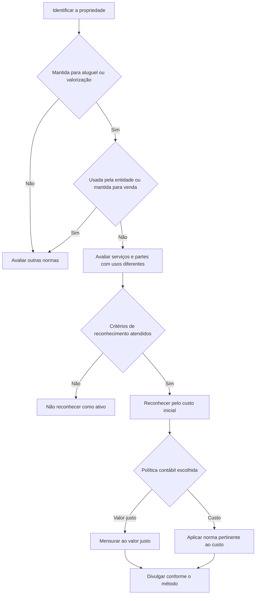

# NBC TG 28 (R4) — Propriedade para Investimento

## Resumo em 30 segundos

A NBC TG 28 trata do reconhecimento, da mensuração e da divulgação de propriedades mantidas para obter aluguel, valorização do capital ou ambos. A classificação depende do uso efetivo da propriedade: em geral, ela é propriedade para investimento quando seus fluxos de caixa são independentes dos demais ativos da entidade e ela não é usada pela própria entidade nem mantida para venda no curso ordinário dos negócios.

Após o reconhecimento inicial pelo custo, a entidade escolhe, como política contábil, o método do valor justo ou o método do custo e, ressalvadas as condições específicas da norma, aplica o método escolhido às propriedades para investimento. No método do valor justo, as variações são reconhecidas no resultado. No método do custo, aplicam-se os requisitos pertinentes da NBC TG 27, da NBC TG 06 ou da NBC TG 31, conforme a situação.

> [!abstract] Essência prática
> Primeiro determine **para que a propriedade é efetivamente mantida**; depois aplique os critérios de reconhecimento e custo inicial; por fim, use consistentemente a política de mensuração escolhida e prepare as divulgações correspondentes.

## Ficha rápida

| Campo | Síntese |
|---|---|
| Norma | NBC TG 28 (R4) — Propriedade para Investimento |
| Objetivo | Definir o tratamento contábil e os requisitos de divulgação |
| Aplicação | Reconhecimento, mensuração e divulgação de propriedades para investimento |
| Mensuração inicial | Custo, incluindo custos de transação |
| Após o reconhecimento | Método do valor justo ou método do custo, sujeitos às condições previstas |
| Classificação no balanço | Subgrupo Investimentos, dentro do Ativo Não Circulante |

O texto ao final do PDF informa que as alterações da R4 entram em vigor na data de publicação e produzem efeitos a partir de 1º de janeiro de 2018. Essa informação é apresentada como dado da resolução que acompanha o texto técnico.

## Objetivo e alcance

A norma estabelece o tratamento contábil das propriedades para investimento e o que deve ser divulgado sobre elas. Aplica-se ao reconhecimento, à mensuração e à divulgação dessas propriedades. O texto também prevê aplicação a certas propriedades relacionadas a arrendamentos, respeitados os assuntos que cabem à NBC TG 06.

Não são tratados pela NBC TG 28, entre outros, a classificação de arrendamentos, determinados aspectos de receita de arrendamento, a mensuração do investimento líquido do arrendador em arrendamento financeiro, transações de venda e retroarrendamento e divulgações de arrendamento cobertas pela NBC TG 06.

A norma não se aplica a ativos biológicos relacionados à atividade agrícola nem a direitos sobre reservas minerais e recursos semelhantes não renováveis. Também ficam fora de seu alcance, entre outros exemplos, propriedades mantidas para venda no curso ordinário dos negócios e propriedades ocupadas pelo proprietário.

## Conceitos-chave

**Propriedade para investimento** é terreno, edifício ou parte de edifício mantido para auferir aluguel, valorização do capital ou ambos. Não é mantido para uso na produção ou fornecimento de bens ou serviços, para finalidades administrativas ou para venda no curso ordinário do negócio.

**Propriedade ocupada pelo proprietário** é mantida para uso na produção ou fornecimento de bens ou serviços ou para finalidades administrativas. O tratamento dessa propriedade se relaciona à NBC TG 27 ou, quando mantida como ativo de direito de uso, à NBC TG 06.

**Exemplos de propriedades para investimento:** terreno mantido para valorização de longo prazo; terreno cujo uso futuro não foi determinado; edifício arrendado a terceiros sob arrendamento operacional; edifício desocupado mantido para futura locação; e propriedade em construção para uso futuro como propriedade para investimento.

**Fluxos de caixa independentes:** a propriedade para investimento tende a gerar fluxos de caixa altamente independentes dos fluxos de outros ativos da entidade. Essa característica ajuda a distingui-la de uma propriedade usada nas operações da própria entidade.

**Partes com usos diferentes:** se partes da propriedade puderem ser vendidas ou arrendadas separadamente, devem ser contabilizadas separadamente. Se não puderem, a propriedade só é classificada integralmente como propriedade para investimento quando a parcela usada pela própria entidade for insignificante.

**Serviços aos ocupantes:** serviços de apoio insignificantes em relação ao acordo não impedem a classificação como propriedade para investimento. Se forem significativos — como pode ocorrer em um hotel administrado pelo proprietário — a propriedade tende a ser ocupada pelo proprietário. A classificação exige julgamento consistente; quando for difícil, a entidade divulga os critérios adotados.

> [!info] Arrendamentos e ativo de direito de uso
> Quando a propriedade para investimento é mantida por arrendatário como ativo de direito de uso, o texto remete à NBC TG 06 para o reconhecimento e a mensuração inicial. Se a entidade usar o método do valor justo, mensura o ativo de direito de uso, e não a propriedade subjacente.

## Diagrama de decisão

## Aplicação passo a passo / checklist

1. **Identifique o uso da propriedade.** Documente se ela é mantida para renda, valorização do capital ou ambos, ou se é usada pela entidade ou mantida para venda.
2. **Avalie propriedades mistas.** Verifique se as partes podem ser vendidas ou arrendadas separadamente. Se não puderem, avalie se o uso próprio é insignificante.
3. **Considere os serviços prestados.** Julgue se os serviços aos ocupantes são insignificantes ou relevantes para o acordo como um todo.
4. **Formalize critérios de julgamento.** Aplique-os consistentemente e divulgue-os quando a classificação for difícil.
5. **Teste os critérios de reconhecimento.** Reconheça a propriedade como ativo somente quando for provável que os benefícios econômicos futuros fluam para a entidade e o custo puder ser mensurado confiavelmente.
6. **Determine o custo inicial.** Inclua o preço de compra e os dispêndios diretamente atribuíveis, como serviços legais e impostos de transferência. Considere separadamente pagamentos a prazo, trocas e propriedades mantidas por arrendatário como ativo de direito de uso.
7. **Escolha a política de mensuração subsequente.** Selecione o método do valor justo ou o método do custo e aplique-o às propriedades abrangidas pela escolha, observadas as condições específicas previstas na norma.
8. **Reavalie o uso quando houver mudança.** Transfira a propriedade para, ou de, propriedade para investimento apenas quando houver mudança de uso evidenciada. Uma mudança isolada na intenção da administração não basta.
9. **Avalie substituições e alienações.** Ao reconhecer o custo de uma parte substituta, baixe o valor contábil da parte substituída. Baixe a propriedade quando alienada ou quando permanentemente retirada de uso sem benefício econômico esperado.
10. **Prepare as divulgações do método escolhido.** Inclua, conforme aplicável, conciliações, informações sobre valor justo, restrições, obrigações contratuais e valores reconhecidos no resultado.

## Reconhecimento e mensuração

### Reconhecimento e custo inicial

O reconhecimento inicial depende de dois requisitos cumulativos: probabilidade de entrada de benefícios econômicos futuros e mensuração confiável do custo. A entidade avalia esses critérios tanto na aquisição quanto nos custos subsequentes. Gastos com serviços diários, como mão de obra, consumíveis e pequenos reparos, são reconhecidos no resultado quando incorridos, e não incorporados ao valor da propriedade.

Custos de substituição podem ser incorporados ao ativo se atenderem aos critérios de reconhecimento; o valor contábil da parte substituída deve ser baixado. O custo não inclui, como regra, custos de início de atividades, perdas operacionais anteriores ao nível de ocupação previsto ou desperdícios anormais de materiais e recursos. Para pagamento a prazo, o custo corresponde ao equivalente ao preço à vista; a diferença é despesa financeira ao longo do período do crédito.

Em troca de ativos, o custo é mensurado pelo valor justo, exceto quando a troca não tiver substância comercial ou os valores justos relevantes não forem confiavelmente mensuráveis. Nesses casos, aplica-se o valor contábil do ativo cedido. A norma relaciona a substância comercial à mudança significativa na configuração dos fluxos de caixa ou no valor específico para a entidade.

### Mensuração após o reconhecimento

| Método | Tratamento principal |
|---|---|
| Valor justo | Mensurar as propriedades abrangidas pelo método ao valor justo; reconhecer ganhos e perdas de variações no resultado do período |
| Custo | Aplicar os requisitos da norma pertinente: NBC TG 27, NBC TG 06 ou NBC TG 31, conforme a condição da propriedade |

A entidade deve determinar o valor justo para mensuração, se adotar esse método, ou para divulgação, se adotar o método do custo. A avaliação por profissional independente com qualificação reconhecida e experiência recente é incentivada, mas não exigida pelo texto.

Há presunção refutável de que o valor justo pode ser mensurado confiavelmente de forma contínua. A exceção depende de evidência clara: mercado de propriedades comparáveis inativo e inexistência de mensurações alternativas confiáveis. Para propriedade em construção, o custo é mantido até que o valor justo se torne mensurável com confiabilidade ou a construção seja concluída, o que ocorrer primeiro. Para as demais propriedades afetadas pela exceção, aplica-se o método do custo previsto na norma pertinente; o valor residual é presumido zero. A exceção para uma propriedade não autoriza aplicar o custo às demais: as outras continuam pelo valor justo, conforme o caso.

O valor justo deve evitar a dupla contagem de itens já reconhecidos separadamente. A norma também orienta a considerar os fluxos de caixa relacionados à propriedade e, para ativo de direito de uso, a mensurar o próprio ativo de direito de uso.

> [!warning] Mudança de método
> Uma alteração voluntária de política contábil depende dos requisitos da NBC TG 23. O texto afirma ser altamente improvável que a mudança do método do valor justo para o método do custo resulte em apresentação mais apropriada.

## Transferências e alienações

A transferência para ou de propriedade para investimento ocorre somente quando houver mudança de uso, evidenciada por fatos como o início da ocupação pelo proprietário, o início de desenvolvimento para venda, o fim da ocupação pelo proprietário ou o começo de arrendamento operacional a terceiros para uma propriedade antes mantida como estoque. A intenção da administração, sem evidência de mudança no uso, não é suficiente.

Se a entidade decidir alienar a propriedade sem desenvolvimento, ela continua a tratá-la como propriedade para investimento até a baixa; não a reclassifica como estoque apenas por decidir vendê-la. Se iniciar novo desenvolvimento para continuar usando-a como propriedade para investimento, ela permanece nessa classificação durante o desenvolvimento.

A propriedade é baixada na alienação ou quando permanentemente retirada de uso sem expectativa de benefícios econômicos futuros de sua alienação. Ganhos ou perdas são, em geral, a diferença entre os valores líquidos da alienação e o valor contábil, reconhecida no resultado. Para a venda, a data de alienação é aquela em que o recebedor obtém o controle, conforme a NBC TG 47. Indenizações de terceiros são reconhecidas no resultado quando se tornam recebíveis; perdas por redução ao valor recuperável são tratadas conforme a NBC TG 01.

## Divulgação

A entidade divulga se utiliza o método do valor justo ou o método do custo. Também divulga, quando a classificação for difícil, os critérios usados para distinguir propriedades para investimento de propriedades ocupadas pelo proprietário e de propriedades mantidas para venda.

Entre as informações requeridas estão os valores reconhecidos no resultado relativos a rendas, gastos operacionais diretos de propriedades que geraram ou não rendas, restrições à realização das propriedades ou à remessa de recursos e obrigações contratuais para aquisição, construção, desenvolvimento, reparos, manutenção ou aumento.

- **Método do valor justo:** conciliação dos valores contábeis entre o início e o fim do período, incluindo adições, alienações, ganhos ou perdas de valor justo, diferenças cambiais, transferências e outras alterações. Ajustes significativos entre a avaliação obtida e a incluída nas demonstrações também exigem conciliação.
- **Método do custo:** métodos e taxas de depreciação ou vidas úteis; valor contábil bruto e depreciação acumulada; conciliação do valor contábil; e valor justo das propriedades. Se o valor justo não puder ser mensurado confiavelmente em caso excepcional, divulgar a descrição da propriedade, a justificativa e, se possível, o intervalo estimado.

## Exceções e erros comuns

> [!danger] Não classifique apenas pela intenção
> Decidir vender ou alterar uma intenção administrativa, sem evidência de mudança de uso, não basta para reclassificar a propriedade.

- **Confundir renda com uso próprio:** receber aluguel não determina sozinho a classificação. Avalie o uso da propriedade, os serviços prestados e a relação dos fluxos de caixa com outros ativos.
- **Capitalizar manutenção diária:** gastos de serviços diários vão ao resultado quando incorridos; não são automaticamente incorporados ao ativo.
- **Omitir a baixa da parte substituída:** reconhecer a substituição exige avaliar a baixa do valor contábil da parte substituída.
- **Tratar a exceção de valor justo como escolha livre:** a impossibilidade de mensuração confiável é excepcional e requer as condições descritas na norma.
- **Aplicar métodos diferentes sem observar as condições:** a norma exige política contábil consistente para as propriedades abrangidas, ressalvadas as categorias específicas previstas no texto.
- **Ignorar divulgações do método do custo:** esse método não elimina a necessidade de determinar e divulgar o valor justo, conforme requerido.

## Conexões com outras normas

As relações abaixo são expressamente indicadas no texto:

- **NBC TG 06 — Arrendamentos:** propriedades para investimento mantidas por arrendatário como ativo de direito de uso e assuntos de arrendamento.
- **NBC TG 27 — Ativo Imobilizado:** propriedade ocupada pelo proprietário e mensuração pelo custo nos casos previstos.
- **NBC TG 31 — Ativo Não Circulante Mantido para Venda e Operação Descontinuada:** propriedade que atende aos critérios de classificação como mantida para venda.
- **NBC TG 46 — Mensuração do Valor Justo:** referência para a definição e mensuração do valor justo.
- **NBC TG 23 — Políticas Contábeis, Mudança de Estimativa e Retificação de Erro:** alterações de política contábil.
- **NBC TG 01 — Redução ao Valor Recuperável de Ativos:** perdas por impairment.
- **NBC TG 25 — Provisões, Passivos Contingentes e Ativos Contingentes:** passivos relacionados a situações descritas na norma.
- **NBC TG 47 — Receita de Contrato com Cliente:** controle na alienação e determinação do preço de transação.

## Fonte

PDF **NBC TG 28 (R4).pdf** — NBC TG 28 (R4), *Propriedade para Investimento*. O documento inclui o texto técnico da norma e a resolução que identifica alterações da R4.
