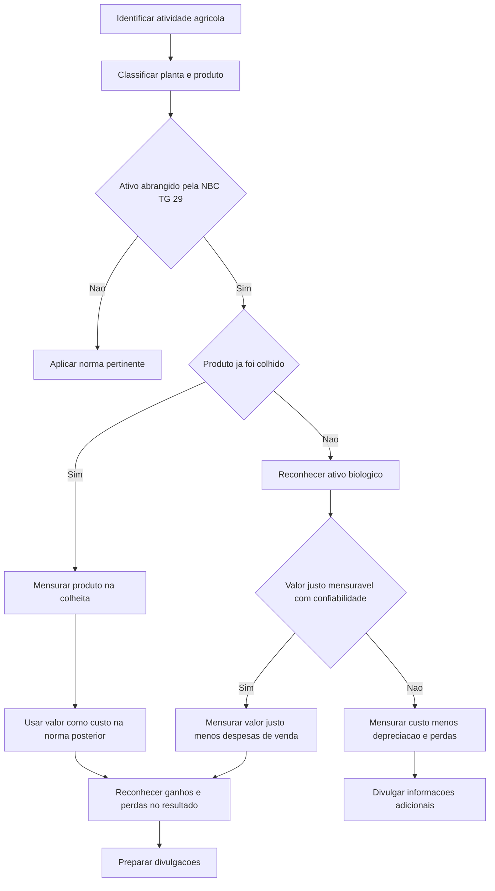

# NBC TG 29 (R2) — Ativo Biológico e Produto Agrícola

> [!abstract] Resumo em 30 segundos
> A NBC TG 29 disciplina a contabilização de ativos biológicos e de produtos agrícolas **até o momento da colheita**. Em regra, ativos biológicos são mensurados pelo valor justo menos as despesas de venda, tanto no reconhecimento inicial quanto no encerramento de cada período. O produto agrícola é mensurado dessa mesma forma na colheita; esse valor passa a ser seu custo para a NBC TG 16 ou outra norma aplicável. Variações de valor justo e ganhos ou perdas no reconhecimento inicial são reconhecidos no resultado. Há uma exceção restrita para ativo biológico cujo valor justo não possa ser mensurado confiavelmente.

## Ficha rápida

| Campo | Síntese |
|---|---|
| Norma | NBC TG 29 (R2) — Ativo Biológico e Produto Agrícola |
| Objetivo | Estabelecer o tratamento contábil e as divulgações relativos a ativos biológicos e produtos agrícolas |
| Marco do tratamento | Colheita; após ela, aplica-se a NBC TG 16 ou outra norma mais adequada |
| Mensuração usual | Valor justo menos despesas de venda |
| Exceção de mensuração | Determinados ativos biológicos mensurados ao custo, menos depreciação e perdas por irrecuperabilidade acumuladas |
| Alteração R2 | O texto da resolução informa aplicação aos exercícios iniciados a partir de 1º de janeiro de 2016 |

> [!info] Sobre a data
> A data de aplicação acima é a indicada no texto da resolução de alteração reproduzido no PDF. Não representa uma conclusão sobre alterações posteriores ou vigência atual.

## Objetivo e alcance

A norma trata da contabilização de:

- ativos biológicos, **exceto plantas portadoras**;
- produção agrícola no ponto da colheita;
- subvenções governamentais previstas nos itens 34 e 35.

Planta portadora é uma planta viva utilizada para produzir ou fornecer produtos agrícolas, cultivada para produzir frutos por mais de um período e com probabilidade remota de ser vendida como produto agrícola — salvo venda eventual como sucata. A planta portadora fica no alcance da NBC TG 27; **o produto dela**, inclusive quando ainda em desenvolvimento, fica no alcance da NBC TG 29. A norma também exclui subvenções e assistência governamentais relacionadas a plantas portadoras, que remetem à NBC TG 07. (Itens 1, 2 e 5; pp. 1–3)

Não são plantas portadoras, por exemplo, plantas cultivadas para serem colhidas como produto agrícola, plantas cultivadas para produto agrícola quando também é mais do que remota a possibilidade de colher e vender a própria planta, e culturas anuais como milho e trigo.

A norma não se aplica a terras relacionadas à atividade agrícola, ativos intangíveis relacionados à atividade agrícola nem ativos de direito de uso decorrentes de arrendamento de terrenos agrícolas. O PDF remete, respectivamente, às NBC TG 27 e 28, à NBC TG 04 e à NBC TG 06. (Item 2; pp. 1–2)

O processamento posterior à colheita não é tratado pela NBC TG 29. Por exemplo, a uva colhida segue a norma até a colheita; sua transformação em vinho fica fora do alcance desta norma. Após a colheita, o produto passa à NBC TG 16 ou a outra norma mais adequada. (Itens 3 e 4; p. 2)

## Conceitos-chave

| Termo | Significado no contexto da norma |
|---|---|
| Ativo biológico | Animal ou planta vivos |
| Atividade agrícola | Gerenciamento da transformação biológica e da colheita para venda, conversão em produto agrícola ou geração de ativos biológicos adicionais |
| Produção agrícola | Produto colhido de ativo biológico da entidade |
| Transformação biológica | Crescimento, degeneração, produção e procriação que alteram a qualidade ou a quantidade do ativo |
| Colheita | Extração do produto do ativo biológico ou cessação da vida desse ativo |
| Despesa de venda | Despesa incremental diretamente atribuível à venda do ativo, exceto despesas financeiras e tributos sobre o lucro |

A caracterização de atividade agrícola envolve mudança biológica, gerenciamento dessa mudança e mensuração rotineira de seus efeitos. A coleta em fonte não gerenciada, como pesca no oceano ou desflorestamento, não é atividade agrícola segundo os exemplos do texto. (Itens 5–7; pp. 3–4)

Ativos biológicos podem ser consumíveis — colhidos como produto agrícola ou vendidos como ativos — ou de produção, mantidos para produzir. Também podem ser maduros ou imaturos: maduros quando aptos à colheita ou a sustentar colheitas regulares. A entidade é encorajada a divulgar essas distinções quando apropriado e a informar a base usada. (Itens 43–45; pp. 8–9)

## Diagrama do tratamento

## Aplicação passo a passo — checklist

1. **Identifique a operação.** Verifique se há gerenciamento de transformação biológica e colheita, e não apenas coleta de recursos naturais não gerenciados.
2. **Determine o que está sendo contabilizado.** Separe o animal ou a planta viva, o produto agrícola colhido e o produto resultante do processamento posterior.
3. **Verifique o alcance.** Identifique se o item é planta portadora, produto de planta portadora, ativo biológico, produção agrícola ou item excluído.
4. **Confirme o reconhecimento.** Reconheça o ativo biológico ou produto agrícola somente quando a entidade controlar o ativo por evento passado, for provável a entrada de benefícios econômicos futuros e o valor justo ou o custo puder ser mensurado confiavelmente. A propriedade legal e a marcação do gado são exemplos de evidência de controle. (Itens 10–11; p. 4)
5. **Mensure o ativo biológico.** Use o valor justo menos despesas de venda no reconhecimento inicial e no fim de cada período, salvo a exceção prevista no item 30.
6. **Mensure o produto na colheita.** Use o valor justo menos despesas de venda; esse valor é o custo quando se aplica a NBC TG 16 ou outra norma pertinente.
7. **Registre o efeito no resultado.** Reconheça no período os ganhos ou perdas previstos pela norma.
8. **Avalie subvenções e divulgações.** Identifique se a subvenção é incondicional ou condicional e reúna as informações sobre ativos, alterações de saldos e riscos exigidas para divulgação.

## Reconhecimento e mensuração

### Regra geral

A mensuração do ativo biológico é:

**Valor justo menos despesas de venda**

Essa base aplica-se no reconhecimento inicial e no encerramento de cada período. O produto agrícola colhido também é mensurado por essa base, mas **no momento da colheita**. A norma presume que o valor justo do produto agrícola nesse momento pode sempre ser mensurado confiavelmente. (Itens 12–13 e 32; pp. 4 e 7)

A mensuração pode ser facilitada pelo agrupamento de ativos conforme atributos significativos que correspondam aos usados pelo mercado, como idade ou qualidade. Contratos de venda futura não ajustam, por si só, o valor justo: este reflete as condições correntes de mercado. (Itens 15–16; pp. 5)

Quando não houver mercado ativo, o texto técnico remete à NBC TG 46 para mensuração do valor justo, e indica que custos podem, em algumas situações, aproximar-se do valor justo — por exemplo, quando houve pouca transformação biológica desde o reconhecimento ou quando seu efeito esperado sobre o preço não é material. Ativos biológicos implantados na terra podem ser mensurados com apoio de informações sobre ativos combinados, como terra e melhorias, desde que se isole o valor do ativo biológico. (Itens 24–25; pp. 6)

### Exceção: valor justo não mensurável confiavelmente

A presunção de mensuração confiável do valor justo só pode ser rejeitada **no reconhecimento inicial** de ativo biológico quando não houver preço de mercado disponível e as alternativas de mensuração não forem claramente confiáveis. Nesse caso, mensura-se ao custo, menos depreciação e perdas por irrecuperabilidade acumuladas. Quando o valor justo se tornar mensurável confiavelmente, passa-se a mensurar pelo valor justo menos despesas de venda. (Itens 30–31; p. 7)

> [!warning] A exceção não se estende ao produto agrícola
> Mesmo que um ativo biológico esteja sendo mensurado ao custo, o produto agrícola deve ser mensurado ao valor justo menos despesas de venda na colheita. Para determinar custo, depreciação e perdas por irrecuperabilidade na exceção, a norma remete às NBC TG 16, 27 e 01. (Itens 32–33; p. 7)

### Ganhos e perdas

Reconheça no resultado do período:

- o ganho ou a perda decorrente da mudança no valor justo menos despesas de venda do ativo biológico;
- o ganho ou a perda do reconhecimento inicial do ativo biológico;
- o ganho ou a perda do reconhecimento inicial do produto agrícola na colheita.

A dedução das despesas de venda pode gerar perda no reconhecimento inicial do ativo biológico; o nascimento de um animal é citado como possível origem de ganho. (Itens 26–29; p. 7)

### Subvenções governamentais

Para ativo biológico mensurado ao valor justo menos despesas de venda, reconheça a subvenção incondicional no resultado quando se tornar recebível. Se a subvenção for condicional, reconheça-a quando a condição for atendida. Quando a subvenção estiver relacionada a ativo mensurado ao custo na exceção, aplique a NBC TG 07. (Itens 34–38; p. 8)

## Divulgação

A entidade deve divulgar o ganho ou a perda do período relativo ao reconhecimento inicial do ativo biológico e do produto agrícola, bem como os decorrentes da mudança no valor justo menos despesas de venda dos ativos biológicos. Deve também descrever cada grupo de ativos biológicos. (Itens 40–42; p. 8)

Quando não houver divulgação equivalente em outra parte das demonstrações, divulgue a natureza das atividades envolvendo cada grupo e mensurações ou estimativas não financeiras das quantidades físicas dos grupos no fim do período e da produção agrícola durante o período. A descrição quantitativa por grupo, a distinção entre consumíveis e de produção ou entre maduros e imaturos são encorajadas, não apresentadas como obrigação geral. (Itens 43 e 46; pp. 8–9)

Outras divulgações requeridas incluem:

- existência e total de ativos biológicos com titularidade legal restrita, bem como montantes dados em garantia;
- compromissos relacionados ao desenvolvimento ou à aquisição de ativos biológicos;
- estratégias de administração de riscos financeiros relacionadas à atividade agrícola;
- conciliação do valor contábil dos ativos biológicos entre o início e o fim do período.

A conciliação inclui, entre outros componentes, mudanças de valor justo, compras, vendas, ativos mantidos para venda, colheitas, combinações de negócios, diferenças cambiais e outras mudanças. (Itens 49–50; p. 9)

A separação das mudanças de valor justo entre efeitos físicos e efeitos de preços é **encorajada**, não obrigatória. Se eventos climáticos, doenças ou outros riscos naturais gerarem item material de receita ou despesa, divulgue sua natureza e valor de acordo com a NBC TG 26. (Itens 51–53; p. 10)

Para ativos biológicos mensurados ao custo pela exceção, divulgue descrição, razão da impossibilidade de mensurar o valor justo, faixa de estimativas quando possível, método e vida útil ou taxa de depreciação, e valores brutos e acumulados. A norma também prevê divulgação separada de ganhos ou perdas na venda, de componentes da conciliação e dos efeitos da passagem para mensuração confiável ao valor justo. (Itens 54–56; p. 10)

Para subvenções governamentais, divulgue natureza e extensão, condições não atendidas e contingências associadas, e reduções significativas esperadas. (Item 57; p. 10)

## Exceções e erros comuns

> [!danger] Pontos de atenção
> - **Não trate planta portadora e seu produto como o mesmo item:** a planta segue a NBC TG 27; seu produto e seu produto em desenvolvimento seguem a NBC TG 29.
> - **Não estenda a NBC TG 29 ao processamento pós-colheita:** o limite é o momento da colheita.
> - **Não leve o preço contratado automaticamente ao valor justo:** a norma informa que a existência do contrato não ajusta essa mensuração.
> - **Não use a exceção de custo para produto agrícola na colheita:** a norma exige valor justo menos despesas de venda nesse momento.
> - **Não trate a divulgação da separação entre mudanças físicas e preços como obrigatória:** ela é encorajada.
> - **Não confunda divulgação encorajada com requerida:** a descrição quantitativa por grupo e certas distinções são encorajadas; as divulgações expressamente previstas nos itens 46, 49 e 50 são requeridas.

## Conexões com outras normas

As remissões expressas no texto incluem: NBC TG 27 para ativo imobilizado e plantas portadoras; NBC TG 28 para propriedade para investimento; NBC TG 04 para ativos intangíveis; NBC TG 06 para ativos de direito de uso de terrenos arrendados; NBC TG 16 para estoques após a colheita; NBC TG 46 para mensuração do valor justo; NBC TG 07 para subvenções em casos indicados; NBC TG 01 e 27 para perdas e depreciação na exceção de custo; NBC TG 31 para ativos mantidos para venda; NBC TG 25 para contratos onerosos; e NBC TG 26 para divulgação de itens materiais decorrentes de eventos naturais. (pp. 1–2, 4–10)

## Fonte

**NBC TG 29 (R2) — Ativo Biológico e Produto Agrícola**, PDF indicado nos metadados: *NBC TG 29 (R2).pdf*. Síntese baseada no texto técnico e no texto de alteração reproduzidos no documento, especialmente itens 1–57 e páginas 1–10.
