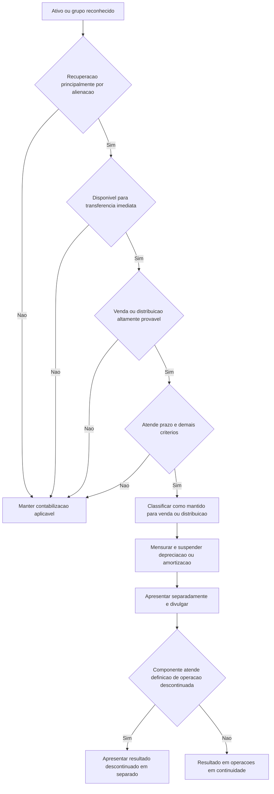

# NBC TG 31 (R4) — Ativo Não Circulante Mantido para Venda e Operação Descontinuada

> [!abstract] Resumo em 30 segundos
> A NBC TG 31 define quando um ativo não circulante — ou grupo de ativos — deve ser classificado como mantido para venda ou para distribuição aos sócios. Em regra, a classificação exige disponibilidade para alienação imediata e alta probabilidade de conclusão, normalmente em até um ano. O ativo é mensurado pelo menor entre valor contábil e valor justo menos despesas de venda; enquanto estiver nessa classificação, não é depreciado nem amortizado. A norma também determina apresentação separada e divulgações próprias para operações descontinuadas.

## Ficha rápida

| Campo | Síntese |
|---|---|
| Norma | NBC TG 31 (R4) |
| Tema | Ativo não circulante mantido para venda e operação descontinuada |
| Questões centrais | Classificação, mensuração, apresentação e divulgação |
| Critério de mensuração principal | Menor entre valor contábil e valor justo menos despesas de venda |
| Tratamento importante | Suspender depreciação ou amortização após a classificação |
| Alteração identificável da R4 | Inclusão da NBC TG 48 entre as normas aplicáveis à mensuração de certos ativos financeiros |

## Objetivo e alcance

A norma trata da contabilização de ativos não circulantes mantidos para venda — inclusive quando incluídos em um grupo de ativos — e da apresentação e divulgação de operações descontinuadas. Seu objetivo é tornar visíveis os ativos destinados à alienação e os efeitos financeiros de componentes cuja atividade foi ou será descontinuada.

Os requisitos de **classificação e apresentação** aplicam-se a ativos não circulantes reconhecidos e a grupos de ativos mantidos para venda. Os requisitos de **mensuração** também se aplicam, ressalvados determinados ativos que continuam mensurados pelas normas específicas que os regem. Entre eles estão ativos fiscais diferidos, ativos de benefícios a empregados, certos ativos financeiros, propriedades para investimento mensuradas ao valor justo, ativos biológicos abrangidos pela NBC TG 29 e direitos contratuais de seguro. A R4 identifica os ativos financeiros no alcance da NBC TG 48 entre essas exceções de mensuração.

A exceção de mensuração não elimina automaticamente os requisitos de classificação e apresentação da NBC TG 31. A norma também estende seus requisitos aplicáveis a ativos mantidos para venda aos ativos classificados como **mantidos para distribuição aos proprietários**.

## Conceitos-chave

- **Mantido para venda:** o valor contábil será recuperado principalmente por uma transação de venda, em vez do uso contínuo.
- **Disponível para venda imediata:** a entidade tem intenção e capacidade de transferir o ativo em sua condição atual, sujeito apenas a condições usuais para esse tipo de venda. Uma demora causada pela própria entidade — por exemplo, esperar a conclusão de um novo prédio antes de desocupar o atual — pode impedir a classificação.
- **Venda altamente provável:** requer, entre outros elementos, compromisso da administração apropriada, início de um programa firme para localizar comprador, preço razoável em relação ao valor justo corrente e expectativa de conclusão normalmente dentro de um ano. As ações devem indicar que não é provável haver mudança significativa ou abandono do plano.
- **Grupo de ativos mantido para venda:** conjunto a ser alienado em uma única transação, que pode incluir ativos e passivos diretamente associados. A definição também pode abranger ativos circulantes e itens cuja mensuração segue outras normas.
- **Operação descontinuada:** componente da entidade baixado ou classificado como mantido para venda que representa uma importante linha separada de negócios ou área geográfica, integra plano coordenado para vender uma delas, ou é controlada adquirida exclusivamente para revenda.
- **Mantido para distribuição aos proprietários:** classificação aplicável quando a entidade está comprometida com a distribuição, o ativo está disponível para distribuição imediata e a distribuição é altamente provável.

A classificação de um componente como operação descontinuada não decorre apenas de ele estar à venda: também é necessário atender a uma das características específicas da definição.

## Diagrama de decisão

## Aplicação passo a passo / checklist

1. **Delimite o ativo ou grupo.** Identifique os ativos e, quando houver, os passivos diretamente associados à transação. Avalie se a alienação conjunta corresponde a um grupo de ativos.
2. **Verifique como o valor será recuperado.** A classificação exige que a recuperação ocorra principalmente pela venda — ou, na classificação correspondente, pela distribuição aos proprietários — e não pelo uso contínuo.
3. **Teste a disponibilidade imediata.** Confirme que a entidade pode transferir o ativo em suas condições atuais, ressalvadas apenas condições usuais. Planos de reforma ou encerramento de operações antes da transferência podem impedir a classificação.
4. **Documente o compromisso e a probabilidade.** Verifique o comprometimento do nível apropriado da administração, as iniciativas firmes para localizar comprador, o preço razoável em relação ao valor justo e a baixa probabilidade de alteração ou abandono do plano.
5. **Avalie o prazo.** A conclusão da venda deve ser esperada, em regra, dentro de um ano da classificação. Se houver atraso além do controle da entidade, verifique se as condições específicas do item 9 e do Apêndice B são satisfeitas; o prazo maior, sozinho, não basta.
6. **Para distribuição a proprietários, aplique o teste próprio.** Confirme disponibilidade imediata, ações iniciadas e expectativa de concluir em até um ano. Se a aprovação dos sócios for legal ou estatutariamente necessária, considere sua probabilidade.
7. **Antes da mensuração de venda, atualize os valores.** Imediatamente antes da classificação inicial, mensure os ativos e passivos conforme as normas que já lhes eram aplicáveis.
8. **Mensure e registre os efeitos subsequentes.** Compare o valor contábil com o valor justo menos despesas de venda; reconheça perdas e eventuais reversões dentro dos limites da norma.
9. **Verifique se há operação descontinuada.** Analise se o componente satisfaz uma das condições do item 32. Se não satisfizer, ganhos ou perdas de remensuração ficam nas operações em continuidade.
10. **Apresente e divulgue separadamente.** Separe ativos e passivos no balanço e forneça as informações exigidas sobre a alienação e, quando aplicável, sobre a operação descontinuada.

> [!tip] Controle prático
> Mantenha evidências da decisão da administração, das ações para localizar comprador, da avaliação do preço, do cronograma e de eventuais fatores que possam afetar a conclusão da transação.

## Reconhecimento e mensuração

### Mensuração inicial e posterior

Para ativo ou grupo de ativos mantido para venda, a regra é:

**Valor contábil reconhecido = menor entre:**
- valor contábil; e
- valor justo menos despesas de venda.

Para ativos mantidos para distribuição aos proprietários, a comparação usa o valor justo menos **despesas de distribuição**. Essas despesas são incrementais e diretamente atribuíveis à distribuição, excluídas despesas financeiras e tributos sobre o lucro.

Se a venda for esperada após um ano, as despesas de venda são mensuradas pelo valor presente. O aumento decorrente da passagem do tempo é reconhecido no resultado como despesa financeira, conforme aplicável a orientação da NBC TG 12.

Em grupos de ativos, itens fora do alcance das regras de mensuração da NBC TG 31 devem ser remensurados de acordo com suas normas específicas antes da remensuração do grupo. A norma reconhece perdas e ganhos posteriores no valor justo menos despesas de venda, mas limita o reconhecimento de ganhos às perdas por redução ao valor recuperável acumuladas aplicáveis. Para grupos, a alocação da perda ou do ganho aos ativos sujeitos à mensuração da NBC TG 31 segue a ordem indicada pela NBC TG 01.

### Depreciação, amortização e baixa

A depreciação ou amortização do ativo cessa enquanto ele estiver classificado como mantido para venda ou integrar um grupo assim classificado. Juros e outros gastos atribuíveis a passivos incluídos no grupo continuam a ser reconhecidos.

Ganhos ou perdas ainda não reconhecidos antes da venda são reconhecidos na data da baixa, segundo os requisitos aplicáveis à baixa de imobilizado ou de intangível.

### Mudança do plano

Se os critérios deixarem de ser atendidos, a entidade deixa de classificar o ativo como mantido para venda ou para distribuição. Em geral, o ativo é mensurado pelo menor entre:

1. o valor contábil que teria sido reconhecido sem a classificação, ajustado pela depreciação, amortização ou reavaliação que teria ocorrido; e
2. o montante recuperável na data da decisão de não vender ou distribuir.

O ajuste é incluído no resultado das operações em continuidade, ressalvado o tratamento indicado pela norma para ativo reavaliado. A NBC TG 31 prevê tratamento próprio quando há reclassificação direta entre mantido para venda e mantido para distribuição: a mudança é considerada continuação do plano original de alienação, com aplicação dos requisitos correspondentes ao novo método.

> [!warning] Ativo a ser baixado não é, por isso, mantido para venda
> Ativos destinados a ser usados até o fim de sua vida econômica ou fechados, em vez de vendidos, não são classificados como mantidos para venda. Uma retirada temporária de serviço também não equivale a abandono. Se o ativo a ser abandonado fizer parte de operação descontinuada, os resultados e fluxos de caixa são apresentados como tais quando ele deixar de ser usado, desde que atendidos os critérios pertinentes.

## Apresentação e divulgação

### Balanço patrimonial

Apresente separadamente dos demais ativos os ativos não circulantes classificados como mantidos para venda e, dos demais passivos, os passivos do grupo de ativos. **Não compense** ativos e passivos nem os apresente em um único valor. Divulgue separadamente as principais classes de ativos e passivos, no balanço ou em notas, e apresente separadamente valores acumulados em outros resultados abrangentes relacionados.

A classificação no período corrente não exige reclassificar ou reapresentar os valores dos balanços de períodos anteriores para refletir essa classificação.

### Demonstração do resultado e operação descontinuada

Para uma operação descontinuada, a entidade apresenta um montante único que reúne o resultado total após tributos das operações descontinuadas e os ganhos ou perdas após tributos reconhecidos na mensuração ou baixa dos ativos correspondentes.

Também divulga a análise do montante — incluindo receitas, despesas, resultado antes dos tributos e efeitos tributários e de mensuração ou alienação — e os fluxos de caixa líquidos atribuíveis às atividades operacionais, de investimento e de financiamento. A análise pode constar das notas ou de seção identificada na demonstração do resultado. Há dispensa de certas análises para controlada recém-adquirida que já satisfaça os critérios de classificação na aquisição. Quando a entidade apresenta uma demonstração do resultado separada, deve incluir nela seção identificada para operações descontinuadas.

Os períodos anteriores apresentados são reapresentados para refletir as operações descontinuadas à data do balanço mais recente. Se um componente deixar de ser classificado como mantido para venda, os resultados anteriormente apresentados como descontinuados são reclassificados para operações em continuidade nos períodos apresentados.

### Notas explicativas sobre a alienação

No período em que o ativo é classificado como mantido para venda ou vendido, divulgue:

- descrição do ativo ou grupo;
- fatos e circunstâncias da venda ou alienação esperada, forma e cronograma previstos;
- ganho ou perda reconhecido e, se não estiver destacado na demonstração do resultado, a linha que o inclui;
- segmento ao qual o ativo ou grupo pertence, quando aplicável.

Se o plano de venda mudar nos casos abrangidos pela norma, divulgue a descrição dos fatos e circunstâncias que motivaram a decisão e seus efeitos nos resultados do período e dos períodos anteriores apresentados.

> [!info] Operação em continuidade
> Se a remensuração de um ativo mantido para venda não atender à definição de operação descontinuada, o ganho ou a perda correspondente integra o resultado das operações em continuidade.

## Exceções e erros comuns

| Evite | Tratamento conforme a norma |
|---|---|
| Reclassificar automaticamente um ativo não circulante como circulante só porque foi colocado à venda | Aplicar os critérios de classificação da NBC TG 31. |
| Classificar como mantido para venda um ativo que a entidade ainda não pode transferir em sua condição atual | Testar disponibilidade para venda imediata. |
| Considerar que o prazo superior a um ano sempre impede a classificação | Avaliar se o atraso está fora do controle da entidade e se as condições específicas para extensão são satisfeitas. |
| Continuar depreciando ou amortizando após a classificação | Suspender depreciação ou amortização enquanto durar a classificação. |
| Compensar ativos e passivos do grupo no balanço | Apresentá-los separadamente, sem compensação. |
| Tratar toda venda como operação descontinuada | Confirmar que o componente atende a uma das condições da definição. |
| Aplicar a mensuração da NBC TG 31 a ativos excluídos dessa regra | Manter a mensuração prevista nas normas específicas aplicáveis. |

## Conexões com outras normas

A própria NBC TG 31 remete a normas específicas: NBC TG 01 para redução ao valor recuperável e montante recuperável; NBC TG 12 para ajuste a valor presente; NBC TG 26 para apresentação das demonstrações contábeis; NBC TG 27 e NBC TG 04 para baixa de imobilizado e intangível; NBC TG 32 para tributos sobre o lucro; NBC TG 22 para informação por segmento; e NBC TG 48 para certos ativos financeiros excluídos das regras de mensuração da NBC TG 31. Essas conexões decorrem das remissões expressas no texto da norma.

## Fonte

- **PDF:** *NBC TG 31 (R4).pdf*, texto técnico e apêndices fornecidos.
- O PDF identifica a alteração R4 como alteração do item 5, aprovada em 24 de novembro de 2017. A alteração menciona efeitos a partir de 1º de janeiro de 2018; esse dado reproduz a informação expressa no documento.
