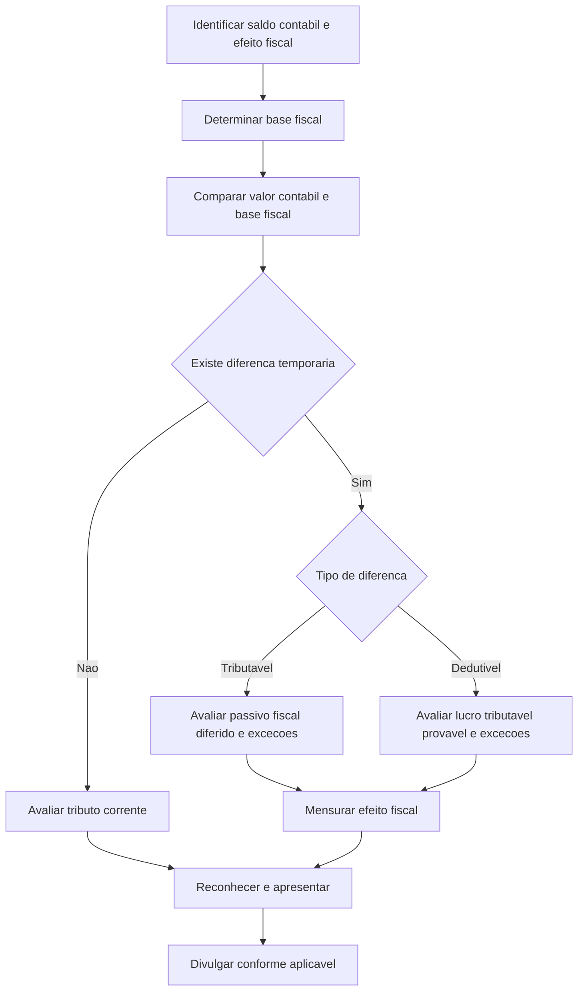

# NBC TG 32 (R4) — Tributos sobre o Lucro

> [!abstract] Em uma frase
> A NBC TG 32 disciplina o reconhecimento, a mensuração, a apresentação e a divulgação dos efeitos fiscais correntes e futuros das transações e dos saldos contábeis.

## Resumo em 30 segundos

A norma conecta a contabilidade ao efeito tributário esperado da recuperação de ativos e da liquidação de passivos. O tributo corrente corresponde ao valor devido ou recuperável sobre o lucro tributável ou prejuízo fiscal do período. O tributo diferido decorre principalmente de diferenças entre o valor contábil de ativos e passivos e suas bases fiscais.

Em regra, diferenças temporárias tributáveis originam passivo fiscal diferido. Diferenças temporárias dedutíveis, prejuízos fiscais não utilizados e créditos fiscais não utilizados podem originar ativo fiscal diferido, mas este depende da probabilidade de haver lucro tributável contra o qual possa ser aproveitado. Há exceções, inclusive para certos reconhecimentos iniciais e para o ágio de expectativa de rentabilidade futura.

Os efeitos fiscais acompanham o local de reconhecimento da transação que os originou: resultado, outros resultados abrangentes, patrimônio líquido ou, em combinação de negócios, os valores relacionados à aquisição.

## Ficha rápida

| Campo | Síntese |
|---|---|
| Norma | NBC TG 32 (R4) — Tributos sobre o Lucro |
| Objetivo | Definir o tratamento contábil dos efeitos fiscais atuais e futuros |
| Assunto central | Tributo corrente e diferenças temporárias que originam tributo diferido |
| Alteração identificada | A resolução altera os itens 20 e 59 da NBC TG 32 (R3) |
| Efeito informado no PDF | As alterações produzem efeitos a partir de 1º de janeiro de 2018 |
| Fonte desta síntese | Texto fornecido do PDF; há conteúdo intermediário omitido no material |

## Objetivo e alcance

A norma trata dos tributos sobre o lucro, incluindo impostos e contribuições nacionais e estrangeiros incidentes sobre lucros tributáveis. A definição também abrange impostos retidos na fonte devidos por controlada, coligada ou empreendimento sob controle conjunto em distribuições à entidade que apresenta as demonstrações contábeis.

Seu foco é contabilizar:

- os efeitos fiscais da futura recuperação do valor contábil de ativos e da liquidação de passivos;
- os efeitos fiscais de transações e outros eventos do período;
- ativos fiscais diferidos relacionados a prejuízos fiscais e créditos fiscais não utilizados;
- a apresentação e a divulgação dos tributos sobre o lucro.

A norma não trata dos métodos de contabilização de subvenções governamentais nem de créditos fiscais de investimentos. Trata, contudo, das diferenças temporárias que possam surgir desses itens.

## Conceitos-chave

| Conceito | Significado prático |
|---|---|
| Resultado contábil | Lucro ou prejuízo antes da dedução dos tributos sobre o lucro. |
| Lucro tributável ou prejuízo fiscal | Resultado apurado conforme as regras fiscais, sobre o qual o tributo é devido ou recuperável. |
| Tributo corrente | Tributo devido ou recuperável sobre o lucro tributável ou prejuízo fiscal do período. |
| Base fiscal | Valor atribuído a ativo ou passivo para fins fiscais. |
| Diferença temporária | Diferença entre o valor contábil e a base fiscal de ativo ou passivo. |
| Diferença temporária tributável | Diferença que resultará em valores tributáveis em períodos futuros. |
| Diferença temporária dedutível | Diferença que resultará em valores dedutíveis em períodos futuros. |
| Passivo fiscal diferido | Tributo sobre o lucro devido em período futuro, associado a diferenças temporárias tributáveis. |
| Ativo fiscal diferido | Tributo recuperável em período futuro, associado a diferenças temporárias dedutíveis, prejuízos fiscais ou créditos fiscais não utilizados. |

Para identificar a base fiscal, considere o tratamento tributário dos benefícios econômicos que serão obtidos com a recuperação do ativo ou dos valores dedutíveis quando o passivo for liquidado. Um item pode ter base fiscal mesmo sem estar reconhecido como ativo ou passivo contábil; o PDF ilustra isso com gastos de pesquisa dedutíveis apenas em período futuro.

## Diagrama do processo

## Aplicação passo a passo — checklist

1. **Identifique os saldos e eventos relevantes.** Considere ativos, passivos, itens não reconhecidos que tenham base fiscal e tributos correntes do período.
2. **Determine a base fiscal.** Analise o que será dedutível ou tributável quando o ativo for recuperado ou o passivo liquidado.
3. **Compare base fiscal e valor contábil.** Identifique se há diferença temporária e classifique-a como tributável ou dedutível.
4. **Avalie o tributo corrente.** Reconheça como passivo o tributo devido ainda não pago. Se o pagamento exceder o devido, reconheça o excesso como ativo. Um benefício de prejuízo fiscal usado para recuperar tributo corrente de período anterior também pode ser reconhecido como ativo.
5. **Avalie o tributo diferido.** Para diferenças tributáveis, verifique a obrigação de reconhecer passivo fiscal diferido e as exceções aplicáveis. Para diferenças dedutíveis, prejuízos fiscais e créditos fiscais, verifique se é provável haver lucro tributável disponível para aproveitamento.
6. **Considere limites de utilização.** Avalie a mesma autoridade tributária, a mesma entidade tributável, os períodos de reversão e eventuais restrições legais às fontes de lucro tributável.
7. **Defina onde reconhecer o efeito fiscal.** Acompanhe o tratamento contábil da transação relacionada.
8. **Revise ativos fiscais diferidos não reconhecidos.** Reavalie a possibilidade de reconhecimento ao final de cada período de apresentação.
9. **Verifique apresentação e divulgação.** Considere os saldos fiscais, sua compensação quando aplicável e as informações exigidas pela norma.

## Reconhecimento e mensuração

### Tributo corrente

Tributos correntes de períodos corrente e anteriores, enquanto não pagos, são reconhecidos como passivos. Pagamentos superiores ao valor devido são reconhecidos como ativos. O benefício de prejuízo fiscal utilizado para recuperar tributo corrente anterior é reconhecido no período em que o prejuízo ocorre, conforme a orientação apresentada no PDF.

### Tributo diferido

- **Diferenças temporárias tributáveis:** em regra, dão origem a passivo fiscal diferido.
- **Diferenças temporárias dedutíveis:** dão origem a ativo fiscal diferido somente na medida em que seja provável a existência de lucro tributável para utilizá-las.
- **Prejuízos e créditos fiscais não utilizados:** seguem critério de probabilidade semelhante. Um histórico recente de perdas é evidência importante contra a disponibilidade de lucros tributáveis; nesse caso, o reconhecimento exige diferenças tributáveis suficientes ou outras evidências convincentes.
- **Ágio de expectativa de rentabilidade futura:** não se reconhece passivo fiscal diferido decorrente do reconhecimento inicial do ágio. O PDF prevê tratamento para diferenças relacionadas ao ágio que não decorram desse reconhecimento inicial.
- **Reconhecimento inicial:** há exceção para ativo ou passivo reconhecido em transação que não seja combinação de negócios e que, no momento inicial, não afete o lucro contábil nem o lucro tributável. A norma também estabelece tratamento específico para combinações de negócios.

A avaliação do ativo fiscal diferido deve considerar se as diferenças tributáveis reverterão em períodos compatíveis, se haverá lucro tributável suficiente e se existem oportunidades de planejamento tributário. Quando a legislação restringir as fontes de lucro que podem absorver deduções, a avaliação deve respeitar essa restrição.

A mensuração deve refletir os efeitos fiscais da forma esperada de recuperação ou liquidação. Para ativo não depreciável reavaliado, o Apêndice C determina que o efeito seja considerado com base na recuperação por venda; se a alíquota aplicável à venda diferir da aplicável ao uso, aplica-se a alíquota relativa à venda.

### Reconhecimento do efeito fiscal

| Reconhecimento da transação relacionada | Reconhecimento do efeito fiscal |
|---|---|
| Resultado | Resultado |
| Outros resultados abrangentes | Outros resultados abrangentes |
| Diretamente no patrimônio líquido | Diretamente no patrimônio líquido |
| Combinação de negócios | Pode afetar o ágio ou o ganho por compra vantajosa |

## Divulgação

A norma contém seção própria sobre divulgação. No texto fornecido, há uma exigência expressamente mencionada para ativo fiscal diferido reconhecido apesar de perdas recentes: divulgar o valor do ativo e a natureza das evidências que sustentam seu reconhecimento.

O material recebido não contém o corpo completo da seção de divulgação. Portanto, esta síntese não detalha outras informações exigidas nem os critérios de apresentação e compensação; consulte o texto integral da norma antes de concluir a nota explicativa.

## Exceções e erros comuns

> [!warning] Não confunda diferença temporária com diferença permanente
> A análise depende da diferença entre valor contábil e base fiscal e do efeito esperado em períodos futuros. Multas não dedutíveis, por exemplo, não geram automaticamente ativo fiscal diferido.

- **Reconhecer ativo fiscal diferido sem evidência suficiente:** a existência de uma dedução futura não basta; é necessário avaliar a disponibilidade provável de lucro tributável.
- **Ignorar prejuízos recentes:** perdas recentes são evidência de que lucros futuros podem não estar disponíveis e exigem suporte convincente para o reconhecimento.
- **Omitir diferenças de ativos reavaliados:** a diferença pode gerar tributo diferido mesmo que a entidade não pretenda vender o ativo, conforme o texto sobre recuperação por uso.
- **Reconhecer passivo fiscal diferido sobre o ágio inicial:** a norma prevê exceção para o passivo decorrente do reconhecimento inicial do ágio.
- **Registrar todo efeito fiscal no resultado:** o efeito deve acompanhar o local em que a transação relacionada foi reconhecida.
- **Avaliar deduções sem considerar restrições fiscais:** quando a legislação limita as fontes de lucro tributável, as diferenças dedutíveis devem ser avaliadas conforme essas restrições.

## Conexões com outras normas

O texto relaciona expressamente os tributos diferidos a:

- **NBC TG 15 — Combinação de Negócios:** diferenças originadas na aquisição podem afetar o ágio ou o ganho por compra vantajosa.
- **NBC TG 26 — Apresentação das Demonstrações Contábeis:** referência aos outros resultados abrangentes.
- **NBC TG 07 — Subvenção e Assistência Governamentais:** a NBC TG 32 não disciplina a contabilização da subvenção, mas trata de diferenças temporárias relacionadas.
- **NBC TG 27, NBC TG 04, NBC TG 48 e NBC TG 28:** citadas no texto em conexão com ativos mensurados ao valor justo ou reavaliados.
- **NBC TG 39 — Instrumentos Financeiros: Apresentação:** mencionada no tratamento fiscal de instrumento financeiro composto.

## Fonte

**NBC TG 32 (R4) — Tributos sobre o Lucro**, PDF informado como *NBC TG 32 (R4).pdf*. A resolução do CFC no final do PDF identifica a alteração dos itens 20 e 59 e informa efeitos a partir de 1º de janeiro de 2018. O texto recebido omite conteúdo intermediário; os pontos de divulgação e apresentação foram resumidos somente na extensão confirmável pelo material fornecido.
