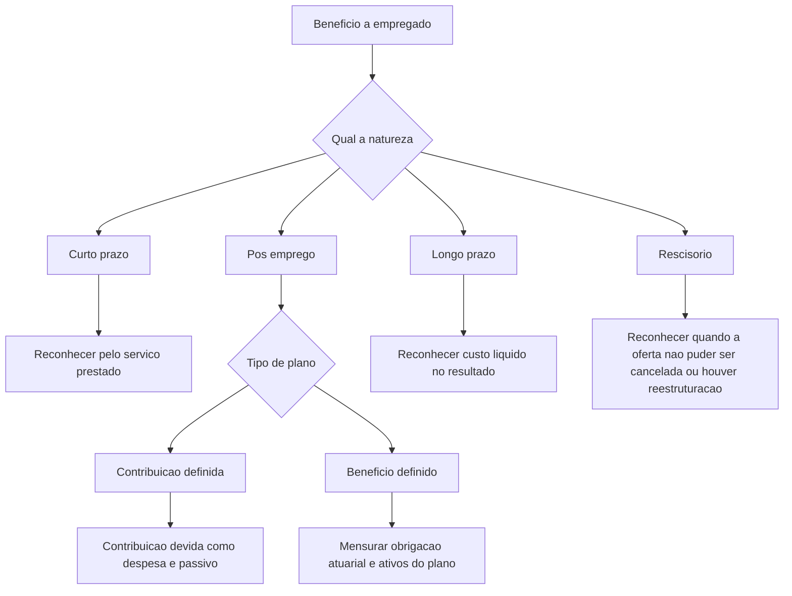

# NBC TG 33 (R2) — Benefícios a Empregados

> [!abstract] Resumo em 30 segundos
> A NBC TG 33 disciplina como a entidade empregadora ou patrocinadora reconhece, mensura e divulga benefícios concedidos aos empregados. Em regra, o serviço prestado gera uma despesa e, se o benefício ainda não foi pago, um passivo. O tratamento depende da natureza do benefício: curto prazo, pós-emprego, longo prazo ou rescisório. Nos planos de benefício definido, a entidade mensura a obrigação atuarial, deduz os ativos do plano e considera o teto de ativo.

## Ficha rápida

| Campo | Síntese |
|---|---|
| Norma | NBC TG 33 (R2) — Benefícios a Empregados |
| Grupo | 02 - NBC TG |
| Aplicação | Entidade empregadora ou patrocinadora |
| Assunto central | Reconhecimento, mensuração, apresentação e divulgação de benefícios a empregados |
| Alteração identificável nesta revisão | Mudança na orientação da taxa de desconto do item 83 e inclusão do item 177 |

## Objetivo e alcance

A norma busca estabelecer a contabilização e a divulgação dos benefícios concedidos aos empregados. A entidade reconhece um **passivo** quando o empregado presta serviços em troca de benefícios a pagar no futuro e uma **despesa** quando consome o benefício econômico decorrente do serviço recebido (item 1).

Aplica-se aos benefícios oferecidos por acordo formal, exigência legal ou prática informal que gere obrigação construtiva. Abrange empregados em diferentes modalidades de trabalho e inclui diretores e administradores. Os benefícios podem ser destinados ao empregado ou a seus dependentes e pagos diretamente ou por terceiros, como seguradoras (itens 2 e 4 a 7).

A norma não trata das demonstrações contábeis dos próprios planos de benefícios ou fundos de pensão. Também não abrange benefícios sujeitos à NBC TG 10 — Pagamento Baseado em Ações (itens 2 e 3).

## Conceitos-chave

- **Benefícios de curto prazo:** exceto os rescisórios, espera-se liquidá-los integralmente em até doze meses após o período em que o empregado prestou o serviço.
- **Benefícios pós-emprego:** benefícios pagos após o período de emprego, como aposentadoria, seguro de vida ou assistência médica pós-emprego.
- **Outros benefícios de longo prazo:** benefícios que não sejam de curto prazo, pós-emprego ou rescisórios.
- **Benefícios rescisórios:** decorrem da decisão da entidade de encerrar o vínculo antes da aposentadoria normal ou da decisão do empregado de aceitar uma oferta em troca da rescisão.
- **Plano de contribuição definida:** a obrigação da entidade limita-se às contribuições acordadas. O empregado suporta, em essência, os riscos atuarial e de investimento.
- **Plano de benefício definido:** a obrigação é fornecer os benefícios pactuados; a entidade suporta substancialmente os riscos atuarial e de investimento.
- **Obrigação construtiva:** nasce de práticas informais quando a entidade não tem alternativa realista senão pagar o benefício.
- **Ativos do plano:** ativos elegíveis mantidos por fundo separado para custear benefícios, além de apólices de seguro elegíveis.
- **Teto de ativo:** valor presente dos benefícios econômicos disponíveis à entidade por restituições do plano ou reduções nas contribuições futuras.

## Diagrama de classificação e tratamento

## Aplicação passo a passo

1. **Identifique o benefício e seu beneficiário.** Verifique se ele decorre de acordo formal, lei ou prática que tenha criado obrigação construtiva.
2. **Classifique-o.** Determine se é de curto prazo, pós-emprego, outro benefício de longo prazo ou rescisório. Para curto prazo, considere a expectativa de liquidação integral em até doze meses após o período de prestação do serviço.
3. **Para benefícios pós-emprego, avalie a essência do plano.** Não se limite ao nome do plano: examine os termos e condições e se a obrigação da entidade está limitada às contribuições.
4. **Reconheça o efeito do serviço.** Em geral, registre o passivo pelo valor devido, deduzindo pagamentos ou contribuições já efetuados; reconheça despesa, salvo quando outra norma exigir ou permitir incorporá-la ao custo de um ativo.
5. **Mensure conforme a categoria.** Use valor não descontado para benefícios de curto prazo; avalie se contribuições de contribuição definida precisam ser descontadas; para benefício definido, aplique o método atuarial e considere os ativos do plano e o teto de ativo.
6. **Defina apresentação e divulgação.** Separe os valores reconhecidos em resultado, outros resultados abrangentes e balanço patrimonial conforme a categoria; verifique as divulgações requeridas pela norma e por outras normas aplicáveis.
7. **Documente premissas, estimativas e limitações.** Isso é particularmente importante em planos de benefício definido e em planos multiempregadores.

> [!tip] Checklist de fechamento
> - O benefício está sustentado por acordo, lei ou prática que gere obrigação?
> - A classificação considera quando se espera liquidar o benefício e o que gera a obrigação?
> - O plano pós-emprego foi classificado pela essência econômica?
> - Valores pagos antecipadamente só foram reconhecidos como ativo quando puderem reduzir pagamentos futuros ou ser restituídos?
> - Para benefício definido, foram considerados obrigação, ativos do plano, teto de ativo e remensurações?

## Reconhecimento e mensuração

### Benefícios de curto prazo

Quando o empregado presta o serviço, a entidade reconhece o valor não descontado esperado como passivo, líquido do que já foi pago, e como despesa, exceto se outra norma exigir ou permitir sua inclusão no custo de ativo (item 11). Se o pagamento antecipado superar o benefício devido, o excesso pode ser ativo quando resultar em redução de pagamentos futuros ou restituição.

**Licenças remuneradas cumulativas** são reconhecidas à medida que o serviço aumenta o direito a ausências futuras. A mensuração corresponde ao pagamento adicional esperado pelo direito não utilizado acumulado na data das demonstrações contábeis. **Licenças não cumulativas** são reconhecidas quando a ausência ocorre, pois o serviço prestado não aumenta um direito futuro (itens 13 a 18).

Participação nos lucros e bônus são reconhecidos quando há obrigação legal ou construtiva por eventos passados e a obrigação pode ser estimada confiavelmente. A estimativa deve considerar, quando pertinente, a possibilidade de empregados saírem antes de adquirir o direito. Esses valores são despesas, não distribuições de lucro (itens 19 a 23). Se não forem integralmente liquidados dentro de doze meses após o período do serviço, são tratados como outros benefícios de longo prazo (item 24).

### Benefícios pós-emprego

Nos **planos de contribuição definida**, a entidade reconhece a contribuição devida pelo serviço como passivo, líquida do que foi pago, e como despesa, salvo capitalização exigida ou permitida por outra norma. Contribuições não liquidadas dentro de doze meses após o período do serviço são descontadas (itens 51 e 52).

Nos **planos de benefício definido**, a contabilização considera a obrigação atuarial e os ativos do plano. A entidade utiliza o **Método de Crédito Unitário Projetado**, atribui os benefícios aos períodos de serviço, adota premissas atuariais e desconta a obrigação a valor presente. Em seguida, deduz o valor justo dos ativos do plano e considera o teto de ativo. A avaliação deve ser feita com regularidade suficiente para evitar divergências significativas no valor reconhecido (itens 57 a 69).

A taxa de desconto indicada no item 83 baseia-se nos rendimentos de mercado, na data das demonstrações, de títulos ou obrigações corporativas de alta qualidade. Onde não houver mercado ativo desses títulos na moeda relevante, usam-se rendimentos de títulos do Tesouro Nacional nessa moeda. Moeda e prazo devem ser consistentes com os da obrigação.

O balanço patrimonial apresenta o valor líquido do passivo ou ativo de benefício definido. Se houver superávit, o ativo reconhecido fica limitado ao menor entre o superávit e o teto de ativo (itens 63 a 65).

Para planos de benefício definido, o custo do serviço, o custo do serviço passado, os ganhos ou perdas na liquidação e os juros líquidos são reconhecidos em resultado conforme os requisitos da norma. Ganhos e perdas atuariais, retorno dos ativos do plano excluídos os valores considerados nos juros líquidos e mudanças pertinentes no teto de ativo são remensurações reconhecidas em outros resultados abrangentes (item 57).

Planos multiempregadores, planos que compartilham riscos entre entidades sob controle comum, planos públicos e benefícios segurados exigem análise de suas características e da informação disponível. Quando faltarem informações suficientes para contabilizar um plano multiempregador como benefício definido, a entidade contabiliza-o como contribuição definida e aplica as divulgações específicas previstas para essa situação (itens 32 a 49).

### Outros benefícios de longo prazo e rescisórios

Para outros benefícios de longo prazo, a entidade reconhece no resultado o valor líquido do custo do serviço, juros líquidos e remensurações, salvo inclusão no custo de ativo exigida ou permitida por outra norma. Diferentemente de benefícios pós-emprego, as remensurações não são reconhecidas em outros resultados abrangentes (itens 154 a 157).

Benefícios rescisórios são reconhecidos como passivo e despesa na data que ocorrer primeiro: quando a entidade não puder mais cancelar a oferta ou quando reconhecer custos de reestruturação que envolvam esses benefícios. A mensuração segue a natureza do benefício: aplicam-se os requisitos de curto prazo se a liquidação integral for esperada em até doze meses; caso contrário, os de outros benefícios de longo prazo. Se o benefício representar melhoria de benefício pós-emprego, aplicam-se os requisitos dessa categoria (itens 165 a 170).

## Divulgação

A norma não exige divulgação específica para benefícios de curto prazo, outros benefícios de longo prazo ou benefícios rescisórios; outras normas podem exigir informações, inclusive sobre administradores e despesas com benefícios (itens 25, 158 e 171).

Para contribuição definida, divulga-se o montante reconhecido como despesa (item 53). Para benefício definido, as divulgações incluem informações sobre características dos planos e riscos, valores das demonstrações, premissas atuariais significativas, sensibilidade a mudanças razoavelmente possíveis, estratégias de gestão de riscos e informações sobre fluxos de caixa futuros. Entre estas, podem estar contribuições esperadas e o perfil de vencimento da obrigação (itens 139 a 147).

Também há requisitos específicos para planos multiempregadores e planos que compartilham riscos entre entidades sob controle comum, além de informações que outras normas podem exigir sobre partes relacionadas e passivos contingentes (itens 148 a 152).

## Exceções e erros comuns

> [!warning] Pontos de atenção
> - **Classificar pelo nome do plano, não pela obrigação:** contribuição definida ou benefício definido depende da essência econômica e dos termos do plano.
> - **Tratar toda licença não utilizada da mesma forma:** licenças cumulativas geram reconhecimento conforme o direito se acumula; não cumulativas, quando a ausência ocorre.
> - **Registrar bônus como distribuição de lucro:** a norma trata a obrigação por participação nos lucros e bônus como despesa.
> - **Presumir que prêmio de seguro elimina a obrigação:** se a entidade mantiver obrigação legal ou construtiva de cobrir insuficiências, o plano pode ser de benefício definido.
> - **Reconhecer todo superávit como ativo:** o ativo está sujeito ao teto de ativo.
> - **Omitir a análise de prazo:** pagamentos de participação nos lucros não liquidados dentro do prazo definido passam a ser tratados como benefícios de longo prazo.
> - **Confundir benefício rescisório com benefício por serviço:** o gatilho é a rescisão, mas parcelas condicionadas à prestação de serviço futuro podem pertencer a outra categoria.

## Conexões com outras normas

- **NBC TG 10:** benefícios baseados em ações ficam fora do alcance da NBC TG 33.
- **NBC TG 25:** relacionada a obrigações construtivas, reestruturações, saída ou encerramento de plano e passivos contingentes.
- **NBC TG 05 e NBC TG 26:** podem exigir divulgações sobre benefícios a administradores, partes relacionadas e despesas.
- **NBC TG 16 e NBC TG 27:** citadas como exemplos de normas que podem permitir ou exigir a inclusão de benefícios no custo de ativo.
- **NBC TG 23:** indicada para aplicação retrospectiva nas disposições transitórias.
- **NBC TG 46:** citada na classificação de ativos do plano entre os que têm e os que não têm valor cotado em mercado ativo.
- **NBC TG 11:** a norma esclarece que apólice de seguro elegível não é necessariamente um contrato de seguro na definição daquela norma.

## Fonte

**NBC TG 33 (R2) — Benefícios a Empregados**, conforme o PDF fornecido. O texto identifica alteração do item 83, inclusão do item 177 e eliminação dos itens 174 a 176. Também informa que as alterações entram em vigor na data de publicação e se aplicam a exercícios iniciados a partir de 1º de janeiro de 2016.
