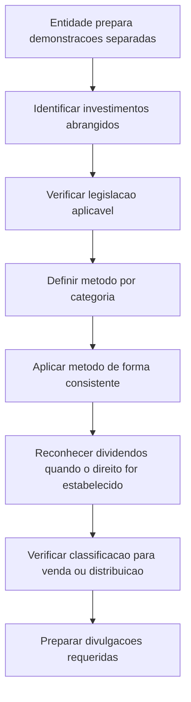

# NBC TG 35 (R2) — Demonstrações Separadas

> [!abstract] Resumo em 30 segundos
> A NBC TG 35 trata da contabilização e da divulgação de investimentos em controladas, coligadas e empreendimentos controlados em conjunto quando a entidade apresenta demonstrações separadas. Em regra, a entidade escolhe, observada a legislação aplicável, entre custo histórico, NBC TG 38 ou método da equivalência patrimonial — e usa práticas contábeis consistentes para cada categoria de investimento. Também deve reconhecer dividendos quando o direito ao recebimento estiver estabelecido e divulgar a natureza das demonstrações, os investimentos significativos e os métodos contábeis adotados.

## Ficha rápida

| Campo | Síntese |
|---|---|
| Norma | NBC TG 35 (R2) — Demonstrações Separadas |
| Grupo | 02 - NBC TG |
| Foco | Contabilização e divulgação de investimentos em demonstrações separadas |
| Investimentos abrangidos | Em controladas, coligadas e empreendimentos controlados em conjunto |
| Alternativas de contabilização | Custo histórico, NBC TG 38 ou método da equivalência patrimonial, conforme a legislação aplicável |
| Publicação indicada no documento | 22 de dezembro de 2014 |
| Aplicação indicada no documento | Exercícios encerrados em ou após 31 de dezembro de 2014 |

> [!info] Leitura da vigência
> A data e a aplicação acima reproduzem o texto de aprovação da NBC TG 35 (R2) incluído no PDF. Não representam uma verificação de vigência atual.

## Objetivo e alcance

O objetivo é estabelecer o tratamento contábil e as divulgações requeridas para investimentos em controladas, coligadas e empreendimentos controlados em conjunto quando são elaboradas demonstrações separadas (item 1).

A norma se aplica quando a entidade investidora escolhe apresentar demonstrações separadas ou quando a legislação local exigir essa apresentação. Ela não determina quais entidades devem elaborá-las: determina o tratamento a observar quando forem preparadas em conformidade com as normas, interpretações e comunicados técnicos do CFC (itens 2 e 3).

Demonstrações separadas não são sinônimo de demonstrações contábeis individuais. São demonstrações apresentadas adicionalmente às demonstrações consolidadas ou às demonstrações em que os investimentos são contabilizados pelo método da equivalência patrimonial. Em situações previstas na norma e se permitido legalmente, podem ser apresentadas como únicas demonstrações contábeis (itens 6, 8 e 8A).

As demonstrações em que se aplica o método da equivalência patrimonial não são, por esse motivo, demonstrações separadas. Tampouco o são demonstrações de uma entidade que não tenha investimentos em controlada, coligada ou empreendimento controlado em conjunto (itens 6 e 7).

## Conceitos-chave

- **Demonstrações consolidadas:** apresentam os ativos, passivos, patrimônio líquido, receitas, despesas e fluxos de caixa da controladora e de suas controladas como se fossem de uma única entidade econômica.
- **Demonstrações separadas:** demonstrações nas quais os investimentos abrangidos são contabilizados segundo uma das alternativas admitidas pela norma, observados seus requisitos e a legislação aplicável.
- **Categorias de investimentos:** a entidade deve aplicar as mesmas práticas contábeis a cada categoria de investimentos (item 10). A regra requer consistência dentro da categoria; não significa que todas as categorias devam necessariamente usar a mesma alternativa.
- **Termos técnicos:** “controlada”, “coligada”, “controle conjunto”, “influência significativa” e “entidade de investimento”, entre outros, remetem às definições indicadas no item 5, nas NBC TG 36, NBC TG 19 e NBC TG 18.

## Diagrama do processo

## Aplicação passo a passo e checklist

1. **Confirme que as demonstrações são separadas.** Verifique se são adicionais às demonstrações consolidadas ou às demonstrações individuais com equivalência patrimonial. Não classifique como separadas apenas por serem demonstrações não consolidadas.
2. **Identifique os investimentos abrangidos.** Levante participações em controladas, coligadas e empreendimentos controlados em conjunto.
3. **Verifique a exigência legal e as circunstâncias de apresentação.** A NBC TG 35 não decide quem deve elaborar demonstrações separadas. Verifique também se a entidade pode apresentá-las como suas únicas demonstrações.
4. **Escolha o tratamento contábil por categoria.** Conforme o item 10 e observada a legislação em vigor, escolha entre:
   - custo histórico;
   - contabilização em consonância com a NBC TG 38; ou
   - método da equivalência patrimonial, conforme a NBC TG 18.
5. **Mantenha consistência.** Aplique as mesmas práticas contábeis aos investimentos pertencentes à mesma categoria.
6. **Considere a classificação como mantido para venda ou para distribuição.** Para investimentos ao custo ou pela equivalência patrimonial, avalie a aplicação da NBC TG 31 quando houver essa classificação. A mensuração dos investimentos contabilizados segundo a NBC TG 38 não é modificada por essa circunstância, conforme item 10.
7. **Reconheça dividendos.** Reconheça-os quando o direito ao recebimento estiver estabelecido. Se o investimento for contabilizado pela equivalência patrimonial, o dividendo reduz o valor contábil do investimento; nos demais casos descritos no item 12, é reconhecido no resultado.
8. **Prepare as divulgações.** Identifique quais requisitos dos itens 15 a 17 se aplicam à situação da entidade e informe os métodos empregados.

## Reconhecimento e mensuração

### Alternativas de contabilização

| Alternativa | Tratamento indicado |
|---|---|
| Custo histórico | Contabilizar o investimento ao custo, observando a NBC TG 31 quando aplicável |
| NBC TG 38 | Contabilizar em consonância com essa norma; sua mensuração não é modificada por classificação como mantido para venda ou distribuição |
| Equivalência patrimonial | Aplicar conforme descrito na NBC TG 18; observar a NBC TG 31 quando aplicável |

A escolha deve respeitar a legislação em vigor e ser aplicada de forma consistente a cada categoria. O item 11 também determina que, se a entidade eleger, conforme a NBC TG 18, mensurar investimentos ao valor justo por meio do resultado de acordo com a NBC TG 38, deve contabilizá-los do mesmo modo em suas demonstrações separadas.

### Dividendos

O reconhecimento ocorre quando o direito da entidade ao recebimento do dividendo estiver estabelecido. O tratamento depende da alternativa contábil:

- **Equivalência patrimonial:** o dividendo reduz o valor contábil do investimento.
- **Demais alternativas tratadas no item 12:** o dividendo é reconhecido no resultado do período.

### Mudança de condição de entidade de investimento

Quando a controladora deixa de ser entidade de investimento, a data da mudança é tratada como data considerada de aquisição. O valor justo da controlada nessa data representa a contraprestação considerada para contabilizar o investimento de acordo com o item 10.

Quando a controladora se torna entidade de investimento, contabiliza o investimento em controlada ao valor justo por meio do resultado, conforme a NBC TG 38. A diferença entre o valor contábil anterior e o valor justo na data da mudança é reconhecida como ganho ou perda no resultado. Ganhos ou perdas relacionados anteriormente reconhecidos em outros resultados abrangentes são tratados como se a entidade de investimento tivesse alienado as controladas nessa data (item 11B).

### Reorganizações societárias

Nos casos que atendam aos critérios do item 13, a nova controladora que contabiliza o investimento na controladora original pelo custo histórico deve mensurar sua participação com base no montante contábil dos itens de patrimônio líquido das demonstrações separadas da controladora original na data da reorganização. O item 14 estende o tratamento a reorganizações semelhantes em que a entidade original não é uma sociedade controladora.

## Divulgação

Todas as divulgações aplicáveis às demonstrações separadas devem ser observadas, além dos requisitos específicos dos itens 16 e 17.

**Controladora dispensada de elaborar demonstrações consolidadas**, que legalmente possa apresentar demonstrações separadas em seu lugar (item 16), deve divulgar:

- que as demonstrações são separadas e que foi utilizada a dispensa da consolidação;
- identificação da controladora final ou intermediária pertinente — nome, endereço principal e país de constituição, se diferente — e onde suas demonstrações consolidadas estão disponíveis ao público;
- lista dos investimentos significativos, com nome, endereço principal, país de constituição, proporção de participação e, se diferente, proporção do capital votante;
- método empregado para contabilizar cada investimento listado.

**Outras controladoras e investidores com controle conjunto ou influência significativa** devem identificar as demonstrações relacionadas elaboradas conforme as NBC TG 36, NBC TG 19 e NBC TG 18. Devem também informar que as demonstrações são separadas e, se não forem exigidas por lei, as razões para sua elaboração; listar os investimentos significativos e suas informações; e descrever o método usado para contabilizá-los (item 17).

A entidade de investimento que apresente demonstrações separadas como únicas demonstrações, nas condições do item 8A, divulga esse fato e apresenta também as divulgações para entidades de investimento exigidas pela NBC TG 45 (item 16A).

## Exceções e erros comuns

> [!warning] Não confunda demonstrações individuais com demonstrações separadas
> A aplicação da equivalência patrimonial nas demonstrações individuais não transforma, por si só, essas demonstrações em separadas.

- **Tratar todas as alternativas como escolhas sem restrições:** o item 10 condiciona a contabilização à legislação em vigor.
- **Mudar práticas dentro de uma categoria:** a entidade deve manter as mesmas práticas contábeis para cada categoria de investimentos.
- **Reconhecer o dividendo sempre como receita:** se o método utilizado for a equivalência patrimonial, o dividendo reduz o valor contábil do investimento.
- **Aplicar o tratamento de venda indistintamente:** a norma ressalva que a mensuração segundo a NBC TG 38 não é modificada pela classificação como mantido para venda ou distribuição.
- **Omitir a base de apresentação:** divulgue que as demonstrações são separadas, as razões quando não forem exigidas por lei e as demonstrações relacionadas, conforme a situação aplicável.
- **Ignorar as regras de transição para entidades de investimento:** os itens 18C a 18I tratam da aplicação inicial das alterações, de ajustes retrospectivos, de situações em que a aplicação seja impraticável e de comparativos. O item 18H dispensa ajustes relativos a investimento já alienado ou cujo controle tenha sido perdido antes da data de aplicação inicial.

## Conexões com outras normas

As relações abaixo são expressamente indicadas no texto:

- **NBC TG 18:** método da equivalência patrimonial e definições relacionadas a investimentos em coligadas, controladas e empreendimentos controlados em conjunto.
- **NBC TG 19:** definições relacionadas a negócios em conjunto e empreendimentos controlados em conjunto.
- **NBC TG 36:** demonstrações consolidadas, dispensa de consolidação e requisitos aplicáveis a entidades de investimento.
- **NBC TG 38:** contabilização de investimentos conforme essa norma, inclusive valor justo por meio do resultado.
- **NBC TG 31:** tratamento de investimentos ao custo ou pela equivalência patrimonial classificados como mantidos para venda ou distribuição.
- **NBC TG 45:** divulgações relativas a entidades de investimento.
- **NBC TG 23:** definição de impraticabilidade referida nas disposições de transição do item 18G.

## Fonte

PDF fornecido: *NBC TG 35 (R2).pdf*. Texto técnico da NBC TG 35 (R2), especialmente itens 1 a 17 e disposições de transição dos itens 18C a 18I. O documento identifica a publicação da R2 em 22 de dezembro de 2014 e informa aplicação aos exercícios encerrados em ou após 31 de dezembro de 2014.
