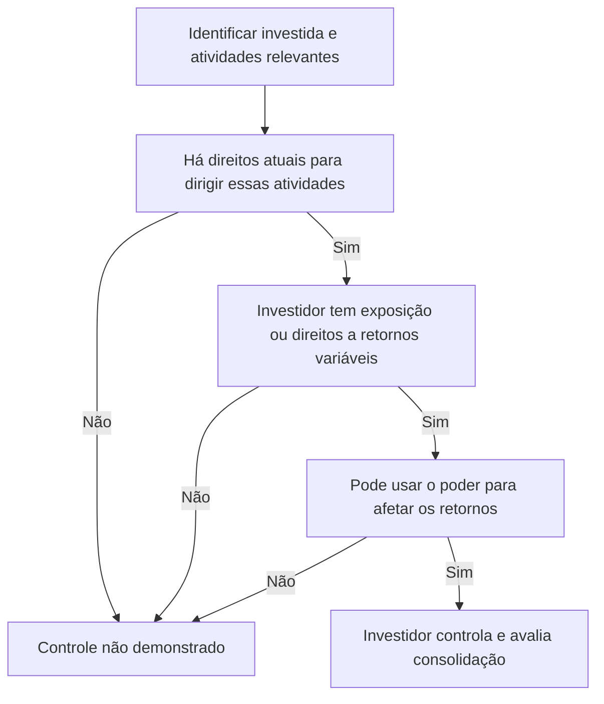

# NBC TG 36 (R3) — Demonstrações Consolidadas

> [!abstract] Resumo em 30 segundos
> A NBC TG 36 estabelece que a consolidação se baseia no **controle**, avaliado pela presença conjunta de poder sobre a investida, exposição a retornos variáveis e capacidade de usar esse poder para afetar os retornos. A controladora consolida a investida desde que obtém o controle até que o perca, usando políticas contábeis uniformes. Há uma exceção específica para entidades de investimento, que, em regra, mensuram controladas ao valor justo por meio do resultado, em vez de consolidá-las.

## Ficha rápida

| Campo | Síntese |
|---|---|
| Norma | NBC TG 36 (R3) — Demonstrações Consolidadas |
| Tema | Identificação do controle e elaboração de demonstrações consolidadas |
| Base da consolidação | Controle da investida |
| Regra geral | Controladora apresenta demonstrações consolidadas |
| Início e término | Da obtenção do controle à perda do controle |
| Alterações R3 | O texto da resolução informa aplicação aos exercícios iniciados a partir de 1º de janeiro de 2016 |

A resolução publicada em 2015 informa que as alterações entram em vigor na data de sua publicação e se aplicam aos exercícios iniciados a partir de 1º de janeiro de 2016. Essa informação é apresentada aqui conforme o texto da resolução reproduzido no PDF.

## Objetivo e alcance

O objetivo é estabelecer princípios para apresentar e elaborar demonstrações consolidadas quando uma entidade controla uma ou mais entidades (itens 1 a 3). A controladora apresenta os ativos, passivos, patrimônio líquido, receitas, despesas e fluxos de caixa do grupo como se fossem de uma única entidade econômica.

A norma aplica-se à entidade controladora. A controladora pode deixar de apresentar demonstrações consolidadas **somente quando todas as condições previstas no item 4(a) forem atendidas**, além de a dispensa ser permitida legalmente. Em síntese:

- a controladora é, por sua vez, controlada integral ou parcialmente, e os demais proprietários — inclusive os sem direito a voto — foram consultados e não se opuseram à dispensa;
- seus instrumentos de dívida ou patrimoniais não são negociados publicamente;
- ela não arquivou nem está arquivando demonstrações perante a CVM ou outro regulador para emissão pública de instrumentos no mercado de capitais; e
- uma controladora final ou intermediária disponibiliza demonstrações consolidadas conforme as normas do CFC, consolidando as controladas ou mensurando-as ao valor justo por meio do resultado, conforme aplicável.

O texto também esclarece que demonstrações consolidadas em IFRS, como editadas pelo IASB, atendem à condição do item 4(a)(iv), desde que a controladora relevante esteja sujeita à regulamentação brasileira e disponibilize demonstrações consolidadas no Brasil (itens 4C e 4D).

A norma não se aplica a planos de benefícios pós-emprego ou outros planos de benefícios de longo prazo a empregados abrangidos pela NBC TG 33. Há ainda tratamento específico para controladoras que sejam entidades de investimento.

## Conceitos-chave

| Conceito | Como aplicar |
|---|---|
| **Controle** | Exige poder, exposição ou direitos a retornos variáveis e capacidade de usar o poder para afetar esses retornos. |
| **Atividades relevantes** | Atividades da investida que afetam significativamente seus retornos. |
| **Poder** | Direitos existentes que conferem capacidade atual de dirigir as atividades relevantes. |
| **Direitos substantivos** | Direitos cujo titular tem capacidade prática de exercê-los. São considerados na avaliação do poder. |
| **Direitos de proteção** | Protegem o titular sem lhe dar poder sobre a investida. |
| **Participação de não controladores** | Parcela do patrimônio líquido da controlada não atribuível, direta ou indiretamente, à controladora. |
| **Grupo econômico** | A controladora e todas as suas controladas. |

A avaliação considera fatos e circunstâncias; deve ser refeita quando houver mudanças que possam alterar um ou mais elementos do controle (item 8). Direitos de voto não são a única base possível: poder também pode decorrer de contratos ou de outros direitos de decisão. A participação nos retornos, por si só, não prova poder.

Se investidores precisam agir em conjunto para dirigir as atividades relevantes, há controle coletivo; nenhum deles controla individualmente a investida apenas por essa razão (item 9). O investidor que exerce direitos de decisão delegados deve avaliar se atua como principal ou agente: o agente não controla a investida por exercer esses direitos nessa condição (item 18).

### Avaliação do controle

## Aplicação passo a passo / checklist

1. **Identifique a investida e seu propósito e estrutura.** Determine quem recebe os retornos, como as decisões são tomadas e quais atividades podem afetar significativamente esses retornos.
2. **Determine as atividades relevantes.** Podem incluir, conforme as circunstâncias, compra e venda de bens ou serviços, gestão de ativos financeiros, seleção ou alienação de ativos, pesquisa e desenvolvimento e decisões sobre estrutura de capital (itens B5 e B11).
3. **Mapeie os direitos de decisão.** Considere direitos de voto, direitos de voto potenciais, acordos contratuais, nomeação ou destituição de gestores e direitos de instruir ou vetar determinadas transações.
4. **Avalie se os direitos são substantivos.** Considere se o titular consegue exercê-los na prática e quando decisões relevantes precisam ser tomadas. Barreiras econômicas, legais, operacionais ou informacionais podem ser relevantes (itens B22 a B24).
5. **Separe direitos substantivos de direitos de proteção.** Direitos de credor que limitam atividades para proteger o crédito são um exemplo de proteção; isoladamente, não conferem poder (itens B26 a B28).
6. **Avalie retornos e sua relação com o poder.** Verifique se o investidor está exposto a retornos variáveis e se pode usar seus direitos para influenciá-los.
7. **Considere outras partes e a condição de principal ou agente.** Direitos substantivos de terceiros podem impedir o investidor de controlar; direitos delegados a um agente não bastam para que este controle.
8. **Conclua e documente a avaliação.** Reavalie o controle se fatos e circunstâncias mudarem (item 8).
9. **Se houver controle, defina o período de consolidação.** Consolide desde a data em que o controle é obtido e cesse a consolidação quando ele for perdido (item 20).
10. **Verifique o tratamento de entidade de investimento e as exceções aplicáveis.**

> [!tip] Direitos de voto não são uma conclusão automática
> A maioria dos votos frequentemente indica poder quando esses direitos são substantivos e dirigem as atividades relevantes. Mas o investidor pode não controlar apesar de deter a maioria, por exemplo, se outra entidade tiver o direito efetivo de dirigir essas atividades ou se os votos não forem substantivos (itens B35 a B37). Também pode haver poder com menos da maioria dos votos.

## Reconhecimento e mensuração

- **Políticas contábeis:** use políticas contábeis uniformes para transações similares e eventos em circunstâncias similares nas demonstrações consolidadas (item 19).
- **Período de consolidação:** começa na data de obtenção do controle e termina na data da perda de controle (item 20).
- **Participações de não controladores:** apresente-as no patrimônio líquido do balanço patrimonial consolidado, separadamente do patrimônio líquido dos proprietários da controladora (item 22).
- **Mudanças de participação sem perda de controle:** são transações patrimoniais, isto é, transações com os sócios (item 23).
- **Perda de controle:** desreconheça os ativos e passivos da ex-controlada do balanço consolidado; remensure ao valor justo qualquer participação mantida na data da perda de controle; e reconheça o ganho ou a perda associado, conforme a orientação aplicável (item 25 e itens B97 a B99A). O valor justo remensurado é considerado valor justo no reconhecimento inicial de ativo financeiro ou, quando apropriado, custo inicial de investimento em coligada ou empreendimento controlado em conjunto.

Há regra adicional quando a controladora perde o controle de controlada que não contém um negócio em transação envolvendo coligada ou empreendimento controlado em conjunto contabilizado pelo método da equivalência patrimonial. Nesse caso, o ganho ou a perda é reconhecido no resultado apenas na extensão das participações dos investidores não relacionados; a parte restante é eliminada contra o valor contábil do investimento, conforme a situação descrita no item B99A.

### Entidades de investimento

A entidade deve atender cumulativamente à definição: obter recursos de investidores para prestar serviços de gestão de investimentos; comprometer-se a investir exclusivamente para valorização do capital, receitas de investimentos ou ambos; e mensurar e avaliar o desempenho de substancialmente todos os investimentos com base no valor justo (item 27).

Salvo a exceção do item 32, a entidade de investimento **não consolida suas controladas** e mensura o investimento em controlada ao valor justo por meio do resultado (item 31). Deve, porém, consolidar a controlada que não seja ela própria entidade de investimento e cuja finalidade principal e atividades sejam prestar serviços relacionados às atividades de investimento da entidade de investimento (item 32). A controladora de uma entidade de investimento consolida as entidades que controla, inclusive as controladas por meio da entidade de investimento, exceto se a própria controladora for uma entidade de investimento (item 33).

As características típicas — como mais de um investimento, mais de um investidor, investidores não relacionados e participações patrimoniais ou similares — ajudam na avaliação. A ausência de qualquer delas, isoladamente, não impede a classificação, mas requer julgamento adicional; a divulgação adicional indicada no texto é a do item 9A da NBC TG 45 (item 28).

## Divulgação

O texto fornecido confirma que as participações de não controladores devem ser apresentadas separadamente dentro do patrimônio líquido consolidado (item 22). Também determina divulgação adicional conforme o item 9A da NBC TG 45 para entidade de investimento que não possua todas as características típicas mencionadas no item 28.

O conteúdo disponibilizado não detalha outros requisitos de divulgação da NBC TG 36. Portanto, esta seção não presume nem acrescenta exigências além das identificadas expressamente.

## Exceções e erros comuns

> [!warning] Não confundir exposição a retornos com controle
> Um investidor pode ter grande exposição aos resultados da investida sem possuir direitos que lhe deem capacidade atual de dirigir suas atividades relevantes. A exposição é um elemento da análise, não substitui o poder.

- **Concluir pelo percentual de votos sem avaliar os direitos.** Analise se os votos são substantivos e se efetivamente dirigem as atividades relevantes.
- **Tratar direitos de proteção como poder.** Direitos voltados a proteger o credor ou a participação de um não controlador não conferem, por si só, capacidade de dirigir a investida.
- **Ignorar direitos contratuais ou direitos de terceiros.** O controle pode decorrer de contratos, e direitos substantivos de outras partes podem limitar ou impedir o controle do investidor.
- **Manter a consolidação após perda de controle.** A consolidação cessa quando o controle é perdido; a participação remanescente é tratada conforme o item 25.
- **Contabilizar como resultado uma mudança de participação sem perda de controle.** A norma classifica essas mudanças como transações patrimoniais.
- **Aplicar a exceção de entidade de investimento automaticamente.** É necessário verificar a definição, a mensuração ao valor justo e a exceção de consolidação para controlada prestadora de serviços prevista no item 32.
- **Presumir que a falta de uma característica típica exclui a condição de entidade de investimento.** O texto exige julgamento adicional, não exclusão automática.

## Conexões com outras normas

| Norma citada | Relação indicada no texto |
|---|---|
| NBC TG 15 — Combinação de Negócios | A NBC TG 36 não trata dos requisitos contábeis da combinação de negócios; a norma é também indicada para certas aquisições de controladas de entidade de investimento (itens 3 e 32). |
| NBC TG 18 — Investimento em Coligada, em Controlada e em Empreendimento Controlado em Conjunto | Citada para a contabilização de participações e de investimentos remanescentes, conforme o caso. |
| NBC TG 19 — Negócios em Conjunto | Exemplo de norma aplicável quando não há controle individual e referência para negócios em conjunto. |
| NBC TG 33 — Benefícios a Empregados | Planos nela abrangidos estão fora do alcance da NBC TG 36 (item 4A). |
| NBC TG 38 — Instrumentos Financeiros: Reconhecimento e Mensuração | Citada para mensuração ao valor justo de investimento de entidade de investimento e para o tratamento do investimento remanescente quando aplicável. |
| NBC TG 45 — Divulgação de Participações em Outras Entidades | Referência à divulgação adicional indicada no item 9A para entidade de investimento sem todas as características típicas (item 28). |

## Fonte

**NBC TG 36 (R3) — Demonstrações Consolidadas**, PDF fornecido: *NBC TG 36 (R3).pdf*. Base deste resumo: texto técnico e alterações da NBC TG 36 (R3) reproduzidos no PDF, incluindo os itens 1 a 33, Apêndices A, B e C e a resolução de 23 de outubro de 2015.
