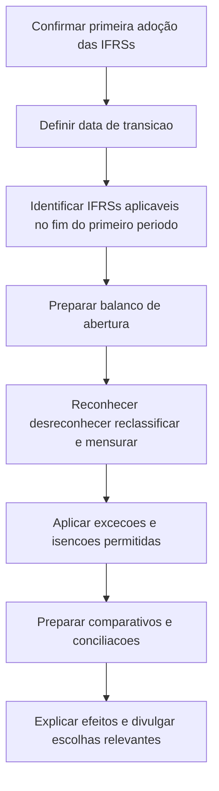

# NBC TG 37 (R5) — Adoção Inicial das Normas Internacionais de Contabilidade

> [!abstract] Resumo em 30 segundos
> A NBC TG 37 orienta a entidade que adota as IFRSs pela primeira vez. Ela exige um balanço patrimonial de abertura na data de transição, políticas contábeis consistentes baseadas nas IFRSs vigentes ao final do primeiro período de reporte e ajustes de transição, em regra, reconhecidos no patrimônio líquido. Há exceções que restringem a aplicação retrospectiva e isenções específicas, que não podem ser ampliadas por analogia. As primeiras demonstrações devem explicar e conciliar os efeitos da transição.

## Ficha rápida

| Campo | Síntese |
|---|---|
| Norma | NBC TG 37 (R5) — Adoção Inicial das Normas Internacionais de Contabilidade |
| Tema | Transição inicial para as IFRSs |
| Aplicação central | Primeiras demonstrações anuais em IFRSs, com declaração explícita e sem ressalvas de conformidade |
| Marco contábil | Balanço patrimonial de abertura na data de transição |
| Evidenciação essencial | Explicação dos efeitos da transição e conciliações entre critérios anteriores e IFRSs |

A norma também se aplica às demonstrações intermediárias, quando apresentadas de acordo com a NBC TG 21 para o período coberto pelas primeiras demonstrações anuais em IFRSs (itens 1 a 3 e 32).

## Objetivo e alcance

O objetivo é assegurar que as primeiras demonstrações em IFRSs — e as demonstrações intermediárias abrangidas — forneçam informação de qualidade: transparente, comparável entre períodos, adequada como ponto de partida para a contabilidade em IFRSs e produzida a um custo que não exceda os benefícios (item 1).

A NBC TG 37 se aplica quando a entidade adota as IFRSs pela primeira vez por meio de declaração explícita e sem ressalvas de conformidade. A definição pode alcançar situações em que demonstrações anteriores usaram normas locais incompatíveis, declararam conformidade apenas parcial, foram preparadas para uso interno ou para consolidação sem constituir um conjunto completo, ou em que não houve demonstrações de períodos anteriores (item 3).

**Não é uma norma geral para mudanças contábeis posteriores à adoção.** Mudanças de políticas de uma entidade que já aplica IFRSs ficam sujeitas à NBC TG 23 e às disposições transitórias específicas de outras normas (item 5).

Há uma situação adicional: se a entidade já aplicou IFRSs anteriormente, mas sua demonstração mais recente não contém declaração explícita e sem ressalvas de conformidade, o item 4A prevê aplicar a NBC TG 37 ou aplicar IFRSs retrospectivamente conforme a NBC TG 23. Se optar por não aplicar a NBC TG 37 nesse caso, deve observar as divulgações indicadas no item 4B.

## Conceitos-chave

| Conceito | Significado para a transição |
|---|---|
| **Adotante pela primeira vez** | Entidade que apresenta suas primeiras demonstrações anuais em IFRSs com declaração explícita e sem ressalvas. |
| **Data de transição** | Início do primeiro período para o qual a entidade apresenta informação comparativa completa em IFRSs. |
| **Balanço patrimonial de abertura** | Balanço na data de transição; é o ponto inicial da contabilidade em IFRSs. |
| **Critérios contábeis anteriores** | Base contábil usada imediatamente antes da adoção das IFRSs. |
| **Custo atribuído** | Valor usado como substituto do custo, ou do custo depreciado ou amortizado, em determinada data. |

Os conceitos estão definidos no Apêndice A. A norma também define valor justo; o texto consolidado remete à NBC TG 46.

## Reconhecimento e mensuração

### Princípio geral

A entidade deve preparar o balanço patrimonial de abertura aplicando as IFRSs vigentes ao final do primeiro período de reporte em IFRSs, ressalvadas as exceções e isenções da NBC TG 37. Deve usar políticas contábeis consistentes no balanço de abertura e em todos os períodos apresentados, sem escolher versões diferentes das IFRSs. Uma norma ainda não obrigatória só pode ser aplicada antecipadamente se permitir essa aplicação e tiver sido admitida pelo CFC (itens 7, 8 e 8A).

No balanço de abertura, a entidade deve:

1. reconhecer os ativos e passivos exigidos pelas IFRSs;
2. deixar de reconhecer itens que as IFRSs não permitem reconhecer;
3. reclassificar itens quando sua natureza contábil difere da classificação anterior; e
4. mensurar os ativos e passivos reconhecidos conforme as IFRSs.

Os ajustes decorrentes de eventos e transações anteriores à data de transição são reconhecidos diretamente em lucros ou prejuízos acumulados ou, quando apropriado, em outra conta do patrimônio líquido (itens 10 e 11).

### Estimativas e aplicação retrospectiva

As estimativas em IFRSs na data de transição devem ser consistentes com as estimativas feitas nessa mesma data sob os critérios anteriores, ajustadas pelas diferenças de políticas contábeis, salvo evidência objetiva de erro. Informação obtida depois da data de transição, por si só, não deve ser usada para reescrever uma estimativa anterior: a norma orienta tratá-la como evento subsequente que não exige ajuste, conforme a NBC TG 24. Estimativas necessárias em IFRSs devem refletir as condições existentes na data pertinente, inclusive as condições de mercado para preços, juros e câmbio (itens 14 a 17).

> [!warning] Evite julgamento retrospectivo
> Não use o conhecimento posterior sobre o desfecho de uma transação para reconstruir estimativas passadas. A exceção é quando houver evidência objetiva de que a estimativa anterior estava errada ou quando o ajuste decorrer de diferença de política contábil.

### Exceções e isenções

A norma organiza as diferenças ao princípio de aplicação integral retrospectiva em duas categorias:

- **Exceções à aplicação retrospectiva:** proíbem a aplicação retrospectiva em aspectos determinados, conforme itens 13 a 17 e Apêndice B.
- **Isenções específicas:** dispensam certas exigências de outras IFRSs, conforme Apêndices C e D. A entidade pode escolher uma ou mais isenções previstas, mas não pode estendê-las a outros itens por analogia (itens 12, 13 e 18).

O Apêndice B lista temas sujeitos a exceções, incluindo desreconhecimento de instrumentos financeiros, contabilidade de hedge, participação de não controladores, classificação e mensuração de ativos financeiros, redução ao valor recuperável de ativos financeiros, derivativos embutidos e empréstimos governamentais (Apêndice B, item B1). Para o desreconhecimento, o texto prevê aplicação prospectiva a transações ocorridas em ou após 1º de janeiro de 2004, com possibilidade de aplicação retrospectiva a partir de data escolhida se houver informação necessária (itens B2 e B3).

## Diagrama do processo

## Aplicação passo a passo / checklist

- [ ] **Confirmar o enquadramento:** verificar se são as primeiras demonstrações anuais em IFRSs com declaração explícita e sem ressalvas.
- [ ] **Fixar as datas:** identificar o fim do primeiro período de reporte em IFRSs e a data de transição, início do primeiro período comparativo completo.
- [ ] **Definir a base normativa:** usar as IFRSs vigentes ao final do primeiro período de reporte; avaliar aplicação antecipada apenas se permitida pela norma e admitida pelo CFC.
- [ ] **Montar o balanço de abertura:** revisar reconhecimento, desreconhecimento, classificação e mensuração de cada saldo relevante.
- [ ] **Analisar exceções e isenções:** aplicar apenas as previstas, documentar as escolhas e não estendê-las por analogia.
- [ ] **Revisar estimativas:** separar diferenças de política contábil de informação posterior sobre resultados já conhecidos.
- [ ] **Preparar demonstrações comparativas:** observar o conjunto mínimo descrito na NBC TG 26 e os requisitos aplicáveis às intermediárias.
- [ ] **Construir conciliações:** reconciliar patrimônio líquido nas datas exigidas e resultado do último período anual anterior apresentado.
- [ ] **Explicar os ajustes:** apresentar detalhe suficiente e separar correções de erros anteriores de mudanças de políticas.
- [ ] **Revisar divulgações especiais:** incluir informações específicas sobre isenções utilizadas, designações de instrumentos financeiros e outras situações aplicáveis.

## Apresentação e divulgação

A NBC TG 37 **não prevê exceções gerais** às exigências de apresentação e divulgação de outras IFRSs (item 20).

As primeiras demonstrações devem incluir, no mínimo, três balanços patrimoniais e duas demonstrações de cada uma das seguintes categorias: resultado, fluxos de caixa, mutações do patrimônio líquido e resultado abrangente, além das demonstrações do valor adicionado quando requeridas pelo regulador ou apresentadas espontaneamente, e respectivas notas explicativas (item 21).

A entidade deve explicar como a transição afetou a posição patrimonial, o desempenho e os fluxos de caixa. As conciliações obrigatórias incluem:

1. patrimônio líquido pelos critérios anteriores versus IFRSs na data de transição;
2. patrimônio líquido na data final do último período anual apresentado anteriormente; e
3. resultado do último período anual apresentado anteriormente, partindo do resultado pelos critérios anteriores.

Se houver demonstração do resultado abrangente, a conciliação também se aplica a ela. Se a entidade reconhecer ou reverter perda por redução ao valor recuperável no balanço de abertura, deve divulgar as informações que a NBC TG 01 teria exigido para o reconhecimento ou reversão no período iniciado na data de transição (itens 23 a 25).

As conciliações devem detalhar os ajustes relevantes. Se houver demonstração dos fluxos de caixa anterior, a entidade também deve explicar ajustes relevantes nela. Erros dos critérios anteriores devem ser distinguidos de mudanças de políticas contábeis (itens 25 e 26).

Se forem apresentados resumos históricos ou comparativos preparados pelos critérios anteriores, eles devem ser identificados como não elaborados em IFRSs, e a natureza dos principais ajustes deve ser explicada; a quantificação desses ajustes não é exigida por essa disposição (item 22).

## Exceções e erros comuns

> [!danger] Não confundir transição com escolha livre de políticas
> A norma exige políticas consistentes, restringe a aplicação retrospectiva em temas específicos e limita as isenções às opções expressamente previstas.

Erros a evitar:

- tratar uma declaração anterior com ressalvas como declaração explícita e sem ressalvas;
- usar informações posteriores para refazer estimativas da data de transição sem base permitida;
- aplicar uma isenção por analogia a um item não contemplado;
- omitir conciliações ou não separar ajustes de política da correção de erro;
- presumir que as exigências de divulgação também estão dispensadas porque existe uma isenção de reconhecimento ou mensuração;
- ignorar as regras brasileiras de alinhamento contábil do item 40.

No contexto brasileiro, o item 40 determina que as demonstrações consolidadas em IFRSs sigam, em regra, as mesmas políticas e práticas usadas nas demonstrações brasileiras. Havendo alternativas, a entidade deve observar a política ou alternativa adotada segundo as regras do CFC; se uma alternativa for vedada por imposição legal nas demonstrações brasileiras, também fica vedada nas consolidadas em IFRSs. A nota explicativa do PDF esclarece que essa disposição especial não existe na versão do IASB (item 40; Nota Explicativa, NE9).

A norma ainda restringe o uso de custo atribuído no contexto brasileiro: valores de custo atribuído utilizados segundo a ITG 10 devem ser usados no balanço de abertura para ativo imobilizado, propriedade para investimento ou ativo de direito de uso, com divulgações por linha; o texto afirma que não se admite essa opção para ativos intangíveis, investimentos em controladas, controladas em conjunto, coligadas ou outros ativos (itens 30 e 31).

## Conexões com outras normas

| Norma citada | Relação expressa no texto |
|---|---|
| **NBC TG 26** | Apresentação das demonstrações e informação comparativa mínima. |
| **NBC TG 21** | Divulgação de demonstrações intermediárias durante o período de primeira adoção. |
| **NBC TG 23** | Mudanças de políticas contábeis, erros e caso de retorno à aplicação das IFRSs. |
| **NBC TG 24** | Tratamento de informação posterior relacionada a estimativas. |
| **NBC TG 01** | Divulgações de perdas ou reversões por redução ao valor recuperável no contexto indicado. |
| **NBC TG 48** | Referências do texto para instrumentos financeiros, classificação, mensuração e hedge. |
| **ITG 10** | Custo atribuído para ativos especificados pela norma. |

## Fonte

- **PDF fornecido:** *NBC TG 37 (R5).pdf*.
- Referências principais utilizadas: itens 1 a 40, Apêndice A e Apêndice B, além da Nota Explicativa. صفحات identificáveis no material fornecido: pp. 3–16 e 52–58.
