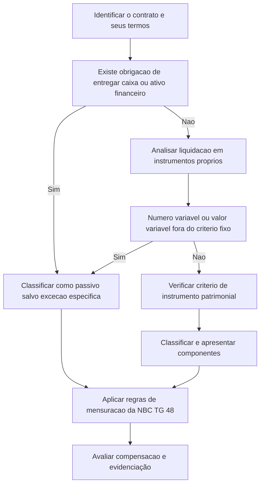

# NBC TG 39 (R5) — Instrumentos Financeiros: Apresentação

> [!abstract] Resumo em 30 segundos
> A NBC TG 39 orienta como apresentar instrumentos financeiros: principalmente, como distinguir passivo financeiro de instrumento patrimonial pela essência do contrato e pelas obrigações do emissor. Também disciplina instrumentos compostos, ações em tesouraria, classificação de juros e dividendos e compensação entre ativos e passivos financeiros. A compensação só é admitida quando há direito legalmente executável e intenção de liquidar pelo valor líquido ou simultaneamente.

## Ficha rápida

| Campo | Síntese |
|---|---|
| Norma | NBC TG 39 (R5) — Instrumentos Financeiros: Apresentação |
| Foco | Classificação e apresentação de instrumentos financeiros |
| Perspectiva central | Emissor do instrumento |
| Complementos expressos no texto | NBC TG 48, para reconhecimento e mensuração; NBC TG 40, para evidenciação |
| Aplicação | Entidades e instrumentos financeiros, observadas as exclusões e condições de alcance |

## Objetivo e alcance

A norma estabelece princípios para apresentar instrumentos financeiros como **passivos financeiros** ou **instrumentos patrimoniais** e para compensar ativos financeiros e passivos financeiros. Também trata da classificação de juros, dividendos, perdas e ganhos relacionados a esses instrumentos.

Em regra, aplica-se a todas as entidades e a todos os tipos de instrumentos financeiros. O texto prevê exclusões ou tratamentos específicos, entre eles participações contabilizadas segundo normas de investimentos e demonstrações consolidadas ou separadas, direitos e obrigações de planos de benefícios a empregados e determinados contratos ou instrumentos de seguro. Há, porém, situações em que a própria norma volta a ser aplicável — por exemplo, a certos derivativos vinculados a participações ou embutidos em contratos de seguro, conforme as condições indicadas no texto.

A norma também alcança certos contratos de compra ou venda de itens não financeiros quando possam ser liquidados pelo valor líquido em caixa ou por instrumentos financeiros. A exceção descrita é para contratos celebrados e mantidos para receber ou entregar o item não financeiro conforme as necessidades esperadas de compra, venda ou uso. O texto também inclui contratos que a entidade designa para mensuração ao valor justo por meio do resultado, conforme a NBC TG 48.

> [!info] Limite da norma
> A NBC TG 39 trata de apresentação. O próprio texto remete à NBC TG 48 para reconhecimento e mensuração e à NBC TG 40 para evidenciação.

## Conceitos-chave

| Conceito | Em termos práticos |
|---|---|
| Instrumento financeiro | Contrato que gera ativo financeiro para uma entidade e passivo financeiro ou instrumento patrimonial para outra. |
| Ativo financeiro | Inclui caixa, instrumento patrimonial de outra entidade e direitos contratuais a receber ou trocar ativos financeiros em condições potencialmente favoráveis. |
| Passivo financeiro | Inclui obrigação contratual de entregar caixa ou outro ativo financeiro, ou de trocar instrumentos financeiros em condições potencialmente desfavoráveis. Também pode resultar de contratos liquidados com quantidade variável de instrumentos próprios. |
| Instrumento patrimonial | Contrato que evidencia participação nos ativos da entidade após a dedução de todos os passivos. |
| Instrumento com opção de venda | Instrumento que permite ao titular devolvê-lo ao emissor por caixa ou outro ativo financeiro, ou prevê sua devolução em certas circunstâncias. |

A classificação não depende apenas do nome ou da forma jurídica do instrumento. Importam a **essência do acordo**, os direitos e obrigações contratuais e a existência de obrigação de transferir recursos financeiros.

## Diagrama de decisão

## Aplicação passo a passo — checklist

1. **Identifique o instrumento e o contrato.** Considere os termos contratuais e seus efeitos econômicos; contratos não precisam necessariamente estar formalizados.
2. **Confirme o alcance.** Verifique se o instrumento está sujeito à NBC TG 39 ou se há exclusão ou tratamento específico.
3. **Analise as obrigações do emissor.** Determine se existe obrigação contratual de entregar caixa ou outro ativo financeiro, inclusive obrigação indireta decorrente dos termos do instrumento.
4. **Examine a liquidação com instrumentos próprios.** Um contrato não é patrimonial apenas porque pode ser liquidado com ações próprias. Verifique se há troca de montante fixo de caixa ou outro ativo financeiro por número fixo de instrumentos patrimoniais próprios.
5. **Avalie exceções para instrumentos com opção de venda ou liquidação na liquidação da entidade.** Só classifique como patrimônio quando todas as características e condições aplicáveis estiverem atendidas.
6. **Separe componentes, se necessário.** Um instrumento não derivativo pode conter componente de passivo e componente patrimonial.
7. **Classifique os efeitos no resultado ou no patrimônio líquido.** A classificação do instrumento orienta o tratamento de juros, dividendos, perdas e ganhos.
8. **Avalie a compensação separadamente.** Confirme os dois critérios cumulativos da norma: direito legalmente executável e intenção de liquidação líquida ou simultânea.
9. **Considere a evidenciação relacionada.** Para os instrumentos abrangidos, observe a remissão à NBC TG 40.

## Reconhecimento e mensuração

### Classificação: obrigação contratual e essência

No reconhecimento inicial, o emissor classifica o instrumento, ou seus componentes, como ativo financeiro, passivo financeiro ou instrumento patrimonial, conforme a essência do contrato e as definições da norma.

Como regra, se o emissor não tem direito incondicional de evitar a entrega de caixa ou de outro ativo financeiro para liquidar uma obrigação contratual, há passivo financeiro. Restrições práticas — como falta de moeda estrangeira ou necessidade de autorização regulatória — não eliminam, por si, a obrigação contratual. Uma obrigação condicionada ao exercício do direito de resgate pela contraparte também pode ser passivo.

A liquidação em instrumentos próprios não basta para caracterizar patrimônio. Um contrato que exige número variável de ações próprias para satisfazer um valor determinado é passivo ou ativo financeiro, conforme seus termos. A norma trata como patrimonial, em regra, o contrato liquidado pela troca de **montante fixo** de caixa ou outro ativo financeiro por **número fixo** de instrumentos patrimoniais próprios, observadas as exceções descritas.

### Exceções específicas de classificação

Instrumentos com opção de venda são, em regra, passivos, pois podem obrigar o emissor a recomprá-los ou resgatá-los por caixa ou outro ativo financeiro. A classificação excepcional como patrimônio depende de todas as condições aplicáveis, incluindo participação pro rata nos ativos líquidos, subordinação a todas as demais classes, características idênticas dentro da classe e ausência de outros instrumentos ou contratos que restrinjam substancialmente ou fixem o retorno residual, conforme os critérios da norma.

Há tratamento excepcional semelhante para certos instrumentos que impõem a entrega pro rata de ativos líquidos apenas na liquidação da entidade. Se uma condição exigida não puder ser confirmada, o instrumento não deve ser classificado como patrimonial.

A classificação desses instrumentos pode mudar quando deixam de satisfazer — ou passam a satisfazer — as condições. Na reclassificação de patrimônio para passivo, o passivo é mensurado pelo valor justo na data, e a diferença para o valor contábil do instrumento patrimonial é reconhecida no patrimônio líquido. Na reclassificação de passivo para patrimônio, o instrumento patrimonial é mensurado pelo valor contábil do passivo na data.

### Instrumentos compostos e ações próprias

O emissor de instrumento financeiro não derivativo deve avaliar se há componentes de passivo e de patrimônio líquido. No exemplo de título conversível em número fixo de ações, a obrigação de pagar pode constituir o componente de passivo, enquanto a opção de conversão pode constituir o componente patrimonial.

No reconhecimento inicial, atribui-se ao passivo o valor determinado para esse componente; o componente patrimonial corresponde ao valor residual após deduzir o passivo do valor justo total do instrumento. A soma dos componentes deve igualar o valor justo do instrumento como um todo, sem ganho ou perda no reconhecimento inicial decorrente da separação.

A própria entidade não reconhece suas ações em tesouraria como ativo financeiro: elas são deduzidas do patrimônio líquido. O texto prevê tratamento distinto quando a entidade mantém ações próprias em nome de terceiros em uma relação de agência.

## Juros, dividendos, perdas e ganhos

O tratamento acompanha a classificação do instrumento. Em termos gerais, valores relacionados a um passivo financeiro são tratados como despesas ou ganhos no resultado; distribuições relacionadas a instrumento patrimonial são reconhecidas diretamente no patrimônio líquido. Em instrumentos compostos, os efeitos devem ser atribuídos ao componente correspondente. A norma também esclarece que a probabilidade de exercício de uma opção de conversão não leva, por si só, à revisão da classificação dos componentes.

## Compensação e divulgação

Um ativo financeiro e um passivo financeiro devem ser compensados, com apresentação do valor líquido, **se e somente se**:

- a entidade possuir atualmente direito legalmente executável de compensar os valores reconhecidos; e
- pretender liquidar pelo valor líquido ou realizar o ativo e liquidar o passivo simultaneamente.

O direito não pode estar condicionado a evento futuro e deve ser executável no curso normal dos negócios, em caso de inadimplência e em caso de insolvência ou falência, para a entidade e todas as contrapartes. A análise deve considerar as leis e os contratos aplicáveis. Um mecanismo de liquidação bruta só equivale à liquidação líquida quando, entre outras características, processa os valores em um único ciclo e elimina ou reduz a nível insignificante os riscos de crédito e liquidez descritos no texto.

A norma remete à NBC TG 40 para informações adicionais sobre instrumentos financeiros reconhecidos abrangidos pelos itens indicados nessa norma. O texto também esclarece que instrumentos financeiros sintéticos, formados por contratos separados, não devem ser apresentados líquidos apenas por produzirem conjuntamente efeitos semelhantes: cada instrumento é avaliado separadamente para fins de compensação.

> [!warning] Atenção
> Ter direito de compensar não basta. A entidade também precisa pretender liquidar pelo valor líquido ou realizar o ativo e liquidar o passivo simultaneamente — ressalvada a equivalência prevista para certos sistemas de liquidação.

## Exceções e erros comuns

> [!danger] Erros a evitar
> - Classificar pelo nome ou pela forma jurídica, sem examinar a essência do contrato.
> - Tratar toda ação própria usada em uma liquidação como instrumento patrimonial.
> - Classificar instrumento com opção de venda como patrimônio sem comprovar todas as condições da exceção.
> - Compensar ativos e passivos apenas porque existe acordo de compensação ou direito condicionado a evento futuro.
> - Considerar que um conjunto de instrumentos separados pode ser apresentado líquido só porque, em conjunto, simula outro instrumento.
> - Confundir apresentação, objeto desta norma, com reconhecimento e mensuração, tratados pela NBC TG 48.

## Conexões com outras normas

- **NBC TG 48 — Instrumentos Financeiros:** complementa a NBC TG 39 quanto ao reconhecimento e à mensuração; a NBC TG 39 remete a ela para esses temas.
- **NBC TG 40 — Instrumentos Financeiros: Evidenciação:** trata das informações a divulgar sobre instrumentos financeiros; a NBC TG 39 remete a requisitos específicos de evidenciação.
- **NBC TG 11, NBC TG 33, NBC TG 10, NBC TG 18, NBC TG 35 e NBC TG 36:** aparecem no texto ao tratar do alcance, das exclusões e dos casos em que determinados instrumentos ou contratos recebem tratamento específico.

## Fonte

PDF **NBC TG 39 (R5).pdf**, texto da NBC TG 39 (R5) — *Instrumentos Financeiros: Apresentação* — e alteração identificada como aprovada pelo CFC em 24 de novembro de 2017. Itens e páginas foram citados apenas quando identificáveis no texto fornecido.
