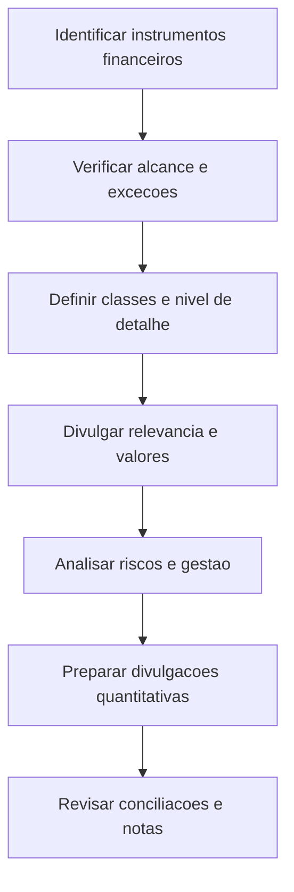

# NBC TG 40 (R3) — Instrumentos Financeiros: Evidenciação

> [!abstract] Em 30 segundos
> A NBC TG 40 (R3) determina **quais informações sobre instrumentos financeiros devem ser divulgadas** para que os usuários avaliem sua relevância para a posição financeira e o desempenho da entidade, bem como os riscos associados e a forma como são administrados. As divulgações abrangem informações qualitativas e quantitativas, com atenção especial a crédito, liquidez e mercado. A norma trata de evidenciação: não substitui os requisitos de reconhecimento e mensuração de outras normas.

## Ficha rápida

| Campo | Síntese |
|---|---|
| Norma | NBC TG 40 (R3) |
| Tema | Divulgação de instrumentos financeiros e dos riscos relacionados |
| Aplicação | Entidades que tenham instrumentos financeiros reconhecidos ou certos instrumentos não reconhecidos abrangidos pela norma |
| Foco para preparação | Divulgações proporcionais ao uso de instrumentos financeiros e à exposição a riscos |
| Referências centrais no texto | NBC TG 48, NBC TG 39 e, para valor justo, NBC TG 46 |

## Objetivo e alcance

A entidade deve divulgar informações que permitam aos usuários avaliar:

1. a significância dos instrumentos financeiros para sua posição patrimonial e financeira e para seu desempenho; e
2. a natureza e a extensão dos riscos decorrentes desses instrumentos durante o período e ao final dele, incluindo a maneira como a entidade administra esses riscos.

A norma se aplica a instrumentos financeiros reconhecidos e, em determinados casos, a instrumentos não reconhecidos, como alguns compromissos de empréstimo. Também alcança contratos de compra ou venda de item não financeiro que estejam dentro do escopo da NBC TG 48.

A abrangência é ampla: pode alcançar desde uma entidade com contas a receber e a pagar até uma instituição cujo negócio envolva muitos instrumentos financeiros. **O volume e a natureza das divulgações devem refletir a extensão do uso dos instrumentos e da exposição a riscos.** Quando a divulgação for exigida por classe, a entidade deve agrupar instrumentos conforme a natureza da informação e as características dos instrumentos, mantendo informação suficiente para conciliação com o balanço patrimonial.

### Limites de alcance destacados no texto

Há exclusões e tratamentos específicos, entre eles participações em controladas, coligadas e empreendimentos controlados em conjunto contabilizadas pelas normas próprias; direitos e obrigações de empregadores decorrentes de planos de benefícios a empregados; contratos de seguro; instrumentos, contratos e obrigações de pagamento baseado em ações; e certos instrumentos classificados como patrimoniais pela NBC TG 39.

Esses limites não afastam automaticamente a NBC TG 40 de situações expressamente ressalvadas no texto — por exemplo, determinados derivativos vinculados a participações e derivativos embutidos em contratos de seguro quando outra norma exigir sua contabilização separada. Portanto, a entidade deve verificar a exceção e a ressalva aplicáveis ao caso, em vez de presumir que todo instrumento associado a uma atividade excluída está fora da norma.

## Conceitos-chave

- **Classe de instrumento financeiro:** agrupamento definido para divulgar informação apropriada à natureza e às características dos instrumentos. Não deve ser confundido com as categorias de mensuração da NBC TG 48.
- **Categorias de mensuração:** classificações relevantes para divulgar valores contábeis e resultados. O texto consolidado da R3 inclui, entre outras, ativos e passivos ao valor justo por meio do resultado, ativos e passivos ao custo amortizado e ativos ao valor justo por meio de outros resultados abrangentes.
- **Exposição a risco:** efeito potencial dos instrumentos financeiros sobre a entidade. A norma destaca risco de crédito, de liquidez e de mercado.
- **Divulgação qualitativa:** objetivos, políticas e processos de gestão de riscos.
- **Divulgação quantitativa:** dimensão das exposições, apoiada nas informações fornecidas internamente ao pessoal-chave da administração.
- **Conciliação:** apresentação que permite relacionar divulgações por classe aos valores apresentados nas demonstrações contábeis.

## Como aplicar

## Aplicação passo a passo — checklist

- [ ] **Inventariar os instrumentos.** Considere instrumentos reconhecidos e avalie também os não reconhecidos que possam estar abrangidos, como certos compromissos de empréstimo.
- [ ] **Verificar o alcance.** Identifique exclusões, ressalvas e interações com outras normas antes de decidir que uma divulgação não se aplica.
- [ ] **Definir classes apropriadas.** Agrupe instrumentos por natureza da informação e características; não use automaticamente as categorias de mensuração como classes de divulgação.
- [ ] **Relacionar classes e demonstrações.** Confirme que os valores divulgados podem ser conciliados com os itens apresentados no balanço patrimonial.
- [ ] **Avaliar a significância.** Organize as divulgações que permitam compreender a relevância dos instrumentos para a posição financeira e o desempenho.
- [ ] **Descrever a gestão de riscos.** Explique objetivos, políticas e processos usados pela administração.
- [ ] **Mensurar as exposições quantitativas.** Use informações consistentes com aquelas fornecidas internamente ao pessoal-chave da administração.
- [ ] **Cobrir os riscos requeridos.** Verifique as divulgações específicas sobre crédito, liquidez e mercado.
- [ ] **Revisar eventos e condições relevantes.** Considere garantias, descumprimentos contratuais, compensação e transferências de ativos financeiros quando aplicáveis.
- [ ] **Organizar as notas.** Evite omissões e duplicações; quando informações forem apresentadas em outras partes disponíveis aos usuários, use referências cruzadas apropriadas conforme o texto da norma.

## Reconhecimento e mensuração

A NBC TG 40 é uma norma de **evidenciação**. Seus princípios complementam os requisitos de reconhecimento, mensuração e apresentação previstos, no texto consolidado, principalmente na NBC TG 48 e na NBC TG 39; para mensuração do valor justo, o texto também remete à NBC TG 46 em situações específicas.

Assim, a aplicação da NBC TG 40 não consiste em escolher novamente como reconhecer ou mensurar o instrumento. Consiste em identificar as divulgações exigidas sobre valores, categorias, resultados e riscos, considerando a contabilização determinada pelas normas aplicáveis.

Entre as divulgações de valores contábeis, a R3 prevê a apresentação, no balanço ou em nota explicativa, das categorias pertinentes. O texto inclui ativos e passivos financeiros ao valor justo por meio do resultado, ativos e passivos ao custo amortizado e ativos ao valor justo por meio de outros resultados abrangentes. Para determinadas categorias ao valor justo por meio do resultado, a divulgação deve distinguir designações feitas pela entidade de mensurações obrigatórias, conforme a categoria aplicável.

**A apresentação deve refletir a categoria vigente descrita na R3 e na norma de mensuração aplicável.** Categorias que aparecem em versões anteriores do texto, mas foram eliminadas na redação alterada, não devem ser tratadas como exigência atual apenas por constarem em trechos históricos reproduzidos no PDF.

## Divulgações principais

### Relevância para posição financeira e desempenho

A entidade divulga os valores contábeis das categorias requeridas e, conforme aplicável, itens de receita, despesa, ganho e perda relacionados a instrumentos financeiros. O texto também prevê divulgações específicas para certos ativos ou passivos designados ao valor justo por meio do resultado, inclusive informações sobre exposição máxima a risco de crédito e variações de valor justo atribuíveis ao risco de crédito.

As políticas contábeis relevantes devem explicar as bases de mensuração e outras políticas necessárias à compreensão das demonstrações.

### Riscos

A norma requer informações qualitativas e quantitativas sobre a exposição e a gestão dos riscos. Para orientar a análise:

| Risco | Questão prática de preparação |
|---|---|
| Crédito | Que exposição existe e que informações permitem compreender sua extensão e concentração? |
| Liquidez | Que informações descrevem a exposição e auxiliam na avaliação dos riscos associados aos pagamentos? |
| Mercado | Como alterações nas variáveis de mercado podem afetar a entidade? O texto prevê análise de sensibilidade e outras divulgações pertinentes. |

O trecho fornecido identifica divulgações específicas sobre risco de crédito, liquidez e mercado, mas não reproduz integralmente todos os requisitos desses assuntos. As divulgações devem ser conferidas na íntegra da norma para determinar os dados, formatos e desagregações aplicáveis a cada caso.

### Outras situações que podem exigir divulgação

Conforme aplicável, o texto prevê divulgações relacionadas a:

- ativos financeiros usados como garantia e condições associadas;
- garantias recebidas que possam ser vendidas ou reapresentadas;
- descumprimentos de compromissos contratuais de empréstimos e renegociações;
- instrumentos financeiros sujeitos a compensação ou a acordos principais de liquidação executáveis;
- instrumentos financeiros compostos com componentes patrimonial e de passivo e múltiplos derivativos embutidos interdependentes;
- contabilização de hedge;
- transferências de ativos financeiros.

Nas divulgações sobre compensação, o texto prevê informações quantitativas separadas para ativos e passivos financeiros, incluindo valores brutos, valores compensados, valores líquidos apresentados no balanço e valores sujeitos a determinados acordos que não foram incluídos na compensação. Também exige descrição dos direitos de compensação relacionados.

## Exceções e erros comuns

> [!warning] Cuidado com versões e categorias
> O PDF reproduz redações anteriores e alterações da R3 em sequência em diversos pontos. Para aplicar a norma, use a redação alterada identificada como NBC TG 40 (R3), e não requisitos históricos eliminados que permaneçam visíveis no documento.

- **Confundir divulgação com reconhecimento ou mensuração.** A NBC TG 40 exige evidenciação; os critérios contábeis correspondentes são tratados pelas normas relacionadas.
- **Tratar classe e categoria como sinônimos.** A classe é definida para divulgação; a categoria de mensuração decorre da norma aplicável.
- **Presumir que instrumentos simples dispensam divulgação.** O texto abrange todas as entidades dentro do alcance; a extensão das divulgações é que depende do uso dos instrumentos e da exposição a riscos.
- **Excluir instrumentos não reconhecidos sem análise.** Alguns podem estar no alcance da norma.
- **Usar exclusões sem verificar ressalvas.** Derivativos e outros casos expressamente ressalvados podem continuar sujeitos à NBC TG 40.
- **Apresentar valores sem conciliação ou contexto.** A divulgação deve permitir relacionar classes e saldos contábeis, além de oferecer informação suficiente para avaliar riscos.
- **Repetir informações sem necessidade ou omitir referências cruzadas.** Quando informações forem apresentadas em outro local nos termos previstos pela norma, a referência cruzada deve permitir que os usuários as localizem.

## Conexões com outras normas

- **NBC TG 48 — Instrumentos Financeiros:** norma relacionada ao reconhecimento e à mensuração; fornece categorias e critérios citados pelas divulgações da NBC TG 40.
- **NBC TG 39 — Instrumentos Financeiros: Apresentação:** relacionada à apresentação e à compensação de ativos e passivos financeiros.
- **NBC TG 46 — Mensuração do Valor Justo:** citada para divulgações de itens mensurados ao valor justo em situações previstas no texto.
- **NBC TG 26 — Apresentação das Demonstrações Contábeis:** referência para a divulgação de bases de mensuração e políticas contábeis relevantes.
- **NBC TG 47 — Receita de Contrato com Cliente:** o texto determina que requisitos de divulgação de risco de crédito indicados na norma também alcancem certos direitos que devem ser contabilizados de acordo com a NBC TG 48 para fins de reconhecimento de perdas de crédito.

## Fonte

**NBC TG 40 (R3) — Instrumentos Financeiros: Evidenciação**, PDF indicado como *NBC TG 40 (R3).pdf*. As referências de páginas deste resumo não foram individualizadas; o texto fornecido abrange páginas identificadas de 1 a 77 e não reproduz integralmente todos os trechos técnicos intermediários.
