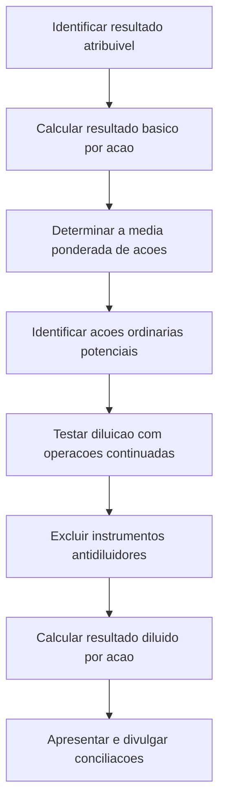

# NBC TG 41 (R2) — Resultado por Ação

> [!abstract] Resumo em 30 segundos
> A NBC TG 41 disciplina o cálculo e a apresentação do resultado básico e diluído por ação. O básico relaciona o resultado atribuível aos titulares de ações ordinárias à média ponderada das ações ordinárias em circulação. O diluído considera, além disso, os efeitos de ações ordinárias potenciais que reduziriam o resultado por ação — ou aumentariam o prejuízo por ação — das operações continuadas. A norma também especifica ajustes retrospectivos, apresentação e divulgações.

## Ficha rápida

| Campo | Síntese |
|---|---|
| Norma | NBC TG 41 (R2) — Resultado por Ação |
| Grupo | 02 - NBC TG |
| Foco | Denominador do cálculo e comparabilidade do resultado por ação |
| Resultado básico | Resultado atribuível aos titulares de ações ordinárias ÷ média ponderada de ações ordinárias em circulação |
| Resultado diluído | Resultado e quantidade de ações ajustados pelos efeitos diluidores de ações ordinárias potenciais |
| Alcance principal | Companhias com ações ordinárias ou potenciais negociadas publicamente, ou registradas em órgão regulador — e demonstrações consolidadas de grupos cuja controladora atenda a esses critérios |
| Fonte | PDF NBC TG 41 (R2).pdf |

## Objetivo e alcance

A norma busca melhorar a comparação do desempenho entre companhias no mesmo período e entre períodos da mesma companhia. Embora diferenças nas políticas contábeis possam limitar a comparabilidade do resultado, o uso consistente do denominador melhora a informação por ação. O texto destaca justamente a determinação desse denominador como foco da norma (itens 1–4A).

A aplicação alcança demonstrações separadas e individuais de companhias que tenham ações ordinárias ou ações ordinárias potenciais publicamente negociadas, ou que estejam registradas — ou em processo de registro — para distribuir esses instrumentos em mercados organizados. Também alcança demonstrações consolidadas de grupo cuja controladora se enquadre nesses requisitos. A companhia que divulgar resultado por ação deve calculá-lo e apresentá-lo em conformidade com a norma.

As disposições aplicáveis ao resultado por ação ordinária também se aplicam, no que couber, às ações preferenciais por classe quando estejam em negociação ou em processo de negociação em mercados organizados, independentemente de serem classificadas como instrumento patrimonial ou de dívida (item 3A).

## Conceitos-chave

| Conceito | Significado prático |
|---|---|
| Ação ordinária potencial | Instrumento financeiro ou contrato que dá ao titular direito a ações ordinárias. |
| Diluição | Redução do lucro por ação ou aumento do prejuízo por ação em razão da conversão, do exercício ou da emissão de ações potenciais. |
| Antidiluição | Aumento do lucro por ação ou redução do prejuízo por ação decorrente desses mesmos pressupostos. |
| Ações emissíveis sob condição | Ações ordinárias que podem ser emitidas por pouca ou nenhuma contrapartida após satisfeitas condições especificadas. |
| Ações em circulação | Ações com os acionistas, excluídas as ações mantidas em tesouraria. |
| Opções e bônus de subscrição | Instrumentos que dão ao titular o direito de adquirir ações. |

Exemplos de ações ordinárias potenciais incluem instrumentos conversíveis, opções, bônus de subscrição e ações emitíveis após o cumprimento de condições contratuais (itens 5–8).

## Cálculo em uma visão

## Aplicação passo a passo e checklist

### 1. Identifique o conjunto de demonstrações e as classes de ações

- Confirme se a companhia se enquadra no alcance da norma e se divulga resultado por ação.
- Identifique as classes de ações ordinárias com direitos diferentes de participação no lucro.
- Considere a regra de apresentação aplicável quando houver demonstrações consolidadas e separadas. Em regra, as divulgações requeridas são baseadas nas informações consolidadas; se a entidade optar por apresentar resultado por ação com base nas demonstrações separadas, a norma determina onde essas informações podem ser apresentadas (item 4).

### 2. Determine o resultado atribuível aos titulares de ações ordinárias

- Parta do lucro ou prejuízo atribuível à companhia.
- Para cálculo consolidado, considere a parcela atribuível à controladora e exclua as participações de não controladores.
- Ajuste, quando aplicável, dividendos preferenciais e efeitos semelhantes de ações preferenciais classificadas como patrimônio líquido, após os tributos correspondentes.
- Considere os itens de receitas e despesas reconhecidos no período que sejam atribuíveis aos titulares de ações ordinárias. A norma também trata de dividendos de ações preferenciais classificados como passivos (itens 12–18).

### 3. Calcule o resultado básico por ação

Use como denominador a média ponderada das ações ordinárias em circulação durante o período, excluindo ações em tesouraria:

**Resultado básico por ação = resultado atribuível aos titulares de ações ordinárias ÷ média ponderada de ações ordinárias em circulação**

Pondere as emissões e recompras pelo período em que as ações estiveram com os acionistas. Em geral, a inclusão começa quando a contrapartida é recebível, conforme os termos e a essência da emissão. O texto apresenta situações específicas, como emissão por dinheiro, conversão de dívida, liquidação de passivo e aquisição de ativos (itens 19–23).

### 4. Identifique e teste ações ordinárias potenciais

- Liste instrumentos conversíveis, opções, bônus de subscrição, acordos contingentes e outros contratos relevantes.
- Determine quantas ações seriam incluídas e os ajustes correspondentes no numerador, se os instrumentos fossem convertidos ou exercidos.
- Use o lucro ou prejuízo das operações continuadas atribuível à companhia como número de controle para testar se cada instrumento é diluidor.
- Avalie cada emissão ou série separadamente e ordene os instrumentos do mais diluidor ao menos diluidor.
- Exclua do cálculo os instrumentos antidiluidores (itens 41–44).

### 5. Calcule o resultado diluído e revise eventos posteriores

Ajuste o numerador pelos efeitos após tributos, dividendos, participações e outras receitas ou despesas que mudariam com a conversão. Ajuste o denominador pela média ponderada das ações adicionais que seriam emitidas. Considere as regras próprias de opções, conversíveis, ações contingentes e contratos liquidáveis em dinheiro ou ações (itens 30–63).

Verifique se houve eventos que exijam ajuste retrospectivo, como bonificações, capitalização de reservas, desdobramentos ou grupamentos de ações. Não revise resultados diluídos de períodos anteriores por alterações nas premissas usadas para o cálculo (itens 64–65).

### 6. Apresente e divulgue

- Apresente os resultados básico e diluído com igual destaque para todos os períodos apresentados.
- Apresente valores negativos quando houver prejuízo por ação.
- Prepare conciliações do numerador e do denominador e identifique os instrumentos potenciais que não entraram no cálculo por serem antidiluidores.

## Reconhecimento e mensuração

### Resultado básico

O numerador parte do lucro ou prejuízo atribuível aos titulares de ações ordinárias. Para ações preferenciais classificadas como patrimônio líquido, a norma prevê ajustes relativos a dividendos e efeitos semelhantes. A regra para dividendos de ações preferenciais cumulativas considera o valor exigível relativo ao período, ainda que não tenha sido declarado; valores relativos a períodos anteriores não se confundem com o dividendo do período corrente (itens 12–18).

O denominador é uma média ponderada pelo tempo. Ações readquiridas deixam de integrar as ações em circulação. Quando a emissão altera o número de ações sem alteração correspondente nos recursos — por exemplo, bonificação, capitalização de reservas ou desdobramento — o cálculo é ajustado como se a alteração tivesse ocorrido no início do período mais antigo apresentado. Grupamentos também podem exigir ajuste, observadas as situações descritas na norma (itens 19–29).

### Resultado diluído

O cálculo deve refletir todas as ações ordinárias potenciais diluidoras em circulação durante o período. Se a conversão reduzir o lucro por ação ou aumentar o prejuízo por ação proveniente das operações continuadas, o instrumento é diluidor; se produzir o efeito contrário, é antidiluidor e não é presumido no cálculo.

Para opções e bônus de subscrição, a norma presume o exercício e considera as ações que seriam emitidas ao preço médio de mercado. A diferença entre essas ações e as ações que seriam emitidas pelo preço médio de mercado é tratada como emissão sem contrapartida. O efeito diluidor ocorre quando o preço médio de mercado supera o preço de exercício (itens 45–48).

Para instrumentos conversíveis, o resultado é ajustado pelos efeitos que deixariam de existir ou mudariam com a conversão, incluindo os efeitos tributários aplicáveis. A versão R2 altera o item 34 quanto às referências às normas relacionadas a custos e descontos associados a ações ordinárias potenciais: o texto técnico menciona a NBC TG 48 e a NBC TG 08.

> [!info] Ajustes retrospectivos
> Bonificações, capitalizações, desdobramentos e grupamentos que alterem a quantidade de ações sem mudança correspondente nos recursos podem exigir ajuste retrospectivo dos resultados por ação de todos os períodos apresentados. Se ocorrerem após a data do balanço, mas antes da autorização das demonstrações, a norma também prevê o recálculo com base no novo número de ações e a divulgação do fato (itens 26–29 e 64).

## Divulgação e apresentação

A demonstração do resultado deve apresentar o resultado básico e o diluído para o lucro ou prejuízo das operações continuadas atribuível aos titulares de capital próprio ordinário e para o lucro ou prejuízo atribuível a esses titulares no período. A apresentação considera cada classe de ações ordinárias com direito diferente de participação no lucro. Se houver operação descontinuada, devem ser divulgados os resultados básico e diluído por ação correspondentes, na demonstração ou em notas explicativas (itens 66–69).

As divulgações incluem (item 70):

- os numeradores usados nos cálculos básico e diluído, conciliados com o lucro ou prejuízo atribuível à companhia, com os efeitos individuais das classes de instrumentos relevantes;
- as médias ponderadas de ações usadas como denominadores e a conciliação entre elas;
- instrumentos potencialmente diluidores que foram excluídos por serem antidiluidores nos períodos apresentados;
- descrição de transações de ações ocorridas após a data do balanço que poderiam alterar significativamente a quantidade de ações.

Se forem divulgados valores por ação baseados em outro componente da demonstração do resultado, a companhia deve usar a média ponderada determinada conforme a norma, apresentar esses valores com igual destaque e explicar a base do numerador, inclusive se é antes ou depois dos tributos (itens 72–73A).

## Exceções e erros comuns

> [!warning] Não inclua instrumentos antidiluidores
> A conversão, o exercício ou a emissão potencial não é automaticamente incluído no resultado diluído. O efeito deve ser testado com o número de controle das operações continuadas; instrumentos antidiluidores ficam fora do cálculo.

- **Usar o saldo de ações no encerramento como denominador:** a regra é a média ponderada pelo tempo, e não simplesmente a quantidade final.
- **Incluir ações em tesouraria:** elas são excluídas das ações em circulação.
- **Ignorar a classe ou os direitos das ações:** classes com direitos distintos podem exigir cálculos e apresentações separados.
- **Ajustar retroativamente por variações de preço das ações:** a norma afirma que o resultado por ação anteriormente apresentado não deve ser ajustado apenas por mudanças no preço das ações ordinárias.
- **Revisar períodos anteriores por mudanças nas premissas de diluição:** a norma não permite essa revisão por alteração das premissas usadas ou pela conversão de ações potenciais.
- **Deixar de apresentar prejuízo por ação:** a divulgação também é requerida quando os valores são negativos.
- **Omitir instrumentos excluídos:** instrumentos potencialmente diluidores que não foram incluídos por antidiluição devem ser divulgados.

## Conexões com outras normas

As conexões abaixo são expressamente mencionadas no texto da NBC TG 41:

- **NBC TG 26 — Apresentação das Demonstrações Contábeis:** componentes do resultado e apresentação do resultado por ação.
- **NBC TG 35 e NBC TG 36 — Demonstrações Separadas e Consolidadas:** base das demonstrações quando há apresentação de demonstrações consolidadas e separadas.
- **NBC TG 39 — Instrumentos Financeiros: Apresentação:** termos e definições de instrumentos financeiros.
- **NBC TG 46 — Mensuração do Valor Justo:** definição e requisitos de aplicação do valor justo.
- **NBC TG 40 — Instrumentos Financeiros: Evidenciação:** divulgação encorajada dos termos e condições de instrumentos e contratos relevantes.
- **NBC TG 48 — Instrumentos Financeiros, NBC TG 08 — Custos de Transação e Prêmios na Emissão de Títulos e Valores Mobiliários e NBC TG 10 — Pagamento Baseado em Ações:** referências relacionadas a despesas de instrumentos potenciais e a opções ou contratos de pagamento baseado em ações.

## Fonte

PDF **NBC TG 41 (R2).pdf**, especialmente os trechos técnicos de objetivo, alcance, definições, mensuração, ajuste retrospectivo, apresentação e divulgação (itens 1–73A). O texto de resolução ao final identifica a alteração da NBC TG 41 (R1) como NBC TG 41 (R2) e registra efeitos a partir de 1º de janeiro de 2018.
