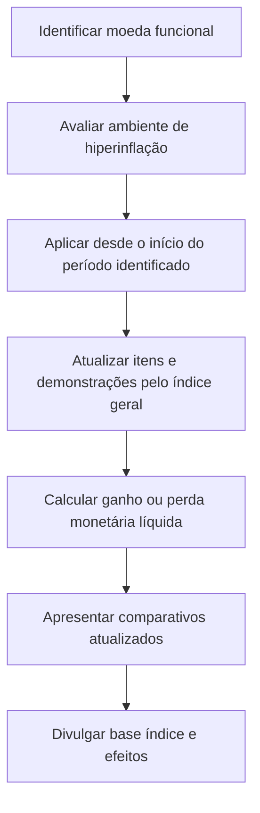

# NBC TG 42 — Contabilidade em Economia Hiperinflacionária

> [!abstract] Resumo em 30 segundos
> Quando a moeda funcional é a de uma economia hiperinflacionária, as demonstrações contábeis devem ser expressas na unidade de mensuração corrente no fim do período. Em geral, isso exige atualizar os valores não monetários, as receitas e despesas e os comparativos por um índice geral de preços. Itens monetários não são atualizados. O ganho ou a perda na posição monetária líquida vai ao resultado e deve ser divulgado separadamente.

## Ficha rápida

| Campo | Síntese |
|---|---|
| Norma | NBC TG 42 — Contabilidade em Economia Hiperinflacionária |
| Tema | Atualização monetária das demonstrações contábeis em moeda de economia hiperinflacionária |
| Aplicação | Entidades cuja moeda funcional seja a moeda de uma economia hiperinflacionária, inclusive em demonstrações consolidadas |
| Referência de hiperinflação | Julgamento com base nas características do ambiente econômico; a inflação acumulada no triênio próxima ou superior a 100% é um dos indicadores |
| Base de atualização | Índice Geral de Preços que reflita mudanças no poder aquisitivo geral |
| Vigência indicada no texto | Na data de publicação; aplicável aos exercícios iniciados em ou após 1º de janeiro de 2018 |

## Objetivo e alcance

A norma trata da preparação e apresentação de demonstrações contábeis de entidades cuja moeda funcional é a moeda de uma economia hiperinflacionária. Aplica-se também às demonstrações consolidadas. A razão é que, nesse ambiente, o dinheiro perde poder aquisitivo e valores de transações realizadas em momentos diferentes deixam de ser comparáveis sem atualização monetária.

A NBC TG 42 não determina uma taxa absoluta que, isoladamente, defina o início da hiperinflação. A avaliação depende de julgamento e das características do ambiente econômico. Entre os indicadores citados estão a preferência por ativos não monetários ou moeda estrangeira relativamente estável; preços expressos nessa moeda; preços a crédito que compensam a perda de poder aquisitivo; taxas, salários e preços vinculados a índices; e inflação acumulada em três anos próxima ou superior a 100% (itens 1–4).

A norma se aplica desde o início do período contábil em que a entidade identifica a existência de hiperinflação no país cuja moeda utiliza para reportar. Em economia hiperinflacionária, não basta apresentar informações atualizadas como complemento às demonstrações não atualizadas: a norma exige demonstrações expressas na unidade de mensuração corrente no fim do período.

## Conceitos-chave

- **Unidade de mensuração corrente:** unidade de poder aquisitivo correspondente ao fim do período de relatório.
- **Itens monetários:** dinheiro mantido e valores a receber ou pagar em dinheiro. Já estão expressos em unidade monetária corrente e não são atualizados.
- **Itens não monetários:** em regra, ativos e passivos que não são monetários. Podem precisar de atualização, salvo quando já estiverem reconhecidos por valores correntes no fim do período.
- **Índice Geral de Preços:** índice usado para refletir a mudança no poder aquisitivo geral. É preferível que entidades que reportam na mesma moeda usem o mesmo índice.
- **Posição monetária líquida:** exposição decorrente da diferença entre ativos e passivos monetários. Em inflação, uma posição líquida de ativos monetários tende a gerar perda de poder aquisitivo; uma posição líquida de passivos monetários tende a gerar ganho, desde que não haja vinculação ao nível de preços.

> [!warning] O indicador de 100% não é um limite automático
> A norma não estabelece uma taxa absoluta. A inflação acumulada no triênio próxima ou superior a 100% é apenas um dos indicadores a considerar junto às demais características econômicas.

## Diagrama de aplicação

## Aplicação passo a passo — checklist

1. **Avalie a economia:** documente o julgamento sobre a existência de hiperinflação com base nas características previstas na norma. Não use um percentual isolado como regra automática.
2. **Defina o período de aplicação:** aplique a norma desde o início do período de relatório em que a entidade identificar hiperinflação na economia da moeda em que reporta.
3. **Escolha e documente o índice:** utilize índice geral de preços que reflita mudanças no poder aquisitivo geral. Considere a preferência por uso do mesmo índice entre entidades que reportam na mesma moeda.
4. **Classifique os saldos:** separe itens monetários, itens não monetários já mensurados por valores correntes e demais itens não monetários.
5. **Atualize o balanço:** aplique o índice aos itens que não estejam expressos em unidade corrente no fim do período. Atualize itens sujeitos a cláusulas de preço conforme o contrato.
6. **Atualize resultado e demais demonstrações:** leve receitas, despesas e itens das demonstrações dos fluxos de caixa e do valor adicionado à unidade de mensuração corrente no fim do período.
7. **Apure a posição monetária líquida:** reconheça o ganho ou a perda no resultado e apresente-o separadamente.
8. **Atualize comparativos:** expresse valores correspondentes e informações de períodos anteriores em unidade de mensuração corrente no fim do período atual.
9. **Revise consolidação e tributos:** atualize demonstrações de controladas em moedas hiperinflacionárias antes da consolidação; avalie diferenças entre valores contábeis e bases fiscais conforme a NBC TG 32.
10. **Complete as divulgações:** informe a base de mensuração, o índice utilizado e sua variação, além do fato de que as demonstrações e os comparativos foram atualizados.

## Reconhecimento e mensuração

### Balanço patrimonial

| Tipo de item | Tratamento |
|---|---|
| Monetário | Não atualizar, pois já está expresso na unidade monetária corrente no fim do período |
| Não monetário mensurado por valor corrente no fim do período | Não atualizar novamente |
| Demais itens não monetários | Atualizar pelo índice geral de preços, desde a data de aquisição, formação ou outra data-base pertinente |
| Item contratualmente vinculado a preços | Ajustar conforme o contrato para obter o valor em aberto no fim do período |

Para itens não monetários registrados ao custo, a atualização parte da data de aquisição ou formação. Em estoques de produtos acabados ou em elaboração, considera-se quando os custos de compra e fabricação foram incorridos. Se um item tiver sido mensurado a valor corrente em data anterior ao encerramento, a atualização parte dessa data.

Após a atualização, aplicam-se as normas contábeis pertinentes para reduções ao valor recuperável ou ao valor líquido realizável. Por exemplo, valores atualizados de imobilizado e ativos intangíveis citados na norma devem ser reduzidos ao valor recuperável quando excedido; estoques, ao valor líquido realizável.

No primeiro período de aplicação, se não houver registros detalhados das datas de aquisição de itens do imobilizado, a norma admite, nas raras circunstâncias descritas, uma avaliação profissional independente como base. Se o índice necessário não estiver disponível, pode ser preciso utilizar estimativa, inclusive com base na variação cambial frente a moeda relativamente estável.

Custos de empréstimos que compensem inflação não devem ser capitalizados simultaneamente à atualização monetária do ativo financiado: essa parcela deve ser reconhecida como despesa no período em que incorrer. Se um ativo for comprado com pagamento postergado sem encargos explícitos e for impraticável imputar juros, a atualização começa na data do pagamento, não na data da compra.

No início do primeiro período de aplicação, os componentes do patrimônio líquido, exceto lucros acumulados e reserva de reavaliação, são atualizados desde as datas em que surgiram ou foram contribuídos; reservas de reavaliação anteriores são eliminadas. Nos períodos seguintes, todos os componentes são atualizados desde o início do período ou desde a contribuição, se posterior. As mutações do patrimônio líquido são divulgadas conforme a NBC TG 26.

### Resultado, posição monetária e custo corrente

Todos os itens da demonstração do resultado abrangente devem ser atualizados desde a data em que receitas ou despesas foram inicialmente registradas. Nas demonstrações pelo custo corrente, itens já apresentados por custo corrente no encerramento não são atualizados no balanço; os demais seguem o tratamento aplicável. Os valores do resultado pelo custo corrente também devem ser expressos na unidade de mensuração corrente no fim do período.

O ganho ou a perda na posição monetária líquida é reconhecido no resultado e divulgado separadamente. Pode ser estimado aplicando a variação do índice à média ponderada das diferenças entre ativos e passivos monetários no período. Ajustes contratuais de itens vinculados a preços são compensados com esse ganho ou perda. Juros e diferenças cambiais relacionados a fundos investidos ou tomados em empréstimo também se relacionam à posição monetária líquida e, embora divulgados separadamente, podem ser apresentados junto a ela.

## Divulgação

A entidade deve divulgar (itens 39–40):

- que as demonstrações e os valores correspondentes de períodos anteriores foram atualizados para refletir mudanças no poder aquisitivo geral e estão expressos na unidade corrente no fim do período;
- se as demonstrações se baseiam no custo histórico ou no custo corrente;
- a identificação e o nível do índice de preços no fim do período; e
- a variação do índice no período corrente e no período anterior.

As divulgações devem tornar clara a base usada para tratar os efeitos da inflação e fornecer informações necessárias para compreender essa base e os valores resultantes.

## Exceções e erros comuns

> [!danger] Não apresente a atualização apenas como informação complementar
> A norma exige que as demonstrações aplicáveis sejam atualizadas. Apresentar demonstrações não atualizadas acompanhadas de informações corrigidas não atende ao tratamento descrito.

- **Atualizar itens monetários:** erro; eles já representam unidade monetária corrente.
- **Atualizar novamente um item já mensurado por valor corrente no fim do período:** erro; isso duplicaria o efeito.
- **Tratar o triênio de 100% como critério absoluto:** erro; é um indicador, e a identificação depende de julgamento.
- **Ignorar comparativos:** os valores correspondentes e outras informações de períodos anteriores também devem ser atualizados.
- **Capitalizar o componente inflacionário do empréstimo e atualizar o ativo pelo mesmo efeito:** a norma determina reconhecer esse componente como despesa.
- **Deixar de aplicar reduções pertinentes após a atualização:** valores atualizados continuam sujeitos às normas aplicáveis de recuperabilidade e valor líquido realizável.

Quando uma economia deixa de ser hiperinflacionária e a entidade interrompe a aplicação da norma, os valores expressos na unidade de mensuração corrente no fim do período anterior passam a ser a base dos valores contábeis nas demonstrações subsequentes (item 38).

## Conexões com outras normas

- **NBC TG 26 — Apresentação das Demonstrações Contábeis:** referência para valores comparativos e divulgação das mutações do patrimônio líquido.
- **NBC TG 02 — Efeitos das Mudanças nas Taxas de Câmbio e Conversão de Demonstrações Contábeis:** aplicável à apresentação de comparativos em moeda de apresentação diferente e ao tratamento de controladas que não reportam em moedas de economias hiperinflacionárias.
- **NBC TG 32 — Tributos sobre o Lucro:** diferenças entre valores contábeis atualizados e bases fiscais são contabilizadas conforme essa norma.

## Fonte

PDF **NBC TG 42.pdf**. A NBC TG 42 foi aprovada pelo Conselho Federal de Contabilidade em 19 de dezembro de 2018, conforme o texto da resolução reproduzido no documento. O item 41 informa vigência na data de publicação e aplicação aos exercícios iniciados em ou após 1º de janeiro de 2018.
