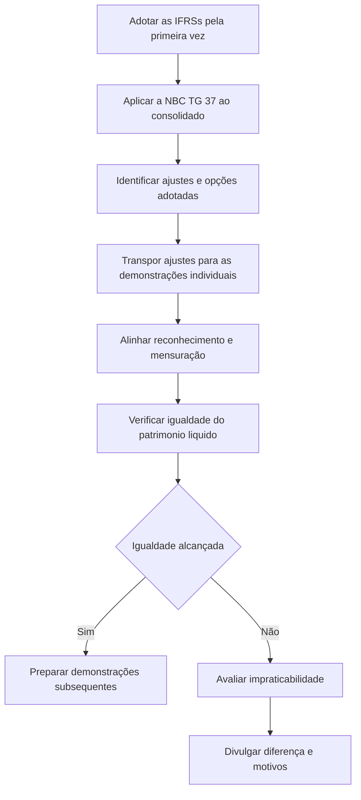

# NBC TG 43 — Adoção Inicial das NBC Ts Convergidas em 2009

> [!abstract] Em uma frase
> A NBC TG 43 orienta como transportar para as demonstrações individuais e separadas os efeitos da adoção inicial das normas internacionais aplicada às demonstrações consolidadas, buscando alinhar os valores contábeis e permitir que as demonstrações sejam declaradas em conformidade com as IFRSs, ressalvadas as divergências expressamente indicadas.

## Resumo em 30 segundos

A entidade começa aplicando a [[NBC TG 37 (R5) - Resumo|NBC TG 37 — Adoção Inicial das Normas Internacionais de Contabilidade]] às demonstrações consolidadas, quando adota as IFRSs pela primeira vez. Depois, transpõe para as demonstrações individuais os ajustes necessários — e as opções exercidas — para que, observadas as exceções previstas, o patrimônio líquido individual e o consolidado sejam iguais.

Os critérios de reconhecimento e mensuração devem ser os mesmos nos dois conjuntos de demonstrações e na mesma data de transição. Diferenças que não puderem ser eliminadas por impraticabilidade precisam ser explicadas e divulgadas. A norma também trata de situações específicas relacionadas a investimentos avaliados por equivalência patrimonial e a determinados saldos históricos.

## Ficha rápida

| Campo | Síntese |
|---|---|
| Norma | NBC TG 43 |
| Título | Adoção Inicial das NBC Ts Convergidas em 2009 |
| Tema central | Harmonização das demonstrações individuais e separadas com os efeitos da adoção inicial nas consolidadas |
| Foco operacional | Transposição dos ajustes da NBC TG 37 |
| Público tratado | Entidades que elaboram demonstrações consolidadas, individuais e, quando aplicável, separadas |
| Base indicada no PDF | Pronunciamento Técnico CPC 43 (R1), relacionado à IFRS 1 |

A Resolução CFC n.º 1.315/10 aprovou a norma. O próprio PDF informa que a sigla e a numeração foram posteriormente alteradas de NBC T 19.40 para NBC TG 43.

## Objetivo e alcance

O objetivo é fornecer diretrizes para que demonstrações contábeis preparadas segundo as normas, interpretações e comunicados técnicos do CFC — e as divulgações contábeis intermediárias correspondentes — possam ser declaradas em conformidade com as IFRSs, observadas as exceções indicadas pela norma (item 1).

A NBC TG 43 aplica-se às primeiras demonstrações consolidadas, individuais e separadas preparadas a partir das datas determinadas pelos órgãos reguladores contábeis brasileiros. As demonstrações subsequentes dão continuidade às práticas adotadas inicialmente até que documentos do CFC as modifiquem (itens 2 e 3).

A norma distingue situações que afetam a declaração de conformidade:

- **Demonstrações individuais com investimento em controlada ou empreendimento controlado em conjunto avaliado por equivalência patrimonial:** segundo a legislação brasileira, esse método pode ser exigido; nesse caso, essas demonstrações individuais não são consideradas conformes às IFRSs (item 4).
- **Saldo no ativo diferido mantido conforme a NBC TG 13:** a manutenção é admitida no contexto descrito pela norma para demonstrações individuais, mas não está em conformidade com as IFRSs. O efeito deve ser eliminado nas demonstrações consolidadas (item 5).
- **Determinados saldos em reservas de capital:** sua manutenção pode ser admitida pela legislação brasileira nos termos descritos no item 5A. Se causar diferenças de resultado ou patrimônio líquido em relação às IFRSs, devem ser feitos os ajustes necessários.

## Conceitos-chave

| Conceito | Como entender na aplicação |
|---|---|
| Adoção inicial | Primeira aplicação das normas internacionais, sujeita aos procedimentos da NBC TG 37. |
| Transposição de ajustes | Levar às demonstrações individuais os ajustes necessários ou as opções adotadas na aplicação da NBC TG 37. |
| Igualdade do patrimônio líquido | Objetivo de alinhar os patrimônios líquidos individual e consolidado, respeitadas as exceções da norma. |
| Mesmos critérios | Reconhecimento e mensuração devem ser consistentes entre demonstrações individuais e consolidadas. |
| Impraticabilidade | Se impedir a igualdade pretendida, exige divulgação do fato e dos motivos. |

> [!info] Limite da norma
> A NBC TG 43 não apresenta um catálogo autônomo de critérios de reconhecimento e mensuração para cada classe de ativo, passivo, receita ou despesa. Seu procedimento central é aplicar a NBC TG 37 no consolidado e transportar os efeitos necessários às demonstrações individuais.

## Diagrama do processo

## Aplicação passo a passo / checklist

1. **Identifique a adoção inicial.** Determine se a entidade está preparando as primeiras demonstrações consolidadas, individuais ou separadas abrangidas pela norma, conforme as datas definidas pelos órgãos reguladores.
2. **Trate primeiro o consolidado.** Ao adotar as normas internacionais pela primeira vez, aplique a NBC TG 37 às demonstrações consolidadas (item 7). O texto sugere esse procedimento também a entidades não obrigadas à adoção, tendo em vista o objetivo da NBC TG 43.
3. **Registre os ajustes e opções da adoção inicial.** Mantenha rastreabilidade dos ajustes necessários e das opções exercidas na aplicação da NBC TG 37.
4. **Transponha os efeitos ao individual.** Reflita nas demonstrações individuais os ajustes necessários ou escolhidos no consolidado para buscar o mesmo patrimônio líquido nos dois balanços (item 8).
5. **Avalie investimentos relevantes para o alinhamento.** Pode ser necessário ajustar investimentos em controladas ou empreendimentos controlados em conjunto para que a aplicação da equivalência patrimonial contribua para a igualdade pretendida.
6. **Elimine diferenças ligadas à adoção antecipada.** Se houver diferenças entre as demonstrações individuais e consolidadas causadas por adoção antecipada de IFRSs no consolidado, ajuste as demonstrações individuais (item 8).
7. **Confirme a consistência.** Verifique se reconhecimento e mensuração seguem os mesmos critérios e a mesma data de transição nos dois conjuntos de demonstrações (item 11).
8. **Teste a igualdade do patrimônio líquido.** Considere as exceções previstas pela norma. Se um procedimento for impraticável e impedir a igualdade, documente a limitação e divulgue os motivos (item 9).
9. **Revise demonstrações separadas, se apresentadas.** Elas devem partir das demonstrações individuais; os ajustes admitidos pela NBC TG 43 se limitam aos decorrentes da modificação do método de avaliação dos investimentos em controladas, coligadas e empreendimentos controlados em conjunto (item 12).
10. **Mantenha a consistência nos períodos seguintes.** As demonstrações subsequentes devem dar continuidade às práticas adotadas inicialmente até que documentos do CFC provoquem alterações (item 3).

## Reconhecimento e mensuração

A exigência operacional é que os critérios de reconhecimento e mensuração utilizados nas demonstrações consolidadas e individuais sejam os mesmos. A norma também determina que a adoção ocorra na mesma data de transição e que sejam feitos, nas demonstrações individuais, os ajustes necessários para essa consistência (item 11).

A igualdade entre patrimônios líquidos é um objetivo explícito do processo. Para alcançá-la, a entidade pode precisar ajustar contabilmente investimentos em controladas ou empreendimentos controlados em conjunto, de modo que a equivalência patrimonial produza o alinhamento pretendido (item 8).

Isso não autoriza ignorar as diferenças expressamente tratadas pela norma. Em particular, a avaliação por equivalência patrimonial de investimentos em controladas ou empreendimentos controlados em conjunto nas demonstrações individuais, quando exigida pela legislação brasileira, impede que essas demonstrações sejam consideradas conformes às IFRSs nessa forma (item 4).

> [!warning] Evite extrapolações
> O tratamento excepcional do ativo diferido descrito no item 5 não deve ser usado por analogia em outras situações. A norma afirma que essa permissão se refere às demonstrações individuais e que o efeito deve ser eliminado nas consolidadas.

## Divulgação

Quando um procedimento for impraticável e, por isso, causar diferença entre os patrimônios líquidos individual e consolidado, a entidade deve divulgar:

- que a igualdade não foi alcançada;
- qual procedimento se mostrou impraticável; e
- os motivos que impediram o alinhamento (item 9).

A introdução também relembra a prevalência da essência sobre a forma e indica que, em situação considerada extremamente rara, se a aplicação de um documento distorcer a representação da realidade, a entidade deve justificar e divulgar devidamente o procedimento substitutivo, conforme a referência feita à NBC TG 26. Essa orientação não deve ser confundida com uma dispensa geral de aplicação das normas.

## Exceções e erros comuns

### Situações expressamente tratadas

- **Investimentos avaliados por equivalência patrimonial nas demonstrações individuais:** podem impedir a declaração de conformidade dessas demonstrações com as IFRSs (item 4).
- **Ativo diferido:** a manutenção de saldo nos termos da NBC TG 13 é tratada como situação permitida no contexto indicado, mas incompatível com as IFRSs; seu efeito deve ser eliminado nas consolidadas (item 5).
- **Reservas de capital mencionadas no item 5A:** a simples manutenção dos saldos não gera necessariamente diferença, mas, se houver diferença de resultado ou patrimônio líquido, devem ser realizados os ajustes necessários.
- **Outras divergências:** o item 6 afirma que as exceções nele descritas, em conjunto com a indicada no item 34A da NBC TG 37, são as únicas divergências admitidas entre as demonstrações preparadas segundo documentos do CFC e as IFRSs.

### Erros a evitar

- Aplicar os ajustes apenas ao consolidado e não avaliar sua transposição às demonstrações individuais.
- Usar critérios de reconhecimento ou mensuração diferentes entre os dois conjuntos de demonstrações.
- Presumir que a manutenção de uma reserva de capital sempre causa diferença — o item 5A diz que isso não ocorre necessariamente.
- Estender por analogia a permissão de manutenção do ativo diferido.
- Deixar de divulgar a diferença e os motivos quando a impraticabilidade impedir a igualdade pretendida.
- Apresentar demonstrações consolidadas com resultado, patrimônio líquido ou outros elementos não modificáveis pela consolidação diferentes dos valores correspondentes nas demonstrações individuais da controladora, exceto nos casos previstos pela norma (item 11).

> [!danger] Conformidade não presumida
> A igualdade de saldos, por si só, não substitui a avaliação dos critérios de reconhecimento e mensuração nem elimina as exceções expressas nos itens 4 e 5.

## Conexões com outras normas

- [[NBC TG 37 (R5) - Resumo|NBC TG 37 — Adoção Inicial das Normas Internacionais de Contabilidade]]: é o ponto de partida para aplicar as IFRSs às demonstrações consolidadas e fornece os ajustes a transpor às individuais (itens 7 e 8).
- **NBC TG 36 — Demonstrações Consolidadas:** a norma é citada no tratamento do ativo diferido, cuja manutenção não foi acolhida para as demonstrações consolidadas (item 5).
- **NBC TG 13 — Adoção Inicial da Lei n.º 11.638/07 e da Medida Provisória n.º 449/08:** é citada em relação ao ativo diferido e a determinados saldos de reservas de capital (itens 5 e 5A).
- **NBC TG 35 — Demonstrações Separadas:** aparece na introdução ao explicar a distinção entre demonstrações individuais e separadas e a avaliação de investimentos em demonstrações separadas.
- **NBC TG 26 — Apresentação das Demonstrações Contábeis** e **NBC TG Estrutura Conceitual:** são relacionadas na introdução à apresentação das demonstrações e à prevalência da essência sobre a forma.
- **NBC TG 1000 — Contabilidade para Pequenas e Médias Empresas:** a introdução informa que os procedimentos de adoção inicial para entidades que seguem essa norma estão nela própria e que essas entidades não devem declarar conformidade com as IFRSs com base apenas na NBC TG 1000.

## Fonte

PDF **NBC TG 43.pdf**, texto técnico da NBC TG 43 — *Adoção Inicial das NBC Ts Convergidas em 2009*, especialmente objetivo, alcance e procedimentos (itens 1 a 12, páginas 5 a 7) e introdução (páginas 3 a 5). A resolução que aprova a norma é identificada no PDF como Resolução CFC n.º 1.315/10 (página 1).
