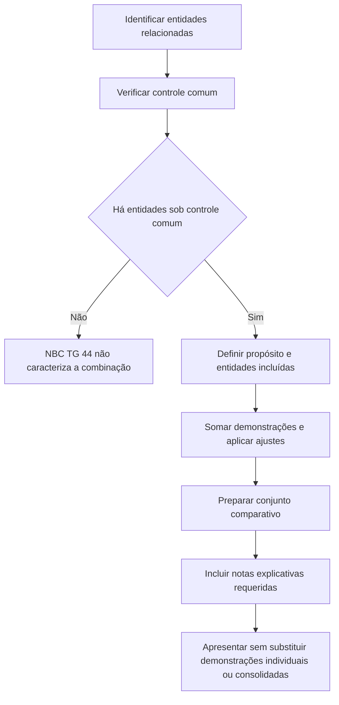

# NBC TG 44 — Demonstrações Combinadas

> [!abstract] Resumo em 30 segundos
> A NBC TG 44 orienta a elaboração e a apresentação de demonstrações contábeis combinadas para entidades sob controle comum. O conjunto apresenta essas entidades como se fossem uma única entidade, embora não exista necessariamente uma controladora que prepare demonstrações consolidadas. A preparação usa, no que for pertinente, técnicas de consolidação: soma das demonstrações, eliminação de saldos e transações entre as entidades, ajuste de resultados não realizados e alinhamento das práticas contábeis. As notas explicativas devem esclarecer o propósito, as entidades incluídas e as limitações de uso dessas demonstrações.

## Ficha rápida

| Campo | Síntese |
|---|---|
| Norma | NBC TG 44 — Demonstrações Combinadas |
| Objetivo | Orientar critérios, circunstâncias e forma de apresentação |
| Quem pode estar abrangido | Entidades distintas sob controle comum |
| Base técnica | Técnicas de consolidação, no que forem pertinentes |
| Referências explícitas no texto | NBC TG 36, NBC TG 26, NBC TG 19 e CTG 06 |
| Fonte deste resumo | PDF fornecido, páginas 1 a 5 |

## Objetivo e alcance

A norma orienta como elaborar e apresentar demonstrações contábeis combinadas de acordo com as práticas contábeis adotadas no Brasil e esclarece o significado dessas demonstrações (item 1, p. 1).

Demonstrações combinadas são um único conjunto de demonstrações contábeis de entidades sob controle comum. Podem ser relevantes, por exemplo, quando o controlador é uma pessoa física ou um grupo de pessoas físicas que não prepara demonstrações financeiras consolidadas. A combinação evidencia as entidades como um grupo, embora não haja necessariamente uma controladora que apresente demonstrações consolidadas (itens 2 e 3, pp. 1–2).

A administração exerce julgamento para definir quais entidades sob controle comum serão combinadas e qual é o propósito da apresentação. Se outras entidades do grupo sob controle comum forem deixadas de fora, as razões para a exclusão devem ser explicadas (item 4, p. 2).

> [!warning] As demonstrações combinadas não substituem demonstrações individuais ou consolidadas que devam ser divulgadas a reguladores ou ao público conforme a legislação aplicável (item 14, p. 4).

## Conceitos-chave

### Controle comum

Há controle comum quando o controlador — pessoa física ou jurídica — tem poder sobre a investida, está exposto a retornos variáveis ou tem direitos sobre eles e pode usar seu poder para afetar esses retornos. A determinação do controle deve seguir a definição e as orientações da NBC TG 36 (itens 7 e 8, pp. 2–3).

### Combinadas não são consolidadas

Nas demonstrações consolidadas, a controladora apresenta suas controladas e, conforme o texto da norma, as entidades em que assume a maioria dos riscos e benefícios. Nas combinadas, o conjunto é formado por entidades sob controle comum e não pressupõe uma controladora que prepare esse conjunto (itens 4 e 9, pp. 2–3).

### Combinadas não são pro forma

Demonstrações combinadas apresentam operações históricas efetivamente ocorridas entre entidades sob controle comum. Informações pro forma, por sua vez, ilustram como informações históricas teriam sido afetadas se determinada transação tivesse ocorrido antes. O PDF remete o tratamento de informações pro forma ao CTG 06 (item 6, p. 2).

### Identificação do grupo

A denominação deve permitir identificar a quem pertencem as entidades. A norma exemplifica a referência a “Entidades do Grupo Econômico XXX” antes de uma reestruturação que constitua uma holding e, em determinadas situações após reestruturação, a informações combinadas da “Entidade YYY” (item 5, p. 2).

## Diagrama de aplicação

## Aplicação passo a passo e checklist

1. **Identifique as entidades candidatas.** Determine quais entidades podem integrar o conjunto e quem exerce o controle.
2. **Avalie o controle comum.** Use a definição e as orientações da NBC TG 36; não conclua pela existência de controle apenas com base em relações econômicas ou societárias não avaliadas segundo essa definição.
3. **Defina o propósito e o perímetro.** Documente por que as demonstrações combinadas serão apresentadas e quais entidades serão incluídas. Se houver outras entidades sob controle comum não combinadas, prepare a justificativa para divulgação.
4. **Estabeleça a identificação do conjunto.** Use uma denominação que deixe claro a que entidades as demonstrações se referem.
5. **Combine os dados contábeis.** Aplique, no que for pertinente, conceitos e técnicas usados na consolidação, incluindo eliminações e alinhamento de práticas contábeis.
6. **Trate corretamente períodos e datas.** Se uma entidade for adquirida ou vendida durante o exercício ou período, considere suas operações apenas enquanto estiver sob controle comum.
7. **Prepare todas as demonstrações requeridas.** Apresente-as de forma comparativa e inclua notas explicativas.
8. **Revise as divulgações e os limites de uso.** Explique que o conjunto fornece análises adicionais e não representa demonstrações individuais ou consolidadas de uma pessoa jurídica e suas controladas; indique também que não deve ser usado para calcular dividendos, impostos ou outros fins societários ou estatutários.
9. **Verifique outras obrigações de apresentação.** A combinação não elimina a necessidade de demonstrações individuais ou consolidadas exigidas pela legislação aplicável.

## Reconhecimento e mensuração

A NBC TG 44 determina que a elaboração siga, no que for pertinente, os conceitos e técnicas aplicáveis à consolidação. Em termos práticos, as demonstrações combinadas partem da soma das demonstrações individuais e exigem:

- eliminação de saldos e transações entre as entidades combinadas;
- ajuste de resultados ainda não realizados entre essas entidades;
- alinhamento das práticas contábeis (item 10, p. 3).

Se houver entidades adquiridas ou vendidas durante o período, as demonstrações do resultado, do resultado abrangente, dos fluxos de caixa e do valor adicionado, quando aplicável, abrangem suas operações somente durante o intervalo em que estiveram sob controle comum. O primeiro balanço patrimonial combinado corresponde à data em que se adquire a condição de controle comum; o último, à data em que essa condição é perdida (item 16, p. 4).

Para operações controladas em conjunto pelo grupo de entidades sob controle comum, devem ser incluídas nas demonstrações combinadas as demonstrações dessas operações, com reconhecimento dos interesses nos ativos, passivos, receitas e despesas, em linha com a NBC TG 19 (item 18, p. 4).

> [!info] O PDF não estabelece uma base de mensuração própria detalhada para cada rubrica. A instrução é aplicar as normas, interpretações e comunicados técnicos do CFC, especialmente a NBC TG 36, além das técnicas de consolidação pertinentes (itens 10 e 15, pp. 3–4).

## Demonstrações e divulgação

As demonstrações combinadas devem conter, de forma comparativa, o conjunto exigido pela NBC TG 26: balanço patrimonial, demonstração do resultado, demonstração do resultado abrangente, demonstração das mutações do patrimônio líquido, demonstração dos fluxos de caixa e demonstração do valor adicionado, quando aplicável. O conjunto deve ser acompanhado de notas explicativas e seguir o formato e as normas, interpretações e comunicados técnicos do CFC (item 11, p. 3).

As notas explicativas devem incluir as informações requeridas para demonstrações consolidadas conforme a NBC TG 36 e, adicionalmente:

- breve descrição do contexto operacional de cada entidade combinada;
- percentuais de participação da entidade ou das pessoas físicas que controlam cada entidade incluída;
- justificativa do propósito da apresentação;
- razões para a inclusão das entidades, se outras entidades sob controle comum não tiverem sido combinadas;
- para cada entidade incluída, valor total dos ativos, patrimônio líquido, lucro ou prejuízo líquido e outros resultados abrangentes, além do total das eliminações, se necessário;
- esclarecimento de que as demonstrações servem apenas para fornecer análises adicionais a terceiros e não são demonstrações individuais ou consolidadas de uma pessoa jurídica e suas controladas;
- esclarecimento de que não devem ser usadas como base para cálculo de dividendos, impostos ou outros fins societários ou estatutários (item 12, p. 3).

## Situações específicas

Se não houver demonstrações combinadas de períodos ou datas anteriores e uma reestruturação ou reorganização societária fizer com que algumas entidades deixem de estar sob controle comum, a norma permite elaborar demonstrações combinadas somente com as entidades que permanecem ou permanecerão sob o mesmo grupo de controle comum. A situação exige evidenciação especial em nota explicativa (item 17, p. 4).

A apresentação pode ser mais representativa do que demonstrações individuais quando as entidades estiverem economicamente unidas pelo controle comum. Essa utilidade não altera a obrigação de apresentar demonstrações individuais ou consolidadas quando exigidas (itens 13 e 14, p. 4).

## Exceções e erros comuns

> [!danger] Não trate o conjunto como demonstração de uma pessoa jurídica
> As demonstrações combinadas reúnem entidades sob controle comum; a norma exige que essa natureza e a limitação de uso sejam esclarecidas nas notas.

> [!warning] Não confunda combinação com pro forma
> A combinação reflete operações históricas efetivamente ocorridas. A informação pro forma ilustra o efeito hipotético de uma transação em período anterior.

> [!warning] Não omita entidades sem explicar
> Se houver outras entidades sob controle comum que não foram incluídas, divulgue as razões da seleção do perímetro.

> [!tip] Não esqueça o recorte temporal
> Para entidades adquiridas ou vendidas durante o período, inclua operações apenas enquanto estiveram sob controle comum e observe as datas de início e término indicadas para o balanço combinado.

## Conexões com outras normas

| Referência | Relação indicada no PDF |
|---|---|
| NBC TG 36 — Demonstrações Consolidadas | Fornece a definição e as orientações para avaliar controle; suas divulgações de demonstrações consolidadas são requeridas adicionalmente nas notas das combinadas. |
| NBC TG 26 — Apresentação das Demonstrações Contábeis | Indica o conjunto de demonstrações a apresentar comparativamente. |
| NBC TG 19 — Negócios em Conjunto | Orienta a inclusão de operações controladas em conjunto e o reconhecimento dos interesses correspondentes. |
| CTG 06 — Apresentação de Informações Financeiras Pro Forma | Referência para a elaboração e apresentação de informações pro forma. |

## Fonte

**NBC TG 44 — Demonstrações Combinadas**, PDF fornecido, páginas 1–5. O texto identifica a norma como baseada no CPC 44 e informa que sua vigência começa na data de publicação (item 20, p. 4).
