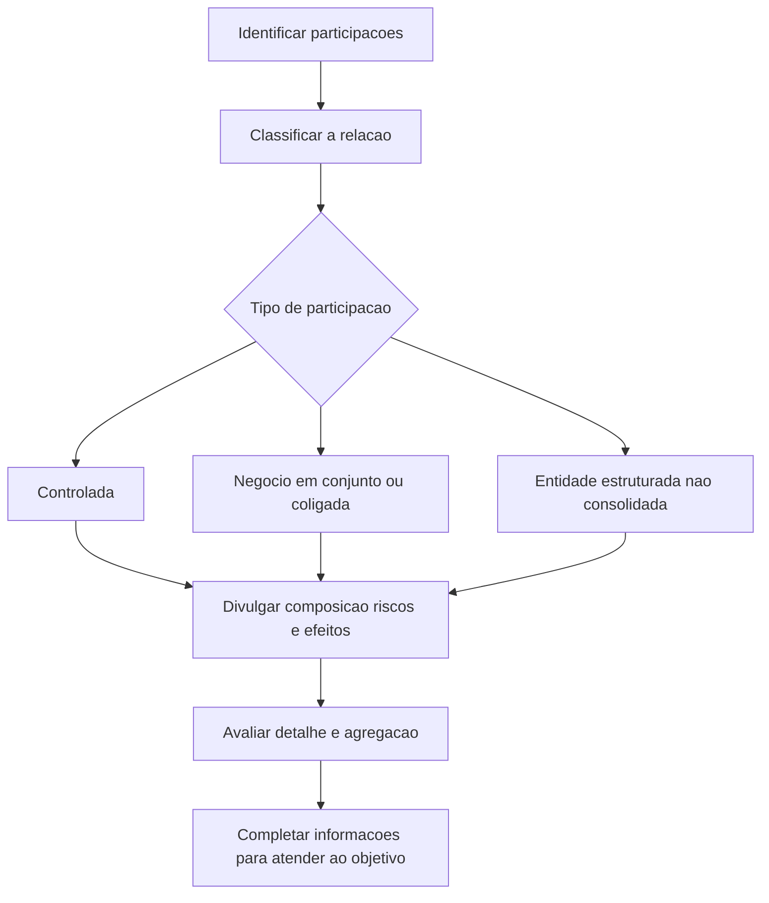

# NBC TG 45 (R3) — Divulgação de Participações em Outras Entidades

> [!abstract] Em uma frase
> A NBC TG 45 exige divulgações que permitam aos usuários compreender a natureza das participações da entidade em outras entidades, os riscos associados e os efeitos dessas participações sobre a posição financeira, o desempenho e os fluxos de caixa.

## Resumo em 30 segundos

A norma trata de **divulgação**, não de estabelecer, por si só, como reconhecer ou mensurar investimentos. Seu foco é tornar visíveis as relações e exposições da entidade em controladas, negócios em conjunto, coligadas e entidades estruturadas não consolidadas.

Na prática, a entidade deve explicar julgamentos relevantes sobre controle, controle conjunto, influência significativa e classificação do negócio em conjunto; apresentar informações financeiras e societárias exigidas para as participações relevantes; e descrever restrições, compromissos, suporte financeiro e exposições a perdas quando aplicável. As divulgações devem ser detalhadas o suficiente para serem úteis, sem excesso de informação nem agregação que esconda diferenças importantes.

## Ficha rápida

| Campo | Síntese |
|---|---|
| Norma | NBC TG 45 (R3) — Divulgação de Participações em Outras Entidades |
| Tema | Divulgação de participações, riscos e efeitos financeiros |
| Entidades abrangidas | Entidades com participações em controladas, negócios em conjunto, coligadas ou entidades estruturadas não consolidadas |
| Natureza dos requisitos | Divulgações qualitativas e quantitativas |
| Alteração identificada como R3 | Inclusão do item 5A e alteração do item B17 sobre participações classificadas como mantidas para venda ou incluídas em grupo para alienação |
| Efeito indicado na resolução do PDF | A alteração produz efeitos a partir de 1º de janeiro de 2018 |

## Objetivo e alcance

O objetivo é permitir que os usuários avaliem:

- a natureza das participações da entidade em outras entidades e os riscos associados; e
- os efeitos dessas participações sobre a posição financeira, o desempenho financeiro e os fluxos de caixa (item 1).

A norma se aplica a participações em **controladas**, **negócios em conjunto** — operações em conjunto ou empreendimentos controlados em conjunto —, **coligadas** e **entidades estruturadas não consolidadas** (item 5). Conforme o item 5A, os requisitos também se aplicam, em regra, a interesses classificados como mantidos para venda ou incluídos em grupo classificado para alienação, ressalvada a dispensa específica do item B17 para determinadas informações financeiras resumidas.

Há exclusões e situações específicas de aplicação. A norma não se aplica, em geral, a planos abrangidos pela NBC TG 33, demonstrações separadas abrangidas pela NBC TG 35, ou participações contabilizadas conforme a NBC TG 38. O próprio item 6 prevê situações em que requisitos da NBC TG 45 ainda se aplicam, como certas entidades estruturadas não consolidadas e determinadas participações em coligadas ou joint ventures mensuradas ao valor justo por meio do resultado.

> [!info] Participação pode existir sem instrumento patrimonial
> A definição inclui envolvimento contratual ou não contratual que exponha a entidade à variabilidade dos retornos de outra entidade. Pode envolver, por exemplo, financiamento, suporte de liquidez, melhoria de crédito ou garantias. A relação típica de cliente e fornecedor, isoladamente, não caracteriza necessariamente participação (Apêndice A).

## Conceitos-chave

- **Entidade estruturada:** entidade desenhada de modo que os direitos de voto ou similares não sejam o fator dominante para determinar quem a controla. As atividades relevantes podem ser dirigidas por acordos contratuais (Apêndice A; B21).
- **Julgamentos significativos:** avaliações e premissas usadas para determinar controle, controle conjunto, influência significativa, tipo de negócio em conjunto e, quando aplicável, condição de entidade de investimento (itens 7 a 9B).
- **Exposição máxima à perda:** valor que melhor representa a exposição da entidade decorrente de suas participações em entidades estruturadas não consolidadas. A entidade deve explicar como determinou o valor; se não puder quantificá-lo, deve informar isso e apresentar as razões (item 29).
- **Agregação:** pode ser usada para entidades similares, desde que não prejudique a compreensão e seja explicada. As classes de controladas, joint ventures, operações em conjunto, coligadas e entidades estruturadas não consolidadas devem ser apresentadas separadamente (B3 a B5).

## Diagrama de aplicação

## Aplicação passo a passo — checklist

1. **Mapeie as participações.** Identifique as entidades e acordos em que existe envolvimento que possa expor a entidade à variabilidade dos retornos.
2. **Classifique cada relação.** Determine se há controle, controle conjunto, influência significativa ou participação em entidade estruturada não consolidada. Considere propósito, estrutura, direitos e acordos relevantes.
3. **Documente julgamentos e mudanças.** Registre as premissas significativas adotadas e mudanças nas conclusões durante o período. A norma inclui casos em que a conclusão diverge do que poderia sugerir a proporção dos direitos de voto (itens 7 a 9).
4. **Avalie materialidade e organização.** Identifique participações materiais e defina um nível de detalhe útil. Separe as classes requeridas e justifique a agregação de participações similares (item 4; B2 a B6).
5. **Reúna dados por classe.** Para controladas, considere composição do grupo, participação de não controladores, restrições e alterações de participação. Para joint ventures e coligadas, reúna informações financeiras, restrições, compromissos e contingências. Para entidades estruturadas não consolidadas, avalie natureza, exposição e suporte.
6. **Verifique exposições e eventos de suporte.** Identifique compromissos contratuais, suporte prestado sem obrigação contratual e intenções atuais de fornecer suporte, conforme aplicável.
7. **Revise suficiência e clareza.** Se as divulgações requeridas, combinadas com as de outras normas, não atingirem o objetivo, acrescente informações necessárias (item 3).

## Reconhecimento e mensuração

A NBC TG 45 **não estabelece uma base geral própria de reconhecimento e mensuração** para os investimentos: exige que a entidade divulgue informações sobre participações contabilizadas segundo os requisitos aplicáveis. Assim, não se deve tratar a norma como substituta das regras de consolidação, equivalência patrimonial ou instrumentos financeiros.

Entre as informações quantitativas exigidas ou previstas estão:

- **Controladas com participação de não controladores material:** proporção de participação e de direitos de voto, lucros ou prejuízos alocados, saldo acumulado da participação e informações financeiras resumidas (item 12; B10). As informações resumidas da controlada são apresentadas antes das eliminações entre empresas (B11).
- **Joint ventures e coligadas materiais:** método utilizado — equivalência patrimonial ou valor justo —, informações financeiras resumidas e, se houver preço de mercado cotado, valor justo do investimento contabilizado pelo método da equivalência patrimonial (item 21). As informações financeiras resumidas se referem aos valores da investida, e não apenas à parcela da entidade; a norma prevê ajustes e conciliação com o valor contábil do investimento quando aplicáveis (B14).
- **Mudanças societárias:** apresentar quadro demonstrativo dos efeitos no patrimônio líquido atribuível aos proprietários da controladora quando a participação mudar sem perda de controle (item 18). Se houver perda de controle, divulgar o ganho ou a perda, a parcela ligada à mensuração a valor justo do investimento retido e a rubrica de resultado pertinente (item 19).
- **Entidades estruturadas não consolidadas:** divulgar valores contábeis reconhecidos, exposição máxima à perda e comparação entre esses valores e a exposição (item 29).

> [!warning] Não confunda valor contábil com exposição máxima
> Para participações em entidades estruturadas não consolidadas, a norma pede ambos os dados e a comparação entre eles. O valor contábil dos ativos e passivos pode não representar, por si só, a exposição máxima à perda.

## Divulgação

As divulgações variam conforme a participação. Entre os principais requisitos:

| Participação | Informações centrais |
|---|---|
| Controladas | Composição do grupo; dados sobre participações de não controladores materiais; restrições a ativos e passivos; riscos de entidades estruturadas consolidadas; mudanças sem perda de controle e perdas de controle (itens 10 a 19) |
| Joint ventures e coligadas | Natureza da relação, nome, localização e proporções de participação; dados financeiros resumidos para participações materiais; restrições, perdas não reconhecidas, compromissos e passivos contingentes (itens 20 a 23) |
| Entidades estruturadas não consolidadas | Natureza, propósito, porte, atividades e financiamento; exposição máxima à perda; suporte prestado e intenções atuais de suporte (itens 24 a 31) |

Para entidades estruturadas consolidadas, devem ser divulgados os termos de acordos que possam exigir suporte financeiro, incluindo eventos que exponham a entidade a perdas. Se houver suporte prestado sem obrigação contratual, informar tipo, valor e razões. A norma também exige divulgar intenções atuais de suporte (itens 14 a 17).

Para entidades estruturadas não consolidadas patrocinadas, mesmo sem participação na data de reporte, podem ser exigidas informações sobre a determinação das entidades patrocinadas, seus resultados e os ativos transferidos durante o período (itens 27 e 28).

## Exceções e erros comuns

> [!danger] Não presuma que ausência de participação contratual elimina a divulgação
> A definição de participação alcança envolvimento não contratual e exposições decorrentes de suporte, garantias ou outras formas de envolvimento (Apêndice A).

- **Omitir julgamentos porque a participação nos votos parece conclusiva.** A norma pede divulgação de julgamentos relevantes, inclusive quando a conclusão sobre controle ou influência significativa não acompanha indicadores simples de direitos de voto (itens 7 a 9).
- **Agregar categorias diferentes.** As divulgações devem distinguir controladas, joint ventures, operações em conjunto, coligadas e entidades estruturadas não consolidadas (B4).
- **Apresentar apenas dados da parcela investida.** Para informações financeiras resumidas de joint ventures e coligadas, a base é a informação da investida, com os ajustes e conciliações previstos pela norma (B12 a B14).
- **Omitir suporte por não haver obrigação contratual.** O suporte voluntário pode exigir divulgação, assim como a razão para prestá-lo e, em situações previstas, seus efeitos sobre controle (itens 15, 16 e 30).
- **Aplicar a dispensa do item B17 além do que o texto prevê.** A dispensa diz respeito às informações financeiras resumidas especificadas nos itens B10 a B16 para participações classificadas como mantidas para venda ou incluídas em grupo para alienação. Não é uma dispensa geral das divulgações da norma.

## Conexões com outras normas

As conexões abaixo são expressas no texto da NBC TG 45:

- **NBC TG 36 — Demonstrações Consolidadas:** conceitos e julgamentos sobre controle e entidade de investimento; perda de controle e efeitos relacionados.
- **NBC TG 18 — Investimento em Coligada, em Controlada e em Empreendimento Controlado em Conjunto:** método da equivalência patrimonial e referências a mensuração ao valor justo.
- **NBC TG 19 — Negócios em Conjunto:** terminologia de negócios em conjunto, operações em conjunto e joint ventures.
- **NBC TG 31 — Ativo Não Circulante Mantido para Venda e Operação Descontinuada:** classificação relacionada ao item 5A e dispensa delimitada pelo item B17.
- **NBC TG 25 — Provisões, Passivos Contingentes e Ativos Contingentes:** passivos contingentes ligados a participações em joint ventures e coligadas (item 23).
- **NBC TG 33 e NBC TG 35:** exclusões e tratamento específico de planos de benefícios e demonstrações separadas.
- **NBC TG 38:** referência às participações contabilizadas segundo a norma de instrumentos financeiros e às situações em que a NBC TG 45 ainda se aplica.

## Fonte

PDF fornecido: **NBC TG 45 (R3).pdf**. Síntese baseada no texto técnico da NBC TG 45 (R3) e nos apêndices A e B reproduzidos no PDF. O documento identifica a alteração R3 como relacionada aos itens 5A e B17; a resolução reproduzida informa efeitos a partir de 1º de janeiro de 2018.
