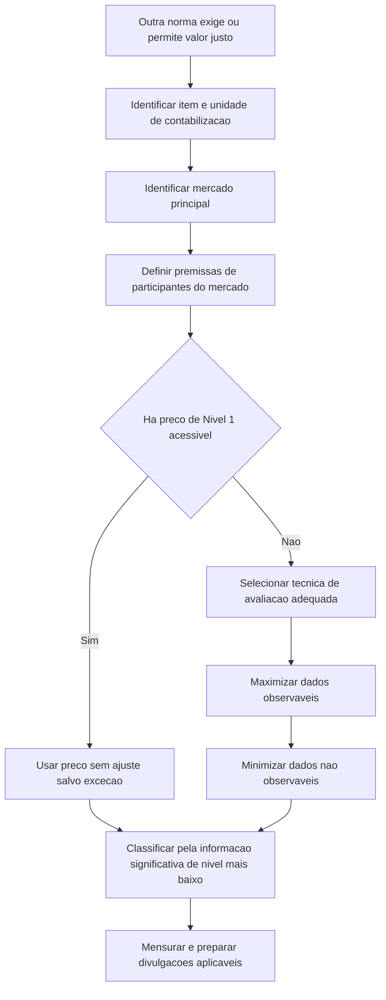

# NBC TG 46 (R2) — Mensuração do Valor Justo

> [!abstract] Resumo em 30 segundos
> Valor justo é o preço de saída estimado para vender um ativo ou transferir um passivo, em uma transação não forçada entre participantes do mercado, na data de mensuração. A mensuração é baseada nas premissas do mercado — não na intenção específica da entidade. Deve-se priorizar dados observáveis e classificar a mensuração conforme o dado significativo de nível mais baixo utilizado: Nível 1, 2 ou 3. A norma também estabelece divulgações sobre técnicas, informações e, em certos casos, efeitos das mensurações.

## Ficha rápida

| Campo | Síntese |
|---|---|
| Norma | NBC TG 46 (R2) — Mensuração do Valor Justo |
| Grupo | 02 - NBC TG |
| Finalidade | Definir valor justo, estabelecer uma estrutura de mensuração e disciplinar divulgações |
| Aplicação | Quando outra norma exigir ou permitir mensuração ou divulgação de valor justo, ressalvadas as exclusões expressas |
| Referência no PDF | Texto técnico, itens 1–99; a alteração R2 identificável modifica o item 52 |

A resolução identificada no PDF é datada de 24 de novembro de 2017. Ela informa que a alteração produz efeitos a partir de 1º de janeiro de 2018.

## Objetivo e alcance

A NBC TG 46 define valor justo e reúne em uma estrutura única os princípios para mensurá-lo e divulgá-lo. A estrutura vale tanto para mensuração inicial quanto para mensuração subsequente, sempre que outra norma exigir ou permitir o uso do valor justo (itens 1 e 8).

A norma é aplicável também a mensurações baseadas no valor justo e a divulgações relacionadas, salvo as exceções especificadas. Entre as exclusões de mensuração e divulgação estão transações de pagamento baseado em ações e de arrendamento dentro do alcance das respectivas normas, além de medidas que se parecem com valor justo, mas não o são — como valor realizável líquido e valor em uso (itens 5–7).

A norma não é, por si só, uma exigência para mensurar determinado item ao valor justo: essa exigência ou permissão vem de outra norma. A NBC TG 46 disciplina **como** mensurar e, quando aplicável, **o que divulgar**.

## Conceitos-chave

### Preço de saída e perspectiva de mercado

Valor justo é o preço que seria recebido pela venda de um ativo ou pago pela transferência de um passivo em transação não forçada entre participantes do mercado na data de mensuração (item 9). É, portanto, um preço de saída, que pode ser diretamente observável ou estimado por técnica de avaliação.

A mensuração usa premissas que participantes do mercado empregariam, agindo em seu melhor interesse econômico. A intenção da entidade de manter o ativo, liquidar o passivo ou satisfazê-lo de outra forma não determina o valor justo (itens 3 e 22).

### Mercado principal ou mais vantajoso

A transação presumida ocorre no mercado principal. Na ausência dele, considera-se o mercado mais vantajoso. Se houver mercado principal, utiliza-se o preço desse mercado, mesmo que outro mercado ofereça preço potencialmente mais vantajoso. A entidade precisa ter acesso ao mercado na data da mensuração, mas não precisa conseguir negociar o item específico nessa data (itens 16–20).

### Características do item e unidade de contabilização

Devem ser consideradas as características do ativo ou passivo que participantes do mercado levariam em conta na precificação, como condição, localização e restrições de uso ou venda do ativo (itens 11–12). A unidade de contabilização é determinada pela norma que exige ou permite a mensuração, salvo disposição específica da NBC TG 46 (item 14).

### Melhor uso possível de ativo não financeiro

Para ativos não financeiros, o valor justo considera o uso que maximiza o valor para participantes do mercado. Esse uso deve ser fisicamente possível, legalmente permitido e financeiramente viável. O uso atual presume-se como o melhor, salvo evidência de que outro uso maximizaria o valor. A intenção da entidade de não usar o ativo em seu melhor uso não altera essa premissa de mensuração (itens 27–30).

### Hierarquia de valor justo

A hierarquia classifica as informações usadas na mensuração, não as técnicas de avaliação. A classificação integral corresponde ao nível da informação significativa de nível mais baixo utilizada na mensuração como um todo (itens 72–75).

| Nível | Informação característica |
|---|---|
| 1 | Preço cotado, não ajustado, em mercado ativo para item idêntico e acessível na data |
| 2 | Informação observável, direta ou indiretamente, exceto preço de Nível 1 |
| 3 | Dado não observável, desenvolvido com as melhores informações disponíveis |

## Diagrama de decisão

## Aplicação passo a passo: checklist

- [ ] **Confirme a base normativa:** identifique a norma que exige ou permite valor justo e verifique se há exclusão aplicável.
- [ ] **Delimite o objeto:** determine ativo, passivo, instrumento patrimonial próprio ou grupo relevante e a unidade de contabilização.
- [ ] **Identifique características pertinentes:** considere, por exemplo, condição e localização do ativo e restrições que participantes do mercado levariam em conta.
- [ ] **Determine o mercado:** use o mercado principal; se não houver, use o mais vantajoso. Considere os mercados aos quais a entidade tem acesso.
- [ ] **Estabeleça as premissas de mercado:** não substitua as premissas dos participantes do mercado pela intenção própria da entidade.
- [ ] **Escolha a técnica:** use uma ou mais técnicas adequadas e com dados suficientes, entre abordagem de mercado, de custo e de receita.
- [ ] **Priorize evidência observável:** maximize informações observáveis relevantes e minimize dados não observáveis.
- [ ] **Considere riscos pertinentes:** inclua os riscos que participantes do mercado incorporariam, inclusive o risco de descumprimento quando se mensura passivo.
- [ ] **Classifique a mensuração:** identifique as informações significativas e classifique pelo nível mais baixo que seja significativo para a mensuração como um todo.
- [ ] **Documente e divulgue:** registre técnica, informações e demais dados exigidos para a mensuração em questão.

## Reconhecimento e mensuração

### Técnicas e informações

A entidade deve selecionar técnicas apropriadas às circunstâncias e para as quais existam dados suficientes. As abordagens amplamente utilizadas são mercado, custo e receita. Uma técnica pode bastar; em outros casos, podem ser necessárias várias. Se houver múltiplas indicações, avalia-se a razoabilidade da faixa e escolhe-se o ponto que melhor represente o valor justo nas circunstâncias (itens 61–63).

Quando o preço da transação corresponde ao valor justo no reconhecimento inicial, uma técnica que use dados não observáveis deve ser calibrada para produzir esse mesmo resultado inicial. Depois, deve refletir as informações de mercado observáveis disponíveis na data de mensuração (item 64). Mudanças na técnica ou em sua aplicação são apropriadas quando resultarem em mensuração igualmente ou mais representativa; a norma trata essas revisões como mudança de estimativa contábil, com a ressalva de divulgação prevista no item 66.

### Preço da transação e valor justo inicial

Preço da transação é preço de entrada; valor justo é preço de saída. Podem coincidir, mas não necessariamente. Se outra norma exigir ou permitir mensuração inicial ao valor justo e o preço da transação diferir dele, reconhece-se o ganho ou a perda no resultado, salvo determinação diferente da norma aplicável (itens 57–60).

### Ajustes e casos específicos

O preço de valor justo não é ajustado pelos custos de transação, que são tratados conforme outras normas. Custos de transporte não são custos de transação para esse fim: se a localização for característica do ativo, ajusta-se o preço para refletir o transporte ao mercado relevante (itens 25–26).

Para passivos e instrumentos patrimoniais próprios, presume-se transferência a participante do mercado, não liquidação ou cancelamento na data de mensuração. O valor justo do passivo reflete o risco de descumprimento, inclusive o risco de crédito próprio, sem transferir ao passivo o efeito de melhoria de crédito de terceiro contabilizada separadamente (itens 34, 42–44).

Se não houver preço cotado de transferência e o item idêntico for mantido por outra parte como ativo, a mensuração pode partir do preço desse ativo, observados os ajustes necessários para diferenças relevantes. Se não for mantido por outra parte como ativo, utiliza-se técnica de avaliação da perspectiva de participante que deva o passivo ou tenha exercido o direito patrimonial (itens 37–41).

Uma entidade que gerencia determinados grupos de ativos e passivos financeiros com base em exposição líquida a riscos de mercado ou de crédito pode aplicar a exceção de mensuração em base líquida, somente se atender às condições previstas nos itens 48–51. A exceção não é uma regra de apresentação líquida. Na redação R2 do item 52, seu alcance inclui ativos financeiros, passivos financeiros e outros contratos incluídos no alcance da NBC TG 48.

> [!tip] Fórmula útil para a exceção de posição líquida
> A mensuração do grupo considera o preço de saída da posição líquida relativa à exposição a risco que os participantes do mercado precificariam, quando satisfeitas as condições da norma.

## Divulgação

A entidade deve divulgar informações que permitam aos usuários avaliar as técnicas de avaliação e as informações usadas nas mensurações de valor justo realizadas após o reconhecimento inicial, recorrentes ou não recorrentes. Para mensurações recorrentes com dados não observáveis significativos de Nível 3, deve permitir avaliar também o efeito sobre o resultado do período ou outros resultados abrangentes (item 91).

Os exemplos do próprio documento ilustram divulgações como valores por classe e nível da hierarquia; técnicas de avaliação; informações quantitativas sobre dados não observáveis significativos; processos de avaliação; e sensibilidade a mudanças nesses dados, inclusive relações entre premissas. O detalhe requerido deve ser adequado ao objetivo de ajudar os usuários a compreender as mensurações, sem presumir que um formato de tabela específico seja obrigatório.

## Exceções e erros comuns

> [!warning] Não confunda
> **Valor justo não é valor específico da entidade.** A intenção de conservar um ativo ou liquidar um passivo não substitui a perspectiva de participantes do mercado.

- Não confundir valor justo com valor realizável líquido ou valor em uso; o texto os identifica como medidas que não representam valor justo.
- Não escolher automaticamente o mercado de melhor preço quando existe mercado principal.
- Não deduzir custos de transação do preço de valor justo.
- Não aplicar prêmio ou desconto incompatível com a unidade de contabilização. A norma também não permite ajuste por fator de venda em bloco relacionado ao tamanho da posição quando esse fator não é característica do ativo ou passivo (item 69).
- Não ajustar um preço de Nível 1, salvo nas circunstâncias específicas previstas no item 79; quando o ajuste ou método alternativo for utilizado, pode haver classificação em nível inferior.
- Não classificar toda mensuração com técnica sofisticada como Nível 3 por esse motivo apenas: a classificação depende das informações significativas usadas.
- Não tratar a exceção de exposição líquida como autorização para apresentação líquida nas demonstrações contábeis.

## Conexões com outras normas

As relações abaixo são expressamente identificadas no texto da NBC TG 46:

- **NBC TG 48 — Instrumentos Financeiros:** define o alcance, na redação R2 do item 52, dos contratos elegíveis à exceção de mensuração por exposição líquida.
- **NBC TG 23 — Políticas Contábeis, Mudança de Estimativa e Retificação de Erro:** relacionada à política contábil para uso da exceção e à contabilização de mudanças em técnicas de avaliação.
- **NBC TG 10, NBC TG 06, NBC TG 16 e NBC TG 01:** citadas para delimitar exclusões ou distinguir outras bases de mensuração.
- **NBC TG 33:** citada quanto à divulgação de ativos de planos mensurados ao valor justo.
- **NBC TG 40 e NBC TG 05:** citadas, respectivamente, em relação a risco de crédito e à informação fornecida ao pessoal-chave da administração.

## Fonte

- **NBC TG 46 (R2) — Mensuração do Valor Justo**, PDF fornecido. Texto técnico e exemplos ilustrativos; resolução de alteração R2 datada de 24 de novembro de 2017.
- Itens citados no resumo: 1–9, 11–30, 34–66, 69–91 e 48–56; exemplos ilustrativos EI64–EI66.
