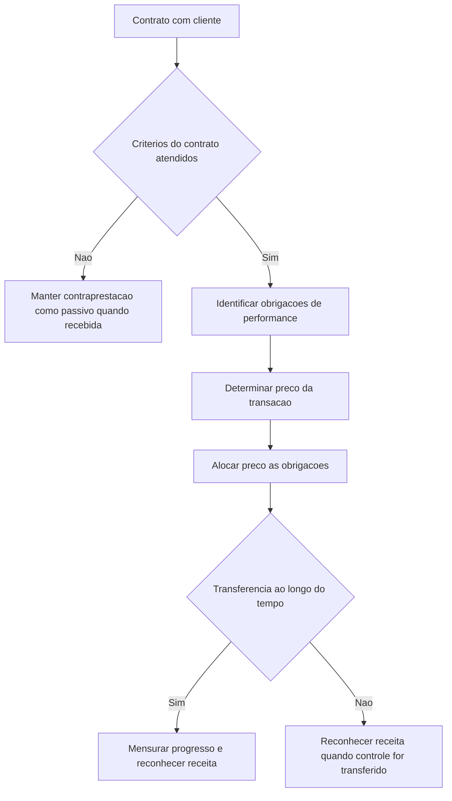

# NBC TG 47 — Receita de Contrato com Cliente

> [!abstract] Resumo em 30 segundos
> A NBC TG 47 estabelece que a receita deve retratar a transferência de bens ou serviços prometidos ao cliente pelo valor da contraprestação a que a entidade espera ter direito. Para aplicar esse princípio, a entidade identifica o contrato e as obrigações de performance, determina e aloca o preço da transação e reconhece receita quando — ou à medida que — transfere o controle dos bens ou serviços. (p. 2, itens 1–4 e p. 8, itens 31–32)

## Ficha rápida

| Campo | Síntese |
|---|---|
| Norma | NBC TG 47 — Receita de Contrato com Cliente |
| Objetivo | Informar usuários sobre natureza, valor, época e incerteza das receitas e dos fluxos de caixa de contratos com clientes |
| Princípio central | Reconhecer receita para representar a transferência de bens ou serviços pelo valor da contraprestação esperada |
| Estrutura | Identificar contrato e obrigações; determinar e alocar o preço; reconhecer a receita quando o controle é transferido |
| Aplicação a carteiras | Permitida como expediente prático quando se espere que o resultado não difira significativamente da aplicação contrato a contrato |
| Vigência e transição | O apêndice C informa que a vigência será definida pelos órgãos reguladores; também indica 1º de janeiro de 2018 para o pleno atendimento às normas internacionais. Não se deve tratar essa data, isoladamente, como definição da vigência regulatória brasileira. (p. 41, C1) |

## Objetivo e alcance

A norma busca que a receita represente fielmente a transferência de bens ou serviços ao cliente e a contraprestação esperada em troca. A entidade deve considerar os termos contratuais e os fatos e circunstâncias relevantes, aplicando os requisitos de forma consistente a contratos semelhantes em circunstâncias semelhantes. A aplicação a uma carteira de contratos ou obrigações de performance é possível se a entidade razoavelmente esperar que os efeitos não sejam significativamente diferentes dos obtidos pela análise individual. Nesse caso, as estimativas e premissas devem refletir o tamanho e a composição da carteira. (p. 2, itens 1–4)

Em regra, a NBC TG 47 abrange contratos em que a contraparte é cliente — isto é, contratou para obter bens ou serviços que sejam produtos das atividades normais da entidade, em troca de contraprestação. O texto exclui, entre outros, contratos de arrendamento e seguro abrangidos por normas próprias, determinados instrumentos financeiros e direitos ou obrigações contratuais tratados em outras normas, além de certas permutas não monetárias entre entidades da mesma linha de negócios. Também não trata como cliente uma parte que compartilhe riscos e benefícios de uma atividade ou processo, em vez de adquirir o produto das atividades normais da entidade. (pp. 2–3, itens 5–6)

Um contrato pode envolver componentes abrangidos por normas diferentes. Quando outra norma determinar a separação ou mensuração inicial de um componente, a entidade aplica primeiro esses requisitos e aloca o preço remanescente às obrigações dentro do alcance da NBC TG 47. Se a outra norma não determinar como separar ou mensurar inicialmente o componente, a entidade aplica a NBC TG 47. (p. 3, item 7)

## Conceitos-chave

| Conceito | Aplicação prática |
|---|---|
| Contrato | Acordo que cria direitos e obrigações exigíveis. Pode ser escrito, verbal ou decorrer de práticas usuais; a exigibilidade é matéria legal. |
| Cliente | Parte que obtém bens ou serviços das atividades normais da entidade em troca de contraprestação. |
| Obrigação de performance | Promessa de transferir ao cliente um bem ou serviço distinto, ou uma série de bens ou serviços distintos com o mesmo padrão de transferência. |
| Bem ou serviço distinto | O cliente pode beneficiar-se dele, isoladamente ou com recursos prontamente disponíveis, e a promessa é separadamente identificável no contexto do contrato. |
| Controle | Capacidade de determinar o uso do ativo e obter substancialmente seus benefícios restantes, além de impedir que outros direcionem seu uso ou obtenham esses benefícios. |
| Preço da transação | Contraprestação a que a entidade espera ter direito, excluídos valores cobrados em nome de terceiros. |

### Identificar o que foi prometido

As promessas não se limitam às declarações expressas do contrato: práticas usuais, políticas publicadas ou declarações específicas podem criar uma expectativa válida de transferência para o cliente. Atividades administrativas necessárias para cumprir o contrato, por si só, não são obrigações de performance se não transferirem um bem ou serviço. (pp. 6–7, itens 24–25)

Para avaliar se uma promessa é distinta, considere se o cliente pode beneficiar-se do bem ou serviço e se ele é separável das demais promessas. Integração significativa, modificação ou personalização significativa e alta interdependência entre os itens são fatores que podem indicar que as promessas não são separadamente identificáveis. Se um item não for distinto, combine-o com outros até identificar um grupo distinto; o resultado pode ser uma única obrigação de performance para o contrato. (pp. 7–8, itens 27–30)

## Reconhecimento: quando transferir controle

No início do contrato, a entidade determina se cada obrigação de performance será satisfeita **ao longo do tempo** ou **em momento específico**. Reconhece receita ao satisfazê-la, transferindo ao cliente o controle do bem ou serviço prometido. (p. 8, itens 31–32)

A obrigação é satisfeita ao longo do tempo se pelo menos uma destas condições se verificar:

1. O cliente recebe e consome simultaneamente os benefícios do desempenho da entidade.
2. O desempenho cria ou melhora um ativo que o cliente controla à medida que é criado ou melhorado.
3. O desempenho não cria um ativo com uso alternativo para a entidade, e a entidade tem direito executável a pagamento pelo desempenho concluído até a data presente.

Para a terceira condição, a avaliação do uso alternativo é feita no início do contrato; o direito a pagamento deve, em termos gerais, compensar pelo menos o desempenho concluído se o cliente rescindir por motivo diferente da falha da entidade em cumprir o prometido. Se nenhum critério de transferência ao longo do tempo for atendido, a obrigação é satisfeita em momento específico. (pp. 8–9, itens 35–38)

Na transferência em momento específico, avalie em conjunto a evidência de controle. Indicadores incluem direito presente a pagamento, titularidade legal, posse física, transferência dos riscos e benefícios significativos da propriedade e aceite pelo cliente. Nenhum indicador deve ser aplicado sem considerar os fatos e termos do contrato: posse física, por exemplo, pode não coincidir com controle. (p. 9, item 38)

## Diagrama do processo

## Aplicação passo a passo / checklist

1. **Confirme o contrato.** Verifique aprovação e compromisso das partes, direitos identificáveis, termos de pagamento, substância comercial e probabilidade de recebimento. Essa probabilidade considera a capacidade e a intenção do cliente de pagar quando devido. (pp. 3–4, item 9)
2. **Avalie contrato e contraprestação recebida.** Se os critérios não forem atendidos, continue avaliando se serão atendidos depois. Contraprestação recebida fica registrada como passivo até que os critérios sejam satisfeitos ou ocorra uma das hipóteses especificadas para reconhecimento da receita — entre elas, contrato rescindido com contraprestação não restituível. O passivo representa obrigação de transferir bens ou serviços ou de devolver o valor recebido. (p. 4, itens 14–16)
3. **Considere combinações e modificações.** Combine contratos com o mesmo cliente celebrados na mesma data ou perto dela quando forem negociados como pacote, quando a contraprestação de um depender de outro ou quando as promessas formarem uma única obrigação. Para uma modificação, avalie se deve ser tratada como contrato separado ou como parte do contrato existente. (pp. 4–5, itens 17–21)
4. **Identifique cada promessa e teste se é distinta.** Inclua promessas implícitas quando criarem expectativa válida; não transforme tarefas administrativas em obrigações de performance sem transferência ao cliente. (pp. 6–8, itens 22–30)
5. **Determine o preço da transação.** Considere componentes variáveis, restrição da contraprestação variável, financiamento significativo, contraprestação não monetária e valores a pagar ao cliente. (pp. 11–14, itens 47–72)
6. **Alocação e reconhecimento.** Aloque o preço às obrigações e reconheça a parcela correspondente quando ou à medida que cada obrigação for satisfeita. O trecho fornecido identifica essa etapa, mas não contém o texto integral dos requisitos de alocação dos itens 73–86.
7. **Atualize estimativas e progresso.** Para obrigações satisfeitas ao longo do tempo, use um método apropriado e consistente, remensurando o progresso ao fim de cada período. Atualizações por mudanças nas circunstâncias são mudanças de estimativa contábil. (p. 10, itens 39–45; p. 13, item 59)

## Reconhecimento e mensuração

A receita reconhecida para uma obrigação satisfeita corresponde à parcela alocada do preço da transação, excluídas estimativas de contraprestação variável que tenham sido restringidas. (p. 11, item 46)

Para contraprestação variável, a entidade estima o valor pelo método que melhor preveja a contraprestação a que terá direito: **valor esperado**, quando uma faixa de resultados é mais informativa, ou **valor mais provável**, que seleciona o resultado único mais provável. O método deve ser aplicado consistentemente durante o contrato. A entidade só inclui a estimativa no preço da transação na medida em que seja altamente provável que não ocorra reversão significativa da receita acumulada quando a incerteza for resolvida. Reavalia o preço ao fim de cada período. (pp. 11–13, itens 50–59)

Se houver componente de financiamento significativo, ajuste a contraprestação para refletir o preço de venda à vista, usando a taxa de desconto que seria refletida em financiamento separado no início do contrato. Os efeitos financeiros são apresentados separadamente da receita de contratos com clientes. O texto indica fatores que afastam essa conclusão, como pagamentos antecipados cuja data de transferência seja determinada pelo cliente e certas contraprestações variáveis. (pp. 13–14, itens 60–65)

A contraprestação não monetária é mensurada pelo valor justo; se ele não puder ser estimado razoavelmente, a mensuração é feita por referência ao preço de venda individual dos bens ou serviços prometidos. Valores a pagar ao cliente reduzem o preço da transação e a receita, exceto quando pagos em troca de bem ou serviço distinto transferido pelo cliente. (p. 14–15, itens 66–72)

> [!info] Custos do contrato
> O sumário informa que a norma trata de custos incrementais para obter contratos e de custos para cumprir contratos quando não abrangidos por outra norma, incluindo amortização e redução ao valor recuperável. O texto disponível não contém o conteúdo dos itens 91–104; portanto, não permite detalhar os critérios de reconhecimento ou mensuração desses custos.

## Divulgação

O sumário identifica requisitos de divulgação relativos a contratos com clientes, julgamentos significativos, ativos reconhecidos a partir dos custos para obter ou cumprir contratos e expedientes práticos. O apêndice também indica a divulgação de receita desagregada em categorias que descrevam como fatores econômicos afetam sua natureza, valor, época e incerteza. Exemplos de categorias incluem tipo de bem ou serviço, região, tipo de cliente, duração, momento da transferência e canal de venda. (pp. 1 e 41, itens 110–129 e B87–B89)

> [!warning] Limite do texto disponível
> O material fornecido omite parte do texto técnico, inclusive os itens 73–129. Assim, não é possível sintetizar de forma completa os critérios de alocação nem as divulgações obrigatórias específicas. Confirme esses requisitos no PDF integral antes de concluir uma nota de divulgação ou uma alocação contábil.

## Exceções e erros comuns

- **Tratar qualquer recebimento como receita:** se os critérios de existência do contrato não forem atendidos, o recebimento pode permanecer como passivo, conforme os fatos e as condições de restituição.
- **Confundir atividade com obrigação:** tarefas administrativas não são obrigação de performance se não transferirem bens ou serviços ao cliente.
- **Usar a entrega física como prova suficiente de controle:** consignação, recompra e acordos de faturamento sem entrega podem exigir análise diferente.
- **Reconhecer toda contraprestação variável estimada:** aplique a restrição para evitar reversão significativa de receita acumulada.
- **Ignorar a substância das promessas:** uma promessa implícita pode integrar o contrato; promessas altamente integradas ou interdependentes podem formar uma única obrigação.
- **Aplicar a norma a qualquer contraparte:** confirme que a parte é cliente e que o contrato não pertence ao alcance de outra norma.
- **Presumir que a data de 2018 define a vigência brasileira:** o próprio apêndice C diz que a vigência será definida pelos órgãos reguladores. (p. 41, C1)

## Conexões com outras normas

- **NBC TG 23:** mudanças na mensuração do progresso de uma obrigação satisfeita ao longo do tempo são contabilizadas como mudança de estimativa contábil. (p. 10, item 43)
- **Normas de arrendamento, seguro e instrumentos financeiros, entre outras:** determinam o tratamento de certos contratos ou componentes fora do alcance da NBC TG 47. O texto também relaciona normas substituídas no apêndice C, mas essa informação não altera por si só a análise de vigência. (pp. 2–3, itens 5–7; p. 43, C10)

## Fonte

**NBC TG 47 — Receita de Contrato com Cliente**, aprovada pelo Conselho Federal de Contabilidade em 25 de novembro de 2016; arquivo: `NBC TG 47.pdf`. Síntese baseada exclusivamente no texto fornecido, incluindo as páginas e itens identificáveis nesse material.
