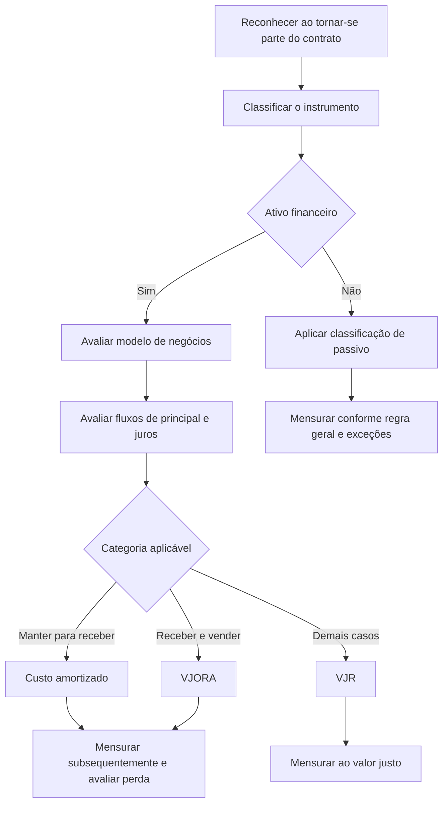

# NBC TG 48 — Instrumentos Financeiros

> [!abstract] Resumo em 30 segundos
> A NBC TG 48 estabelece como reconhecer, classificar, mensurar e desreconhecer ativos e passivos financeiros. Para classificar ativos financeiros, a entidade considera conjuntamente seu modelo de negócios e as características dos fluxos de caixa contratuais. A norma também trata de redução ao valor recuperável, derivativos embutidos e contabilização de hedge. O objetivo é produzir informações úteis sobre valores, época e incerteza dos fluxos de caixa futuros.

## Ficha rápida

| Campo | Síntese |
|---|---|
| Norma | NBC TG 48 — Instrumentos Financeiros |
| Aprovação identificada no PDF | Norma Brasileira de Contabilidade de 25 de novembro de 2016 |
| Tema central | Relatórios financeiros de ativos e passivos financeiros |
| Aplicação | Entidades e instrumentos financeiros, ressalvadas as exclusões e regras específicas de alcance |
| Referência internacional indicada | IFRS 9 do IASB |

> [!info] Vigência
> O sumário do PDF identifica um capítulo sobre vigência e transição, mas o trecho fornecido não reproduz seu conteúdo. Portanto, este resumo não informa data de vigência nem requisitos de transição.

## Objetivo e alcance

A norma busca que as demonstrações contábeis apresentem informações pertinentes e úteis para avaliar os valores, a época e a incerteza dos fluxos de caixa futuros relacionados a ativos e passivos financeiros.

Aplica-se, em regra, a todos os tipos de instrumentos financeiros. Entre as exclusões indicadas no texto estão participações contabilizadas conforme normas específicas de consolidação, demonstrações separadas ou investimentos em coligadas e controladas; direitos e obrigações de arrendamentos; planos de benefícios a empregados; certos instrumentos patrimoniais emitidos pela própria entidade; determinados contratos de seguro; compromissos de empréstimo fora das situações abrangidas; e itens tratados por normas de pagamento baseado em ações, provisões ou receita de contrato com cliente.

As exclusões não significam que todos os aspectos desses contratos fiquem fora da NBC TG 48. O texto prevê, por exemplo, requisitos desta norma para determinados recebíveis de arrendamento, passivos de arrendamento, derivativos embutidos, redução ao valor recuperável ou desreconhecimento. É necessário verificar a regra específica aplicável ao item.

Contratos para comprar ou vender itens não financeiros podem entrar no alcance quando puderem ser liquidados pelo valor líquido à vista, por outro instrumento financeiro ou pela troca de instrumentos financeiros. Há uma exceção para contratos celebrados e mantidos para recebimento ou entrega física conforme os requisitos esperados de compra, venda ou uso da entidade. A norma também permite, em condições delimitadas, designar certos contratos como mensurados ao valor justo por meio do resultado.

## Conceitos-chave

- **Modelo de negócios:** forma pela qual a entidade administra ativos financeiros. É relevante para classificar ativos, e sua mudança é a única circunstância geral prevista no texto para reclassificá-los.
- **Fluxos de caixa de principal e juros:** para a avaliação contratual, principal corresponde ao valor justo do ativo no reconhecimento inicial. Juros representam, entre outros componentes descritos, a contraprestação pelo valor do dinheiro no tempo e pelo risco de crédito do principal em aberto.
- **Custo amortizado:** categoria ligada ao recebimento de fluxos de caixa contratuais e ao atendimento do teste de principal e juros.
- **Valor justo por meio de outros resultados abrangentes — VJORA:** categoria de ativo associada a modelo de negócios que busca tanto receber fluxos contratuais quanto vender ativos, desde que os fluxos atendam ao teste de principal e juros.
- **Valor justo por meio do resultado — VJR:** categoria residual para ativos financeiros que não se enquadrem nas categorias anteriores, além de ativos ou passivos que possam ser designados ao VJR conforme as condições da norma.
- **Derivativo embutido:** componente de contrato híbrido que altera parte dos fluxos de caixa conforme uma variável especificada. Um derivativo contratualmente transferível em separado, ou com contraparte diferente, é tratado como instrumento financeiro separado.
- **Desreconhecimento:** retirada do ativo ou passivo financeiro do balanço quando os critérios da norma forem atendidos.

## Reconhecimento e mensuração

### Reconhecimento e desreconhecimento

A entidade reconhece um ativo ou passivo financeiro quando se torna parte das disposições contratuais do instrumento. Compras e vendas regulares de ativos financeiros podem ser reconhecidas pela data da negociação ou pela data da liquidação, conforme a política aplicável prevista na norma.

Um ativo financeiro é desreconhecido quando os direitos contratuais aos fluxos de caixa expiram ou quando ocorre uma transferência que se qualifica para baixa. Na transferência, a análise considera, nesta ordem, se foram transferidos ou retidos substancialmente os riscos e benefícios e, quando a resposta não for conclusiva, se a entidade reteve o controle. Se houver controle retido, o ativo continua reconhecido na medida do envolvimento contínuo.

Se a transferência não qualificar para baixa porque a entidade reteve substancialmente os riscos e benefícios, o ativo permanece reconhecido e é reconhecido um passivo pela contraprestação recebida. A diferença entre o valor contábil baixado e a contraprestação pertinente é reconhecida no resultado nos casos previstos no texto.

Um passivo financeiro é baixado apenas quando a obrigação contratual for liquidada, cancelada ou expirar. Troca ou modificação substancial dos termos pode representar extinção do passivo original e reconhecimento de um novo.

### Classificação de ativos financeiros

| Categoria | Condições principais |
|---|---|
| Custo amortizado | Modelo cujo objetivo é manter ativos para receber fluxos contratuais; fluxos compostos exclusivamente por principal e juros |
| VJORA | Modelo cujo objetivo é receber fluxos contratuais e vender ativos; fluxos exclusivamente de principal e juros |
| VJR | Categoria aplicável quando o ativo não se enquadra nas categorias anteriores, sem prejuízo das opções de designação permitidas |

No reconhecimento inicial, a entidade pode designar irrevogavelmente um ativo ao VJR quando isso eliminar ou reduzir significativamente uma inconsistência de mensuração ou reconhecimento. Para certos investimentos em instrumentos patrimoniais que de outro modo seriam mensurados ao VJR, existe escolha irrevogável, no reconhecimento inicial, de apresentar alterações posteriores de valor justo em outros resultados abrangentes.

### Classificação de passivos financeiros

A regra geral é mensurar passivos financeiros subsequentemente ao custo amortizado. O texto apresenta exceções, incluindo passivos ao VJR, determinados passivos associados a transferências de ativos que não qualificam para desreconhecimento, contratos de garantia financeira, compromissos de empréstimo com taxa abaixo do mercado e contraprestação contingente de combinação de negócios.

A designação irrevogável de um passivo ao VJR pode ser feita em situações específicas, como para eliminar ou reduzir significativamente inconsistência contábil ou quando um grupo é administrado e avaliado com base no valor justo segundo estratégia documentada.

### Mensuração inicial e subsequente

Em regra, ativos e passivos financeiros são mensurados inicialmente pelo valor justo. Para instrumentos que não sejam ao VJR, somam-se ou deduzem-se os custos de transação diretamente atribuíveis, conforme sejam custos de aquisição ou emissão. Contas a receber de clientes sem componente de financiamento significativo, ou para as quais se aplique o expediente prático referido na NBC TG 47, são mensuradas pelo preço de transação.

Após o reconhecimento inicial, os ativos seguem sua categoria: custo amortizado, VJORA ou VJR. A norma exige aplicação dos requisitos de redução ao valor recuperável aos ativos mensurados ao custo amortizado e ao VJORA. O trecho fornecido não reproduz o conteúdo integral desses requisitos; não é possível detalhar aqui seu cálculo ou suas etapas.

Para ativos ao custo amortizado, a receita de juros é calculada pelo método de juros efetivos, com tratamentos específicos para ativos comprados ou concedidos com problemas de recuperação de crédito e para aqueles que passam a apresentar esses problemas posteriormente. O texto também prevê recalcular o valor contábil bruto quando fluxos contratuais forem renegociados ou modificados sem desreconhecimento, mas o trecho fornecido não reproduz integralmente esse requisito.

## Diagrama de decisão

## Aplicação passo a passo — checklist

1. **Identifique o contrato** e confirme se há instrumento financeiro ou contrato potencialmente abrangido.
2. **Verifique o alcance**, inclusive as exclusões e as exceções que trazem requisitos específicos de volta à norma.
3. **Reconheça o instrumento** quando a entidade se tornar parte de suas disposições contratuais.
4. **Classifique o ativo**, quando aplicável, usando conjuntamente o modelo de negócios e as características dos fluxos contratuais.
5. **Avalie as opções de designação irrevogável** ao VJR ou, para certos instrumentos patrimoniais, a apresentação de alterações em outros resultados abrangentes.
6. **Mensure inicialmente** pelo valor justo e trate os custos de transação conforme a categoria; verifique a regra própria para contas a receber de clientes.
7. **Mensure subsequentemente** segundo a categoria e aplique redução ao valor recuperável quando exigida.
8. **Na transferência de ativos**, avalie expiração de direitos, transferência, riscos e benefícios, controle e eventual envolvimento contínuo.
9. **Na baixa de passivos**, confirme liquidação, cancelamento, expiração ou modificação substancial.
10. **Avalie derivativos embutidos e hedge** quando relevantes, observando os critérios próprios da norma.

## Divulgação

O objetivo da norma relaciona a informação financeira à avaliação dos fluxos de caixa futuros. O sumário identifica capítulos sobre classificação, mensuração, redução ao valor recuperável e contabilização de hedge, mas o trecho fornecido não reproduz requisitos completos de divulgação. Assim, não se especificam aqui notas, quadros ou divulgações obrigatórias que não estejam visíveis no material.

## Exceções e erros comuns

> [!warning] Pontos de atenção
> - Não classificar ativos apenas pela intenção declarada de vender ou manter: a norma considera o modelo de negócios e os termos dos fluxos de caixa.
> - Não confundir VJORA com VJR: a categoria VJORA para ativos depende de ambas as condições previstas para modelo de negócios e fluxos de principal e juros.
> - Não presumir que toda transferência de ativo permite baixa. Riscos, benefícios e controle são determinantes.
> - Não reclassificar passivos financeiros: o texto proíbe sua reclassificação. Para ativos, a reclassificação ocorre somente quando muda o modelo de negócios.
> - Não separar automaticamente um derivativo embutido de um contrato híbrido cujo componente principal seja um ativo dentro do alcance: nesse caso, os requisitos de classificação aplicam-se ao contrato híbrido como um todo.
> - Não tratar todo contrato de item não financeiro como fora do alcance: a possibilidade ou prática de liquidação líquida pode alterar a análise.

## Conexões com outras normas

A NBC TG 48 menciona expressamente normas relacionadas ao tratamento de itens específicos, entre elas NBC TG 36, NBC TG 35 e NBC TG 18 para participações; NBC TG 06 para arrendamentos; NBC TG 33 para benefícios a empregados; NBC TG 39 para apresentação de instrumentos financeiros; NBC TG 11 para contratos de seguro; NBC TG 15 para combinação de negócios; NBC TG 47 para receita e preço de transação; NBC TG 25 para provisões; e NBC TG 03 para caixa e equivalentes de caixa.

## Fonte

**NBC TG 48 — Instrumentos Financeiros**, conforme o conteúdo disponibilizado de *NBC TG 48.pdf*. O PDF identifica a aprovação da norma pelo Conselho Federal de Contabilidade em 25 de novembro de 2016 e declara sua elaboração em conformidade com a IFRS 9 do IASB. Os requisitos sobre vigência, divulgação e partes técnicas não reproduzidas no trecho não foram complementados por fontes externas.
