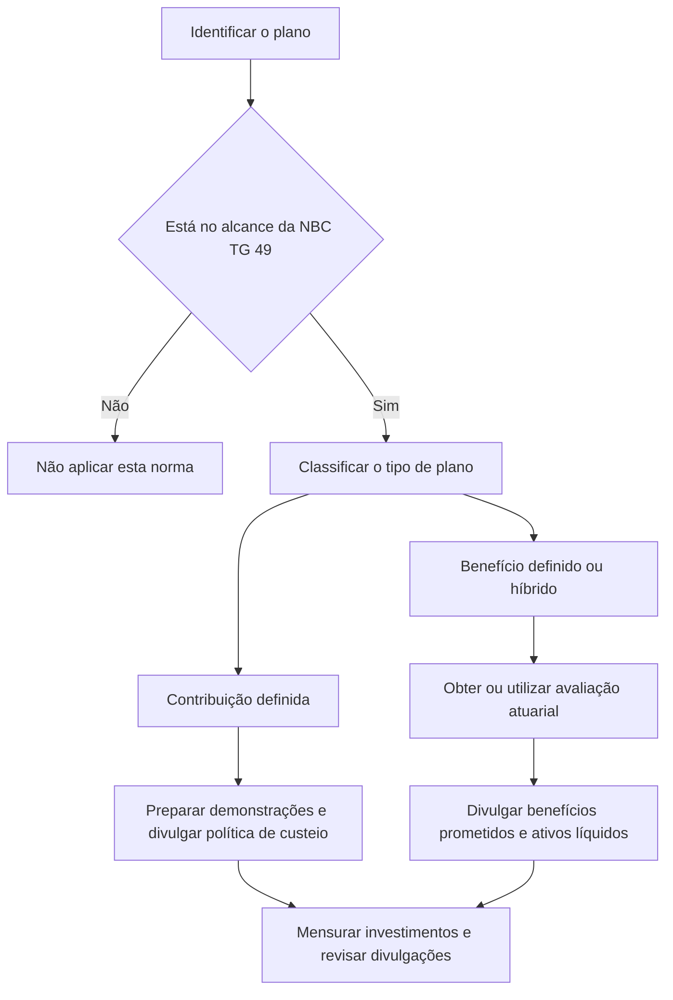

# NBC TG 49 — Contabilização e Relatório Contábil de Planos de Benefícios de Aposentadoria

> [!abstract] Resumo em 30 segundos
> A NBC TG 49 orienta a contabilização e a apresentação das demonstrações contábeis dos próprios planos de benefícios de aposentadoria, tratados como entidades que reportam separadamente dos empregadores ou instituidores. Distingue planos de contribuição definida e de benefício definido, estabelece informações mínimas para cada tipo e exige, em regra, que os investimentos sejam mensurados ao valor justo. Para planos de benefício definido, as demonstrações devem informar o valor presente atuarial dos benefícios prometidos, distinguindo benefícios adquiridos dos não adquiridos.

## Ficha rápida

| Campo | Síntese |
|---|---|
| Norma | NBC TG 49 — Contabilização e Relatório Contábil de Planos de Benefícios de Aposentadoria |
| Objeto | Contabilização e apresentação de informações pelos planos de benefícios de aposentadoria |
| Entidade que reporta | O próprio plano, separado dos empregadores ou instituidores |
| Tipos tratados | Contribuição definida, benefício definido e planos com características de ambos |
| Referência relacionada expressa | NBC TG 33 — Benefícios a Empregados |
| Vigência indicada no PDF | Entra em vigor na data de publicação e aplica-se aos exercícios iniciados a partir de 1º de janeiro de 2019 |

## Objetivo e alcance

A norma se aplica às demonstrações contábeis de planos de benefícios de aposentadoria quando essas demonstrações são elaboradas. Seu foco é a informação fornecida pelo plano a todos os participantes como grupo; não trata da comunicação individual sobre os direitos de cada participante.

O plano é considerado uma entidade que reporta separadamente de seus empregadores ou instituidores. As demais normas emitidas pelo CFC também se aplicam, na medida em que a NBC TG 49 não as substitua. A norma complementa a NBC TG 33, que trata da determinação do custo dos benefícios de aposentadoria nas demonstrações contábeis dos empregadores que mantêm planos.

A aplicação independe da criação de um fundo separado ou da existência de depositários. Também alcança planos com ativos investidos em companhias seguradoras, exceto quando o contrato estiver em nome de participante específico ou grupo de participantes e a obrigação do benefício for exclusivamente da seguradora.

**Fora do alcance:** outras formas de benefícios trabalhistas — como indenizações por rescisão, remuneração diferida, benefícios de licença de longo prazo, aposentadoria especial antecipada, planos de redundância, assistência médica e bem-estar ou bônus — e acordos governamentais do tipo previdenciário.

> [!info] Patrocinador não empregador
> O texto admite planos com patrocinadores distintos dos empregadores e menciona que, no Brasil, pode haver patrocinador instituidor que não seja empregador.

## Conceitos-chave

| Termo | Significado na norma |
|---|---|
| Plano de contribuição definida | O benefício depende das contribuições feitas ao fundo e dos ganhos de investimento. |
| Plano de benefício definido | O benefício é determinado por fórmula geralmente baseada nos rendimentos e/ou anos de serviço. |
| Plano de contribuição variável | Combina características de contribuição definida na acumulação e de benefício definido no pagamento. |
| Custeio | Transferência de ativos para o fundo separado, destinada a satisfazer obrigações futuras de benefícios. |
| Participantes | Membros do plano e outras pessoas com direito a benefícios por força do plano. |
| Ativo líquido disponível para benefícios | Ativos do plano menos passivos, excluído o valor presente atuarial dos benefícios prometidos. |
| Valor presente atuarial dos benefícios prometidos | Valor presente dos pagamentos previstos para participantes atuais e ex-empregados, atribuíveis ao serviço já prestado. |
| Benefício adquirido | Benefício cujo direito não depende da permanência no emprego. |

Planos híbridos que tenham características dos dois tipos são considerados planos de benefício definido para as finalidades da norma.

## Diagrama de aplicação

## Aplicação passo a passo / checklist

1. **Confirme que a entidade que reporta é o plano.** Separe a análise das demonstrações do plano daquela das demonstrações do empregador ou instituidor.
2. **Verifique o alcance.** Confirme que se trata de plano de benefícios de aposentadoria e avalie as exclusões, inclusive os acordos governamentais previdenciários e os contratos de seguro cuja obrigação seja exclusivamente da seguradora.
3. **Classifique o plano.** Identifique se é de contribuição definida, benefício definido ou contribuição variável. Se combinar características de contribuição e benefício definidos, trate-o como benefício definido para esta norma.
4. **Prepare as demonstrações comuns a todos os planos.** Inclua a demonstração das mudanças nos ativos líquidos disponíveis para benefícios, o resumo das políticas contábeis significativas e a descrição do plano e de suas mudanças no período.
5. **Aplique os requisitos específicos do tipo.**
   - **Contribuição definida:** apresente os ativos líquidos disponíveis para pagamento de benefícios e descreva a política de custeio.
   - **Benefício definido:** apresente as informações atuariais exigidas, distinguindo benefícios adquiridos e não adquiridos, e explique a relação entre benefícios prometidos, ativos líquidos e política de custeio.
6. **Avalie os investimentos.** Reconheça-os ao valor justo e documente a base usada. Se não for possível estimar o valor justo, divulgue o motivo.
7. **Complete as divulgações.** Inclua as informações aplicáveis sobre ativos, contribuições, benefícios, despesas, investimentos, premissas atuariais e características do plano.
8. **Confira a data da avaliação atuarial.** Se não houver avaliação na data das demonstrações, use a mais recente e divulgue sua data.

## Reconhecimento e mensuração

### Planos de contribuição definida

O valor dos benefícios futuros é determinado pelas contribuições do empregador, do participante ou de ambos, além da eficiência operacional e dos rendimentos dos investimentos. Em geral, a obrigação do empregador é cumprida à medida que ele realiza as contribuições. A avaliação atuarial normalmente não é necessária, embora possa ser usada para estimar benefícios futuros.

### Planos de benefício definido

Os benefícios prometidos dependem da posição financeira do plano, da capacidade dos contribuintes de realizar aportes futuros, do desempenho dos investimentos e da eficiência operacional. A norma prevê avaliação atuarial periódica para analisar a condição financeira, revisar premissas e recomendar níveis de contribuição futura.

O valor presente atuarial deve considerar os benefícios prometidos nos termos do plano, atribuíveis ao serviço prestado até a data. Pode ser calculado com base nos salários atuais ou projetados; a base utilizada deve ser divulgada. Também devem ser divulgadas as mudanças em premissas atuariais que tenham efeito significativo.

Se a avaliação não tiver sido elaborada na data das demonstrações, a avaliação mais recente pode ser utilizada como base, com divulgação de sua data. O texto não determina que a avaliação seja feita em intervalo fixo; observa que, em muitos países, não ocorre com frequência superior a três anos.

> [!tip] Salários atuais e projetados
> A norma explica que salários atuais podem exigir menos premissas e se relacionar mais de perto a valores devidos em caso de rescisão ou interrupção do plano. Salários projetados podem ser relevantes para planos cujos benefícios e custeio se baseiam em salários próximos à aposentadoria. A escolha deve ser informada e contextualizada.

### Investimentos

Os investimentos do plano devem ser reconhecidos ao valor justo. Para valores mobiliários negociáveis, o valor justo é geralmente o valor de mercado. A norma permite que certos títulos com valor de resgate fixo, adquiridos para compatibilizar obrigações do plano, sejam registrados com base no último valor de resgate, assumindo taxa constante de retorno até o vencimento. Se os investimentos forem registrados por valor diferente do valor de mercado ou do valor justo, este deve ser divulgado de modo geral. Ativos utilizados nas operações do fundo seguem as normas aplicáveis.

## Divulgação

### Requisitos mínimos para todos os planos

As demonstrações contábeis devem conter:

- demonstração das mudanças nos ativos líquidos disponíveis para benefícios;
- resumo das políticas contábeis significativas;
- descrição do plano e do efeito de mudanças ocorridas no período.

Quando aplicável, devem ser apresentados ou divulgados:

- ativos classificados e sua base de avaliação;
- investimentos individuais que excedam 5% dos ativos líquidos disponíveis para benefícios ou 5% de qualquer classe ou tipo de garantia;
- investimentos no empregador e passivos que não correspondam ao valor presente atuarial dos benefícios prometidos;
- contribuições do empregador e dos empregados, rendimentos de investimentos, outras receitas, benefícios pagos ou a pagar, despesas, tributos sobre o lucro, ganhos e perdas com investimentos e transferências entre planos;
- política de custeio.

### Requisitos adicionais para benefício definido

Divulgue o valor presente atuarial dos benefícios prometidos, distinguindo benefícios adquiridos dos não adquiridos, e descreva as premissas atuariais significativas e o método de cálculo. As informações podem constar das demonstrações ou de relatório atuarial, conforme o formato escolhido.

A norma admite três formas de apresentação: incluir ativos líquidos, benefícios prometidos e superávit ou déficit em uma demonstração; apresentar os ativos líquidos e divulgar os benefícios prometidos em nota; ou apresentar os ativos líquidos e remeter ao relatório atuarial separado. Neste último caso, as demonstrações devem conter referência ao relatório e ser acompanhadas dele.

O relatório do plano também deve descrever suas características. Pode informar empregadores ou patrocinadores, grupos cobertos, quantidade e classificação dos participantes, tipo de plano, contribuições dos participantes, benefícios prometidos, termos de rescisão e mudanças nessas informações.

## Exceções e erros comuns

> [!warning] Não confunda as demonstrações do plano com as do empregador
> A NBC TG 49 trata do plano como entidade que reporta. A NBC TG 33 trata do custo dos benefícios nas demonstrações dos empregadores.

- **Tratar o valor presente atuarial como passivo automaticamente.** A norma exige que seja quantificado e divulgado, mas apresenta formatos distintos de apresentação e registra que esse valor não possui, na opinião de alguns, todas as características de um passivo.
- **Omitir a distinção entre benefícios adquiridos e não adquiridos** nas divulgações de benefício definido.
- **Usar a avaliação atuarial mais recente sem informar sua data** quando ela não coincidir com a data das demonstrações.
- **Deixar de explicar a base salarial** — atual ou projetada — usada no cálculo atuarial.
- **Aplicar valor justo sem explicar sua impossibilidade.** Se não for possível estimá-lo, divulgue o motivo.
- **Excluir automaticamente planos com seguro.** Eles estão no alcance, salvo a exceção específica em que a obrigação é exclusivamente da seguradora.
- **Tratar um plano híbrido como contribuição definida.** Para as finalidades desta norma, planos com características de ambos são considerados de benefício definido.

## Conexões com outras normas

A relação explícita no texto é com a **NBC TG 33 — Benefícios a Empregados**: ela trata da determinação do custo dos benefícios de aposentadoria nas demonstrações dos empregadores, enquanto a NBC TG 49 trata da contabilização e apresentação de informações pelo plano.

## Fonte

Texto da **NBC TG 49**, aprovada pelo Conselho Federal de Contabilidade em 18 de maio de 2018, conforme o PDF **NBC TG 49.pdf**. A norma informa vigência na data de sua publicação e aplicação aos exercícios iniciados a partir de 1º de janeiro de 2019.
