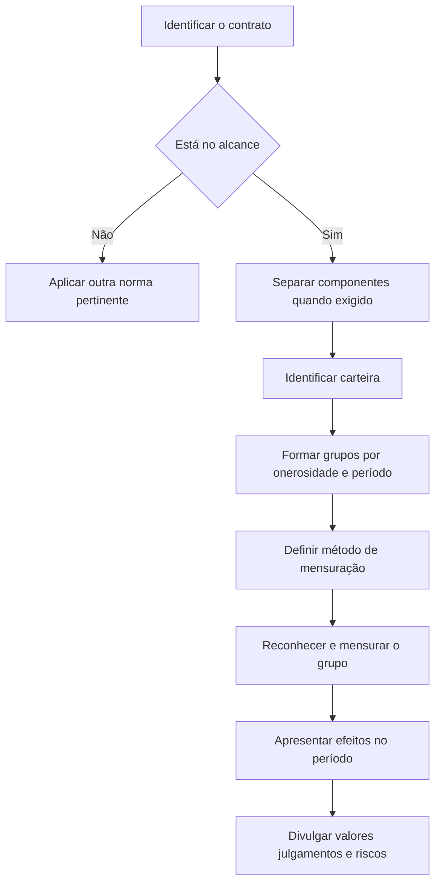

# NBC TG 50 — Contratos de Seguro

> [!abstract] Em uma frase
> A NBC TG 50 estabelece como reconhecer, mensurar, apresentar e divulgar contratos de seguro, com foco em representar a cobertura prestada, os sinistros e os riscos assumidos pela entidade.

## Resumo em 30 segundos

Aplique a norma a contratos de seguro emitidos, resseguros mantidos e, sob condição específica, contratos de investimento com características de participação discricionária. Identifique carteiras e agrupe os contratos por rentabilidade e período de emissão. Reconheça cada grupo quando ocorrer o primeiro marco definido pela norma. Na mensuração geral, combine fluxos de caixa de cumprimento — estimativas futuras, desconto e ajuste de risco não financeiro — com a margem contratual de seguro, que representa lucro ainda não auferido. Reconheça o lucro à medida que a cobertura é prestada e perdas de grupos onerosos no resultado. A abordagem de alocação de prêmio pode simplificar a mensuração quando seus critérios forem atendidos.

## Ficha rápida

| Campo | Síntese |
|---|---|
| Norma | NBC TG 50 — Contratos de Seguro |
| Objetivo | Informações relevantes que representem fielmente os contratos e seus efeitos financeiros |
| Aplicação central | Seguros emitidos e resseguros mantidos |
| Unidade de contabilização | Grupo de contratos dentro de uma carteira |
| Mensuração geral | Fluxos de caixa de cumprimento + margem contratual de seguro |
| Simplificação possível | Abordagem de alocação de prêmio, se os critérios forem satisfeitos |
| Referência internacional indicada no PDF | IFRS 17 |

## Objetivo e alcance

A norma busca permitir que os usuários avaliem os efeitos dos contratos de seguro sobre a posição financeira, o desempenho financeiro e os fluxos de caixa da entidade. Na aplicação, devem ser considerados os direitos e as obrigações substantivos, inclusive os decorrentes de lei, regulamento ou práticas usuais de negócios. Termos sem substância comercial são desconsiderados (itens 1–2).

Aplica-se a (item 3):

- contratos de seguro, inclusive resseguro, emitidos pela entidade;
- contratos de resseguro mantidos; e
- contratos de investimento com características de participação discricionária emitidos por entidade que também emite contratos de seguro.

Há exclusões e escolhas de escopo. Entre os exemplos de contratos não abrangidos estão certas garantias de fabricantes ou varejistas, obrigações de benefícios a empregados, garantias de valor residual e contraprestações contingentes em combinações de negócios. Contratos de garantia financeira podem seguir esta norma ou normas de instrumentos financeiros em circunstâncias específicas; a escolha, quando permitida, é contrato a contrato e irrevogável (item 7).

Alguns contratos que atendem à definição de seguro, mas têm como finalidade principal prestar serviços por taxa fixa, podem ser contabilizados pela NBC TG 47 se todas as condições previstas forem atendidas. Também há uma escolha entre a NBC TG 50 e a NBC TG 48 para determinados contratos que limitam a indenização à liquidação da obrigação do titular da apólice (itens 8 e 8A).

## Conceitos-chave

- **Carteira:** contratos sujeitos a riscos similares e administrados em conjunto (item 14).
- **Grupo de contratos:** unidade à qual se aplicam os requisitos de reconhecimento e mensuração. A carteira deve ser subdividida, no mínimo, entre contratos onerosos no reconhecimento inicial, contratos sem possibilidade significativa de se tornarem onerosos e contratos remanescentes (item 16).
- **Fluxos de caixa de cumprimento:** estimativas de fluxos futuros dentro do limite do contrato, ajustadas pelo valor do dinheiro no tempo e por riscos financeiros, além do ajuste de risco não financeiro (itens 32–37).
- **Margem contratual de seguro — MCS:** lucro não auferido que será reconhecido conforme a prestação futura da cobertura (itens 38 e 43).
- **Contrato oneroso:** grupo cujas saídas líquidas no reconhecimento inicial geram perda; a perda é reconhecida no resultado (item 47).
- **Limite do contrato:** delimita quais direitos e obrigações geram fluxos incluídos na mensuração. Prêmios e sinistros esperados fora desse limite não são reconhecidos como ativo ou passivo do contrato (itens 34–35).
- **Passivo por cobertura remanescente:** associado à cobertura futura. **Passivo por sinistros ocorridos:** associado à cobertura passada e aos sinistros já ocorridos (item 40).

> [!info] Componentes separados
> Antes de aplicar a norma ao contrato principal, avalie se há derivativo embutido, componente de investimento distinto ou promessa de bens ou serviços distintos não relacionados a seguro. Os componentes separados são contabilizados conforme a NBC TG 48 ou a NBC TG 47, conforme aplicável (itens 10–13).

## Diagrama de aplicação

## Aplicação passo a passo — checklist

1. **Avalie o contrato e seus termos substantivos.** Considere direitos e obrigações exequíveis, inclusive os impostos por lei ou regulamento; descarte termos sem substância comercial (item 2).
2. **Confirme o escopo.** Determine se é seguro emitido, resseguro mantido ou contrato de investimento elegível. Verifique exclusões e escolhas expressamente permitidas (itens 3–8A).
3. **Analise componentes.** Separe derivativos, componentes de investimento distintos e promessas distintas de bens ou serviços quando exigido. Atribua os fluxos de caixa entre componentes de modo consistente com as regras aplicáveis (itens 10–13).
4. **Combine contratos quando necessário.** Uma série de contratos com a mesma contraparte ou contraparte relacionada pode precisar ser tratada como um todo quando tiver efeito comercial geral (item 9).
5. **Forme carteiras e grupos.** Agrupe riscos similares administrados em conjunto. Divida cada carteira, no mínimo, nas categorias de onerosidade previstas e não inclua no mesmo grupo contratos emitidos com mais de um ano de intervalo (itens 14–24).
6. **Determine a data de reconhecimento.** Reconheça o grupo no primeiro dos marcos previstos: início da cobertura, vencimento do primeiro pagamento ou, para grupo oneroso, quando se tornar oneroso (item 25).
7. **Escolha e documente o método de mensuração.** Use a abordagem geral ou, se os critérios forem atendidos, a abordagem de alocação de prêmio (itens 29 e 53–59).
8. **Atualize a mensuração e o resultado.** Separe efeitos de cobertura prestada, sinistros ocorridos, onerosidade e efeitos financeiros (itens 40–52 e 87, conforme indicado no texto).
9. **Prepare apresentação e divulgações.** Explique valores, julgamentos e riscos relevantes relacionados aos contratos.

## Reconhecimento e mensuração

### Mensuração geral

No reconhecimento inicial, a mensuração do grupo corresponde à soma de:

\[
\text{Fluxos de caixa de cumprimento} + \text{MCS}
\]

Os fluxos de caixa futuros devem refletir, sem viés, informações razoáveis e sustentáveis disponíveis, perspectivas da entidade compatíveis com preços de mercado observáveis, condições correntes e estimativas explícitas. Quando apropriado, devem representar o valor esperado, ponderado pelas probabilidades dos resultados possíveis (itens 32–33).

As taxas de desconto devem refletir o valor do dinheiro no tempo, as características dos fluxos de caixa e a liquidez dos contratos. Devem ser consistentes com preços de mercado observáveis para instrumentos com características compatíveis e excluir fatores que não afetem os fluxos de caixa do seguro (item 36). O ajuste de risco não financeiro representa a compensação requerida pela entidade por suportar incerteza quanto ao valor e ao prazo dos fluxos (item 37).

Na mensuração subsequente, o valor do grupo inclui o passivo por cobertura remanescente — fluxos relativos à cobertura futura e MCS — e o passivo por sinistros ocorridos — fluxos relativos à cobertura passada (item 40). A MCS é atualizada e reconhecida no resultado conforme a cobertura é prestada. Para grupos sem características de participação direta, a norma também prevê ajustes por juros, novos contratos, alterações em fluxos de caixa relativos à cobertura futura e diferenças cambiais (item 44).

### Grupos onerosos

Se, no reconhecimento inicial, o total dos fluxos de caixa de cumprimento, dos fluxos de aquisição pertinentes e dos demais fluxos do contrato resultar em saída líquida, reconheça a perda no resultado e mantenha a MCS do grupo em zero (item 47). Em períodos posteriores, mudanças desfavoráveis podem tornar o grupo oneroso ou aumentar sua onerosidade; reconheça a perda na medida em que exceder a MCS disponível (item 48). A norma exige acompanhar um componente de perda e alocar sistematicamente as alterações subsequentes relacionadas (itens 49–52).

### Abordagem de alocação de prêmio

A entidade pode usar essa simplificação se, no início do grupo, esperar que o resultado não difira significativamente da mensuração geral ou se o período de cobertura de cada contrato for de um ano ou menos (item 53). A simplificação não é apropriada pelo primeiro critério quando se espera variação significativa nos fluxos de cumprimento que afete a mensuração antes da ocorrência do sinistro (item 54).

O passivo por cobertura remanescente acompanha, entre outros fatores, prêmios recebidos, fluxos de aquisição, financiamento quando aplicável e cobertura prestada (item 55). Se fatos e circunstâncias indicarem onerosidade, compare o passivo simplificado com os fluxos de caixa de cumprimento da cobertura remanescente e reconheça a perda do excedente (itens 57–58). Para contratos com cobertura de até um ano, a entidade pode optar por reconhecer os fluxos de aquisição como despesa quando incorridos (item 59).

### Resseguro mantido e aquisição

A mensuração de resseguro mantido tem adaptações próprias. As premissas devem ser consistentes com as dos contratos subjacentes, e os fluxos devem incluir o risco de não desempenho do ressegurador, inclusive efeitos de garantias e perdas decorrentes de litígios (item 63). Contratos de resseguro mantidos não são onerosos (item 68).

Fluxos de caixa de aquisição pagos antes do reconhecimento do grupo relacionado são, em regra, reconhecidos como ativos e depois baixados quando incluídos na mensuração. A entidade deve avaliar recuperabilidade quando fatos e circunstâncias indicarem possível perda por impairment e reconhecer eventual perda ou reversão no resultado (itens 28A–28F).

## Apresentação e divulgação

No balanço patrimonial, acompanhe separadamente os componentes de cobertura remanescente e de sinistros ocorridos previstos na mensuração da norma. No resultado, distinga os efeitos da cobertura prestada, dos sinistros e despesas incorridos, das perdas e reversões de grupos onerosos e das receitas ou despesas financeiras com seguro (itens 40–42).

O sumário do PDF indica que a divulgação abrange, entre outros temas, explicação dos valores reconhecidos, receitas ou despesas financeiras com seguro, valores de transição e julgamentos significativos. Também prevê informações sobre natureza e extensão dos riscos, incluindo concentração, sensibilidade a riscos de seguro e de mercado, desenvolvimento de sinistros e informações adicionais sobre riscos de crédito e liquidez (itens 93–132). O trecho fornecido não reproduz os requisitos detalhados dessas divulgações; portanto, os tópicos devem ser conferidos no texto integral antes de definir conteúdo, formato ou extensão.

## Exceções e erros comuns

> [!warning] Pontos de controle
> - Não agrupe contratos emitidos com mais de um ano de intervalo na aplicação ordinária dos requisitos de agrupamento.
> - Não reconheça prêmios ou sinistros esperados fora do limite do contrato como ativo ou passivo do contrato.
> - Não trate a MCS como lucro já auferido: ela representa lucro relativo à cobertura futura.
> - Não deixe de reconhecer a perda de um grupo oneroso no resultado.
> - Não aplique a abordagem de alocação de prêmio sem verificar ao menos um dos critérios do item 53.
> - Não inclua no fluxo de caixa de cumprimento do emissor o próprio risco de descumprimento da entidade (item 31).
> - Não trate as escolhas permitidas de escopo como reversíveis: nos casos indicados pela norma, a escolha é irrevogável.

## Conexões com outras normas

As relações abaixo são explicitamente indicadas no texto:

- **NBC TG 47 — Receita de Contrato com Cliente:** promessas separadas de bens ou serviços distintos e possibilidade de contabilizar certos contratos de serviço por taxa fixa (itens 7–8 e 12).
- **NBC TG 48 — Instrumentos Financeiros:** derivativos embutidos separados, componentes de investimento distintos e determinadas escolhas para garantias financeiras (itens 7 e 11).
- **NBC TG 02 — Efeitos das Mudanças nas Taxas de Câmbio:** grupos de contratos em moeda estrangeira tratados como itens monetários (item 30).
- **NBC TG 15 — Combinação de Negócios:** contraprestação contingente excluída do alcance e contratos de seguro adquiridos em combinação de negócios (itens 7 e 39).
- **NBC TG 46 — Mensuração do Valor Justo:** referência à definição de risco de descumprimento usada na mensuração de valor justo (item 31).

O PDF informa que a NBC TG 50 substitui a NBC TG 11 — Contratos de Seguro (Apêndice C, item C34).

## Fonte

- Conselho Federal de Contabilidade. **NBC TG 50 — Contratos de Seguro**, aprovada em 19 de agosto de 2021. PDF: `NBC TG 50.pdf`.
- O cabeçalho do documento informa que a norma foi elaborada de acordo com sua equivalente internacional IFRS 17.
