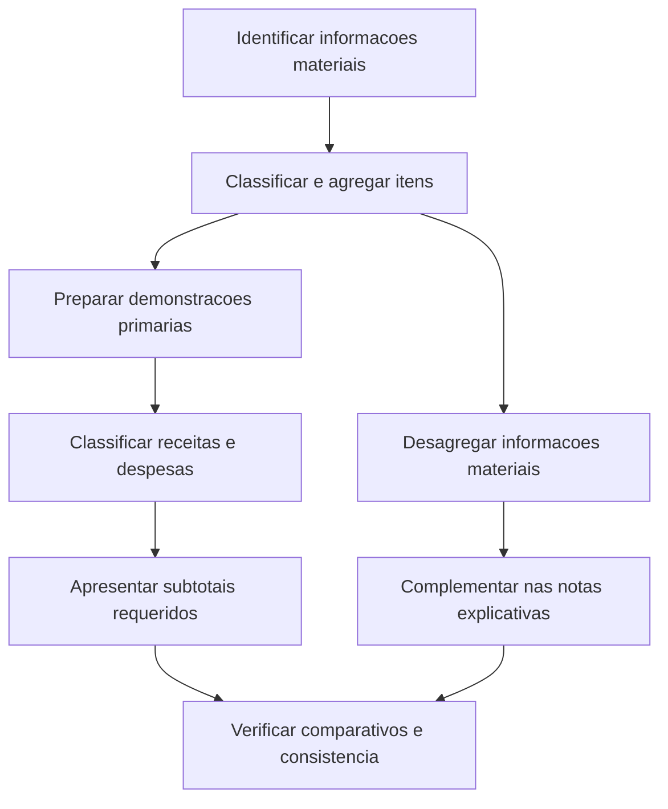

# NBC TG 51 — Apresentação e Divulgação nas Demonstrações Contábeis

> [!abstract] Em uma frase
> A NBC TG 51 organiza como apresentar e divulgar informações nas demonstrações contábeis, com foco em relevância, representação fidedigna, comparabilidade e resumos estruturados úteis — incluindo novas categorias para receitas e despesas na demonstração do resultado.

## Resumo em 30 segundos

A norma disciplina a apresentação das demonstrações contábeis e as informações que as acompanham. Distingue a função das demonstrações contábeis primárias — fornecer resumos estruturados — da função das notas explicativas — detalhar e complementar informações materiais. Exige classificação das receitas e despesas do resultado em cinco categorias: operacional, investimento, financiamento, tributos sobre o lucro e operações descontinuadas. Também estabelece subtotais, regras de agregação e desagregação, comparativos, consistência entre períodos e divulgações específicas, inclusive para medidas de desempenho definidas pela administração.

A NBC TG 51 trata principalmente de **apresentação e divulgação**. Os requisitos de reconhecimento e mensuração de transações específicas são estabelecidos por outras normas.

## Ficha rápida

| Campo | Síntese |
|---|---|
| Norma | NBC TG 51 — Apresentação e Divulgação em Demonstrações Contábeis |
| Grupo | 02 - NBC TG |
| Correlação indicada no PDF | IFRS 18 |
| Aprovada pelo CFC | 13 de novembro de 2025 |
| Aplicação temporal indicada | Vigência a ser estabelecida pelos órgãos reguladores que a aprovarem; para pleno atendimento às normas internacionais, aplicação a períodos anuais iniciados em ou após 1º de janeiro de 2027 |
| Substituição indicada no PDF | NBC TG 26 (R5) |

> [!warning] Vigência
> O PDF não fixa uma única data de vigência brasileira: afirma que ela será estabelecida pelos órgãos reguladores. A data de 1º de janeiro de 2027 é indicada para o pleno atendimento às normas internacionais, não como data geral de vigência estabelecida pelo CFC (Apêndice C, C1).

## Objetivo e alcance

A norma busca assegurar que as demonstrações contábeis para fins gerais forneçam informações relevantes e que representem fidedignamente ativos, passivos, patrimônio líquido, receitas e despesas (item 1). Essas informações devem ajudar os usuários a avaliar as perspectivas de fluxos de entrada de caixa líquidos futuros e a gestão dos recursos econômicos pela administração (item 9).

Aplica-se à apresentação e divulgação de demonstrações contábeis elaboradas de acordo com as Normas, Interpretações e Orientações do CFC. Abrange requisitos para demonstração do resultado, demonstração do resultado abrangente, balanço patrimonial, demonstração das mutações do patrimônio líquido e notas explicativas. A NBC TG 03 (R3) disciplina a demonstração dos fluxos de caixa, mas certos requisitos gerais da NBC TG 51 também se aplicam a ela (itens 2–3).

A norma não se aplica, em geral, a demonstrações intermediárias condensadas elaboradas conforme a NBC TG 21 (R4). O texto, contudo, estende a essas demonstrações os requisitos de agregação e desagregação e os de medidas de desempenho definidas pela administração indicados nos itens 41–45 e 117–125 (item 5).

## Conceitos-chave

- **Demonstrações contábeis primárias:** demonstrações de desempenho financeiro, balanço patrimonial, demonstração das mutações do patrimônio líquido e demonstração dos fluxos de caixa. Fornecem resumos estruturados para visão geral, comparação e identificação de temas que podem exigir explicações adicionais (itens 10–16).
- **Notas explicativas:** complementam as demonstrações primárias e fornecem informações materiais mais detalhadas, inclusive desagregações necessárias para compreender rubricas e eventos (itens 17–18).
- **Materialidade:** a entidade precisa apresentar ou divulgar informação material. Não é necessário cumprir uma apresentação ou divulgação específica se as informações resultantes não forem materiais; podem ser necessárias divulgações adicionais quando os requisitos específicos não bastarem para explicar os efeitos das transações e condições (itens 15 e 19–20).
- **Agregação e desagregação:** agrupar itens com características compartilhadas e desagregar aqueles com características diferentes, de modo que informações materiais não fiquem obscurecidas (itens 41–43).
- **Compensação:** não compensar ativos e passivos ou receitas e despesas, salvo quando outra norma permitir ou exigir. Mensurar um ativo líquido de uma redução por perda, por si só, não é compensação (itens 44–45).
- **Medidas de desempenho definidas pela administração:** o trecho fornecido esclarece que são subtotais de receitas e despesas que comunicam a visão da administração sobre um aspecto do desempenho financeiro da entidade como um todo e são utilizados em comunicados públicos fora das demonstrações. Índices, medidas de caixa e medidas não financeiras não são, por si, esse tipo de medida (Apêndice B, B113–B121).

## Demonstração do resultado: categorias e subtotais

As receitas e despesas incluídas no resultado devem ser classificadas, em regra, nestas cinco categorias (item 47):

| Categoria | Regra geral |
|---|---|
| Operacional | Inclui os itens não classificados nas demais categorias (item 52). |
| Investimento | Inclui resultados de determinados investimentos, caixa e equivalentes de caixa e outros ativos que gerem retorno individual e em grande parte independente dos demais recursos (itens 53–54). |
| Financiamento | Classifica resultados de passivos conforme a natureza da transação e os requisitos específicos aplicáveis (itens 59–66). |
| Tributos sobre o lucro | Inclui receita ou despesa tributária abrangida pela NBC TG 32 e diferenças cambiais relacionadas (item 67). |
| Operações descontinuadas | Inclui receitas e despesas conforme a NBC TG 31 (item 68). |

O resultado deve apresentar, entre outros, lucro ou prejuízo operacional, lucro ou prejuízo antes de financiamento e tributos sobre o lucro e lucro ou prejuízo líquido (itens 69–72). Há uma condição específica para entidades que concedem financiamento a clientes como atividade de negócio principal e adotam determinada política contábil: elas não aplicam o subtotal antes de financiamento e tributos previsto no item 69(b), mas avaliam se um subtotal adicional é necessário para um resumo estruturado útil (itens 73–74).

A entidade deve classificar despesas operacionais por natureza, por função ou por ambas, buscando a apresentação mais útil. Se apresentar despesas por função, deve divulgar descrições qualitativas das despesas em cada rubrica e, em nota única, totais de depreciação, amortização, benefícios a empregados, perdas por redução ao valor recuperável e reduções de estoques, com as informações adicionais previstas no item 83. A isenção de certas desagregações não dispensa outros requisitos específicos de divulgação (itens 78–85).

## Diagrama do fluxo de apresentação

## Aplicação passo a passo / checklist

1. **Defina o conjunto completo:** inclua demonstrações de desempenho financeiro, balanço patrimonial, mutações do patrimônio líquido, fluxos de caixa, notas e informações comparativas. Inclua DVA quando exigida legalmente ou por regulador, ou se apresentada voluntariamente (item 10).
2. **Escolha a forma de apresentação do desempenho:** a norma prevê uma demonstração única com duas seções ou demonstração do resultado separada da demonstração do resultado abrangente. O texto assinala que, no Brasil, requer-se a demonstração do resultado como demonstração separada, conforme item 12(b) (itens 12–13 e 12A).
3. **Separe apresentação de divulgação:** use as demonstrações primárias para resumos estruturados e as notas para explicação e detalhe material (itens 16–18).
4. **Avalie materialidade e estrutura:** agregue itens semelhantes, desagregue diferenças relevantes e não obscureça informação material. Acrescente rubricas ou subtotais somente quando contribuírem para um resumo estruturado útil e respeitarem os requisitos aplicáveis (itens 21–24 e 41–43).
5. **Classifique receitas e despesas do resultado:** aplique as cinco categorias e verifique se a entidade tem atividade de negócio principal especificada, pois isso pode alterar classificações (itens 47–68).
6. **Revise despesas operacionais:** selecione apresentação por natureza, função ou ambas; se usar função, verifique as divulgações adicionais exigidas (itens 78–85).
7. **Prepare comparativos:** apresente o período corrente e o anterior. Se houver reclassificação, divulgue sua natureza, valores e motivo; se for impraticável, explique a razão e a natureza dos ajustes que teriam sido feitos (itens 31–35).
8. **Avalie a necessidade de terceiro balanço:** apresente-o no início do período anterior quando houver aplicação retrospectiva, reapresentação ou reclassificação com efeito material no balanço daquela data (itens 37–40).
9. **Revise identificação e consistência:** identifique claramente as demonstrações, a entidade, se são individuais ou de grupo, as datas, moeda de apresentação e nível de arredondamento; mantenha apresentação e classificação entre períodos, salvo as situações previstas (itens 25–30).

## Reconhecimento e mensuração

A NBC TG 51 organiza apresentação e divulgação; não substitui as normas que estabelecem reconhecimento e mensuração para transações específicas. Ao criar rubricas ou subtotais adicionais, a entidade deve usar valores reconhecidos e mensurados de acordo com as normas aplicáveis e manter consistência com a estrutura exigida (item 24). Para a classificação de receitas e despesas, a norma considera, entre outros fatores, a natureza de ativos e passivos e a atividade de negócio principal da entidade (itens 49–66).

## Divulgação

Além das divulgações sobre comparativos, identificação e despesas operacionais, a norma exige atenção às medidas de desempenho definidas pela administração. O texto do Apêndice B indica que as informações requeridas para essas medidas devem ser reunidas em uma única nota, claramente separadas de outras informações. A medida deve ser descrita de forma compreensível, com explicação dos itens incluídos e excluídos e, conforme o caso, dos métodos de cálculo. Deve ser conciliada ao total ou subtotal mais diretamente comparável, com informações sobre os itens de conciliação e seus efeitos tributários, conforme os requisitos referidos nos itens 121–125 e Apêndice B, B132–B142.

## Exceções e erros comuns

> [!danger] Evite estes erros
> - Tratar todas as receitas e despesas financeiras como pertencentes automaticamente à categoria de financiamento: a norma diferencia passivos e prevê classificações específicas.
> - Compensar saldos ou resultados sem autorização normativa.
> - Usar rubricas agregadas que ocultem diferenças materiais.
> - Alterar a apresentação entre períodos sem avaliar comparativos e divulgações.
> - Apresentar um subtotal adicional com um nome que não represente fielmente os valores incluídos.
> - Presumir que uma análise de desempenho preparada pela administração e publicada separadamente integra as demonstrações contábeis: o item 8 afirma que essa análise está fora do alcance das normas do CFC.

Entidades sem fins lucrativos e entidades cuja estrutura não se ajusta aos termos usuais de patrimônio líquido podem precisar adaptar descrições e rubricas, sem que isso altere a necessidade de apresentação fidedigna (itens 6–7). Mudanças de apresentação são admitidas quando outra apresentação for mais apropriada nas circunstâncias previstas ou quando exigidas por norma (item 30).

## Conexões com outras normas

A relação é expressa no texto: NBC TG 03 (R3), para fluxos de caixa; NBC TG 21 (R4), para demonstrações intermediárias; NBC TG 23, para políticas contábeis, erros e comparativos; NBC TG 32, para tributos sobre o lucro; NBC TG 31, para operações descontinuadas; NBC TG 48 e NBC TG 50, para itens específicos apresentados no resultado; e NBC TG 09 (R1), para a DVA. O Apêndice C também prevê aplicação retrospectiva conforme a NBC TG 23 e conciliações de transição com valores anteriormente apresentados pela NBC TG 26 (R5).

## Fonte

- **PDF:** `NBC TG 51.pdf`, Norma Brasileira de Contabilidade NBC TG 51, aprovada em 13 de novembro de 2025.
- Referências de itens e páginas foram incluídas apenas quando identificáveis no texto fornecido.
