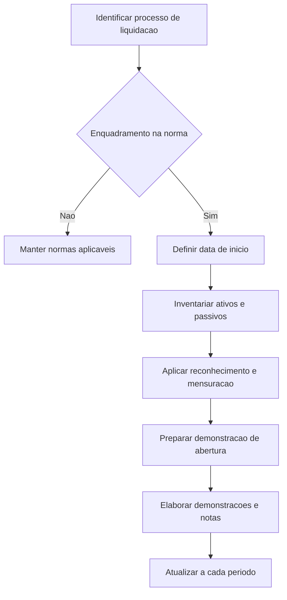

# NBC TG 900 — Entidades em Liquidação

> [!abstract] Resumo em 30 segundos
> A NBC TG 900 estabelece bases contábeis próprias para entidades em liquidação, distintas das aplicáveis a entidades em continuidade. A norma trata de reconhecimento, mensuração, demonstrações contábeis e divulgações. Em geral, ativos são reconhecidos quando houver razoável segurança de realização e mensurados prioritariamente pelo valor de liquidação; passivos determinados seguem os valores formal e legalmente devidos, e provisões são reconhecidas quando a saída de recursos for possível ou provável.

## Ficha rápida

| Campo | Síntese |
|---|---|
| Norma | NBC TG 900 — Entidades em Liquidação |
| Objetivo | Estabelecer critérios e procedimentos contábeis específicos para entidades em liquidação |
| Aplicação | A partir do início do processo de liquidação, observadas as exclusões e particularidades previstas |
| Demonstrações centrais | Ativos Líquidos; Mutações dos Ativos Líquidos; Fluxos de Caixa; e, em situações previstas, Moeda de Liquidação |
| Datas indicadas no texto | Aprovada em 18/03/2021; efeitos em 01/06/2021; adoção permitida desde 01/01/2021 |

## Objetivo e alcance

A norma deve ser aplicada por entidades em liquidação voluntária ou compulsória, inclusive liquidação judicial ou extrajudicial, falência, autofalência e insolvência civil. Aplica-se independentemente das normas utilizadas pela entidade antes de entrar em liquidação. Se não houver orientação específica na NBC TG 900 para uma transação ou evento, a entidade busca orientação nas normas aplicáveis a entidades em continuidade (itens 1–2).

A entidade elabora e divulga demonstrações conforme a norma desde o início do processo de liquidação, sem aguardar o encerramento do período de reporte (item 6). A aplicação decorre do enquadramento como entidade em liquidação, não apenas de dificuldades financeiras, redução de atividades ou risco de descontinuidade.

**Não se aplica da mesma forma** às seguintes situações:

- **Recuperação judicial ou extrajudicial:** a entidade continua a escrituração segundo as normas que seguia antes da recuperação e atende também à regulamentação específica (item 3).
- **Entidade submetida a órgão regulador próprio:** a NBC TG 900 não se aplica integralmente se o regulador tiver critérios e procedimentos específicos (item 4).
- **Liquidação prevista nos documentos constitutivos:** aplicam-se as normas de continuidade até a cessação das atividades e o ingresso em processo efetivo de liquidação (item 5).

> [!warning] Enquadramento
> A norma exclui do conceito de liquidação a extinção decorrente de fusão, incorporação ou cisão. Também esclarece que a provável perda da continuidade — ou uma redução significativa das atividades —, isoladamente, ainda não caracteriza entidade em liquidação (itens 7–8).

## Conceitos-chave

- **Liquidação:** conversão de ativos em dinheiro ou outros ativos, liquidação de obrigações com credores e distribuição de eventual saldo residual, com objetivo de extinguir a entidade.
- **Entidade em liquidação:** entidade cujo plano de liquidação foi aprovado por quem tem autoridade para torná-lo efetivo, ou imposto por terceiros, atendidos os critérios de probabilidade previstos na norma. A liquidação não pode estar prevista nos documentos constitutivos.
- **Data de início:** data em que se completa o fato ou conjunto de fatos que enquadra a entidade em liquidação.
- **Ativos líquidos:** diferença entre ativos e passivos reconhecidos e mensurados segundo a NBC TG 900. Podem ser positivos ou negativos.
- **Valor de liquidação:** valor líquido esperado pela realização do ativo. Para ativos não monetários, considera o preço estimado nas condições de liquidação, inclusive a possibilidade de venda forçada, menos os gastos necessários para preparar e vender o ativo. Para ativos monetários, corresponde ao valor esperado em caixa, deduzidos gastos estimados de negociação e cobrança.
- **Passivos determinados:** obrigações identificadas objetivamente, apoiadas por registros ou evidências verificáveis e mensuráveis com confiabilidade.
- **Provisões:** dívidas incertas oriundas de eventos passados, cujo valor depende de evento futuro. Seu reconhecimento segue critério próprio nesta norma.
- **Passivos contingentes:** provisões remotas ou não mensuráveis confiavelmente, além de obrigações cujo fato gerador dependa de evento futuro.

A **Demonstração dos Ativos Líquidos de Abertura** é a primeira demonstração sob a base de liquidação, preparada a partir do último balanço em continuidade. Se esse balanço não estiver disponível, parte-se de inventário de ativos e passivos na data de início (itens 7–20).

## Reconhecimento e mensuração

### Ativos

Reconhecer ativos quando houver **razoável segurança de venda ou realização para pagamento de passivos**. Se essa segurança não existir, o ativo não é reconhecido, mas deve ser divulgado em nota explicativa (item 21).

Aplicar esta ordem de mensuração (item 22):

1. **Valor de liquidação**;
2. **Valor justo líquido das despesas de venda**, enquanto não houver mensuração disponível do valor de liquidação;
3. **Custo histórico**, com perdas por recuperabilidade e despesas estimadas para realização, apenas excepcionalmente enquanto as alternativas anteriores não estiverem disponíveis.

Quando não for usado o valor de liquidação, explicar a justificativa em nota explicativa. Divulgar também os critérios, métodos e fontes de informação utilizados na mensuração (itens 23 e 46).

### Passivos, provisões e custos da liquidação

| Elemento | Tratamento previsto |
|---|---|
| Passivos determinados | Mensurar pelos valores formal e legalmente devidos |
| Provisões | Mensurar pela melhor estimativa de saída de recursos para liquidar a obrigação |
| Provisões possíveis ou prováveis | Reconhecer na Demonstração dos Ativos Líquidos |
| Passivos contingentes | Não reconhecer, mas divulgar sempre em notas explicativas |
| Custos e despesas até o fim da liquidação | Reconhecer como passivo, líquidos de eventuais receitas, incluindo gastos advocatícios e administrativos |

A regra de reconhecimento de provisões é diferente da indicada pela NBC TG 25: nesta norma, o reconhecimento ocorre quando a saída de recursos for considerada **possível ou provável**. Passivos contingentes devem ser divulgados mesmo quando remotos, não mensuráveis objetivamente ou dependentes de evento futuro com alguma possibilidade de ocorrência (itens 24–28).

Não reduzir passivos com base apenas na expectativa de uma negociação futura. A redução só é reconhecida quando houver garantia jurídica de que a saída de ativos será inferior ao valor registrado (item 31).

Elementos ativos ou passivos não reconhecidos antes da liquidação por erro, omissão, fraude ou aplicação da norma anterior devem ser reconhecidos se satisfizerem as condições da NBC TG 900 (item 29). A demonstração de abertura deve partir do inventário de ativos e passivos conhecidos e mensuráveis; ajustes ainda impossíveis devem ser feitos assim que viáveis, com divulgação da limitação (item 30).

> [!info] Operações durante a liquidação
> Mesmo que tenha autorização para continuar operando, parcial ou totalmente, a entidade permanece sujeita à NBC TG 900 (item 33).

## Aplicação passo a passo / checklist

1. **Verifique o enquadramento:** confirme a existência de plano aprovado ou imposto e se a possibilidade de interromper a liquidação ou deixar esse estado é remota, conforme o caso.
2. **Identifique exclusões:** avalie recuperação judicial ou extrajudicial, regras de regulador próprio e liquidação prevista nos documentos constitutivos.
3. **Fixe a data de início:** determine quando se completaram os fatos que caracterizam a liquidação.
4. **Levante ativos e passivos:** faça inventário e confronte-o com a escrituração e as evidências disponíveis.
5. **Prepare a Demonstração dos Ativos Líquidos de Abertura:** ajuste os saldos da base de continuidade para os critérios de liquidação; se não houver balanço anterior, use o inventário.
6. **Aplique reconhecimento e mensuração:** avalie a segurança de realização dos ativos, mensure passivos e provisões e estime os custos da liquidação.
7. **Documente as limitações:** registre os itens ainda não mensuráveis ou não avaliados e divulgue as razões, os efeitos estimados e as informações disponíveis.
8. **Prepare as demonstrações exigidas:** use o método direto na Demonstração dos Fluxos de Caixa.
9. **Inclua divulgações completas:** situação de liquidação, bases contábeis, plano, estágio de execução e critérios de avaliação.
10. **Atualize nos períodos seguintes:** repita as demonstrações e divulgações ao longo do processo.

O Apêndice apresenta modelos de escrituração especial e demonstrações. A escrituração especial pode ser usada quando não houver exigência legal ou regulatória em sentido contrário (item 32).

## Demonstrações e divulgação

As demonstrações exigidas são (item 35):

- **Demonstração dos Ativos Líquidos**;
- **Demonstração das Mutações dos Ativos Líquidos**;
- **Demonstração dos Fluxos de Caixa**, pelo método direto;
- **Demonstração da Moeda de Liquidação**, nos casos de falência e em outras situações em que seja necessária;
- **Notas explicativas**.

A Demonstração dos Fluxos de Caixa própria da liquidação não se confunde com a demonstração da NBC TG 03. Deve evidenciar entradas pela realização de ativos e saídas para liquidação de passivos e despesas do processo (itens 13 e 42). A Demonstração da Moeda de Liquidação evidencia a relação percentual entre ativos e passivos por classe, observada a ordem de preferência aplicável; os rateios devem ser divulgados cumulativamente (itens 14 e 36).

As notas explicativas devem, entre outros aspectos:

- declarar expressamente que a entidade está em liquidação e declarar conformidade com a NBC TG 900; qualquer impossibilidade comprovada de cumprimento e seu efeito estimado devem ser informados;
- descrever o plano de liquidação: forma de realização dos ativos, liquidação dos passivos, cronograma de pelo menos um ano e data prevista para conclusão;
- informar o estágio atual de execução do plano;
- explicar critérios de avaliação, metodologia e fontes usadas para mensurar valores de liquidação;
- detalhar valores não avaliados conforme a norma e, quando disponíveis, faixas de valor, probabilidade de realização e demais informações úteis;
- identificar ativos e passivos não confirmados ou identificados durante o processo, inclusive os incorporados após seu início.

Os ativos e passivos seguem a ordem da legislação ou regulação, quando aplicável. Sem ordem prescrita, os ativos são apresentados em liquidez decrescente e os passivos em exigibilidade decrescente (itens 39 e 44–50). Na falência, a divulgação considera a ordem legal de liquidação. Gastos de preparação e venda geralmente reduzem o valor estimado do ativo; só são reconhecidos como passivo quando legislação específica assim exigir, caso em que a nota deve esclarecer que o ativo não está apresentado líquido desses gastos (itens 37–38).

## Exceções e erros comuns

> [!danger] Evite estes equívocos
> - Aplicar a NBC TG 900 apenas porque a entidade enfrenta dificuldades, reduziu atividades ou pode deixar de operar.
> - Manter automaticamente os critérios de continuidade depois do início efetivo da liquidação.
> - Reconhecer ativos sem razoável segurança de realização ou deixar de divulgar ativos não reconhecidos.
> - Usar valor justo ou custo histórico sem explicar por que o valor de liquidação não está disponível.
> - Omitir provisões possíveis ou divulgar passivos contingentes apenas quando prováveis.
> - Reduzir passivos com base em negociação esperada, sem garantia jurídica.
> - Tratar recuperação judicial como liquidação para fins desta norma.
> - Apresentar fluxo de caixa pelo método indireto, em vez do método direto previsto para a liquidação.

A norma também contempla o retorno à continuidade: no caso raro de a entidade deixar de ser enquadrada como entidade em liquidação, as novas demonstrações seguem a NBC TG 37 e têm como data inicial aquela em que cessar o enquadramento (item 34).

## Conexões com outras normas

- **NBC TG 26** e **Estrutura Conceitual:** mencionadas no texto em relação à divulgação da não continuidade e da base de preparação.
- **NBC TG 25:** a NBC TG 900 explicita diferenças nos critérios de reconhecimento de provisões e passivos contingentes.
- **NBC TG 46:** referência para métricas de valor justo quando essa base for utilizada.
- **NBC TG 03:** a norma esclarece que a demonstração de fluxos de caixa da liquidação tem estrutura própria.
- **NBC TG 37:** indicada para a elaboração de demonstrações quando a entidade voltar à continuidade.
- **NBC TG 23:** citada na exposição de motivos sobre desenvolvimento de políticas contábeis quando não houver norma específica.

## Fonte

NBC TG 900 — *Entidades em Liquidação*, texto fornecido em **NBC TG 900.pdf**. Referências a itens e páginas indicadas no resumo correspondem à numeração e paginação exibidas no PDF.
