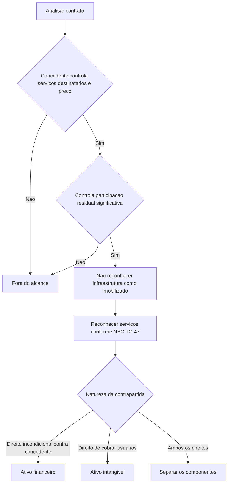

# ITG 01 (R1) — Contratos de Concessão

> [!abstract] Em uma frase
> A ITG 01 (R1) orienta o concessionário a contabilizar os serviços e os direitos que recebe em contratos de concessão de serviços públicos, sem reconhecer como seu imobilizado a infraestrutura controlada pelo concedente.

## Resumo em 30 segundos

A interpretação aplica-se quando o concedente controla ou regulamenta os serviços prestados com a infraestrutura, seus destinatários e seu preço, e controla uma participação residual significativa na infraestrutura ao fim da concessão. O concessionário atua como prestador de serviços: reconhece receitas e custos conforme a NBC TG 47 e classifica a contrapartida, após a fase de construção ou melhoria, conforme a natureza dos direitos recebidos.

- **Direito contratual incondicional de receber caixa do concedente:** ativo financeiro.
- **Direito de cobrar os usuários, condicionado ao uso do serviço:** ativo intangível.
- **Combinação dos dois direitos:** separar e contabilizar cada componente.
- **Infraestrutura da concessão:** não é ativo imobilizado do concessionário.

## Ficha rápida

| Campo | Síntese |
|---|---|
| Norma | ITG 01 (R1) — Contratos de concessão |
| Foco | Contabilização pelo concessionário de concessões de serviços públicos a entidades privadas |
| Decisão central | Identificar se o contrato está no alcance e se a remuneração dá direito a ativo financeiro, intangível ou ambos |
| Normas relacionadas citadas no PDF | Entre outras, NBC TG 47, NBC TG 48, NBC TG 04, NBC TG 20 e NBC TG 25 |
| Alteração R1 | O texto alterado passa a referenciar, entre outras, as NBC TG 47 e NBC TG 48; o PDF informa efeitos a partir de 1º de janeiro de 2018 |

## Objetivo e alcance

A ITG 01 orienta o **concessionário** sobre a contabilização de concessões de serviços públicos a entidades privadas. O concessionário pode construir ou melhorar a infraestrutura, operá-la e mantê-la durante o prazo contratual, prestando o serviço público em nome do concedente. A interpretação **não trata da contabilização pelo concedente**. (p. 2–3)

Para avaliar o alcance, verifique se as duas condições a seguir estão presentes:

1. **Controle dos serviços:** o concedente controla ou regulamenta quais serviços serão prestados com a infraestrutura, a quem serão prestados e o preço.
2. **Participação residual:** o concedente controla, por titularidade, usufruto ou outro meio, uma participação residual significativa na infraestrutura ao fim do contrato. (p. 2–3; guia de aplicação, p. 10–11)

O controle pode decorrer do contrato ou de outra forma, como regulação. O guia esclarece que controlar não significa administrar: o concessionário pode ter independência operacional e ainda assim gerenciar a infraestrutura em nome do concedente. Contratos que incluam atividades não reguladas exigem análise da infraestrutura e dos serviços conforme as orientações do guia. Em certos casos, o direito de uso de instalações separáveis pode, em essência, constituir arrendamento, sujeito à NBC TG 06. (p. 10–11)

A interpretação abrange infraestrutura construída ou adquirida pelo concessionário para cumprir o contrato e infraestrutura existente que o concedente disponibiliza para essa finalidade. Não especifica a contabilização de infraestrutura já reconhecida como imobilizado pelo concessionário antes do contrato; o PDF remete, nesse caso, às regras de baixa da NBC TG 27. (p. 3)

## Conceitos-chave

| Conceito | Aplicação prática |
|---|---|
| Infraestrutura da concessão | O concessionário recebe acesso para operar e prestar o serviço, mas não o controle do uso da infraestrutura. Não a reconhece como seu imobilizado. |
| Ativo financeiro | Surge quando há direito contratual incondicional de receber caixa ou outro ativo financeiro do concedente. |
| Ativo intangível | Surge quando o concessionário recebe autorização para cobrar os usuários; a realização depende do uso do serviço pelo público. |
| Contrato misto | Quando parte da remuneração corresponde a direito contra o concedente e parte a cobrança dos usuários, os componentes são contabilizados separadamente. |
| Ativo de contrato | Durante a construção ou melhoria, os dois tipos de contrapartida são classificados como ativo de contrato segundo a NBC TG 47. |

## Diagrama do tratamento

## Aplicação passo a passo e checklist

1. **Leia os termos contratuais e a legislação aplicável.** Identifique responsabilidades, serviços, usuários, regras de preço, remuneração e condições de devolução da infraestrutura.
2. **Teste o alcance.** Confirme o controle ou a regulamentação dos serviços, destinatários e preço pelo concedente e sua participação residual significativa ao fim do contrato.
3. **Separe as atividades.** Identifique construção ou melhoria, operação e manutenção. Se houver mais de um serviço, aloque a remuneração com base nos valores relativos dos serviços quando forem identificáveis separadamente.
4. **Reconheça os serviços.** Reconheça e mensure receitas e custos dos serviços conforme a NBC TG 47.
5. **Classifique a contrapartida.** Determine se há direito incondicional de receber do concedente, direito de cobrar usuários ou combinação dos dois.
6. **Contabilize os efeitos subsequentes.** Aplique as normas pertinentes ao ativo financeiro ou intangível; avalie provisões, custos de empréstimos e ativos fornecidos pelo concedente, quando aplicável.
7. **Revise a apresentação e os efeitos de transição.** Considere as alterações de práticas contábeis e a orientação de aplicação retrospectiva e impraticabilidade descrita no texto consolidado.

> [!tip] Pergunta de decisão
> A remuneração depende de uma obrigação de pagamento do concedente ou da efetiva utilização do serviço pelos usuários? Essa distinção ajuda a separar o ativo financeiro do ativo intangível.

## Reconhecimento e mensuração

### Serviços e construção ou melhoria

O concessionário contabiliza receitas e custos dos serviços, inclusive construção ou melhoria e operação, de acordo com a **NBC TG 47**. Quando o contrato reúne mais de um serviço e os respectivos valores são identificáveis separadamente, a remuneração recebida ou a receber é alocada com base nos valores justos relativos dos serviços. A natureza da contrapartida determina a contabilização subsequente. (p. 4–6)

Durante a construção ou melhoria, tanto a parcela que dará origem a ativo financeiro quanto a parcela que dará origem a ativo intangível são classificadas como **ativo de contrato**, conforme a NBC TG 47. (p. 5; texto da alteração R1, p. 40–41)

### Ativo financeiro

Reconheça o ativo financeiro à medida que o concessionário obtém direito contratual incondicional a receber caixa ou outro ativo financeiro do concedente. O direito pode existir, por exemplo, quando o concedente garante pagamentos preestabelecidos ou cobre insuficiências em relação a valores determináveis, mesmo que o pagamento esteja sujeito a requisitos de qualidade ou eficiência da infraestrutura. (p. 5)

Segundo a redação R1, a NBC TG 48 aplica-se ao ativo financeiro. O valor devido pelo concedente é mensurado ao **custo amortizado**, ao **valor justo por meio de outros resultados abrangentes** ou ao **valor justo por meio do resultado**, conforme a classificação aplicável. Para valores mensurados ao custo amortizado ou ao valor justo por meio de outros resultados abrangentes, os juros pelo método da taxa efetiva são reconhecidos no resultado. (p. 6–7)

### Ativo intangível

Reconheça o ativo intangível à medida que o concessionário recebe o direito de cobrar os usuários. Como a cobrança depende de o público utilizar o serviço, esse direito não é incondicionalmente exigível do concedente. A NBC TG 04 aplica-se ao ativo intangível. (p. 5 e 7)

### Obrigações, empréstimos e outros ativos

- **Manutenção ou recuperação:** obrigações de manter a infraestrutura em nível especificado ou recuperá-la antes da devolução são reconhecidas e mensuradas conforme a NBC TG 25, pela melhor estimativa dos gastos necessários para liquidar a obrigação presente. Melhorias são tratadas separadamente como serviço de melhoria. (p. 6)
- **Custos de empréstimos:** são despesa quando incorridos, exceto quando o concessionário tem direito contratual ao ativo intangível de cobrança dos usuários; nesse caso, os custos atribuíveis são capitalizados durante a construção, conforme a NBC TG 20. (p. 6)
- **Outros ativos fornecidos pelo concedente:** se integrarem a remuneração pelos serviços, não são subvenções governamentais; o R1 os trata como parte do preço de transação segundo a NBC TG 47. A infraestrutura disponibilizada para operar o serviço continua fora do imobilizado do concessionário. (p. 7 e 41)

## Divulgação

O item 28 aparece como **eliminado** no texto fornecido. Assim, este resumo não atribui à ITG 01 (R1) uma lista específica de divulgações contratuais que não consta como requisito vigente no conteúdo técnico consolidado apresentado. A alteração de práticas contábeis é tratada no texto remanescente dos itens 29 e 30: em regra, aplica-se a NBC TG 23 retrospectivamente. Se a aplicação retrospectiva no início do período mais antigo apresentado for impraticável, o texto descreve procedimentos para registrar os ativos financeiros e intangíveis existentes, manter seus valores contábeis anteriores e testar seu valor recuperável, com a ressalva de impraticabilidade prevista na própria orientação. (p. 8)

## Exceções e erros comuns

> [!warning] Não confunda acesso com controle
> O concessionário opera a infraestrutura conforme o contrato, mas isso não significa que a controle ou que deva reconhecê-la como imobilizado.

- **Erro:** classificar toda a remuneração como ativo financeiro. **Correção:** verificar se há direito incondicional contra o concedente, direito de cobrar usuários ou ambos.
- **Erro:** reconhecer como intangível um direito de receber garantido pelo concedente. **Correção:** avaliar a substância contratual da garantia e dos pagamentos.
- **Erro:** tratar direito de cobrança dos usuários como recebível incondicional. **Correção:** a cobrança depende da utilização do serviço.
- **Erro:** registrar a infraestrutura disponibilizada pelo concedente como ativo do concessionário. **Correção:** não reconhecer como imobilizado da concessão; avaliar separadamente outros ativos fornecidos.
- **Erro:** deixar para reconhecer a obrigação de recuperação apenas quando ocorrer a obra. **Correção:** avaliar a obrigação presente em cada data de balanço conforme a NBC TG 25.
- **Atenção:** infraestrutura previamente reconhecida como imobilizado pelo concessionário antes da celebração do contrato não é tratada diretamente pela interpretação; o PDF remete à NBC TG 27 para a baixa. (p. 3)

## Conexões com outras normas

As relações abaixo são expressamente indicadas no PDF:

- **NBC TG 47 — Receita de Contrato com Cliente:** receita e custos dos serviços, classificação como ativo de contrato durante construção ou melhoria e tratamento de outros ativos que componham o preço de transação.
- **NBC TG 48, NBC TG 39 e NBC TG 40:** normas de instrumentos financeiros aplicáveis ao ativo financeiro.
- **NBC TG 04:** ativo intangível.
- **NBC TG 20:** custos de empréstimos.
- **NBC TG 25:** obrigações de manutenção ou recuperação.
- **NBC TG 27:** baixa de infraestrutura previamente reconhecida como imobilizado.
- **NBC TG 06:** possível aplicação quando o direito de uso de infraestrutura separável ou instalações não reguladas constituir, em essência, arrendamento.
- **NBC TG 01:** unidade geradora de caixa na análise de infraestrutura separável de uso não regulado.
- **NBC TG 07:** distinção entre remuneração por ativos fornecidos e subvenção governamental.

## Fonte

**ITG 01 (R1) — Contratos de concessão**, PDF fornecido. Texto técnico sobre alcance e consenso: p. 2–8; guia de aplicação: p. 10–11; alteração R1: p. 40–41. A resolução identificável no PDF informa que as alterações entram em vigor na data de publicação, com efeitos a partir de 1º de janeiro de 2018.
