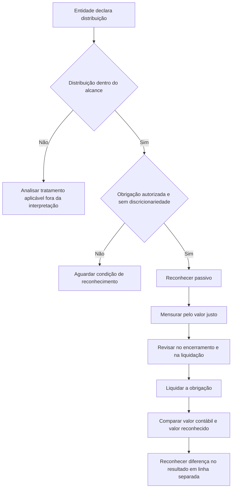

# ITG 07 (R1) — Distribuição de Lucros in Natura

> [!abstract] Resumo em 30 segundos
> A ITG 07 (R1) orienta a entidade que distribui lucros por meio de ativos que não sejam caixa. O passivo pelo dividendo é reconhecido quando a distribuição está autorizada e fora da discricionariedade da entidade, mensurado pelo valor justo dos ativos a distribuir e revisto ao fim de cada período e na liquidação. Na liquidação, a diferença entre o valor contábil dos ativos entregues e o valor reconhecido do dividendo é apresentada separadamente no resultado. A interpretação também estabelece divulgações específicas e delimita situações fora de seu alcance.

## Ficha rápida

| Campo | Síntese |
|---|---|
| Norma | ITG 07 (R1) — Distribuição de lucros in natura |
| Emissor | Conselho Federal de Contabilidade — CFC |
| Tema | Contabilização, pela entidade que distribui, de dividendos em ativos não caixa |
| Destinatários | Entidades que distribuem ativos aos titulares de instrumentos patrimoniais e demais beneficiados |
| Referência temporal | A interpretação determina aplicação prospectiva conforme orientação dos órgãos reguladores; não permite aplicação retrospectiva. |
| Base desta nota | Texto técnico e alteração identificável no PDF fornecido |

## Objetivo e alcance

A interpretação trata de distribuições **não recíprocas** de ativos feitas pela entidade a seus acionistas ou outros beneficiados que agem em seus interesses. Abrange:

- distribuição de ativos não caixa, como itens do imobilizado, negócios, participações em outras entidades ou ativos em descontinuidade; e
- distribuição que permita ao beneficiário escolher entre receber um ativo não caixa ou uma alternativa em caixa.

A aplicação é restrita a distribuições que beneficiem titulares da mesma classe de instrumentos patrimoniais de maneira equitativa. A orientação se dirige à **entidade que realiza a distribuição**; não disciplina a contabilização do beneficiário.

### Quando a interpretação não se aplica

A distribuição fica fora do alcance quando o ativo não caixa é controlado pelas mesmas entidades envolvidas antes e depois da transação. O texto esclarece que isso requer poder coletivo atual, decorrente de acordo contratual, sobre a entidade que distribui.

Também fica fora do alcance a distribuição de parte da participação em controlada quando a entidade que distribui retém o controle. Nesse caso, o tratamento deve seguir a NBC TG 36, conforme a redação alterada pela ITG 07 (R1). Os exemplos ilustrativos do PDF contrastam esse caso com a distribuição de todas as ações da controlada, que resulta em perda de controle e está dentro do alcance.

> [!warning] Verifique o controle antes de aplicar a interpretação
> A mera existência de acionistas beneficiados em comum não basta, por si só, para caracterizar o controle coletivo descrito no texto: é necessário considerar o poder decorrente de acordo contratual.

## Conceitos-chave

- **Dividendo in natura:** distribuição de lucros por meio de ativos que não sejam o próprio caixa.
- **Passivo pelo dividendo:** obrigação reconhecida quando a distribuição foi adequadamente autorizada e deixou de estar à discricionariedade da entidade.
- **Valor justo:** base de mensuração do passivo relacionado à obrigação de distribuir ativos não caixa.
- **Distribuição com alternativa em caixa:** obrigação estimada considerando o valor justo de cada alternativa e as probabilidades de escolha dos beneficiários.
- **Diferença na liquidação:** diferença entre o valor contábil dos ativos distribuídos e o valor reconhecido do dividendo a pagar, reconhecida no resultado.

## Diagrama do tratamento

## Aplicação passo a passo — checklist

1. **Identifique a transação.** Confirme se há distribuição de ativos não caixa ou uma escolha entre ativos não caixa e caixa.
2. **Confirme os beneficiários e a equidade.** Verifique se a distribuição beneficia titulares da mesma classe de instrumentos patrimoniais e se o tratamento é equitativo.
3. **Avalie o controle antes e depois.** Se as mesmas entidades mantêm o controle do ativo antes e depois, a interpretação não se aplica. Se houver distribuição de participação em controlada, confirme se a entidade que distribui retém o controle.
4. **Determine a data de reconhecimento.** Identifique quando a distribuição foi adequadamente autorizada e deixou de estar sob a discricionariedade da entidade.
5. **Mensure o passivo.** Use o valor justo dos ativos a distribuir. Se houver opção entre ativo e caixa, estime a obrigação com base no valor justo das alternativas e nas probabilidades de escolha.
6. **Atualize a mensuração.** Revise e ajuste o valor provisionado ao final de cada período de elaboração de balanço patrimonial e na data da liquidação.
7. **Contabilize a liquidação.** Compare o valor contábil dos ativos entregues com o valor reconhecido do dividendo a pagar e reconheça eventual diferença no resultado.
8. **Apresente e divulgue.** Apresente a diferença em linha separada no resultado e verifique as divulgações dos itens 16 e 17.

> [!tip] Evidência para o fechamento
> Mantenha documentados o ato de autorização, a data em que a entidade perdeu a discricionariedade, a base do valor justo, as probabilidades usadas quando houver escolha e as revisões feitas até a liquidação.

## Reconhecimento e mensuração

### Reconhecimento do passivo

O passivo é reconhecido quando o dividendo está adequadamente autorizado e a decisão está fora da discricionariedade da entidade. O PDF apresenta duas possibilidades para identificar essa data:

- quando o dividendo proposto pelo conselho de administração ou pela diretoria é aprovado pela autoridade competente, como os acionistas, se a aprovação for uma condição legal para sua validade; ou
- quando o dividendo é declarado pelo conselho de administração ou pela diretoria, se não houver exigência legal de aprovação por outro órgão.

Portanto, não se deve concluir que toda proposta de distribuição gera imediatamente um passivo: é preciso verificar a autorização aplicável e quando a entidade deixa de poder decidir discricionariamente sobre a distribuição.

### Mensuração inicial e revisões

O passivo por obrigação de distribuir ativos não caixa é mensurado pelo **valor justo dos ativos a distribuir**.

Quando o beneficiário pode escolher entre receber ativo não caixa ou caixa, a entidade estima o valor do dividendo a pagar considerando:

- o valor justo de cada alternativa; e
- a probabilidade associada à escolha de cada alternativa pelos beneficiários.

Ao final de cada período de elaboração de balanço patrimonial e na data da liquidação, a entidade revisa e ajusta o valor provisionado. Qualquer mudança no dividendo provisionado é reconhecida no patrimônio líquido como ajuste no montante da distribuição declarada.

### Liquidação

Na liquidação, eventual diferença entre o valor contábil dos ativos distribuídos e o valor reconhecido para o dividendo a pagar é reconhecida na demonstração do resultado do exercício. A diferença deve aparecer em **linha separada**.

## Apresentação e divulgação

A entidade deve:

- apresentar em linha separada, na demonstração do resultado do exercício, a diferença reconhecida na liquidação; e
- divulgar, se aplicável:
  - o valor reconhecido do dividendo a pagar no início e no final do período;
  - o aumento ou a diminuição reconhecido no período em decorrência de mudança no valor justo dos ativos a distribuir.

Se, após o encerramento do período de elaboração do balanço patrimonial e antes da aprovação das demonstrações contábeis para divulgação, a entidade declarar dividendo a ser distribuído em ativos não caixa, deve divulgar:

1. a natureza dos ativos a distribuir;
2. o valor contábil desses ativos ao término do período; e
3. o valor justo nessa data, se diferente do valor contábil, além de informações sobre o método utilizado para mensurar o valor justo, conforme a NBC TG 46, itens indicados no texto alterado.

A NBC TG 26 é citada no PDF quanto à apresentação dos detalhes dos dividendos reconhecidos como distribuições na demonstração das mutações do patrimônio líquido ou nas notas explicativas.

## Exceções e erros comuns

> [!danger] Não confunda ajuste no patrimônio líquido com diferença na liquidação
> Mudanças no valor provisionado decorrentes da revisão do valor justo ajustam, durante o período, o montante da distribuição declarada no patrimônio líquido. Já a diferença apurada quando a obrigação é liquidada vai para o resultado, em linha separada.

- **Reconhecer cedo demais:** a proposta, por si só, não basta se ainda depender de aprovação exigida ou permanecer sob discricionariedade da entidade.
- **Mensurar pelo valor contábil do ativo:** o passivo é mensurado pelo valor justo dos ativos a distribuir; o valor contábil é relevante para apurar a diferença na liquidação.
- **Ignorar uma escolha em caixa:** quando há alternativas, a mensuração considera valor justo e probabilidades de escolha, não apenas uma das opções.
- **Aplicar a interpretação a uma transação fora do alcance:** verifique controle comum antes e depois e retenção de controle sobre controlada.
- **Omitir informação de evento posterior:** se a distribuição for declarada após o encerramento e antes da aprovação para divulgação, avalie as informações exigidas pelo item 17.
- **Aplicar retrospectivamente:** o texto técnico determina aplicação prospectiva, conforme os órgãos reguladores, e veda a aplicação retrospectiva.

## Conexões com outras normas

As relações abaixo são expressamente indicadas no PDF:

- **NBC TG 26 — Apresentação das Demonstrações Contábeis:** apresentação dos detalhes dos dividendos reconhecidos como distribuições.
- **NBC TG 15 — Combinação de Negócios:** referência usada no texto para explicar o conceito de controle coletivo e delimitar uma situação excluída do alcance.
- **NBC TG 36 — Demonstrações Consolidadas:** tratamento citado para distribuição de parte da participação em controlada quando a entidade retém o controle.
- **NBC TG 46 — Mensuração do Valor Justo:** referência para as informações sobre mensuração do valor justo exigidas na divulgação do item 17.

## Fonte

PDF fornecido: **ITG 07 (R1).pdf**. Texto técnico da ITG 07 (R1), incluindo itens 1 a 18 e exemplos ilustrativos. A alteração da ITG 07 (R1), de 11 de dezembro de 2013, identifica a inclusão da NBC TG 46 nas referências, a alteração do item 7 e a revisão da alínea “c” do item 17. O PDF também informa que as alterações entram em vigor na data de publicação e se aplicam aos exercícios iniciados a partir de 1º de janeiro de 2013.
