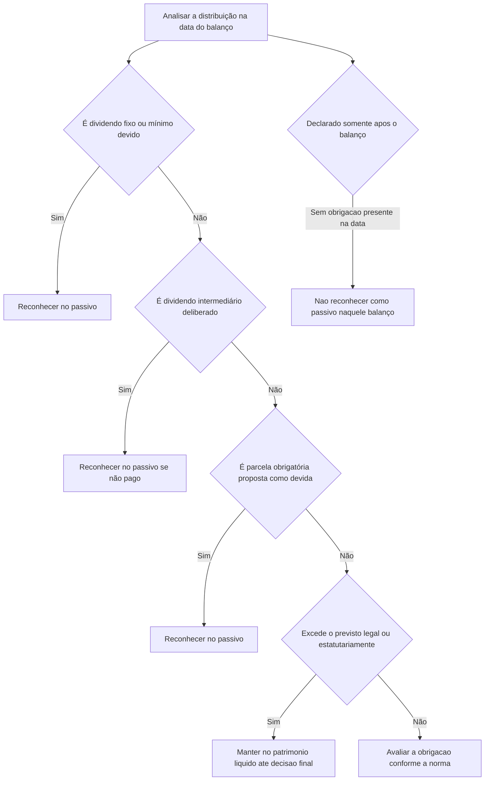

# ITG 08 — Contabilização da Proposta de Pagamento de Dividendos

> [!abstract] Resumo em 30 segundos
> A ITG 08 define quando propostas de dividendos e distribuições devem ser reconhecidas como passivo e quando permanecem no patrimônio líquido. Em síntese: dividendos obrigatórios devidos conforme a lei ou o estatuto, dividendos fixos ou mínimos devidos a acionistas preferencialistas e dividendos intermediários deliberados conforme o estatuto são reconhecidos como obrigação nas condições descritas pela norma. O valor proposto que exceder ao previsto legal ou estatutariamente não é obrigação presente: fica no patrimônio líquido até decisão definitiva. Distribuições declaradas após o encerramento, sem obrigação existente nessa data, não são passivo daquele período.

## Ficha rápida

| Campo | Informação |
|---|---|
| Norma | ITG 08 — Contabilização da Proposta de Pagamento de Dividendos |
| Grupo | 03 - ITG |
| PDF | ITG 08.pdf |
| Tema central | Reconhecimento de dividendos e outras distribuições no passivo ou no patrimônio líquido |
| Referências indicadas | NBC TG 24 — Evento Subsequente; NBC TG 25 — Provisões, Passivos Contingentes e Ativos Contingentes |
| Contexto da resolução | A Resolução CFC n.º 1.398/12 deu nova redação à ITG 08 e informa aplicação aos exercícios iniciados a partir de 1º de janeiro de 2012. |

## Objetivo e alcance

A interpretação trata da contabilização da proposta de pagamento de dividendos e de distribuições relacionadas, considerando as particularidades da legislação societária brasileira e os critérios de reconhecimento de passivos.

Aplica-se a:

- dividendo obrigatório previsto no art. 202 da Lei n.º 6.404/76;
- dividendos fixos e mínimos previstos no art. 17 dessa lei;
- juros sobre o capital próprio (JCP), previstos na legislação tributária;
- dividendos intermediários declarados nos termos do art. 204 da lei (item 13, p. 4).

A questão contábil central é verificar se, na data das demonstrações contábeis, já existe obrigação presente, se é provável a saída de recursos e se o valor pode ser estimado com confiabilidade — critérios de reconhecimento de provisão descritos na NBC TG 25 e reproduzidos pela ITG 08 (itens 16–17, pp. 4–5).

## Conceitos-chave

| Conceito | Tratamento ou característica |
|---|---|
| Dividendo obrigatório | Pode ser retido nas situações previstas na legislação. A parcela não distribuída é destinada a reserva de lucros; a parcela proposta para distribuição como devida constitui obrigação presente conforme a ITG 08. |
| Dividendo fixo ou mínimo | Direito de acionistas preferencialistas, disciplinado no estatuto. Pode ser cumulativo ou não, conforme as condições aplicáveis. |
| Dividendo intermediário | Quando previsto no estatuto e deliberado pela administração conforme as formalidades legais e estatutárias, a deliberação é final. Se não pago, é passivo. |
| Dividendo adicional proposto | Parcela que excede ao previsto legal ou estatutariamente. Até a decisão definitiva dos sócios ou do órgão competente, permanece no patrimônio líquido. |
| JCP | Quando imputado ao dividendo obrigatório, recebe tratamento análogo. O tributo retido na fonte é uma obrigação distinta da obrigação de pagar dividendos. |

### Particularidades societárias relevantes

A lei admite situações em que o dividendo obrigatório pode não ser distribuído ou ser distribuído em valor inferior ao previsto. A ITG 08 explica que, nesses casos, a parcela não distribuída é retida por meio de reservas de lucros. Essas reservas podem vir a ser absorvidas por prejuízos posteriores e, portanto, não representam necessariamente valores que serão pagos como dividendos (itens 2–5, pp. 2–3).

Para ações preferenciais, o estatuto disciplina as características dos dividendos fixos ou mínimos, inclusive sua eventual cumulatividade e participação nos lucros remanescentes. A interpretação também destaca que a constituição de reservas não deve prejudicar os direitos prioritários previstos para esses acionistas (itens 6–9, pp. 3–4).

## Diagrama de decisão

## Aplicação passo a passo / checklist

1. **Identifique a natureza da distribuição.** Determine se se trata de dividendo obrigatório, fixo ou mínimo, JCP ou dividendo intermediário.
2. **Confira a lei, o estatuto e as deliberações.** Verifique a base do direito, as condições de cumulatividade e as formalidades aplicáveis à proposta ou à deliberação.
3. **Avalie se havia obrigação presente na data do balanço.** Não trate toda proposta da administração como obrigação: considere se o órgão competente ainda pode decidir por não pagar ou por pagar valor diferente.
4. **Aplique os critérios de passivo.** Verifique obrigação presente decorrente de evento passado, provável saída de recursos e estimativa confiável do valor (item 17, p. 5).
5. **Separe a parcela obrigatória do excedente proposto.** Reconheça como passivo a parcela que efetivamente representa obrigação presente. Mantenha eventual excedente no patrimônio líquido, em conta específica, até a deliberação definitiva.
6. **Analise dividendos declarados após o encerramento.** Se a declaração ocorreu depois da data do balanço e não havia obrigação presente nessa data, não reconheça passivo naquele encerramento.
7. **Trate separadamente a retenção de tributos sobre JCP.** Não confunda a obrigação tributária com a obrigação de pagar dividendos.
8. **Prepare a divulgação.** Detalhe em nota explicativa a proposta de destinação dos lucros apurados no exercício, mesmo que ela também apareça no relatório da administração.

> [!tip] Pergunta de controle
> Na data do balanço, a entidade já tinha uma obrigação que não podia evitar por decisão futura dos sócios ou de outro órgão competente? Se a resposta for não, a proposta, por si só, não torna o valor um passivo.

## Reconhecimento e mensuração

### Reconhecer como passivo

- **Dividendos intermediários:** se declarados por decisão da administração de acordo com o estatuto e a lei, a deliberação é final. Se não pagos, devem figurar no passivo (item 18, p. 5).
- **Dividendos fixos e mínimos devidos a preferencialistas:** devem ser registrados como obrigação no encerramento do exercício a que se referem as demonstrações, inclusive quando declarados após esse período. A assembleia, segundo a interpretação, não tem poder discricionário para afastar o direito estabelecido legal ou estatutariamente (item 19, p. 5).
- **Dividendo obrigatório:** a parcela dos lucros destinada à distribuição como dividendo obrigatório na proposta encaminhada pelos administradores representa obrigação presente e deve ser registrada no encerramento do exercício a que se referem as demonstrações (itens 20–21, p. 5).

### Manter no patrimônio líquido

A parcela proposta que exceder ao previsto legal ou estatutariamente não é obrigação presente na data do balanço quando ainda depende da decisão dos sócios ou de outro órgão competente. Deve permanecer no patrimônio líquido, em conta específica, como “dividendo adicional proposto” ou denominação equivalente, até a decisão definitiva (item 24, p. 6).

As parcelas do dividendo obrigatório que não forem distribuídas nas hipóteses admitidas pela lei são tratadas como retenção de lucros por meio de reservas, não como passivo por pagamento de dividendos (itens 2–4 e 20, pp. 2–3 e 5).

### JCP e tributo retido

Quando os JCP forem imputados ao dividendo obrigatório, aplica-se tratamento análogo ao deste. O tributo retido na fonte que a companhia deve recolher é uma obrigação presente distinta da obrigação de pagar dividendos.

Se a deliberação for por não pagar os JCP aos sócios e destiná-los, por exemplo, a futuro aumento de capital, o tributo retido não deve ser debitado ao resultado: deve ser debitado à conta para onde os JCP forem destinados. A utilização posterior desses valores considera o montante líquido, deduzido do tributo recolhido, se efetivamente devido (itens 11 e 22, pp. 4–6).

> [!warning] Sem fórmula específica de cálculo
> A interpretação não estabelece uma fórmula geral de mensuração. A entidade deve apurar o valor conforme a obrigação identificada e as condições legais e estatutárias aplicáveis, atendendo ao critério de estimativa confiável.

## Divulgação

A administração deve detalhar em nota explicativa sua proposta de destinação dos lucros apurados no exercício, independentemente de essa informação também constar no relatório da administração (item 27, p. 6).

Dividendos declarados após o período contábil, mas antes da autorização de emissão das demonstrações, não são reconhecidos como passivo no encerramento se nenhuma obrigação existia naquela data. A ITG 08 remete à divulgação em notas explicativas conforme a NBC TG 26, em conexão com a orientação da NBC TG 24 sobre eventos subsequentes (itens 14–15 e 25, p. 4 e p. 6).

## Exceções e erros comuns

> [!danger] Não reconheça automaticamente toda proposta como passivo
> Uma proposta de dividendo adicional que ainda depende de decisão dos sócios ou de outro órgão competente não representa, por si só, obrigação presente.

- **Confundir retenção legal com dividendo a pagar:** se a parcela não distribuída deve ser destinada a reserva de lucros, não a classifique como passivo apenas por estar relacionada ao dividendo obrigatório.
- **Tratar o dividendo intermediário como mera proposta:** quando a deliberação válida da administração é final conforme o estatuto e a lei, o valor não pago é obrigação.
- **Desconsiderar dividendos fixos ou mínimos após o encerramento:** a ITG 08 determina seu reconhecimento no encerramento do exercício a que se referem, mesmo que declarados depois.
- **Registrar no passivo distribuições aprovadas somente após o balanço:** se não havia obrigação presente na data do balanço, não reconheça o passivo naquele período; avalie a divulgação aplicável.
- **Misturar JCP, dividendo e tributo retido:** o tributo a recolher é obrigação distinta, e seu tratamento contábil depende da destinação dos JCP conforme descrito pela interpretação.

## Conexões com outras normas

- **NBC TG 24 — Evento Subsequente:** orienta o tratamento de dividendos declarados após o período contábil; a ITG 08 destaca que eles não são passivo na data do balanço quando não havia obrigação presente.
- **NBC TG 25 — Provisões, Passivos Contingentes e Ativos Contingentes:** fornece os critérios de obrigação presente, provável saída de recursos e estimativa confiável usados na análise de reconhecimento.
- **NBC TG 26 — Apresentação das Demonstrações Contábeis:** indicada pela ITG 08 para divulgação em notas explicativas dos dividendos declarados após o período contábil nas condições descritas.
- **NBC TG 39 — Instrumentos Financeiros: Apresentação:** citada no contexto da definição de detentores de instrumentos patrimoniais.

## Fonte

**PDF:** *ITG 08.pdf*. Texto técnico “ITG 08 — Contabilização da Proposta de Pagamento de Dividendos”, pp. 2–6. A página 1 contém a Resolução CFC n.º 1.398/12, que deu nova redação à interpretação.
