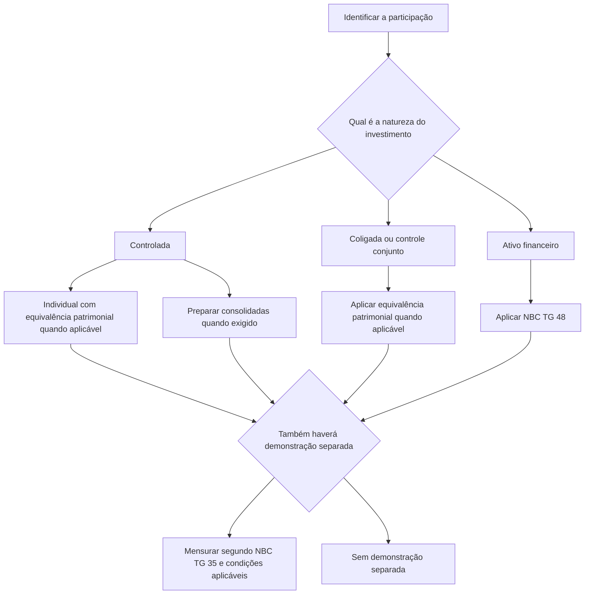

# ITG 09 (R2) — Demonstrações Contábeis Individuais, Demonstrações Separadas, Demonstrações Consolidadas e Aplicação do Método de Equivalência Patrimonial

> [!abstract] Resumo em 30 segundos
> A ITG 09 (R2) orienta como tratar investimentos societários e combinações de negócios nas demonstrações individuais, consolidadas e separadas. No Brasil, as demonstrações individuais da controladora continuam sendo apresentadas quando exigido pela legislação; nelas, investimentos em controladas são reconhecidos pelo método da equivalência patrimonial. A norma também esclarece a mensuração inicial dos ativos líquidos adquiridos e do goodwill, as alterações de participação e a perda de controle.

## Ficha rápida

| Campo | Síntese |
|---|---|
| Norma | ITG 09 (R2) |
| Tema | Demonstrações individuais, separadas e consolidadas; equivalência patrimonial; goodwill |
| Grupo | 03 - ITG |
| PDF | `ITG 09 (R2).pdf` |
| Aprovação | Resolução do CFC de 26/09/2024; publicada no DOU de 03/10/2024 |
| Aplicação indicada no PDF | A revisão entra em vigor na publicação; as alterações aplicam-se a exercícios iniciados em ou após 01/01/2025 |

> [!info] Contexto da norma
> A Interpretação esclarece e orienta questões relacionadas às NBC TG 15, 18, 19, 35 e 36, entre outras. O texto técnico é a base deste resumo; a resolução é mencionada apenas para identificar a aprovação e a aplicação indicadas no próprio PDF.

## Objetivo e alcance

A ITG 09 (R2) esclarece procedimentos para contabilizar investimentos em controladas, coligadas e empreendimentos controlados em conjunto, com atenção especial às demonstrações individuais da controladora. Também aborda a distinção entre demonstrações individuais, consolidadas e separadas e o uso do método da equivalência patrimonial.

O texto trata, entre outros assuntos, de aquisição de controle, goodwill e ganho por compra vantajosa; lucros não realizados; outros resultados abrangentes; mudanças na participação em controladas; perda de controle; e transações entre entidades sob controle comum. **Os detalhes sobre alguns desses tópicos não estão integralmente presentes no texto fornecido**, portanto este resumo não presume procedimentos além dos trechos disponíveis.

## Conceitos-chave

### Tipos de demonstração

- **Demonstrações individuais:** demonstrações da própria entidade investidora. No Brasil, a norma requer sua apresentação enquanto houver exigência legal, inclusive quando a entidade também apresenta demonstrações consolidadas.
- **Demonstrações consolidadas:** apresentam controladora e controladas como uma única entidade econômica, conforme os requisitos aplicáveis.
- **Demonstrações separadas:** demonstrações adicionais, nas quais os investimentos podem ser mensurados, conforme as condições da NBC TG 35, ao valor justo, ao custo ou pelo método da equivalência patrimonial. Não substituem, por si só, as demonstrações individuais ou consolidadas exigidas.
- **Demonstrações combinadas:** são uma das formas possíveis de apresentação do conjunto de demonstrações, conforme as circunstâncias.

O conjunto completo de demonstrações contábeis inclui balanço patrimonial, demonstrações do resultado, do resultado abrangente, das mutações do patrimônio líquido e dos fluxos de caixa, notas explicativas e, quando legalmente ou regulatoriamente exigida, demonstração do valor adicionado (item 2).

### Método da equivalência patrimonial

A equivalência patrimonial reconhece no investimento a parcela da investidora no patrimônio líquido da investida e, no resultado, sua parcela no resultado da investida. É descrita como uma forma simplificada de consolidação: em vez de apresentar cada ativo e passivo da investida, reconhece-se a participação no seu ativo líquido.

A norma prevê equivalência patrimonial para investimentos em controladas nas demonstrações individuais, conforme determinado legalmente, e para investimentos em coligadas e empreendimentos controlados em conjunto nas condições indicadas (itens 1 e 11).

### Classificação do investimento

Antes de escolher a mensuração, identifique a natureza da participação:

| Situação descrita na ITG | Tratamento indicado no texto |
|---|---|
| Investimento em controlada | Equivalência patrimonial nas demonstrações individuais, conforme aplicável; consolidação |
| Investimento em coligada ou empreendimento controlado em conjunto | Equivalência patrimonial, nas condições indicadas |
| Investimento mantido por entidade de investimento, nas hipóteses previstas | Valor justo por meio do resultado |
| Investimento tratado como ativo financeiro | NBC TG 48; não é mensurado pela equivalência patrimonial |
| Investimento em demonstração separada | Valor justo, custo ou equivalência patrimonial, segundo as condições aplicáveis |

## Diagrama de decisão

## Aplicação passo a passo / checklist

1. **Identifique a natureza da participação:** controle, influência significativa, controle conjunto ou ativo financeiro.
2. **Determine quais demonstrações são requeridas:** individuais, consolidadas e, se escolhidas ou exigidas nas condições aplicáveis, separadas.
3. **Defina a base de mensuração para cada conjunto de demonstrações.** Não trate demonstrações separadas como sinônimo de demonstrações individuais.
4. **Na aquisição de controle, ajuste as demonstrações da adquirida às práticas contábeis relevantes da adquirente.** O texto limita esse ajuste a mudanças entre práticas contábeis aceitas; mudanças de estimativas e correções de erros devem ser tratadas nas demonstrações da adquirida (item 19).
5. **Na data da aquisição, mensure ativos e passivos identificáveis conforme a NBC TG 15**, incluindo itens que atendam aos critérios de reconhecimento nessa combinação, mesmo que não constassem anteriormente das demonstrações da adquirida.
6. **Calcule e controle separadamente os componentes do investimento** nas demonstrações individuais: parcela no patrimônio líquido contábil, mais-valia atribuível e goodwill atribuído à controladora (item 23).
7. **Considere os efeitos tributários** das diferenças entre valores justos e contábeis, conforme a NBC TG 32.
8. **Após a aquisição, acompanhe a realização das diferenças de valor justo** por depreciação, amortização, exaustão, venda, liquidação, impairment ou outras mutações relevantes.
9. **Se houver mudança de participação ou perda de controle, aplique os critérios da NBC TG 36** também às demonstrações individuais, conforme a orientação da ITG 09 (R2).
10. **Confira a divulgação dos componentes do investimento e a consistência entre demonstrações individuais e consolidadas.**

## Reconhecimento e mensuração

### Aquisição de controlada e goodwill

Na aquisição de controle, os ativos e passivos identificáveis da adquirida são mensurados conforme a NBC TG 15. Isso pode incluir ativos antes não reconhecidos pela adquirida e passivos contingentes que satisfaçam os critérios de reconhecimento aplicáveis à combinação de negócios (itens 18 a 21).

Nas demonstrações individuais da controladora, o investimento adquirido deve ser controlado em componentes: parcela correspondente ao patrimônio líquido ajustado da adquirida, mais-valia dos ativos líquidos e goodwill atribuído à controladora. A mais-valia deve ser acompanhada até sua realização. Os efeitos tributários correspondentes também devem ser considerados.

> [!info] Apresentação do goodwill
> Nas demonstrações individuais da controladora, o goodwill atribuído a ela integra o saldo do investimento, no ativo não circulante. Nas demonstrações consolidadas, o goodwill da combinação é apresentado no ativo intangível. O texto esclarece que o goodwill não é amortizado por ter vida útil indefinida, mas está sujeito a teste de recuperabilidade conforme a NBC TG 01 (itens 25 e 26).

Como resumo conceitual do cálculo do goodwill atribuível à controladora:

**Goodwill = contraprestação pela aquisição + valor justo de participação preexistente − parcela da adquirente no valor justo dos ativos líquidos identificáveis**

A mensuração da participação de não controladores pode afetar o goodwill reconhecido nas demonstrações consolidadas. Quando essa participação é mensurada a valor justo na data da combinação, pode haver goodwill atribuível aos não controladores; pelo critério proporcional descrito na NBC TG 15, não se reconhece esse goodwill atribuível aos não controladores no balanço consolidado. A opção por valor justo ocorre na data da combinação; a participação é atualizada posteriormente pelas mutações aplicáveis (itens 24 e 31 a 34).

Se houver ganho por compra vantajosa, o registro segue a NBC TG 15 e resulta em reconhecimento de ganho na adquirente (item 29).

### Coligadas e empreendimentos controlados em conjunto

Na obtenção de influência significativa ou controle conjunto, os ativos líquidos identificáveis devem ser mensurados a valor justo, e as demonstrações da investida devem ser ajustadas às práticas contábeis da investidora. O goodwill integra o saldo do investimento nas demonstrações individuais e não é apresentado separadamente como intangível. O investimento como um todo, incluindo o goodwill, está sujeito à avaliação de recuperabilidade nos termos indicados no texto (itens 35 a 38).

### Demonstrações separadas

As demonstrações separadas são facultativas segundo o texto do item 9 e são adicionais às demonstrações individuais e consolidadas exigidas. Se os investimentos forem mensurados ao custo nas demonstrações separadas, a investidora reconhece receita ou despesa quando há declaração ou recebimento de dividendos ou outra distribuição, ou quando ocorre alienação ou baixa do investimento (itens 15 a 17).

### Perda de controle e mudanças de participação

Quando a controladora perde o controle, deve desreconhecer o investimento na ex-controlada nas demonstrações individuais e, nas consolidadas, os ativos e passivos da ex-controlada. Se houver investimento remanescente, ele é reconhecido a valor justo na data da perda de controle. Se a participação remanescente continuar sujeita à equivalência patrimonial, esse valor justo passa a ser o novo custo do investimento, seguido da aplicação da NBC TG 18 quando cabível (itens 70A a 70C).

As alterações de participação em controlada devem seguir a NBC TG 36. A ITG também orienta que, nas demonstrações individuais requeridas pela legislação brasileira, se preservem os critérios dessa norma para variações de participação, buscando evitar divergências entre resultado e patrimônio líquido individuais e consolidados (item 70D).

## Divulgação

A nota explicativa deve detalhar, quando existentes, os três componentes do investimento em controlada nas demonstrações individuais:

1. participação da controladora no valor contábil do patrimônio líquido da adquirida;
2. mais-valia dos ativos líquidos adquiridos atribuída à controladora;
3. goodwill atribuído à controladora.

Essa abertura é requerida para evidenciação em notas explicativas, não como apresentação obrigatória em contas separadas no balanço (item 27).

Quando aplicável, as demonstrações individuais devem ser divulgadas em conjunto com as consolidadas, conforme exigência legal ou da NBC TG 36. O texto não exige que sejam apresentadas lado a lado: uma pode ser apresentada após a outra (itens 6 e 7).

## Exceções e erros comuns

> [!warning] Evite estes equívocos
> - **Confundir demonstrações separadas com individuais.** As separadas são adicionais e não dispensam as demais demonstrações exigidas.
> - **Apresentar o goodwill da controladora como intangível nas demonstrações individuais.** Nesse conjunto, ele compõe o investimento; na consolidação, o goodwill é apresentado no intangível.
> - **Amortizar o goodwill de vida útil indefinida.** O texto determina teste de recuperabilidade, não amortização periódica, ressalvadas as situações específicas referidas nos itens 40 a 43.
> - **Tratar toda participação societária pelo método da equivalência patrimonial.** Investimentos classificados como ativos financeiros seguem a NBC TG 48; há também hipóteses específicas de valor justo para entidades de investimento.
> - **Desconsiderar ativos e passivos identificáveis não reconhecidos anteriormente pela adquirida.** Na combinação, eles podem ser reconhecidos se atenderem aos critérios da NBC TG 15.
> - **Usar valor justo de participação remanescente diferente da data da perda de controle.** O marco indicado é a data em que o controle foi perdido.

> [!danger] Temas sem detalhamento integral no texto fornecido
> O sumário da norma inclui disposições sobre lucros não realizados, outros resultados abrangentes e outros aspectos da equivalência patrimonial, mas os trechos correspondentes não estão integralmente disponíveis no texto fornecido. Não é possível resumir com segurança os procedimentos específicos desses temas com base apenas neste material.

## Conexões com outras normas

- **NBC TG 15 — Combinação de Negócios:** método da aquisição, mensuração dos ativos líquidos identificáveis e apuração do goodwill ou do ganho por compra vantajosa.
- **NBC TG 18 — Investimento em Coligada e em Empreendimento Controlado em Conjunto:** aplicação da equivalência patrimonial e tratamento de investimentos em coligadas e empreendimentos controlados em conjunto.
- **NBC TG 35 — Demonstrações Separadas:** apresentação e mensuração dos investimentos nessas demonstrações.
- **NBC TG 36 — Demonstrações Consolidadas:** consolidação, participação de não controladores, mudanças de participação e perda de controle.
- **NBC TG 01 — Redução ao Valor Recuperável de Ativos:** teste de recuperabilidade do goodwill e dos investimentos, conforme aplicável.
- **NBC TG 32 — Tributos sobre o Lucro:** efeitos tributários das diferenças entre valores justos e contábeis.
- **NBC TG 48 — Instrumentos Financeiros:** mensuração de investimentos tratados como ativos financeiros e hipóteses de valor justo indicadas pela Interpretação.

## Fonte

**Conselho Federal de Contabilidade.** Norma Brasileira de Contabilidade, ITG 09 (R2), de 26 de setembro de 2024 — *Demonstrações Contábeis Individuais, Demonstrações Separadas, Demonstrações Consolidadas e Aplicação do Método da Equivalência Patrimonial*. Publicação indicada no título do PDF: DOU de 03/10/2024. Arquivo: `ITG 09 (R2).pdf`.
